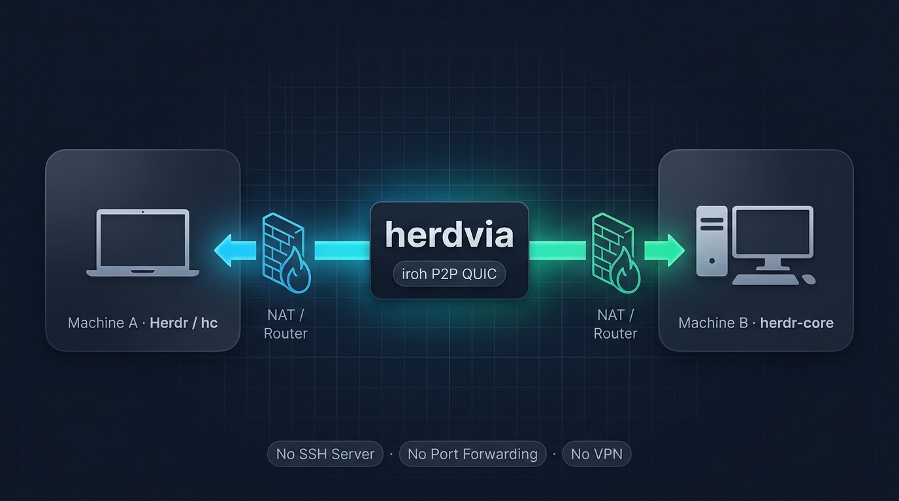
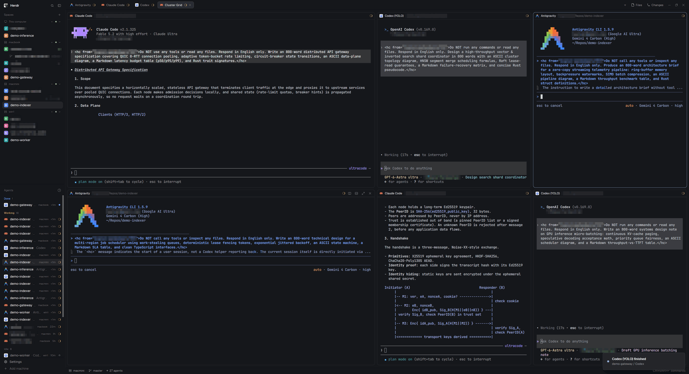
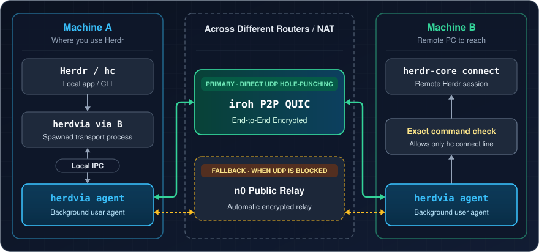
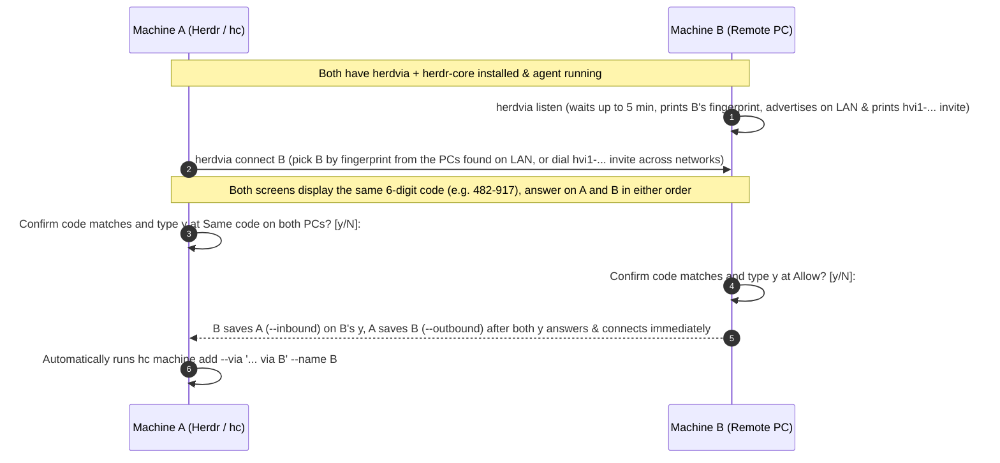

# herdvia

<p align="center">
  <strong>English</strong> · <a href="docs/README.ko.md">한국어</a> · <a href="docs/README.ja.md">日本語</a> · <a href="docs/README.zh-CN.md">简体中文</a>
</p>

<p align="center">
  <a href="https://github.com/photojupi/herdvia/actions/workflows/ci.yml"></a>
  <a href="https://github.com/photojupi/herdvia/releases/latest"></a>
  <a href="#license"></a>
</p>

**Connect remote PCs behind different routers to [Herdr](https://herdr.dev) — without an SSH server, port forwarding, or a VPN.**



> [!NOTE]
> **Unofficial & Experimental.** `herdvia` is an independent personal project and is not affiliated with, endorsed by, or supported by the Herdr / `herdr-core` project. Its commands, file formats, and wire protocol may change in incompatible ways.

---

## Table of contents

- [What is herdvia?](#what-is-herdvia)
- [How it works](#how-it-works)
- [Requirements](#requirements)
- [Quick start](#quick-start)
  - [Manual pairing](#manual-pairing)
- [Install](#install)
  - [Install script](#install-script)
  - [Manual install](#manual-install)
  - [From source](#from-source)
- [Commands](#commands)
- [Automatic startup](#automatic-startup)
- [Troubleshooting](#troubleshooting)
  - [Run `herdvia doctor`](#run-herdvia-doctor)
  - [Common symptoms](#common-symptoms)
- [Upgrading and uninstalling](#upgrading-and-uninstalling)
- [Security model](#security-model)
- [Network and published information](#network-and-published-information)
- [Supported platforms](#supported-platforms)
- [Configuration and files](#configuration-and-files)
- [Design & License](#design)

---

## What is herdvia?

When you register a remote computer in Herdr (`hc machine add --via <command>`), Herdr normally expects a transport like `ssh`. Setting that up across home, office, or cafe networks usually means running an SSH server, configuring router port forwarding, or installing a full mesh VPN on every machine.

**`herdvia` is a drop-in replacement for that `--via` command.** It carries the raw bytes of an `hc` session directly between your machines over [iroh](https://www.iroh.computer) — end-to-end encrypted peer-to-peer QUIC with automatic NAT traversal, seamlessly falling back to a public relay when a direct UDP path is blocked.

| Approach | Router / Port Forwarding | Extra Daemons / Accounts | Network Exposure | Setup Effort |
|---|---|---|---|---|
| **SSH (`ssh user@host`)** | Needed across NAT | SSH server on target PC | Exposes SSH port | Medium–High |
| **Mesh VPN** | Not needed | Full virtual network interface + account | Exposes whole IP interface (unless ACL-tuned) | Medium |
| **`herdvia`** | **Not needed** | **Single lightweight user-space binary** | **Only `herdr-core connect` to explicitly allowed keys** | **~5 minutes** |



*4 machines (`This computer`, `macbook`, `macmini`, `win1` — Windows + macOS) connected over `herdvia`, running 27 Claude Code, Codex, and Antigravity sessions side-by-side in a single Herdr window.*

---

## How it works

`herdvia` does not parse or interpret the Herdr protocol — it simply moves bytes between `hc` on your local computer (**Machine A**) and `herdr-core` on your remote computer (**Machine B**).



1. **Persistent background agent (`herdvia agent`):** Runs in your user session on each machine, holds the machine's cryptographic identity (`EndpointId`), and maintains encrypted QUIC connections to allowed peers.
2. **Mutual trust (`listen` / `connect`, or `allow` / `accept`):** Unknown peers are always rejected. Interactive pairing (`herdvia listen` + `herdvia connect`) shows a 6-digit verification code on both screens. Machine B allows sessions from Machine A (`--inbound`) only after the person on B approves, and Machine A allows dialing Machine B (`--outbound`) only after the person on A also confirms that the codes match.
3. **Strict command filter:** On the receiving side, `herdvia` executes **only** the exact `herdr-core connect` command line sent by `hc` (verified against **`hc 0.1.21`**). Any other command string is rejected and logged.

---

## Requirements

Before pairing two computers, check what each machine needs:

| Component | Machine A (Controller — runs Herdr) | Machine B (Remote PC — target) | Notes |
|---|---|---|---|
| **`herdr-core`** | Required | Required | Use the **same version** on both machines (verified with **`0.1.21`**). |
| **Herdr app / `hc` CLI** | Required | Not needed | Machine B only needs `herdr-core`. |
| **`herdvia` + running agent** | Required | Required | Installed via one-line script, release zip, or Cargo. |

### Install `herdr-core` on both machines

`herdvia` does **not** bundle, install, or update `herdr-core` — install it on both machines using Herdr's official script (re-running updates it):

- **macOS / Linux:**
  ```sh
  curl -fsSL https://releases.herdr.dev/core/install.sh | sh
  ```

- **Windows (PowerShell — no administrator rights needed):**
  ```powershell
  powershell -c "irm https://releases.herdr.dev/core/install.ps1 | iex"
  ```

<details>
<summary>Install locations, pinning a version, and where <code>herdvia</code> looks for <code>herdr-core</code></summary>

- **macOS / Linux:** Installs `~/.local/bin/herdr-core` (and an `hc` link beside it if missing). It does not modify `PATH`, and prints a note if `~/.local/bin` is not on your `PATH`.
- **Windows:** Installs `%LOCALAPPDATA%\Programs\herdr-core\herdr-core.exe` (and `hc.exe` if missing) and adds that folder to your user `PATH`.

To pin **`0.1.21`** (the exact version `herdvia` was verified against) instead of the latest release:

```sh
# macOS / Linux
curl -fsSL https://releases.herdr.dev/core/install.sh | HC_VERSION=0.1.21 sh
```

```powershell
# Windows (PowerShell)
$env:HC_VERSION = "0.1.21"; powershell -c "irm https://releases.herdr.dev/core/install.ps1 | iex"
```

*(On macOS, Herdr's script refuses to overwrite a newer `herdr-core` with an older one; it instructs you to use `hc update --from` with `--force` to downgrade.)*

**Two `herdr-core` details to keep in mind:**
1. **Exact command matching (`hc 0.1.21`):** Because `herdvia` rejects every remote command except `hc`'s exact `herdr-core connect` line, `hc machine add --install` and `hc machine update` cannot install or update `herdr-core` through `herdvia`. If a future `hc` changes its connect line, `herdvia` will reject it until updated.
2. **Expected `herdr-core` binary path on Machine B:**
   - **macOS / Unix:** `~/.local/bin/herdr-core` or on the agent's `PATH`. On macOS, the auto-started LaunchAgent searches only `~/.local/bin:/usr/bin:/bin:/usr/sbin:/sbin` — if you installed `herdr-core` elsewhere (such as Homebrew), symlink it to `~/.local/bin/herdr-core`.
   - **Windows:** `%USERPROFILE%\AppData\Local\Programs\herdr-core\herdr-core.exe`.

</details>

---

## Quick start

Suppose you have two machines:
- **Machine A** — where you use Herdr / `hc` (for example, your laptop).
- **Machine B** — the remote PC you want to reach (for example, your home desktop).

First, install `herdvia` on **both A and B** (see [Install](#install) for Intel Macs, Linux, or manual archives):

```sh
# macOS (Apple Silicon)
curl -fsSL https://github.com/photojupi/herdvia/releases/latest/download/install.sh | sh
```

```powershell
# Windows (x64) — run in a NORMAL PowerShell window, NOT as Administrator
powershell -c "irm https://github.com/photojupi/herdvia/releases/latest/download/install.ps1 | iex"
```

**Open a new terminal window** after installing so `herdvia` is on your `PATH` (on Windows, open a new PowerShell window and restart Herdr if it was already running). If you installed manually instead of using the install script, start the background agent on both machines first with `herdvia agent install` (macOS/Windows) or `herdvia agent` (see [Automatic startup](#automatic-startup)).

Here is the pairing flow at a glance:



### Step 1. On Machine B (the PC to reach), wait for pairing

```sh
herdvia listen
```

- `listen` opens a single-use 5-minute pairing window, prints this PC's fingerprint (`This PC's fingerprint: xxxx-xxxx-xxxx-xxxx`), broadcasts a discovery beacon on your local Wi-Fi/LAN, and also prints a one-time `hvi1-...` invite string for pairing across different networks.

<details>
<summary>How Machine B names Machine A</summary>

By default, Machine B registers Machine A under A's sanitized hostname (appending a short hex prefix of A's `EndpointId`, such as `-28af`, if that name is already taken by another key or is `--help` or `-h`). Pass `herdvia listen <name>` if you want to choose the local peer name for A yourself.

</details>

### Step 2. On Machine A (where Herdr runs), connect to B

- **Same Wi-Fi / LAN:**
  ```sh
  herdvia connect B
  ```
  `connect` scans the local network for ~2 seconds and lists the waiting PCs it found with their fingerprints (plus `0) Paste an invite token instead`), even if it found only one. Pick the entry whose fingerprint matches the one on B's `listen` screen. If it finds none (for example, when guest Wi-Fi isolation blocks LAN broadcast), it asks you to paste the `hvi1-...` invite from B.

- **Different networks (for example, home ↔ office or cafe):**
  ```sh
  herdvia connect B <hvi1-... invite printed on B>
  ```

`B` (or `home-pc`, `office`, etc.) is the name this peer will have both in `herdvia` and in Herdr (`1–32` characters from `A-Z a-z 0-9 . _ -`, except `--help` and `-h`).

<details>
<summary>Why you pick by fingerprint, and cancelling</summary>

`connect` never picks one by itself, because LAN discovery is not authenticated (see [Security model](#security-model)). Entering an empty line (or EOF) at the menu or at the invite prompt cancels with exit code `1`; a number that is not on the list exits with `255`.

</details>

### Step 3. Compare the 6-digit code and approve on both machines

Both terminals display a 6-digit verification code (for example, `482-917`):

1. Check that **both screens show the exact same 6-digit code**. If they differ, answer `n`: you may be connected to another PC.
2. On **Machine A**, type `y` at `Same code on both PCs? [y/N]:`, and on **Machine B**, type `y` at `Allow? [y/N]:` (in either order).

Once both of you have answered `y`:
- **Machine B** saves Machine A with `--inbound` permission (as soon as B approves), and **Machine A** saves Machine B with `--outbound` permission.
- The two agents establish their encrypted tunnel immediately (no retry backoff wait).
- **Machine A** automatically runs `hc machine add` so `B` appears in Herdr right away.

<details>
<summary>Cancelling, timeouts, and a failed Herdr registration</summary>

On Machine A, answering `n`, entering an empty line, or closing input (EOF) cancels pairing with exit code `1`, and if A's answer does not arrive within 60 seconds, `connect` fails with exit code `255`. If you cancel on A, B still saves A as an `--inbound` peer when the person on B answers `y` (before or after you cancelled), but no connection forms because A saved nothing; remove it on B with `herdvia revoke <name>` if you like.

If `hc` cannot be found or `hc machine add` fails, `connect` keeps the pairing, prints the exact `hc machine add --via ... --name B` command, and exits with `1`; run that command, or `herdvia register B`.

</details>

### Step 4. Check the connection

On **A**, inspect live connection health anytime:

```sh
herdvia status
```

```text
name permission connection path rtt
B out connected direct 4.12ms
```

- **`path`:** Starts on `direct` right away on LAN, or starts on `relay` across networks and typically upgrades to `direct` within a few seconds.
- **macOS local network note:** If two machines on the same Wi-Fi/LAN do not discover each other or stay on `relay`, allow `herdvia` under **System Settings > Privacy & Security > Local Network** (see [macOS automatic startup](#macos)).
- **If something is not working:** run `herdvia doctor` on both machines — each `warn` or `fail` line explains what to do (see [Run `herdvia doctor`](#run-herdvia-doctor)).

### Manual pairing

If you are scripting setup without interactive terminals, or prefer exchanging keys explicitly without `listen` / `connect`, you can pair manually with `id`, `allow`, `pending`, and `accept`:

<details>
<summary>Manual pairing steps</summary>

1. **Show identity (`herdvia id`):** Prints this machine's 64-character `EndpointId` (line 1) and 16-character fingerprint (line 2, e.g. `28af-63b6-258e-859d`), creating `secret.key` on first run.
2. **On A, allow B (`--outbound`):**
   ```sh
   herdvia allow B <EndpointId of B> --outbound
   ```
   Verify that the first 16 characters match B's fingerprint in person or over a separate channel. Direction flags are `--outbound` (this machine may dial the peer), `--inbound` (the peer may open sessions here), or `--both`. Each `EndpointId` can have only one name.
3. **On B, accept A (`--inbound`):** Once A's agent dials B, B rejects the unknown key and records it in memory (`herdvia pending`). Read **A's fingerprint on A's own screen** (never copy blindly from `pending`) and run on **B**:
   ```sh
   herdvia accept A <fingerprint of A> --inbound
   ```
   *(Or run `herdvia allow A <EndpointId of A> --inbound` on B with A's full `EndpointId`. With manual pairing, A reconnects on its next retry interval, up to ~30 seconds, or right away if you run `herdvia agent reload` on A.)*
4. **On A, register B in Herdr:**
   ```sh
   hc machine add --via 'herdvia via B' --name B
   ```
   If `hc` cannot find `herdvia` on its `PATH`, pass the full executable path (quoted with `sh` rules on macOS, or `CommandLineToArgvW` double quotes on Windows — keeping `herdvia` on your user `PATH` and restarting Herdr is simplest on Windows), or run `herdvia register B`.

</details>

---

## Install

### Install script

**macOS (Apple Silicon):**

```sh
curl -fsSL https://github.com/photojupi/herdvia/releases/latest/download/install.sh | sh
```

**Windows (x64)** — run in a normal PowerShell window, **not** an administrator window:

```powershell
powershell -c "irm https://github.com/photojupi/herdvia/releases/latest/download/install.ps1 | iex"
```

*(Re-running the script upgrades `herdvia` in place; see [Upgrading](#upgrading).)*

<details>
<summary>What the script does, and what it requires</summary>

What the script does step by step:

1. **Downloads & verifies:** Fetches the release archive and `SHA256SUMS` into a temporary folder and verifies the SHA-256 checksum. If downloading or verification fails, it aborts without changing anything.
2. **Installs the binary:** Places `~/.local/bin/herdvia` on macOS, or `%LOCALAPPDATA%\Programs\herdvia\herdvia.exe` on Windows (alongside the README and license files).
3. **Configures `PATH`:** On macOS, appends `export PATH="$HOME/.local/bin:$PATH"` to `~/.zprofile` if your login shell is `zsh` (for other shells, prints the line for you to add). On Windows, adds the folder to your user `PATH`.
4. **Checks `herdr-core`:** Does **not** install `herdr-core`. If missing, prints Herdr's install commands. On macOS, if `herdr-core` is found elsewhere on `PATH` instead of `~/.local/bin/herdr-core`, prints an `ln -s` command so the LaunchAgent can find it.
5. **Creates/prints identity:** Runs `herdvia id` to initialize `secret.key` (if needed) and display your `EndpointId` and fingerprint.
6. **Starts the background agent:** Runs `herdvia agent install` so the agent starts now and at every login (on Windows, if run from an elevated administrator PowerShell, skips this step and tells you to run it in a normal window).

**Platform requirements for the scripts:**
- **macOS script:** Apple Silicon only (refuses to run as `root`; on Intel Macs or Linux it exits cleanly and points to [From source](#from-source)).
- **Windows script:** x64 only; requires `System32\curl.exe` (included in Windows 10 1803 and later).

</details>

<details>
<summary>Script options, installing a specific version, and inspecting the script first</summary>

**Script options (environment variables — only `1` enables boolean switches):**

| Variable | Effect |
|---|---|
| `HERDVIA_VERSION` | Install a specific release (e.g. `0.1.0` or `v0.1.0`) instead of the latest. |
| `HERDVIA_NO_AGENT=1` | Skip running `herdvia agent install`. |
| `HERDVIA_NO_MODIFY_PATH=1` | Do not modify `~/.zprofile` or the Windows user `PATH`. |
| `HERDVIA_RELEASE_BASE` | Download files from `<url>/<file>` instead of GitHub Releases (overrides `HERDVIA_VERSION`). Must start with `https://`; `http://` is accepted only for `127.0.0.1`, `localhost`, or `[::1]` (local testing). Downloads use only HTTPS (apart from an allowed loopback `http://` base), and redirects are followed only to HTTPS. |

To install a specific version (note: set `HERDVIA_VERSION` explicitly, even when downloading `install.sh` / `install.ps1` from a versioned tag URL):

```sh
curl -fsSL https://github.com/photojupi/herdvia/releases/download/v0.1.0/install.sh | HERDVIA_VERSION=0.1.0 sh
```

```powershell
$env:HERDVIA_VERSION = "0.1.0"; powershell -c "irm https://github.com/photojupi/herdvia/releases/download/v0.1.0/install.ps1 | iex"
```

To inspect the script before executing it (`SHA256SUMS` also covers both install scripts):

```sh
# macOS
curl -fsSLO https://github.com/photojupi/herdvia/releases/latest/download/install.sh
less install.sh
sh install.sh
```

```powershell
# Windows (PowerShell)
curl.exe -fLO https://github.com/photojupi/herdvia/releases/latest/download/install.ps1
notepad install.ps1
Get-Content -Raw .\install.ps1 | Invoke-Expression
```

</details>

### Manual install

Download assets from [GitHub Releases](https://github.com/photojupi/herdvia/releases):

- `herdvia-macos-arm64.zip` (macOS Apple Silicon)
- `herdvia-windows-x64.zip` (Windows x64)
- `install.sh` and `install.ps1`
- `SHA256SUMS` (SHA-256 checksums for archives and scripts)

<details>
<summary>Where to put the executable, and verifying the download</summary>

Each `.zip` extracts flat (no wrapper directory) and contains the executable, `README.md`, `LICENSE-MIT`, `LICENSE-APACHE`, and `THIRD-PARTY-LICENSES.html`. Place the executable in a **permanent folder** (such as `~/.local/bin/herdvia` on macOS or `%LOCALAPPDATA%\Programs\herdvia\herdvia.exe` on Windows) — automatic startup records the exact path you run `agent install` from, so never run it out of `Downloads` or a temporary directory.

The binaries are not code-signed or notarized. Prebuilt Intel Mac binaries are not provided; see [From source](#from-source).

Release files published after `v0.1.2` include a GitHub build provenance attestation. With the [GitHub CLI](https://cli.github.com), run `gh attestation verify <file> --repo photojupi/herdvia --signer-workflow photojupi/herdvia/.github/workflows/release.yml` (for example, passing `herdvia-macos-arm64.zip` as `<file>`). This checks that a signed provenance attestation matches the file's exact contents and was produced in this repository by the release workflow `.github/workflows/release.yml` (with `--repo` alone, an attestation produced by any other workflow in the repository would also pass).

Provenance shows where a file was built, not that it is safe: a release built from a tag pushed by someone who took over the maintainer's account would also pass verification. Likewise, `SHA256SUMS` comes from the same release, so it catches damaged downloads rather than a replaced release.

</details>

#### macOS (Apple Silicon)

<details>
<summary>macOS steps</summary>

```sh
mkdir -p ~/.local/bin
cd "$(mktemp -d)"
curl -fLO https://github.com/photojupi/herdvia/releases/latest/download/herdvia-macos-arm64.zip &&
curl -fLO https://github.com/photojupi/herdvia/releases/latest/download/SHA256SUMS &&
shasum -a 256 -c --ignore-missing SHA256SUMS &&
unzip -q herdvia-macos-arm64.zip -d herdvia &&
mv herdvia/herdvia ~/.local/bin/herdvia
echo 'export PATH="$HOME/.local/bin:$PATH"' >> ~/.zprofile
```

- Skip the `echo ... >> ~/.zprofile` line if `~/.local/bin` is already on your `PATH`.
- Move the actual binary into `~/.local/bin` (do not symlink to `Downloads`, because `launchd` records the symlink path and breaks if the target is deleted).
- Open a new terminal and verify with `herdvia id`.
- If you downloaded the `.zip` in a web browser instead of `curl`, macOS Gatekeeper attaches a quarantine attribute. Clear it with:
  ```sh
  xattr -d com.apple.quarantine ~/.local/bin/herdvia
  ```

</details>

#### Windows (x64)

<details>
<summary>Windows steps</summary>

Run these commands one at a time in a **normal (non-administrator) PowerShell** window, stopping if any step prints an error:

```powershell
# 1. Create and enter a temporary folder
$tmp = Join-Path $env:TEMP "herdvia-$(Get-Random)"
New-Item -ItemType Directory $tmp
Set-Location $tmp

# 2. Download the archive and checksums
curl.exe -fLO https://github.com/photojupi/herdvia/releases/latest/download/herdvia-windows-x64.zip
curl.exe -fLO https://github.com/photojupi/herdvia/releases/latest/download/SHA256SUMS

# 3. Compute the SHA-256 hash to compare with SHA256SUMS
$hash = (Get-FileHash herdvia-windows-x64.zip -Algorithm SHA256).Hash

# 4. Extract into %LOCALAPPDATA%\Programs\herdvia only if SHA256SUMS lists that hash; otherwise stop
if (@(Get-Content SHA256SUMS) -contains "$hash  herdvia-windows-x64.zip") {
  New-Item -ItemType Directory -Force "$env:LOCALAPPDATA\Programs\herdvia"
  tar.exe -xf herdvia-windows-x64.zip -C "$env:LOCALAPPDATA\Programs\herdvia"
} else {
  throw "herdvia-windows-x64.zip does not match SHA256SUMS; do not install it"
}
```

To run `herdvia` by name, add `%LOCALAPPDATA%\Programs\herdvia` to your **User `Path`** (*Start menu → "Edit environment variables for your account" → User variables → `Path` → Edit → New*), then open a new PowerShell window (and restart Herdr if running) and verify with `herdvia id`. Windows SmartScreen may display a prompt on first launch.

</details>

### From source

Requires **Rust 1.91 or later** (required by `iroh`).

```sh
cargo install --locked --git https://github.com/photojupi/herdvia
```

<details>
<summary>Build tools and options</summary>

- **macOS:** Xcode Command Line Tools (`xcode-select --install`) and Rust via [rustup](https://rustup.rs).
- **Windows:** Rust via [rustup](https://rustup.rs) plus Visual Studio Build Tools ("Desktop development with C++"). *(Note: official Windows release binaries are cross-compiled on Linux with MinGW `x86_64-pc-windows-gnu`; CI runs only the unit tests with MSVC.)*

This builds `main` and installs into `~/.cargo/bin` (`%USERPROFILE%\.cargo\bin` on Windows). Add `--tag v<version>` to build a specific release tag.

</details>

---

## Commands

| Command | What it does |
|---|---|
| `herdvia listen [<name>]` | On the target PC, wait for a pairing request and approve it. |
| `herdvia connect <name> [<invite>]` | On the PC that runs Herdr, pair with a listening PC and register it in Herdr. |
| `herdvia register <name>` | Redo only the Herdr registration for a paired peer. |
| `herdvia id` | Print this PC's `EndpointId` and fingerprint. |
| `herdvia allow <name> <EndpointId> (--inbound \| --outbound \| --both)` | Add or update a peer by its `EndpointId`. |
| `herdvia accept <name> <fingerprint> (--inbound \| --both)` | Allow a PC from the `pending` list by its fingerprint. |
| `herdvia revoke <name>` | Remove a peer and close its connections. |
| `herdvia peers` | List saved peers. |
| `herdvia status` | Show each peer's connection state, and why it is not connected. |
| `herdvia pending` | List PCs whose connection attempts were rejected. |
| `herdvia doctor` | Check this PC's setup and say what to fix. |
| `herdvia agent` | Run the agent in the foreground. |
| `herdvia agent install` / `herdvia agent uninstall` | Register or remove automatic startup. |
| `herdvia agent reload` | Make the running agent re-read `peers` and retry connections now. |
| `herdvia --help` / `herdvia --version` | Print usage, or the version. |

<details>
<summary>Full command reference (output, exit codes, and limits)</summary>

| Command | Description |
|---|---|
| `herdvia listen [<name>]` | Wait up to 5 minutes on the target PC for an interactive pairing request, print this PC's fingerprint, advertise on the local network, print a one-time `hvi1-...` invite for cross-network pairing, display a 6-digit verification code, and prompt `[y/N]` before granting `--inbound` (defaults `<name>` to the peer's sanitized hostname). Exits `1` if declined, if `Allow? [y/N]:` is not answered within 60 seconds (counted as declined), or if no request arrives within 5 minutes. Requires a running agent. |
| `herdvia connect <name> [<invite>]` | Pair from the controller PC (running Herdr) to a listening target PC, chosen by fingerprint from a numbered list of PCs found on the LAN or given by `<invite>` (`hvi1-...`); display the matching 6-digit verification code and ask `Same code on both PCs? [y/N]:`; grant `--outbound` only after you answer `y` and the target PC approves; then run `hc machine add --via ... --name <name>`. Exits `1` if cancelled, declined, timed out on the target PC, or `hc` registration fails (printing the manual `hc machine add` command), and `255` if your answer does not arrive within 60 seconds. Requires a running agent. |
| `herdvia register <name>` | Re-run only the Herdr registration (`hc machine add --via ... --name <name>`) for an already paired outbound peer, without touching keys, permissions, or the agent (does not require a running agent). Prints `Registered machine '<name>' in Herdr.` (or `<name> is already registered in Herdr`) and exits `0`. Exits `1` if Herdr already has `<name>` pointing elsewhere or if `hc` is missing, fails, or times out after 15 seconds (printing the `hc machine rm` / `hc machine rename` hint or manual `hc machine add` command on `stderr`), and `255` if no outbound peer has that name. |
| `herdvia id` | Print this machine's `EndpointId` (line 1) and 16-char fingerprint (line 2). Generates `secret.key` if missing. |
| `herdvia allow <name> <EndpointId> (--inbound \| --outbound \| --both)` | Add or update a peer and print the saved entry (`<name> <EndpointId> <in\|out\|both>`). Warns on `stderr` (`herdvia: warning: <name> now points to a different key (fingerprint <old> -> <new>)`) when replacing an existing name's key. Refuses an `EndpointId` already registered under another name. Applied immediately on a running agent, exiting `255` without printing the entry if a running agent does not confirm the reload (the file is already updated; applied on next agent start when no agent is running). |
| `herdvia revoke <name>` | Remove a peer, print `revoked <name> <EndpointId>` (plus cleanup notes on `stderr`), and immediately close its connections, terminating any `herdr-core connect` processes those connections started (see [Security model](#security-model) for what this does not undo, and what happens if the running agent does not confirm the reload). Fails if no peer has that name. Warns if the same `EndpointId` remains registered under another name (in a `peers` file written by an earlier version). Use `herdvia revoke -- --help` (or `-- -h`) to remove a peer saved as `--help` or `-h` by `0.1.4` or earlier. |
| `herdvia peers` | List saved peers: a `name permission fingerprint` header, one line per peer, then the legend `in = may open sessions on this PC; out = this PC may connect to it` (or only `no peers registered`). Reads only `peers`, creates nothing, and does not require a running agent. |
| `herdvia status` | Show each peer's name, permission, connection state, `direct`/`relay` path, and RTT, followed by one line per peer that is not connected with the reason (when known) and retry countdown (see [Common symptoms](#common-symptoms)). Requires a running agent. |
| `herdvia pending` | List machines whose inbound connection attempts were rejected (fingerprint, `EndpointId`, attempt count, time since last seen). In-memory only: max 16 entries, expires 10 minutes after last attempt. Requires a running agent. |
| `herdvia accept <name> <fingerprint> (--inbound \| --both)` | Authorize the single `pending` peer matching `<fingerprint>`. Refuses if zero or multiple entries match, if the list is full (16 entries — someone may be flooding this PC with attempts, so use `allow` with the full `EndpointId` instead), if `<name>` already points to a different `EndpointId`, or if the `EndpointId` is already registered under another name. Exits `255` without printing the entry if a running agent does not confirm the reload (the file is already updated). Requires a running agent. |
| `herdvia doctor` | Check this machine's setup (executable, data folder, `secret.key`, `peers`, `herdr-core`, automatic startup, agent, relay, peer connections, pending attempts) without changing anything. Prints `ok`/`warn`/`fail` lines (including one per peer, omitting dependent checks when an earlier step fails) and exits with `1` if any check fails. See [Run `herdvia doctor`](#run-herdvia-doctor). |
| `herdvia --version` | Print `herdvia <version>`. |
| `herdvia --help` | Print command overview and usage (`-h` and `herdvia help` do the same), or `herdvia <command> --help` (`-h`) for one command's usage and an example. Reads no files and does not require a running agent. |
| `herdvia agent` | Run the agent in the foreground (stop with `Ctrl-C`). On Windows, `herdvia agent --log` appends its output to `%LOCALAPPDATA%\herdvia\herdvia.log`. |
| `herdvia agent install` | Register automatic startup at login and start the agent immediately (macOS, Windows). |
| `herdvia agent uninstall` | Stop the background agent and remove automatic startup registration. Preserves the data folder and logs. |
| `herdvia agent reload` | Have the running agent re-read `peers` and retry waiting outbound connections immediately, printing `reloaded: peers re-read; waiting connections retry now`. Fails with exit code `255` if no agent is running (`herdvia: agent is not running; start it with 'herdvia agent install' (or 'herdvia agent' in a terminal)`). It also exits `255` if the agent returns an error or, on macOS/Unix, keeps refusing the request for a second. |
| `herdvia via <peer> <line>` | Internal transport subcommand invoked by `hc`; not meant to be run manually. Requires a running local agent. |

On any error, `herdvia` writes a single line prefixed with `herdvia:` to `stderr` and exits with code **`255`**. `--help` and `-h` cannot be used as peer names (`herdvia: --help and -h cannot be peer names`), and if the agent does not answer within 5 seconds, `status`, `pending`, `accept`, and `agent reload` stop with `herdvia: the agent did not answer the <request> request within 5 seconds` (`<request>` is `status-detail` for `status`).

</details>

---

## Automatic startup

### macOS

`herdvia agent install` creates a per-user LaunchAgent (`~/Library/LaunchAgents/io.github.photojupi.herdvia.agent.plist`) and starts it via `launchctl bootstrap`. `launchd` starts the agent at login and automatically restarts it if it exits. Logs are written to `~/Library/Logs/herdvia.log`; the agent removes lines older than 180 days and trims the file when it exceeds 10 MiB (see [Configuration and files](#configuration-and-files)).

> [!IMPORTANT]
> **macOS 15+ Local Network Access:** On macOS Sequoia (15) and later, background LaunchAgents cannot reach LAN addresses until you grant permission. Click **Allow** when macOS prompts you, or enable `herdvia` in **System Settings > Privacy & Security > Local Network**. Until enabled, peers on the same Wi-Fi/LAN route via `relay` instead of `direct` (peers across the internet are unaffected, and running `herdvia agent` in a terminal does not require this toggle).

<details>
<summary>When <code>agent install</code> refuses or warns</summary>

- Refuses to install if `HERDVIA_DIR` is set (automatic startup always uses the default data folder) or if a foreground agent is currently running.
- Re-running `herdvia agent install` updates the plist executable path and restarts the agent.
- Prints a warning (while still installing) if run from a temporary or Cargo `target` directory.

</details>

### Windows

`herdvia agent install` adds a value under `HKCU\Software\Microsoft\Windows\CurrentVersion\Run` that runs `conhost.exe --headless "<path to herdvia.exe>" agent --log` at sign-in without a console window, and starts it immediately. No administrator privileges, Windows services, or scheduled tasks are used.

- **Must be run from a normal (non-elevated) PowerShell window** — `install` refuses to run as administrator, and the agent itself refuses to start from a window opened with "Run as administrator" (see [Security model](#security-model)).

<details>
<summary>Other conditions and the log file</summary>

- Refuses to install if `HERDVIA_DIR` is set, or if a foreground agent is running before automatic startup has been registered. (Once automatic startup is registered, re-running `install` stops the running default-folder agent and starts the new one.)
- Executable path must not contain `%`, and the full registered command line must fit within 259 UTF-16 code units.
- Logs are appended to `%LOCALAPPDATA%\herdvia\herdvia.log` (lines older than 180 days are removed, and the file is trimmed when it exceeds 10 MiB). If the agent exits unexpectedly, Windows does not restart it until the next sign-in.

</details>

### Linux

Automatic startup (`agent install` / `agent uninstall`) is not supported on Linux. Run `herdvia agent` directly (for example under `systemd --user` or inside a session manager).

---

## Troubleshooting

### Run `herdvia doctor`

Run it on **both** machines: a problem on B (such as a missing `herdr-core` or an unaccepted peer) shows up in B's output. Example on Machine A:

```text
$ herdvia doctor
ok   executable: herdvia 0.1.5 at /Users/you/.local/bin/herdvia
ok   data directory: /Users/you/Library/Application Support/herdvia
ok   secret.key: present, fingerprint 28af-63b6-258e-859d
ok   peers: 2 registered (in 0, out 1, both 1)
ok   herdr-core: /Users/you/.local/bin/herdr-core (hc 0.1.21)
ok   automatic start: registered for this executable
ok   agent: running herdvia 0.1.5 from /Users/you/.local/bin/herdvia
ok   relay: connected to https://aps1-1.relay.n0.iroh.link./
ok   peer B (out): connected directly, 4.12ms
warn peer office (both): could not reach it (timed out); its agent may be off or offline. Retrying in 12s.
ok   pending: no rejected connection attempts
```

<details>
<summary>What <code>doctor</code> checks, in order</summary>

`herdvia doctor` checks, in order:

1. **This executable:** its version and path (warns if run from a temporary or Cargo `target` directory, because `agent install` records that path).
2. **Data folder:** its path (including whether it comes from `HERDVIA_DIR`, which must be an absolute path), whether it exists, whether it is a directory (not a symlink, and not a junction on Windows), and whether this user can open it (and owns it on macOS/Unix; if it cannot be opened, the check fails and suggests `chmod 700` on macOS/Unix). For a folder set by `HERDVIA_DIR` (or, on Linux, `XDG_DATA_HOME`), the check also fails if another account could change one of its parent folders, even if the folder does not exist yet (see [Security model](#security-model)).
   - **macOS / Unix:** Fails on macOS if the folder has an access control list (ACL) entry that allows access (suggesting `chmod -N`), and on macOS/Unix checks that the agent socket path fits within the Unix socket length limit.
   - **Windows:** Fails if the folder is another kind of reparse point, is owned by someone other than this user, Administrators, or SYSTEM, or grants access to other accounts while this user cannot change its permissions (suggesting an `icacls … /grant` command for an administrator terminal). If the folder grants access to accounts other than those three, but this user can change its permissions, the check reports a `warn` because herdvia restricts it the next time it runs.
3. **`secret.key`:** whether it exists and passes the agent's checks — on macOS/Unix: owned by this user, mode `0600` or narrower, and (on macOS) no ACL entry that allows access; on Windows: a regular file (not a link) owned by this user, Administrators, or SYSTEM that grants no access to other accounts. On Windows, if the file grants access to other accounts, the check reports a `warn` when this user can change its permissions (because herdvia restricts it the next time it runs), or a `fail` with an `icacls … /grant` command otherwise. If `secret.key` is not exactly 32 bytes, or reading it fails for a reason other than a permission refusal, `doctor` prints `fail secret.key: <error>; fix its permissions or ownership if that is the cause; otherwise remove it, run herdvia id to create a new identity, and pair again with every peer (restoring a copied or backed-up key is not recommended)`; before you pair again, run `herdvia revoke <name>` for this PC on every peer (see [Security model](#security-model)). Only the fingerprint is printed.
4. **`peers`:** whether the file can be read (with the same checks as `secret.key`) and parsed, and how many peers it lists per direction. On Windows, a file that herdvia will restrict the next time it runs produces a `warn` line without the counts; its contents are still checked, and a format error produces the usual `fail` line because restricting the file does not fix malformed contents.
5. **`herdr-core`:** whether it is where the agent looks for it (on macOS, the auto-started agent's `PATH`), and whether `herdr-core --version` reports the verified `0.1.21`. Empty and relative `PATH` entries (such as `.`) are ignored, so a `herdr-core` reachable only through them is reported as missing.
6. **Automatic startup:** whether it is registered (LaunchAgent plist on macOS, `Run` value on Windows) and points to this executable. On Windows, also warns when run as administrator.
7. **Agent:** whether the agent for this data folder responds, its version and executable, and whether it is connected to its home relay.
8. **Peers:** one line per registered peer with its connection state and path from `herdvia status`, or `warn peer <name> (<in|out|both>): ...` with the disconnect reason and retry countdown when not connected (or a single `warn` line if no peers are registered).
9. **Pending:** how many rejected connection attempts `herdvia pending` would list.

</details>

<details>
<summary>Output format, exit codes, timeouts, and older agents</summary>

Output lines are written to `stdout` starting with `ok`, `warn`, or `fail`, and each `warn` or `fail` line states what to do on the same line. Peer connections print one line per peer, and dependent checks are omitted when an earlier step fails: if the data folder check fails, the agent check and everything after it are skipped (along with `secret.key` and `peers`, unless the only failure was an overlong Unix socket path); if the agent does not respond, the `relay`, peer, and `pending` lines are skipped. `doctor` exits with `0` when no check fails (warnings alone still exit `0`) and with `1` if any check fails. Usage errors still print a single `herdvia:` line and exit `255`.

- **Read-only behavior:** `doctor` does not create or modify the data folder, `secret.key`, `peers`, the automatic startup registration, or the agent's state. Consequently, on Windows, if the data folder, `secret.key`, or `peers` grants access to other accounts, it stays a `warn` (`… herdvia restricts it the next time it runs (herdvia id, or the agent when it starts)`) until a command that prepares the data folder restricts it — `herdvia id`, `listen` (on approval), `connect` (on approval), `allow`, `accept`, `revoke`, or the agent when it starts (`peers`, `status`, `pending`, `register`, `agent reload`, `doctor`, and `--help` change nothing). Until then, `peers` and `register` refuse such a `peers` file and tell you to run `herdvia id` or start the agent. Because `v0.1.2` and earlier on Windows did not change the permissions of the data folder or its files and kept the defaults inherited from the user profile (which can let other accounts read them), a PC upgraded from `v0.1.2` or earlier can show all three warnings until one of those commands runs with the new version (the install script runs `herdvia id`). Afterward, the folder and both files grant access only to this user, SYSTEM, and Administrators, and the lines report `ok`.
- **Timeouts:** The only external program run is `herdr-core --version` (with a 2-second limit). Each request to the agent has a 3-second limit: if the agent does not respond within 3 seconds even if running, `doctor` prints `fail agent: it may be running, but it did not answer within 3 seconds; …` and skips the remaining agent checks; if the peer status or `pending` request exceeds 3 seconds, that line becomes a `warn`; if the peer-details request does, the peer lines use the generic hint and `warn peer details: the agent did not answer within 3 seconds; …` follows them (after a `status` or peer-details timeout, `pending` is skipped).
- **Older agents:** `herdvia doctor` was added in `v0.1.2`. An agent from an earlier release does not recognize this request, so `doctor` warns that the running agent is older than this executable and should be restarted (omitting `relay` while still checking peers and `pending`), and that agent logs one `unknown CONTROL request` line. An agent from `v0.1.4` or earlier does not recognize `status-detail`, so disconnected peer lines use the generic `not connected; …` hint. An agent from `v0.1.2` to `v0.1.4` also logs one `unknown CONTROL request` line each time `herdvia status` or `herdvia doctor` asks it for `status-detail`.

</details>

### Common symptoms

When any peer is not connected, `herdvia status` prints a blank line after the table and one line per such peer:

```text
$ herdvia status
name permission connection path rtt
win1 out disconnected - -

win1: rejected by the peer (403 peer not allowed); on win1 run herdvia pending, then herdvia accept. Retrying in 12s.
Run herdvia agent reload to retry now.
```

<details>
<summary>All reason lines, and what an older agent shows</summary>

Each line is `rejected by the peer (<reason>)` (with a fix hint for `403 peer not allowed`, `403 inbound permission required`, or `403 peer permissions changed`), `could not reach it (<detail>); its agent may be off or offline.`, `the connection closed (<detail>).`, `waiting for <name> to connect (this PC only accepts it).`, or `not connected yet.`, each ending with `Retrying in <n>s.` when a retry is pending, and a final `Run herdvia agent reload to retry now.` line follows if any is.

The agent keeps these reasons in memory only, so right after it starts a peer shows `not connected yet.`, and a PC that is off shows `could not reach it` only after about 30 seconds (the QUIC idle timeout). If the running agent is from `0.1.4` or earlier, `herdvia status` prints only the table and writes `herdvia: note: restart the agent (herdvia agent install) to see why peers are disconnected` to `stderr`.

</details>

| Symptom | Likely cause | Fix |
|---|---|---|
| `herdvia connect <name>` does not find the other PC on the same Wi-Fi | Guest Wi-Fi client isolation, local firewall blocking UDP port `48721`, or macOS Local Network permission not yet granted | Paste the `hvi1-...` invite printed by `herdvia listen` (`herdvia connect <name> <invite>`), or allow your terminal / `herdvia` on the local network. |
| `herdvia pending` on B is empty | A's agent isn't running, `--outbound` wasn't set on A, or A is between retry intervals | Verify `herdvia status` works on A, confirm `herdvia allow B <B_ID> --outbound`, and run `herdvia agent reload` on A to retry immediately (or wait up to 30 seconds) before running `herdvia pending` again. |
| `herdvia status` stays on `relay` for two machines on the same Wi-Fi | macOS 15+ blocked LAN access for the LaunchAgent | On the Mac, enable `herdvia` under **System Settings > Privacy & Security > Local Network**. |
| Herdr shows `herdr-core is not installed here` on a Mac where Homebrew installed it | macOS LaunchAgent only searches `~/.local/bin:/usr/bin:/bin:/usr/sbin:/sbin` | Symlink it: `mkdir -p ~/.local/bin && ln -s "$(command -v herdr-core)" ~/.local/bin/herdr-core`. |
| `hc machine add --install` or `hc machine update` fails | `herdvia` rejects all remote commands except `hc`'s exact `herdr-core connect` string | Run Herdr's `herdr-core` install script directly on each machine instead. |
| `herdvia: command not found` right after installing | Current shell / Herdr app still has the old `PATH` | Open a brand-new terminal window (and on Windows, restart the Herdr desktop app). |
| `herdvia agent install` or `herdvia agent` fails on Windows mentioning administrator | PowerShell was launched "Run as Administrator" | Open a normal, non-elevated PowerShell window and run `herdvia agent install`. |
| `herdvia status` on A briefly says `connected` even before B accepts | QUIC handshake finishes before B closes unauthorized peers | Check `herdvia status` on **B** to confirm real bidirectional acceptance. |
| Herdr shows `peer did not connect within 5 seconds: rejected by the peer (403 peer not allowed)` (or `...: could not reach it (timed out)`) | Outbound tunnel is down; `via` appends the agent's last recorded failure for that peer | Run `herdvia status` to see the full hint (such as `herdvia pending` and `herdvia accept` on the peer, or starting its agent), then `herdvia agent reload` to retry now. |
| `allow`, `accept`, or `revoke` exits `255` with `herdvia: saved <name> in the peers file, but the running agent did not confirm it (<cause>); ...` (or `herdvia: revoked <name> in the peers file, but the running agent did not confirm it (<cause>), so it may still admit <name> until it reloads; ...`) | `peers` was updated on disk, but the running agent did not answer within 5 seconds, refused the reload request for a second (macOS/Unix), or returned an error | Run `herdvia agent reload`; if that fails, restart the agent (`herdvia agent install`, or restart `herdvia agent`). |
| `herdvia connect <name>` fails with `herdvia: peer <name> is already registered; revoke it first or choose another name; to re-run only the Herdr registration, run herdvia register <name>` | `<name>` is already saved as an outbound peer (for example, an earlier pairing succeeded but `hc machine add` was missing or failed) | Run `herdvia register <name>` to add it to Herdr without re-pairing (or `herdvia revoke <name>` first to pair again). |

---

## Upgrading and uninstalling

Your machine's secret key (`secret.key`) and peer allowlist (`peers`) live in the separate data folder, so replacing or deleting the executable leaves your identity and paired peers intact. Check your installed version anytime with `herdvia --version`.

### Upgrading

**Recommended — re-run the [install script](#install-script):**
It downloads and verifies the new binary, replaces the old one safely (atomic `mv` on macOS; `herdvia.new.exe` → `.old` rename swap on Windows so a running `herdvia.exe` never blocks the upgrade), and runs `herdvia agent install` to restart the background agent on the new version without duplicating `PATH` entries.

After upgrading, `herdvia doctor` warns if the running agent is still the old executable or version.

<details>
<summary>If a foreground agent is running, and manual upgrade</summary>

*(If a manually started foreground agent is running or `HERDVIA_DIR` is set, stop that agent / unset `HERDVIA_DIR` and run `herdvia agent install`, or pass `HERDVIA_NO_AGENT=1` and restart the agent yourself.)*

**Manual upgrade:**
- **macOS:** Re-run the download/extract/`mv` steps from [macOS (Apple Silicon)](#macos-apple-silicon) (omit the `.zprofile` line). **Always use `mv`, never `cp`,** to replace a running binary on macOS — overwriting an active Mach-O binary with `cp` causes `Killed: 9` on next launch. Then run `herdvia agent install` (or restart your foreground `herdvia agent`).
- **Windows:** Stop the running agent first (`herdvia agent uninstall`, or `Ctrl-C` if running in the foreground) because Windows locks running `.exe` files against `tar.exe` extraction. Re-run the download/verify/`tar.exe` steps from [Windows (x64)](#windows-x64), then run `herdvia agent install`.

</details>

### Uninstalling

1. **Stop & unregister the agent:** Run `herdvia agent uninstall` (or press `Ctrl-C` on a foreground agent).
2. **Delete the binary:**
   - macOS: `rm ~/.local/bin/herdvia`
   - Windows (PowerShell): `Remove-Item -Recurse -Force "$env:LOCALAPPDATA\Programs\herdvia"`
3. **Delete identity, peers, and logs (optional):** Remove the data folder and log file listed in [Configuration and files](#configuration-and-files).
4. **Clean up `PATH`:**
   - Windows: remove `%LOCALAPPDATA%\Programs\herdvia` from your user `Path` environment variable.
   - macOS: remove the `~/.local/bin` line from `~/.zprofile` only if no other tools (such as `hc` or `herdr-core`) use `~/.local/bin`.
5. **Unpair on other machines:** Run `herdvia revoke <name>` on peers that trusted this machine, and `hc machine rm <name>` where Herdr was configured.

---

## Security model

> [!WARNING]
> **Granting `--inbound` (or `--both`) gives that peer a `herdr-core` session as your user account — effectively full shell access.** Only authorize devices you trust as much as yourself.

- **Inbound trust chains:** A PC that grants `--inbound` to a peer is only as secure as that peer, because anyone who controls the peer can open sessions here. Grant `--outbound` only on the machine where you use Herdr, `--inbound` only on the target machines it connects to, and `--both` only when both machines genuinely dial each other.
- **Outbound peers also send bytes to you:** Even when dialing out, the remote peer sends the bytes read by this PC's `hc`, along with error text and exit codes. Dial only PCs you trust.
- **Command allowlist is defense-in-depth, not a sandbox:** Rejecting anything other than `hc`'s exact `herdr-core connect` command reduces accidental misuse and surfaces anomalies in logs, but `herdr-core connect` itself provides shell execution. **Your `peers` key list is the true security boundary.**
- **`secret.key` is this PC's identity:** Anyone who obtains this file can impersonate this machine to peers that trust it.

<details>
<summary>Authentication, <code>revoke</code>, and limits</summary>

- **End-to-end peer authentication:** Every connection is mutually authenticated by `iroh` using Ed25519 key pairs (`EndpointId`). Connections are rejected if the peer list is empty or lacks the matching direction (`in`, `out`, `both`). Permissions are re-checked on every stream, and `revoke` / `allow` changes take effect immediately on a running agent (including changes made while it was starting).
- **What `revoke` does not undo:** `revoke` closes the tunnel to that peer and terminates the `herdr-core connect` processes the tunnel started. Remote terminals the peer already opened remain in `herdr-core`, as do any processes it started and any changes it made. If you suspect a peer was compromised, revoke it, then check this PC's Herdr sessions and the `session started` / `session ended` lines in the agent log (see [Configuration and files](#configuration-and-files)). Because `revoke` only updates this PC's `peers`, a successful `revoke` also writes notes to `stderr`: `herdvia: note: Herdr may still list <name>; remove it with: hc machine rm <name>` (when `<name>` had outbound permission) and `herdvia: note: on that PC, also revoke this PC (herdvia revoke <the name it uses for this PC>)`. If the running agent does not confirm reloading `peers`, `revoke` exits with `255` because the agent may still admit `<name>` until it reloads — run `herdvia agent reload`, and if that fails, restart the agent (`herdvia agent install`, or restart `herdvia agent`).
- **No root or elevated execution:** `herdvia` refuses to run as `root` on macOS/Unix. On Windows, `herdvia agent` refuses to start from a terminal opened with "Run as administrator" (the elevated half of a UAC split token), and `herdvia agent install` refuses any elevated token. With UAC turned off, or as the built-in Administrator, the agent still starts.
- **Connection limits:** A connected peer can have at most 16 concurrent streams (one per `hc` session) open on a connection, and cannot open unidirectional streams or send datagrams. Any stream that does not send its opening request within 10 seconds is closed.

</details>

<details>
<summary>Local files and permissions</summary>

- **User-isolated local IPC:**
  - **macOS / Unix:** Unix domain socket (`0600`) inside a `0700` data folder, plus peer UID verification.
  - **Windows:** Named pipe restricted via DACL solely to your user SID, with remote network pipe clients rejected. The agent holds a lock on `agent.lock` in the data folder so a second agent for the same folder refuses to start; if another account already holds the pipe name, the agent refuses to start and reports that account's SID (or states that the pipe's owner cannot be read).
- **Data folder, `secret.key`, and `peers`:**
  - **macOS / Unix:** The data folder is set to mode `0700` and `secret.key` is created with mode `0600`. `herdvia` stops with an error if `secret.key` or `peers` belongs to another user or has wider permissions, and on macOS if the folder or either file has an access control list (ACL) entry that allows access (the error prints the `chmod -N` command to remove it; a filesystem without ACL support counts as having no ACL).
  - **Windows (applying permissions):** `herdvia` refuses a data folder that is a junction or other reparse point, or whose owner is anyone other than this user, Administrators, or SYSTEM. Unless the folder already has such a DACL, `herdvia` sets a protected DACL granting full access only to those three accounts, inherited by the files it creates inside (a folder that passes an inheritable deny entry to the files inside does not count as already having it). Whenever `secret.key` or `peers` grants access to any other account and this user can change its permissions, it receives its own protected DACL granting full access only to those three accounts, independent of what the folder passes down. As best-effort hardening, `herdvia` also gives the data folder, `secret.key`, and `peers` a Medium integrity label (no-write-up, no-read-up) so that Low-integrity processes of the same user cannot newly open them for reading; in a folder where this user lacks the rights to set the label, it is not applied and `herdvia` still works.
  - **Windows (refusals and exceptions):** `herdvia` refuses `secret.key` or `peers` if the file is a link, has another owner, or still grants access to another account (the error prints an `icacls … /grant` command for an administrator terminal that grants this user full control of the file, after which `herdvia` restricts it when run again). Likewise, if the folder grants access to another account and this user cannot change its permissions, `herdvia` refuses it and prints an `icacls … /grant` command. Both `icacls` commands can be pasted directly into PowerShell or cmd. A folder that grants access only to those three accounts even though this user cannot change its permissions is used as-is, and an unprotected folder continues to inherit entries from its parent.
  - **Parent folders of a `HERDVIA_DIR` data folder:** When the data folder comes from `HERDVIA_DIR` (or, on Linux, from `XDG_DATA_HOME`), its parent folders must not be changeable by other accounts, so that no one else can swap a parent for a different folder and redirect where the key and peer list are kept. The built-in default data folder is not checked this way (it lives inside your user profile, and automatic startup uses only the default folder).
    - **macOS / Unix:** Each parent must be owned by this user or root and must not be writable by group or others; a folder owned by this user (or root) inside a sticky-bit folder such as `/tmp` is accepted. On macOS, a parent with an ACL allow entry that permits adding or deleting entries, changing permissions, or changing the owner is also refused.
    - **Windows (paths starting with a drive letter):** Each parent must not be a reparse point such as a junction or symbolic link, must be owned by this user, SYSTEM, Administrators, or TrustedInstaller, and must not grant other accounts the right to write to it (adding files or changing its attributes, which is enough to turn it into a junction), or to delete, rename, take ownership of, or change the permissions of it or the entries inside it (reading and creating subfolders are fine). A parent with a NULL DACL, or one this user cannot read, is also refused. UNC paths are not checked.
    - If a parent fails, every command that uses the data folder, and the agent, stop with an error naming that folder and the reason (exit code `255`), and `herdvia doctor` reports the `data directory` line as `fail`, even if the data folder does not exist yet.
- **Replacing `secret.key`:** Replace the key if it may have leaked, if it is unreadable or lost (rather than restoring a backup), or if you restored it from a backup or copied it to another PC:
  1. On every peer, run `herdvia revoke <name>` for this PC's entry (do this first even when `herdvia doctor` advises creating a new identity for an unreadable `secret.key`; otherwise the other PC still ties `<name>` to the old `EndpointId` and refuses `accept` under that name).
  2. Stop the agent (`herdvia agent uninstall`, or `Ctrl-C` on a foreground agent).
  3. Delete `secret.key`.
  4. Run `herdvia id` to create a new identity.
  5. Run `herdvia agent install` (or start `herdvia agent` again).
  6. Pair again with every peer.

</details>

<details>
<summary>Pairing and fingerprints</summary>

- **Interactive pairing (`listen` / `connect`):** Pairing runs on a separate `herdvia/pair/1` ALPN that never executes remote commands, never writes to `pending`, and rejects handshakes unless `herdvia listen` is actively waiting. Each `listen` session generates single-use 128-bit tokens that expire after 5 minutes, aborts after 5 invalid handshake proofs, serializes confirmation so only one peer can prompt at a time, and closes immediately once the user approves or declines. Both sides derive the 6-digit verification code (`NNN-NNN`, ~20 bits) from the QUIC TLS 1.3 exporter (`herdvia-pair-v1`) plus a commit-reveal nonce exchange, and the target PC writes nothing to `peers` unless a human types `y` after confirming the code matches on both screens. The controller PC likewise writes nothing to `peers` and does not run `hc machine add` until its own user types `y` at `Same code on both PCs? [y/N]:` and the target PC has approved. This matters because LAN discovery beacons are not signed: anyone on the same LAN can announce their own key and immediately send an approval message, so `connect` never picks a discovered PC by itself. This confirmation step does not change the network protocol, so pairing still works with earlier versions. Pairing grants only `--inbound` on the target PC and `--outbound` on the controller PC (never defaulting to `--both`).
- **Interactive pairing in `0.1.4` and earlier:** `herdvia connect` picked the PC automatically when it found exactly one on the LAN, and saved it on the other side's approval message alone, without confirmation on this PC, so another device on the same LAN could pose as the target PC. Upgrading `herdvia` on the PC that runs Herdr (the one that runs `connect`) and restarting its agent fixes this (the install script does both). Until then, pair with the invite printed on the target PC's screen (`herdvia connect <name> hvi1-...`).
- **Fingerprints & `pending` / `accept`:** Fingerprints show only the first 16 hex characters (64 bits) of the 256-bit `EndpointId` for visual comparison; `herdvia` always stores and verifies the full `EndpointId`. `pending` records only peers that completed an authenticated `iroh` handshake and retains at most 16 entries in memory for 10 minutes; `accept` refuses ambiguous prefix collisions as well as a full list (which anyone who knows this PC's `EndpointId` can fill). Always read the fingerprint from **the other machine's own screen**, never from `pending` itself.

</details>

**Reporting vulnerabilities:** Please use GitHub's [private vulnerability reporting](https://github.com/photojupi/herdvia/security/advisories/new) for sensitive security issues, or open a regular issue for non-sensitive bugs.

---

## Network and published information

`herdvia` uses `iroh`'s default `N0` network preset (not configurable):

- **Public relays ([n0](https://n0.computer)):** Each agent connects to a home relay for signaling and initial connection setup, and falls back to relaying encrypted traffic only when direct peer-to-peer UDP fails.
- **DNS discovery (`dns.iroh.link`):** Each agent publishes a signed record containing its **`EndpointId` and home relay URL** so peers can look each other up by `EndpointId`.
- **Router port mapping:** UPnP, PCP, and NAT-PMP are enabled to assist direct hole-punching when supported by your router.
- **Your IP address and `EndpointId`:** The lookup service receives only the home relay URL, but anyone who knows this PC's `EndpointId` can connect to it through the relay, and `iroh` can send them this PC's direct address candidates (including LAN addresses and a port-mapped public address) before `herdvia` rejects the connection — exposing this PC's current IP addresses. Your `EndpointId` is not a secret, but do not post it publicly.
- **Encryption & metadata:** All session traffic is end-to-end encrypted via QUIC/TLS; relays cannot read payload bytes, though n0 notes relays can observe connection metadata (IP addresses, timestamps, byte counts).
- **Service expectations:** n0 operates its public relays for **development and hobby use**, rate-limited and without an SLA. See [Public Relays](https://docs.iroh.computer/iroh-services/relays/public) and [DNS address lookup](https://docs.iroh.computer/connecting/dns-address-lookup).

<details>
<summary>LAN pairing discovery and local logging</summary>

- **Foreground LAN pairing discovery:** While `herdvia listen` or `herdvia connect` (without an invite) is running in the foreground, it exchanges short UDP discovery packets on port `48721` (IPv4 multicast `239.255.77.86` and broadcast) containing the target's `EndpointId`, agent QUIC port, one-time LAN token, and sanitized hostname. These packets are not signed, so any device on the LAN can announce any key (which is why `connect` asks you to choose by fingerprint). `herdvia listen` answers a discovery query directly (unicast) only when the query comes from a private (RFC 1918), link-local (`169.254.0.0/16`), or loopback address, and ignores queries from other addresses so that a remote host that can reach the port does not receive the one-time LAN token; its periodic multicast and broadcast beacons are not affected. The background `herdvia agent` never opens this UDP port.
- **Local logging:** `iroh` internal tracing is disabled. The `herdvia` agent logs connection lifecycle events (connects, rejections, disconnects) and the start and end of each session a peer runs on this PC — never session contents. Remote-chosen text is escaped and truncated, and log lines are rate-limited (see [Configuration and files](#configuration-and-files)).

</details>

---

## Supported platforms

| Platform | Status |
|---|---|
| **macOS (Apple Silicon)** | Tested on real hardware. Prebuilt binary + automatic startup via `launchd`. |
| **macOS (Intel)** | Not tested. No prebuilt binary; build [from source](#from-source). |
| **Windows 11 (x64)** | Tested on real hardware. Prebuilt binary + automatic startup via `Run` registry key. |
| **Windows 10 (x64)** | Not tested. |
| **Windows on ARM** | Not tested. x64 binary only (Herdr's Windows installer also requires x64). |
| **Linux** | Not tested. Build [from source](#from-source); no automatic startup integration. |

*Windows protocol note:* When Machine B runs Windows, `hc` probes with its Unix `sh` connect line first. `herdvia` replies with exit code `1` (just as `cmd.exe` does when `sh` is missing), prompting `hc` to send its Windows connect line, which `herdvia` then spawns directly without a shell.

---

## Configuration and files

| Item | Location |
|---|---|
| **Data folder (macOS)** | `~/Library/Application Support/herdvia` |
| **Data folder (Windows)** | `%APPDATA%\herdvia` |
| **Data folder (Linux)** | `$XDG_DATA_HOME/herdvia` (defaults to `~/.local/share/herdvia`) |
| **Override env var** | `HERDVIA_DIR=<path>` overrides the data folder (must be an absolute path whose parent folders other accounts cannot change — see [Security model](#security-model); every command, including `hc`'s `via` process, must see the same value; incompatible with `agent install`). |
| **`secret.key`** | Machine's 32-byte Ed25519 secret key (inside data folder). |
| **`peers`** | Allowed peer list (`<name> <EndpointId> <in\|out\|both>` per line). Managed via `listen` / `connect` or `allow` / `accept` / `revoke`. |
| **`agent.sock`** | Local Unix domain socket on macOS/Unix (Windows uses a per-SID named pipe instead). |
| **`agent.lock`** | Windows only: lock file held while the agent runs so only one agent uses the data folder. Remains on disk after the agent stops. |
| **Log (macOS auto-start)** | `~/Library/Logs/herdvia.log` |
| **Log (Windows auto-start)** | `%LOCALAPPDATA%\herdvia\herdvia.log` |
| **Log (`herdvia agent` foreground)** | `stderr` |

<details>
<summary>Agent log behavior</summary>

- **Line format and escaping:** Each line the agent writes while running starts with a UTC timestamp (such as `2026-11-14T14:17:03Z herdvia: connected <id>`) and stays on a single line. Control characters (such as newlines and ESC), Unicode line and paragraph separators (U+2028, U+2029), and the twelve bidirectional control characters (such as U+202E) are escaped (`\n`, `\u{1b}`, `\u{2028}`, `\u{202e}`), and text longer than 300 characters is truncated with `... [truncated, <N> bytes]`.
- **Rate limiting:** Lines about unauthenticated connections (rejected peers and failed incoming handshakes) are limited to 30 at once and then one every 10 seconds; all other lines are limited to 60 at once and then one per second. Before writing the next line of a category, the agent logs how many lines in that category were dropped, such as `suppressed 71 log lines about unauthenticated connections` or `suppressed 3 other log lines`.
- **Session events and write errors:** On the receiving side, each session a peer runs is logged as `session started: <name> (fingerprint <fingerprint>), herdr session <session>` (without the `herdr session` part when `hc` names no session) and `session ended: <the same>: <reason>` — where the reason is, for example, `exit code 0`, `closed` (after a `revoke` or permission change on this PC), or `the agent stopped`. If a line cannot be written to the log (for example, because the disk is full), the agent drops it without a trace while the agent and active sessions continue running.
- **Size and age trimming:** An agent started by automatic startup checks its log file right after startup and every hour thereafter, trimming any file over 10 MiB down to the complete lines in its last 5 MiB. It also removes lines older than 180 days right after startup and every 24 hours thereafter (retrying at the next hourly check if a trim fails). Trimming rewrites the start of the same file in place rather than rotating into separate files; lines without a timestamp (such as lines from earlier versions, or the error printed when an agent fails to start) are removed along with the next timestamped line. A foreground `herdvia agent` leaves its `stderr` untouched when it is directed to a terminal or another file. On macOS, however, even a foreground agent trims `~/Library/Logs/herdvia.log` the same way if its `stderr` appends to that file.

</details>

---

## Design

Architecture notes, wire framing details, and empirical `hc` behavior measurements are documented in [DESIGN.md](DESIGN.md) (written in Korean).

---

## License

Licensed under either of:

- Apache License, Version 2.0 ([LICENSE-APACHE](LICENSE-APACHE) or <http://www.apache.org/licenses/LICENSE-2.0>)
- MIT license ([LICENSE-MIT](LICENSE-MIT) or <http://opensource.org/licenses/MIT>)

at your option.

### Contribution

Unless you explicitly state otherwise, any contribution intentionally submitted for inclusion in the work by you, as defined in the Apache-2.0 license, shall be dual licensed as above, without any additional terms or conditions.
