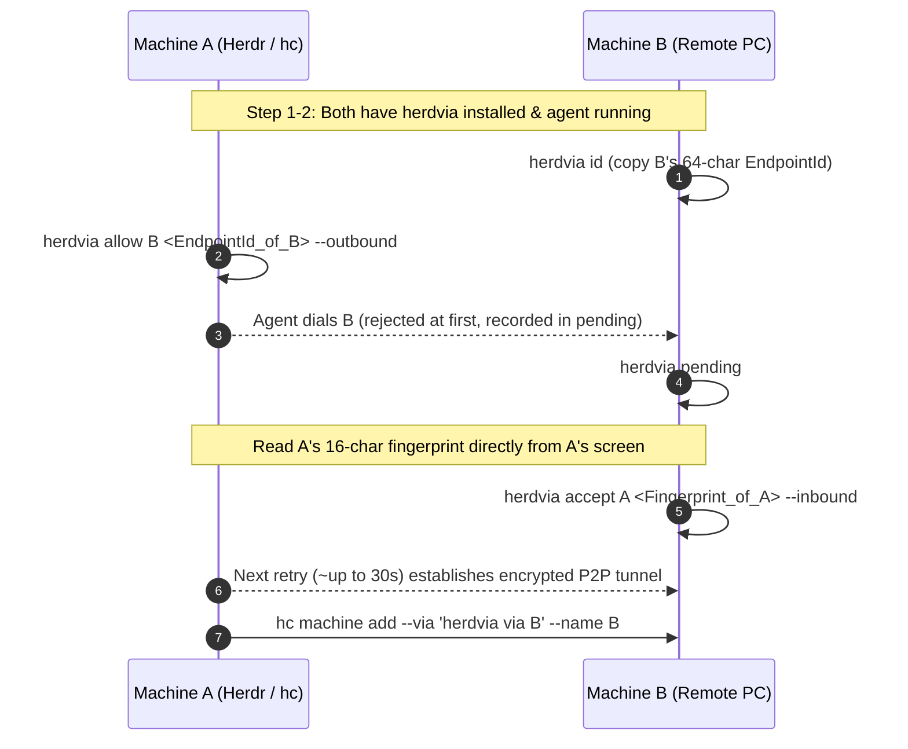

# herdvia

<p align="center">
  <strong>English</strong> · <a href="docs/README.ko.md">한국어</a> · <a href="docs/README.ja.md">日本語</a> · <a href="docs/README.zh-CN.md">简体中文</a>
</p>

<p align="center">
  <a href="https://github.com/photojupi/herdvia/actions/workflows/ci.yml"></a>
  <a href="https://github.com/photojupi/herdvia/releases/latest"></a>
  <a href="#license"></a>
</p>

**Connect remote PCs behind different routers to [Herdr](https://herdr.dev) — without an SSH server, port forwarding, or a VPN.**


> [!NOTE]
> **Unofficial & Experimental.** `herdvia` is an independent personal project and is not affiliated with, endorsed by, or supported by the Herdr / `herdr-core` project. Its commands, file formats, and wire protocol may change in incompatible ways.

---

## Table of contents

- [What is herdvia?](#what-is-herdvia)
- [How it works](#how-it-works)
- [Requirements](#requirements)
- [Quick start](#quick-start)
- [Install](#install)
  - [Install script](#install-script)
  - [Manual install](#manual-install)
  - [From source](#from-source)
- [Commands](#commands)
- [Automatic startup](#automatic-startup)
- [Troubleshooting](#troubleshooting)
  - [Run `herdvia doctor`](#run-herdvia-doctor)
  - [Common symptoms](#common-symptoms)
- [Upgrading and uninstalling](#upgrading-and-uninstalling)
- [Security model](#security-model)
- [Network and published information](#network-and-published-information)
- [Supported platforms](#supported-platforms)
- [Configuration and files](#configuration-and-files)
- [Design & License](#design)

---

## What is herdvia?

When you register a remote computer in Herdr (`hc machine add --via <command>`), Herdr normally expects a transport like `ssh`. Setting that up across home, office, or cafe networks usually means running an SSH server, configuring router port forwarding, or installing a full mesh VPN on every machine.

**`herdvia` is a drop-in replacement for that `--via` command.** It carries the raw bytes of an `hc` session directly between your machines over [iroh](https://www.iroh.computer) — end-to-end encrypted peer-to-peer QUIC with automatic NAT traversal, seamlessly falling back to a public relay when a direct UDP path is blocked.

| Approach | Router / Port Forwarding | Extra Daemons / Accounts | Network Exposure | Setup Effort |
|---|---|---|---|---|
| **SSH (`ssh user@host`)** | Needed across NAT | SSH server on target PC | Exposes SSH port | Medium–High |
| **Mesh VPN** | Not needed | Full virtual network interface + account | Exposes whole IP interface (unless ACL-tuned) | Medium |
| **`herdvia`** | **Not needed** | **Single lightweight user-space binary** | **Only `herdr-core connect` to explicitly allowed keys** | **~5 minutes** |

---

## How it works

`herdvia` does not parse or interpret the Herdr protocol — it simply moves bytes between `hc` on your local computer (**Machine A**) and `herdr-core` on your remote computer (**Machine B**).


1. **Persistent background agent (`herdvia agent`):** Runs in your user session on each machine, holds the machine's cryptographic identity (`EndpointId`), and maintains encrypted QUIC connections to allowed peers.
2. **Mutual trust (`allow` / `accept`):** Unknown peers are always rejected. Machine A must explicitly allow dialing Machine B (`--outbound`), and Machine B must explicitly allow sessions from Machine A (`--inbound`).
3. **Strict command filter:** On the receiving side, `herdvia` executes **only** the exact `herdr-core connect` command line sent by `hc` (verified against **`hc 0.1.21`**). Any other command string is rejected and logged.

---

## Requirements

Before pairing two computers, check what each machine needs:

| Component | Machine A (Controller — runs Herdr) | Machine B (Remote PC — target) | Notes |
|---|---|---|---|
| **`herdr-core`** | Required | Required | Use the **same version** on both machines (verified with **`0.1.21`**). |
| **Herdr app / `hc` CLI** | Required | Not needed | Machine B only needs `herdr-core`. |
| **`herdvia` + running agent** | Required | Required | Installed via one-line script, release zip, or Cargo. |

### Install `herdr-core` on both machines

`herdvia` does **not** bundle, install, or update `herdr-core` — install it on both machines using Herdr's official script (re-running updates it):

- **macOS / Linux:**
  ```sh
  curl -fsSL https://releases.herdr.dev/core/install.sh | sh
  ```
  Installs `~/.local/bin/herdr-core` (and an `hc` link beside it if missing). It does not modify `PATH`, and prints a note if `~/.local/bin` is not on your `PATH`.

- **Windows (PowerShell — no administrator rights needed):**
  ```powershell
  powershell -c "irm https://releases.herdr.dev/core/install.ps1 | iex"
  ```
  Installs `%LOCALAPPDATA%\Programs\herdr-core\herdr-core.exe` (and `hc.exe` if missing) and adds that folder to your user `PATH`.

To pin **`0.1.21`** (the exact version `herdvia` was verified against) instead of the latest release:

```sh
# macOS / Linux
curl -fsSL https://releases.herdr.dev/core/install.sh | HC_VERSION=0.1.21 sh
```

```powershell
# Windows (PowerShell)
$env:HC_VERSION = "0.1.21"; powershell -c "irm https://releases.herdr.dev/core/install.ps1 | iex"
```

*(On macOS, Herdr's script refuses to overwrite a newer `herdr-core` with an older one; it instructs you to use `hc update --from` with `--force` to downgrade.)*

> [!IMPORTANT]
> **Two `herdr-core` details to keep in mind:**
> 1. **Exact command matching (`hc 0.1.21`):** Because `herdvia` rejects every remote command except `hc`'s exact `herdr-core connect` line, `hc machine add --install` and `hc machine update` cannot install or update `herdr-core` through `herdvia`. If a future `hc` changes its connect line, `herdvia` will reject it until updated.
> 2. **Expected `herdr-core` binary path on Machine B:**
>    - **macOS / Unix:** `~/.local/bin/herdr-core` or on the agent's `PATH`. On macOS, the auto-started LaunchAgent searches only `~/.local/bin:/usr/bin:/bin:/usr/sbin:/sbin` — if you installed `herdr-core` elsewhere (such as Homebrew), symlink it to `~/.local/bin/herdr-core`.
>    - **Windows:** `%USERPROFILE%\AppData\Local\Programs\herdr-core\herdr-core.exe`.

---

## Quick start

Suppose you have two machines:
- **Machine A** — where you use Herdr / `hc` (for example, your laptop).
- **Machine B** — the remote PC you want to reach (for example, your home desktop).

First, install `herdvia` on **both A and B** (see [Install](#install) for Intel Macs, Linux, or manual archives):

```sh
# macOS (Apple Silicon)
curl -fsSL https://github.com/photojupi/herdvia/releases/latest/download/install.sh | sh
```

```powershell
# Windows (x64) — run in a NORMAL PowerShell window, NOT as Administrator
powershell -c "irm https://github.com/photojupi/herdvia/releases/latest/download/install.ps1 | iex"
```

**Open a new terminal window** after installing so `herdvia` is on your `PATH` (on Windows, open a new PowerShell window and restart Herdr if it was already running).

Here is the entire pairing flow at a glance:



### Step 1. Show each machine's identity

Run on **both A and B** (the install script already printed this once):

```sh
herdvia id
```

- **Line 1:** Full 64-character `EndpointId` (this machine's public key).
- **Line 2:** Short 16-character fingerprint in groups of four (e.g. `28af-63b6-258e-859d`). The secret key is created automatically on first run.

### Step 2. Run the agent on both machines

If you used the [install script](#install-script), the background agent is **already registered and running** — skip to Step 3.

Otherwise, either register it to start automatically at login and start it right now (macOS & Windows):

```sh
herdvia agent install
```

or run it manually in the foreground:

```sh
herdvia agent
```

See [Automatic startup](#automatic-startup) for platform details.

### Step 3. On A, allow B

Peers are never trusted automatically. Copy **B's `EndpointId`** to **A** and authorize A to dial B:

```sh
herdvia allow B <EndpointId of B> --outbound
```

Verify that the first 16 characters of the `EndpointId` you pasted match the fingerprint `herdvia id` prints on B (compare them in person or over a separate channel from the one used to copy the ID).

| Direction flag | Meaning |
|---|---|
| `--outbound` | **This machine** may dial and open sessions on that peer. |
| `--inbound` | **That peer** may connect and open sessions on this machine. |
| `--both` | Allow both directions. |

*The peer name (`A`, `B`, `home-pc`, etc.) is a local label of 1–32 characters using `A-Z a-z 0-9 . _ -`. Running `allow` again with the same name updates that entry, and `allow` prints the entry it saved (such as `B <EndpointId> out`). An `EndpointId` can have only one name: `allow` refuses an `EndpointId` that is already registered under another name.*

### Step 4. On B, accept A

A's agent immediately starts trying to reach B. Because A is not yet on B's allowlist, B rejects the attempt — and records A's authenticated key in memory so you don't have to copy a second 64-character ID by hand.

On **B**, inspect pending attempts:

```sh
herdvia pending
```

```text
fingerprint id attempts last-seen
28af-63b6-258e-859d 28af63b6258e859dc534c014248ebf7284cdbb34e7cff524e3e4d35c2df1fc55 3 4s
```

Read **A's fingerprint on A's own screen** (line 2 of `herdvia id` on A — **never** copy it blindly from `pending`, since anyone who knows B's `EndpointId` can knock on B) and accept it on **B**:

```sh
herdvia accept A <fingerprint of A> --inbound
```

- `accept` registers A's full `EndpointId` (just like `herdvia allow A <EndpointId of A> --inbound`) and prints `A <EndpointId> in`.
- You can type the fingerprint with or without dashes, in upper or lower case. Use `--both` if B will also dial A (`--outbound` is not accepted by `accept`).
- A retries rejected connections with backoff up to **30 seconds**, so it can take up to ~30 seconds for A to appear in `pending`, and up to ~30 seconds after `accept` for A to reconnect.
- *(Alternative: if copying A's full ID to B is easier, run `herdvia allow A <EndpointId of A> --inbound` on B and verify the fingerprint as in Step 3.)*

### Step 5. Add B to Herdr on A

On **A**, register the machine in Herdr:

```sh
hc machine add --via 'herdvia via B' --name B
```

- The `B` inside `'herdvia via B'` must match the peer name you gave `herdvia allow` on A. `--name B` is the display name in Herdr (it can be anything you like).
- `hc` appends its remote connect line to `--via` as a single extra argument.
- **If `hc` cannot find `herdvia` on its `PATH`:** pass the full executable path and quote it if it contains spaces:
  - **macOS:** `hc` runs `--via` via `sh`, so quote it with `sh` rules (the install script prints a ready-to-paste command).
  - **Windows:** `hc` splits `--via` without a shell (`CommandLineToArgvW` rules), requiring double quotes around a path with spaces. Because Windows PowerShell 5.1 strips inner double quotes unless escaped, it is much simpler to keep `herdvia` on your user `PATH` (open a new PowerShell window and restart Herdr after installing) and run `hc machine add --via 'herdvia via B' --name B` as shown above.

### Step 6. Check the connection

On **A**, inspect live connection health:

```sh
herdvia status
```

```text
name permission connection path rtt
B out connected direct 4.12ms
```

- **`path`:** Starts on `relay` and typically upgrades to `direct` within a few seconds.
- **macOS local network note:** If two machines on the same Wi-Fi/LAN stay on `relay`, allow `herdvia` under **System Settings > Privacy & Security > Local Network** (see [macOS automatic startup](#macos)).
- **Tip:** Before B accepts A, `herdvia status` on A may briefly flash `connected` during each retry before B closes the connection. Running `herdvia status` on **B** shows `connected` only after A is truly accepted and connected.
- **If something is not working:** run `herdvia doctor` on both machines; each `warn` or `fail` line says what to do (see [Run `herdvia doctor`](#run-herdvia-doctor)).

---

## Install

### Install script

**macOS (Apple Silicon):**

```sh
curl -fsSL https://github.com/photojupi/herdvia/releases/latest/download/install.sh | sh
```

**Windows (x64)** — run in a normal PowerShell window, **not** an administrator window:

```powershell
powershell -c "irm https://github.com/photojupi/herdvia/releases/latest/download/install.ps1 | iex"
```

What the script does step by step:

1. **Downloads & verifies:** Fetches the release archive and `SHA256SUMS` into a temporary folder and verifies the SHA-256 checksum. If downloading or verification fails, it aborts without changing anything.
2. **Installs the binary:** Places `~/.local/bin/herdvia` on macOS, or `%LOCALAPPDATA%\Programs\herdvia\herdvia.exe` on Windows (alongside the README and license files).
3. **Configures `PATH`:** On macOS, appends `export PATH="$HOME/.local/bin:$PATH"` to `~/.zprofile` if your login shell is `zsh` (for other shells, prints the line for you to add). On Windows, adds the folder to your user `PATH`.
4. **Checks `herdr-core`:** Does **not** install `herdr-core`. If missing, prints Herdr's install commands. On macOS, if `herdr-core` is found elsewhere on `PATH` instead of `~/.local/bin/herdr-core`, prints an `ln -s` command so the LaunchAgent can find it.
5. **Creates/prints identity:** Runs `herdvia id` to initialize `secret.key` (if needed) and display your `EndpointId` and fingerprint.
6. **Starts the background agent:** Runs `herdvia agent install` so the agent starts now and at every login (on Windows, if run from an elevated administrator PowerShell, skips this step and tells you to run it in a normal window).

**Platform requirements for the scripts:**
- **macOS script:** Apple Silicon only (refuses to run as `root`; on Intel Macs or Linux it exits cleanly and points to [From source](#from-source)).
- **Windows script:** x64 only; requires `System32\curl.exe` (included in Windows 10 1803 and later).

**Script options (environment variables — only `1` enables boolean switches):**

| Variable | Effect |
|---|---|
| `HERDVIA_VERSION` | Install a specific release (e.g. `0.1.0` or `v0.1.0`) instead of the latest. |
| `HERDVIA_NO_AGENT=1` | Skip running `herdvia agent install`. |
| `HERDVIA_NO_MODIFY_PATH=1` | Do not modify `~/.zprofile` or the Windows user `PATH`. |
| `HERDVIA_RELEASE_BASE` | Download files from `<url>/<file>` instead of GitHub Releases (overrides `HERDVIA_VERSION`). |

To install a specific version (note: set `HERDVIA_VERSION` explicitly, even when downloading `install.sh` / `install.ps1` from a versioned tag URL):

```sh
curl -fsSL https://github.com/photojupi/herdvia/releases/download/v0.1.0/install.sh | HERDVIA_VERSION=0.1.0 sh
```

```powershell
$env:HERDVIA_VERSION = "0.1.0"; powershell -c "irm https://github.com/photojupi/herdvia/releases/download/v0.1.0/install.ps1 | iex"
```

To inspect the script before executing it (`SHA256SUMS` also covers both install scripts):

```sh
# macOS
curl -fsSLO https://github.com/photojupi/herdvia/releases/latest/download/install.sh
less install.sh
sh install.sh
```

```powershell
# Windows (PowerShell)
curl.exe -fLO https://github.com/photojupi/herdvia/releases/latest/download/install.ps1
notepad install.ps1
Get-Content -Raw .\install.ps1 | Invoke-Expression
```

*(Re-running the script upgrades `herdvia` in place; see [Upgrading](#upgrading).)*

### Manual install

Download assets from [GitHub Releases](https://github.com/photojupi/herdvia/releases):

- `herdvia-macos-arm64.zip` (macOS Apple Silicon)
- `herdvia-windows-x64.zip` (Windows x64)
- `install.sh` and `install.ps1`
- `SHA256SUMS` (SHA-256 checksums for archives and scripts)

Each `.zip` extracts flat (no wrapper directory) and contains the executable, `README.md`, `LICENSE-MIT`, `LICENSE-APACHE`, and `THIRD-PARTY-LICENSES.html`. Place the executable in a **permanent folder** (such as `~/.local/bin/herdvia` on macOS or `%LOCALAPPDATA%\Programs\herdvia\herdvia.exe` on Windows) — automatic startup records the exact path you run `agent install` from, so never run it out of `Downloads` or a temporary directory.

The binaries are not code-signed or notarized. Prebuilt Intel Mac binaries are not provided; see [From source](#from-source).

Release files published after `v0.1.2` come with a GitHub build provenance attestation. With the [GitHub CLI](https://cli.github.com), run `gh attestation verify <file> --repo photojupi/herdvia --signer-workflow photojupi/herdvia/.github/workflows/release.yml` (for example, with `herdvia-macos-arm64.zip` as `<file>`). It checks that a signed provenance attestation exists for exactly this file's contents and that it was made in this repository by the release workflow, `.github/workflows/release.yml` (with `--repo` alone, an attestation made by any other workflow in the repository would pass too). It shows where a file was built, not that it is safe: a release built from a tag pushed by someone who took over the maintainer's account would also pass. `SHA256SUMS` comes from the same release, so it catches damaged downloads, not a replaced release.

#### macOS (Apple Silicon)

```sh
mkdir -p ~/.local/bin
cd "$(mktemp -d)"
curl -fLO https://github.com/photojupi/herdvia/releases/latest/download/herdvia-macos-arm64.zip &&
curl -fLO https://github.com/photojupi/herdvia/releases/latest/download/SHA256SUMS &&
shasum -a 256 -c --ignore-missing SHA256SUMS &&
unzip -q herdvia-macos-arm64.zip -d herdvia &&
mv herdvia/herdvia ~/.local/bin/herdvia
echo 'export PATH="$HOME/.local/bin:$PATH"' >> ~/.zprofile
```

- Skip the `echo ... >> ~/.zprofile` line if `~/.local/bin` is already on your `PATH`.
- Move the actual binary into `~/.local/bin` (do not symlink to `Downloads`, because `launchd` records the symlink path and breaks if the target is deleted).
- Open a new terminal and verify with `herdvia id`.
- If you downloaded the `.zip` in a web browser instead of `curl`, macOS Gatekeeper attaches a quarantine attribute. Clear it with:
  ```sh
  xattr -d com.apple.quarantine ~/.local/bin/herdvia
  ```

#### Windows (x64)

Run these commands one at a time in a **normal (non-administrator) PowerShell** window, stopping if any step prints an error:

```powershell
# 1. Create and enter a temporary folder
$tmp = Join-Path $env:TEMP "herdvia-$(Get-Random)"
New-Item -ItemType Directory $tmp
Set-Location $tmp

# 2. Download the archive and checksums
curl.exe -fLO https://github.com/photojupi/herdvia/releases/latest/download/herdvia-windows-x64.zip
curl.exe -fLO https://github.com/photojupi/herdvia/releases/latest/download/SHA256SUMS

# 3. Compute the SHA-256 hash to compare with SHA256SUMS
$hash = (Get-FileHash herdvia-windows-x64.zip -Algorithm SHA256).Hash

# 4. Extract into %LOCALAPPDATA%\Programs\herdvia only if SHA256SUMS lists that hash; otherwise stop
if (@(Get-Content SHA256SUMS) -contains "$hash  herdvia-windows-x64.zip") {
  New-Item -ItemType Directory -Force "$env:LOCALAPPDATA\Programs\herdvia"
  tar.exe -xf herdvia-windows-x64.zip -C "$env:LOCALAPPDATA\Programs\herdvia"
} else {
  throw "herdvia-windows-x64.zip does not match SHA256SUMS; do not install it"
}
```

To run `herdvia` by name, add `%LOCALAPPDATA%\Programs\herdvia` to your **User `Path`** (*Start menu → "Edit environment variables for your account" → User variables → `Path` → Edit → New*), then open a new PowerShell window (and restart Herdr if running) and verify with `herdvia id`. Windows SmartScreen may display a prompt on first launch.

### From source

Requires **Rust 1.91 or later** (required by `iroh`).

- **macOS:** Xcode Command Line Tools (`xcode-select --install`) and Rust via [rustup](https://rustup.rs).
- **Windows:** Rust via [rustup](https://rustup.rs) plus Visual Studio Build Tools ("Desktop development with C++"). *(Note: official Windows release binaries are cross-compiled on Linux with MinGW `x86_64-pc-windows-gnu`; CI runs only the unit tests with MSVC.)*

```sh
cargo install --locked --git https://github.com/photojupi/herdvia
```

This builds `main` and installs into `~/.cargo/bin` (`%USERPROFILE%\.cargo\bin` on Windows). Add `--tag v<version>` to build a specific release tag.

---

## Commands

| Command | Description |
|---|---|
| `herdvia id` | Print this machine's `EndpointId` (line 1) and 16-char fingerprint (line 2). Generates `secret.key` if missing. |
| `herdvia allow <name> <EndpointId> (--inbound \| --outbound \| --both)` | Add or update a peer and print the saved entry (`<name> <EndpointId> <in\|out\|both>`). Refuses an `EndpointId` already registered under another name. Applied immediately on a running agent (or on next agent start). |
| `herdvia revoke <name>` | Remove a peer, print `revoked <name> <EndpointId>`, and immediately close its connections, ending the `herdr-core connect` processes they started (see [Security model](#security-model) for what this does not undo). Fails if no peer has that name. Warns if the same `EndpointId` is still registered under another name (in a `peers` file written by an earlier version). |
| `herdvia status` | Show each peer's name, permission, connection state, `direct`/`relay` path, and RTT. Requires a running agent. |
| `herdvia pending` | List machines whose inbound connection attempts were rejected (fingerprint, `EndpointId`, attempt count, time since last seen). In-memory only: max 16 entries, expires 10 minutes after last attempt. Requires a running agent. |
| `herdvia accept <name> <fingerprint> (--inbound \| --both)` | Authorize the single `pending` peer matching `<fingerprint>`. Refuses if 0 or >1 entries match, if the list is full (16 entries: someone may be flooding this PC with attempts, so use `allow` with the full `EndpointId`), if `<name>` already points to a different `EndpointId`, or if the `EndpointId` is registered under another name. Requires a running agent. |
| `herdvia doctor` | Check this machine's setup (executable, data folder, `secret.key`, `peers`, `herdr-core`, automatic startup, agent, relay, peer connections, pending attempts) without changing anything. Prints `ok`/`warn`/`fail` lines (including one per peer, omitting dependent checks when an earlier step fails) and exits with `1` if any check fails. See [Run `herdvia doctor`](#run-herdvia-doctor). |
| `herdvia --version` | Print `herdvia <version>`. |
| `herdvia agent` | Run the agent in the foreground (stop with `Ctrl-C`). |
| `herdvia agent install` | Register automatic startup at login and start the agent immediately (macOS, Windows). |
| `herdvia agent uninstall` | Stop the background agent and remove automatic startup registration. Preserves the data folder and logs. |
| `herdvia via <peer> <line>` | Internal transport subcommand invoked by `hc`; not meant to be run manually. Requires a running local agent. |

On any error, `herdvia` writes a single line prefixed with `herdvia:` to `stderr` and exits with code **`255`**.

---

## Automatic startup

### macOS

`herdvia agent install` creates a per-user LaunchAgent (`~/Library/LaunchAgents/io.github.photojupi.herdvia.agent.plist`) and starts it via `launchctl bootstrap`. `launchd` launches the agent at login and automatically restarts it if it exits. Logs go to `~/Library/Logs/herdvia.log`, and the agent removes lines older than 180 days from it and cuts it down when it grows past 10 MiB (see [Configuration and files](#configuration-and-files)).

- Refuses to install if `HERDVIA_DIR` is set (automatic startup always uses the default data folder) or if a foreground agent is currently running.
- Re-running `herdvia agent install` updates the plist executable path and restarts the agent.
- Prints a warning (while still installing) if run from a temporary or Cargo `target` directory.

> [!IMPORTANT]
> **macOS 15+ Local Network Access:** On macOS Sequoia (15) and later, background LaunchAgents cannot reach LAN addresses until you grant permission. Click **Allow** when macOS prompts you, or enable `herdvia` in **System Settings > Privacy & Security > Local Network**. Until enabled, peers on the same Wi-Fi/LAN route via `relay` instead of `direct` (peers across the internet are unaffected, and running `herdvia agent` in a terminal does not require this toggle).

### Windows

`herdvia agent install` adds a value under `HKCU\Software\Microsoft\Windows\CurrentVersion\Run` that runs `conhost.exe --headless "<path to herdvia.exe>" agent --log` at sign-in without a console window, and starts it immediately. No administrator privileges, Windows services, or scheduled tasks are used.

- **Must be run from a normal (non-elevated) PowerShell window** — `install` refuses to run as administrator, and the agent itself refuses to start from a window opened with "Run as administrator" (see [Security model](#security-model)).
- Refuses if `HERDVIA_DIR` is set, or if a foreground agent is running before auto-start has been registered. (If auto-start is already registered, re-running `install` stops the running default-folder agent and starts the new one.)
- Executable path must not contain `%`, and the full registered command line must fit within 259 UTF-16 code units.
- Logs are appended to `%LOCALAPPDATA%\herdvia\herdvia.log` (lines older than 180 days are removed, and the file is cut down when it grows past 10 MiB). If the agent exits unexpectedly, Windows does not restart it until the next sign-in.

### Linux

Automatic startup (`agent install` / `agent uninstall`) is not supported on Linux. Run `herdvia agent` directly (for example under `systemd --user` or inside a session manager).

---

## Troubleshooting

### Run `herdvia doctor`

`herdvia doctor` checks, in order:

1. **This executable:** its version and path (warns if it runs from a temporary or Cargo `target` directory, because `agent install` records that path).
2. **Data folder:** its path (and whether it comes from `HERDVIA_DIR`, which must be an absolute path), whether it exists, whether it is a directory (not a symlink, nor a junction on Windows), and whether this user can open it (and owns it on macOS/Unix; if it cannot be opened, fails and suggests `chmod 700` on macOS/Unix). It also fails on macOS if the folder has an access control list (ACL) entry that allows access (suggesting `chmod -N`), and on Windows if it is another kind of reparse point, is owned by someone other than this user, Administrators, or SYSTEM, or gives access to other accounts while this user cannot change its permissions (suggesting an `icacls … /grant` command for an administrator terminal). On Windows, a folder that gives access to accounts other than these three but whose permissions this user can change is a `warn`, because herdvia restricts it the next time it runs. On macOS/Unix, also checks that the agent socket path fits the Unix socket length limit.
3. **`secret.key`:** whether it exists and passes the agent's checks (on macOS/Unix: owned by this user, mode `0600` or narrower, and on macOS no ACL entry that allows access; on Windows: a regular file, not a link, owned by this user, Administrators, or SYSTEM, that gives no access to other accounts). On Windows, a file that gives access to other accounts is a `warn` when herdvia will restrict it the next time it runs, and otherwise a `fail` that shows an `icacls … /reset` command. Only the fingerprint is printed.
4. **`peers`:** whether it can be read (with the same checks as `secret.key`) and parsed, and how many peers it lists per direction.
5. **`herdr-core`:** whether it is where the agent looks for it (on macOS, the auto-started agent's `PATH`), and whether `herdr-core --version` reports the verified `0.1.21`.
6. **Automatic startup:** whether it is registered (LaunchAgent plist on macOS, `Run` value on Windows) and points to this executable. On Windows, also warns when run as administrator.
7. **Agent:** whether the agent for this data folder answers, its version and executable, and whether it is connected to its home relay.
8. **Peers:** one line per registered peer with its connection state and path from `herdvia status` (or a single `warn` line if no peers are registered).
9. **Pending:** how many rejected connection attempts `herdvia pending` would list.

Output lines go to `stdout` starting with `ok`, `warn`, or `fail`, and `warn` and `fail` lines say on the same line what to do. Peer connections print one line per peer, and dependent checks are omitted when an earlier step fails: if the data folder check fails, the agent check and everything after it are skipped (and unless only the Unix socket path was too long, `secret.key` and `peers` are skipped too); if the agent does not answer, the `relay`, peer, and `pending` lines are skipped. `doctor` exits with `0` when nothing failed (warnings alone still exit `0`) and with `1` when any check failed. Usage errors still print a single `herdvia:` line and exit `255`.

`doctor` is read-only: it does not create or change the data folder, `secret.key`, `peers`, the automatic startup registration, or the agent's state. So on Windows, a data folder, `secret.key`, or `peers` that gives access to other accounts stays a `warn` (`… herdvia restricts it the next time it runs (herdvia id, or the agent when it starts)`) until a command that uses the data folder restricts it; a PC upgraded from `v0.1.2` can show these lines until its first command of the new version (the install script runs `herdvia id`). The only program it runs is `herdr-core --version` (with a 2-second limit). Each request to the agent has a 3-second limit: if the agent does not answer within 3 seconds even if running, `doctor` prints `fail agent: it may be running, but it did not answer within 3 seconds; …` and skips the remaining agent checks; if the peer status or `pending` request exceeds 3 seconds, that line is `warn` (and after a `status` timeout, `pending` is skipped). `herdvia doctor` was added in `v0.1.2`; an agent from an earlier release does not know its request, so `doctor` warns that the agent is older than this executable and should be restarted (omitting `relay` while still checking peers and `pending`), and that agent logs one `unknown CONTROL request` line.

Run it on **both** machines: a problem on B (such as a missing `herdr-core` or an unaccepted peer) shows up in B's output. Example on Machine A:

```text
$ herdvia doctor
ok   executable: herdvia 0.1.2 at /Users/you/.local/bin/herdvia
ok   data directory: /Users/you/Library/Application Support/herdvia
ok   secret.key: present, fingerprint 28af-63b6-258e-859d
ok   peers: 2 registered (in 0, out 1, both 1)
ok   herdr-core: /Users/you/.local/bin/herdr-core (hc 0.1.21)
ok   automatic start: registered for this executable
ok   agent: running herdvia 0.1.2 from /Users/you/.local/bin/herdvia
ok   relay: connected to https://aps1-1.relay.n0.iroh.link./
ok   peer B (out): connected directly, 4.12ms
warn peer office (both): not connected; its agent is off, or it has not allowed this PC (on that PC: herdvia pending, then herdvia accept)
ok   pending: no rejected connection attempts
```

### Common symptoms

| Symptom | Likely cause | Fix |
|---|---|---|
| `herdvia pending` on B is empty | A's agent isn't running, `--outbound` wasn't set on A, or A is between retry intervals | Verify `herdvia status` works on A, confirm `herdvia allow B <B_ID> --outbound`, and wait up to 30 seconds before running `herdvia pending` again. |
| `herdvia status` stays on `relay` for two machines on the same Wi-Fi | macOS 15+ blocked LAN access for the LaunchAgent | On the Mac, enable `herdvia` under **System Settings > Privacy & Security > Local Network**. |
| Herdr shows `herdr-core is not installed here` on a Mac where Homebrew installed it | macOS LaunchAgent only searches `~/.local/bin:/usr/bin:/bin:/usr/sbin:/sbin` | Symlink it: `mkdir -p ~/.local/bin && ln -s "$(command -v herdr-core)" ~/.local/bin/herdr-core`. |
| `hc machine add --install` or `hc machine update` fails | `herdvia` rejects all remote commands except `hc`'s exact `herdr-core connect` string | Run Herdr's `herdr-core` install script directly on each machine instead. |
| `herdvia: command not found` right after installing | Current shell / Herdr app still has the old `PATH` | Open a brand-new terminal window (and on Windows, restart the Herdr desktop app). |
| `herdvia agent install` or `herdvia agent` fails on Windows mentioning administrator | PowerShell was launched "Run as Administrator" | Open a normal, non-elevated PowerShell window and run `herdvia agent install`. |
| `herdvia status` on A briefly says `connected` even before B accepts | QUIC handshake finishes before B closes unauthorized peers | Check `herdvia status` on **B** to confirm real bidirectional acceptance. |

---

## Upgrading and uninstalling

Your machine's secret key (`secret.key`) and peer allowlist (`peers`) live in the separate data directory, so replacing or deleting the executable leaves your identity and paired peers intact. Check your installed version anytime with `herdvia --version`.

### Upgrading

**Recommended — re-run the [install script](#install-script):**
It downloads and verifies the new binary, replaces the old one safely (atomic `mv` on macOS; `herdvia.new.exe` → `.old` rename swap on Windows so a running `herdvia.exe` never blocks the upgrade), and runs `herdvia agent install` to restart the background agent on the new version without duplicating `PATH` entries.

*(If a manually started foreground agent is running or `HERDVIA_DIR` is set, stop that agent / unset `HERDVIA_DIR` and run `herdvia agent install`, or pass `HERDVIA_NO_AGENT=1` and restart the agent yourself.)*

**Manual upgrade:**
- **macOS:** Re-run the download/extract/`mv` steps from [macOS (Apple Silicon)](#macos-apple-silicon) (omit the `.zprofile` line). **Always use `mv`, never `cp`,** to replace a running binary on macOS — overwriting an active Mach-O binary with `cp` causes `Killed: 9` on next launch. Then run `herdvia agent install` (or restart your foreground `herdvia agent`).
- **Windows:** Stop the running agent first (`herdvia agent uninstall`, or `Ctrl-C` if running in the foreground) because Windows locks running `.exe` files against `tar.exe` extraction. Re-run the download/verify/`tar.exe` steps from [Windows (x64)](#windows-x64), then run `herdvia agent install`.

After upgrading, `herdvia doctor` warns if the running agent is still the old executable or version.

### Uninstalling

1. **Stop & unregister the agent:** Run `herdvia agent uninstall` (or press `Ctrl-C` on a foreground agent).
2. **Delete the binary:**
   - macOS: `rm ~/.local/bin/herdvia`
   - Windows (PowerShell): `Remove-Item -Recurse -Force "$env:LOCALAPPDATA\Programs\herdvia"`
3. **Delete identity, peers, and logs (optional):** Remove the data folder and log file listed in [Configuration and files](#configuration-and-files).
4. **Clean up `PATH`:**
   - Windows: remove `%LOCALAPPDATA%\Programs\herdvia` from your user `Path` environment variable.
   - macOS: remove the `~/.local/bin` line from `~/.zprofile` only if no other tools (such as `hc` or `herdr-core`) use `~/.local/bin`.
5. **Unpair on other machines:** Run `herdvia revoke <name>` on peers that trusted this machine, and `hc machine rm <name>` where Herdr was configured.

---

## Security model

> [!WARNING]
> **Granting `--inbound` (or `--both`) gives that peer a `herdr-core` session as your user account — effectively full shell access.** Only authorize devices you trust as much as yourself.

- **End-to-end peer authentication:** Every connection is mutually authenticated by `iroh` using Ed25519 key pairs (`EndpointId`). Connections are rejected if the peer list is empty or lacks the matching direction (`in`, `out`, `both`). Permissions are re-checked on every stream, and `revoke` / `allow` changes take effect immediately on a running agent (including changes made while it was starting).
- **What `revoke` does not undo:** `revoke` closes the tunnel to that peer and ends the `herdr-core connect` processes the tunnel started. Remote terminals the peer already opened stay in `herdr-core`, and processes it started and changes it made stay too. If you suspect a peer was compromised, revoke it, then check this PC's Herdr sessions and the `session started` / `session ended` lines in the agent log (see [Configuration and files](#configuration-and-files)).
- **Inbound trust chains:** A PC that gives a peer `--inbound` is only as secure as that peer, because whoever controls the peer can open sessions here. Give `--outbound` only on the machine where you use Herdr and `--inbound` only on the machines it reaches, and use `--both` only when both machines really dial each other.
- **Outbound peers also send bytes to you:** A peer you dial sends the bytes that this PC's `hc` reads, along with error text and exit codes. Dial only PCs you trust.
- **Command allowlist is defense-in-depth, not a sandbox:** Rejecting anything other than `hc`'s exact `herdr-core connect` command reduces accidental misuse and surfaces anomalies in logs, but `herdr-core connect` itself provides shell execution. **Your `peers` key list is the true security boundary.**
- **No root or elevated execution:** `herdvia` refuses to run as `root` on macOS/Unix. On Windows, `herdvia agent` refuses to start from a terminal opened with "Run as administrator" (the elevated half of a UAC split token), and `herdvia agent install` refuses any elevated token. With UAC turned off, or as the built-in Administrator, the agent still starts.
- **Connection limits:** A connected peer can have at most 16 streams (one per `hc` session) open at once on a connection, and cannot open unidirectional streams or send datagrams. A stream that does not send its opening request within 10 seconds is closed.
- **User-isolated local IPC:**
  - **macOS / Unix:** Unix domain socket (`0600`) inside a `0700` data directory, plus peer UID verification.
  - **Windows:** Named pipe restricted via DACL solely to your user SID, with remote network pipe clients rejected. The agent holds a lock on `agent.lock` in the data folder, so a second agent for the same folder refuses to start, and if another account already holds the pipe name, the agent refuses to start and names that account's SID (or says that the pipe's owner cannot be read).
- **Data folder, `secret.key`, and `peers`:** On macOS/Unix, the data folder is set to `0700` and `secret.key` is created with mode `0600`; `herdvia` stops with an error if `secret.key` or `peers` belongs to another user or has wider permissions, and on macOS if the folder or either file has an access control list (ACL) entry that allows access (the error shows the `chmod -N` command that removes it; a file system without ACL support counts as having no ACL). On Windows, `herdvia` refuses a data folder that is a junction or other reparse point, or that is owned by someone other than this user, Administrators, or SYSTEM. Unless the folder already has it, `herdvia` sets a protected DACL on it that gives full access only to those three, inherited by the files inside, and makes a `secret.key` or `peers` that gives access to any other account inherit only from the folder. It refuses a `secret.key` or `peers` that is a link, has another owner, or still gives access to another account (the error shows an `icacls … /reset` command for an administrator terminal). If the folder gives access to another account and this user cannot change its permissions, `herdvia` refuses it and shows an `icacls … /grant` command. A folder that gives access only to those three but whose permissions this user cannot change is used as it is: `herdvia` then does not repair `secret.key` or `peers` in it, and a folder that is not protected keeps inheriting entries from its parent.
- **`secret.key` is this PC's identity:** Anyone with it can impersonate this machine to peers that trust it. Replace it if it may have leaked, or if you restored it from a backup or copied it to another PC:
  1. On every peer, run `herdvia revoke <name>` for this PC's entry.
  2. Stop the agent (`herdvia agent uninstall`, or `Ctrl-C` on a foreground agent).
  3. Delete `secret.key`.
  4. Run `herdvia id` to create a new identity.
  5. Run `herdvia agent install` (or start `herdvia agent` again).
  6. Pair again with every peer.
- **Fingerprints & `pending` / `accept`:** Fingerprints represent only the first 16 hex characters (64 bits) of the 256-bit `EndpointId` for human comparison; `herdvia` always stores and verifies the full `EndpointId`. `pending` only records peers that completed an authenticated `iroh` handshake, keeps at most 16 entries in RAM for 10 minutes, and `accept` refuses ambiguous prefix collisions and a full list, which anyone who knows this PC's `EndpointId` can fill. Always read the fingerprint from **the other machine's own screen**, never from `pending` itself.

**Reporting vulnerabilities:** Please use GitHub's [private vulnerability reporting](https://github.com/photojupi/herdvia/security/advisories/new) for sensitive security issues, or open a regular issue for non-sensitive bugs.

---

## Network and published information

`herdvia` uses `iroh`'s default `N0` network preset (not configurable):

- **Public relays ([n0](https://n0.computer)):** Each agent connects to a home relay for signaling and initial connection setup, and falls back to relaying encrypted traffic only when direct peer-to-peer UDP fails.
- **DNS discovery (`dns.iroh.link`):** Each agent publishes a signed record containing its **`EndpointId` and home relay URL** so peers can look each other up by `EndpointId`.
- **Router port mapping:** UPnP, PCP, and NAT-PMP are enabled to assist direct hole-punching when supported by your router.
- **Your IP address and `EndpointId`:** The lookup service gets only the home relay URL, but anyone who knows this PC's `EndpointId` can connect to it through the relay, and `iroh` can send them this PC's direct address candidates (including LAN addresses and a port-mapped public address) before `herdvia` rejects the connection. So they can learn this PC's current IP addresses. The `EndpointId` is not a secret, but do not post it publicly.
- **Encryption & metadata:** All session traffic is end-to-end encrypted via QUIC/TLS; relays cannot read payload bytes, though n0 notes relays can observe connection metadata (IP addresses, timestamps, byte counts).
- **Service expectations:** n0 operates its public relays for **development and hobby use**, rate-limited and without an SLA. See [Public Relays](https://docs.iroh.computer/iroh-services/relays/public) and [DNS address lookup](https://docs.iroh.computer/connecting/dns-address-lookup).
- **Local logging:** `iroh` internal tracing is disabled. The `herdvia` agent logs connection lifecycle events (connects, rejections, disconnects) and the start and end of each session a peer runs on this PC — never session contents. Text a remote can choose is escaped and cut short, and lines are rate-limited (see [Configuration and files](#configuration-and-files)).

---

## Supported platforms

| Platform | Status |
|---|---|
| **macOS (Apple Silicon)** | Tested on real hardware. Prebuilt binary + automatic startup via `launchd`. |
| **macOS (Intel)** | Not tested. No prebuilt binary; build [from source](#from-source). |
| **Windows 11 (x64)** | Tested on real hardware. Prebuilt binary + automatic startup via `Run` registry key. |
| **Windows 10 (x64)** | Not tested. |
| **Windows on ARM** | Not tested. x64 binary only (Herdr's Windows installer also requires x64). |
| **Linux** | Not tested. Build [from source](#from-source); no automatic startup integration. |

*Windows protocol note:* When Machine B runs Windows, `hc` probes with its Unix `sh` connect line first. `herdvia` replies with exit code `1` (just as `cmd.exe` does when `sh` is missing), prompting `hc` to send its Windows connect line, which `herdvia` then spawns directly without a shell.

---

## Configuration and files

| Item | Location |
|---|---|
| **Data folder (macOS)** | `~/Library/Application Support/herdvia` |
| **Data folder (Windows)** | `%APPDATA%\herdvia` |
| **Data folder (Linux)** | `$XDG_DATA_HOME/herdvia` (defaults to `~/.local/share/herdvia`) |
| **Override env var** | `HERDVIA_DIR=<path>` overrides the data folder (it must be an absolute path; every command, including `hc`'s `via` process, must see the same value; incompatible with `agent install`). |
| **`secret.key`** | Machine's 32-byte Ed25519 secret key (inside data folder). |
| **`peers`** | Allowed peer list (`<name> <EndpointId> <in\|out\|both>` per line). Managed via `allow` / `accept` / `revoke`. |
| **`agent.sock`** | Local Unix domain socket on macOS/Unix (Windows uses a per-SID named pipe instead). |
| **`agent.lock`** | Windows only: the file the agent locks while it runs, so that only one agent uses the data folder. It stays after the agent stops. |
| **Log (macOS auto-start)** | `~/Library/Logs/herdvia.log` |
| **Log (Windows auto-start)** | `%LOCALAPPDATA%\herdvia\herdvia.log` |
| **Log (`herdvia agent` foreground)** | `stderr` |

*Note: Each line the agent writes to its log while running starts with the UTC time, such as `2026-11-14T14:17:03Z herdvia: connected <id>`, and is always one line: control characters such as newlines and ESC, the Unicode line and paragraph separators (U+2028, U+2029), and the twelve bidirectional control characters (such as U+202E) are escaped (`\n`, `\u{1b}`, `\u{2028}`, `\u{202e}`), and text longer than 300 characters is cut and ends with `... [truncated, <N> bytes]`. Lines about unauthenticated connections (rejected peers and failed incoming handshakes) are limited to 30 at once and then one every 10 seconds, and all other lines to 60 at once and then one per second. Before the next line of a kind it writes, the agent writes how many of that kind it dropped, such as `suppressed 71 log lines about unauthenticated connections` or `suppressed 3 other log lines`. On the receiving side, each session a peer runs is logged as `session started: <name> (fingerprint <fingerprint>), herdr session <session>` (without the `herdr session` part when `hc` names no session) and `session ended: <the same>: <reason>`, where the reason is, for example, `exit code 0`, `closed` (after a `revoke` or permission change on this PC), or `the agent stopped`. If a line cannot be written to the log (for example, because the disk is full), the agent drops it and the agent and its sessions carry on; such lines are lost without a trace.*

*An agent started by automatic startup checks its log file right after it starts and every hour after that, and cuts a file over 10 MiB down to the whole lines in its last 5 MiB. It also removes lines older than 180 days right after it starts and every 24 hours after that (if that fails, it tries again at the next hourly check). It trims the start of the same file in place rather than rotating it into separate files. Lines without a time (such as those written by earlier versions, or the error an agent prints when it fails to start) are removed together with the next line that has one. A foreground `herdvia agent` leaves its `stderr` alone when it goes to a terminal or another file. On macOS, even a foreground agent trims `~/Library/Logs/herdvia.log` the same way if its `stderr` appends to that file.*

---

## Design

Architecture notes, wire framing details, and empirical `hc` behavior measurements are documented in [DESIGN.md](DESIGN.md) (written in Korean).

---

## License

Licensed under either of:

- Apache License, Version 2.0 ([LICENSE-APACHE](LICENSE-APACHE) or <http://www.apache.org/licenses/LICENSE-2.0>)
- MIT license ([LICENSE-MIT](LICENSE-MIT) or <http://opensource.org/licenses/MIT>)

at your option.

### Contribution

Unless you explicitly state otherwise, any contribution intentionally submitted for inclusion in the work by you, as defined in the Apache-2.0 license, shall be dual licensed as above, without any additional terms or conditions.
