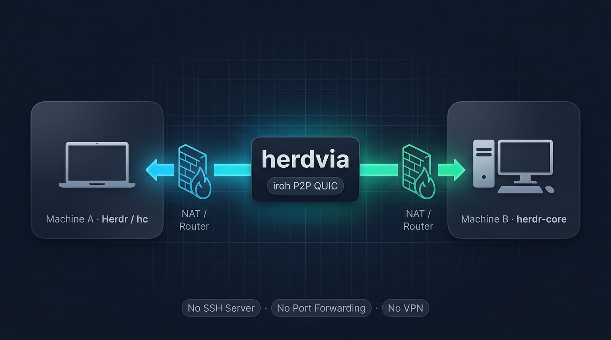
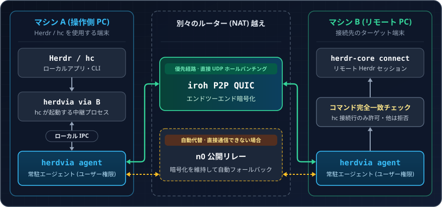
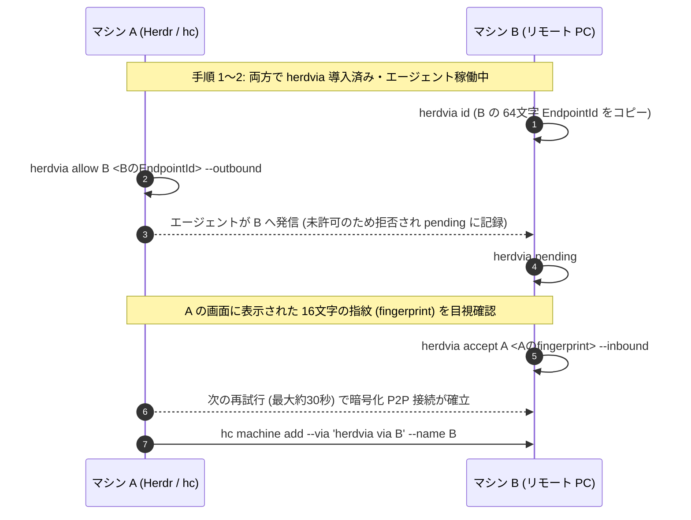

# herdvia

<p align="center">
  <a href="../README.md">English</a> · <a href="README.ko.md">한국어</a> · <strong>日本語</strong> · <a href="README.zh-CN.md">简体中文</a>
</p>

<p align="center">
  <a href="https://github.com/photojupi/herdvia/actions/workflows/ci.yml"></a>
  <a href="https://github.com/photojupi/herdvia/releases/latest"></a>
  <a href="#license"></a>
</p>

**SSH サーバー、ポート開放（ポートフォワーディング）、VPN なしで、別々のルーター配下にある PC を [Herdr](https://herdr.dev) にリモートマシンとして接続します。**



> [!NOTE]
> **非公式・実験的プロジェクト:** `herdvia` は独立した個人開発プロジェクトであり、Herdr / `herdr-core` プロジェクトとは提携しておらず、公式の承認やサポートも受けていません。コマンド、ファイル形式、通信プロトコルは互換性のない形で変更される場合があります。

---

## 目次

- [herdvia とは？](#what-is-herdvia)
- [仕組み](#how-it-works)
- [事前準備（必要なもの）](#requirements)
- [5分クイックスタート](#quick-start)
- [インストール方法](#install)
  - [インストールスクリプト（推奨）](#install-script)
  - [手動インストール](#manual-install)
  - [ソースコードからビルド](#from-source)
- [コマンド一覧](#commands)
- [ログイン時の自動起動](#automatic-startup)
- [トラブルシューティング](#troubleshooting)
  - [`herdvia doctor` を実行する](#run-herdvia-doctor)
  - [よくある症状](#common-symptoms)
- [アップグレードとアンインストール](#upgrading-and-uninstalling)
- [セキュリティモデル](#security-model)
- [ネットワークと公開される情報](#network-and-published-information)
- [対応プラットフォーム](#supported-platforms)
- [設定とファイルの保存場所](#configuration-and-files)
- [設計ドキュメントとライセンス](#design)

---

<a id="what-is-herdvia"></a>
## herdvia とは？

Herdr にリモート PC を追加する `hc machine add --via <コマンド>` は、通常 `ssh` のようなトランスポートを想定しています。しかし、自宅・職場・カフェなど別々のルーター（NAT）の背後にある PC 同士をつなぐには、SSH サーバーの構築、ルーターのポート開放、あるいはメッシュ VPN の導入が必要になりがちです。

**`herdvia` は、その `--via` にそのまま差し替えて使える P2P トランスポートです。** [iroh](https://www.iroh.computer)（自動 NAT 越えと公開リレーサーバーへの自動フォールバックを備えたエンドツーエンド暗号化 P2P QUIC）を利用して、2 台の PC 間で `hc` セッションのバイト列をそのまま安全に中継します。

| 接続方式 | ルーターのポート開放 | 追加デーモン / アカウント作成 | ネットワーク公開範囲 | 導入の手間 |
|---|---|---|---|---|
| **SSH (`ssh user@host`)** | NAT 越えには必要 | 接続先 PC に SSH サーバーが必要 | SSH ポートを公開 | 中〜高 |
| **メッシュ VPN** | 不要 | 仮想ネットワークドライバ + アカウント登録 | IP インターフェース全体（ACL で制限しない限り） | 中 |
| **`herdvia`** | **不要** | **軽量な単一バイナリのみ（アカウント不要）** | **許可した公開鍵に対し `herdr-core connect` のみ実行** | **約 5 分** |

---

<a id="how-it-works"></a>
## 仕組み

`herdvia` は Herdr の内部プロトコルを解釈せず、手元の PC（**マシン A**）の `hc` と接続先 PC（**マシン B**）の `herdr-core` の間でバイト列を中継するだけに徹します。



1. **常駐エージェント (`herdvia agent`):** 各マシンのユーザーセッションで動作し、マシン固有の鍵（`EndpointId`）を使って許可済みピアとの暗号化 QUIC 接続を維持します。
2. **双方向の明示的な許可 (`allow` / `accept`):** 未知の端末が自動的に信頼されることはありません。発信側（マシン A）で `--outbound` を許可し、着信側（マシン B）で `--inbound` を承認して初めて通信が成立します。
3. **厳格なコマンド検証:** 着信側（マシン B）では、`hc` が送信する `herdr-core connect` コマンドラインと完全一致する場合のみ実行します（**`hc 0.1.21`** で検証済み）。それ以外のコマンド文字列はすべて拒否し、ログに記録します。

---

<a id="requirements"></a>
## 事前準備（必要なもの）

接続する 2 台のマシンで必要なものを確認してください。

| 要素 | マシン A（操作側 — Herdr を使用） | マシン B（接続先のリモート PC） | 備考 |
|---|---|---|---|
| **`herdr-core`** | 必須 | 必須 | 両方のマシンで**同じバージョン**を使用してください（**`0.1.21`** で検証済み） |
| **Herdr アプリ / `hc` CLI** | 必須 | 不要 | マシン B には `herdr-core` だけあれば動作します |
| **`herdvia` + エージェント起動** | 必須 | 必須 | 1 行スクリプト、リリース ZIP、または Cargo で導入 |

### 両方のマシンに `herdr-core` をインストールする

`herdvia` は `herdr-core` を**同梱・インストール・更新しません**。両方のマシンで Herdr 公式のインストールスクリプトを実行してください（再実行すると更新されます）。

- **macOS / Linux:**
  ```sh
  curl -fsSL https://releases.herdr.dev/core/install.sh | sh
  ```
  `~/.local/bin/herdr-core`（および未作成なら同じ場所に `hc` リンク）を配置します。`PATH` は変更せず、`~/.local/bin` が `PATH` になければ案内を表示します。

- **Windows（通常の PowerShell — 管理者権限不要）:**
  ```powershell
  powershell -c "irm https://releases.herdr.dev/core/install.ps1 | iex"
  ```
  `%LOCALAPPDATA%\Programs\herdr-core\herdr-core.exe`（および未作成なら `hc.exe`）をインストールし、ユーザー `PATH` に自動で追加します。

`herdvia` で動作確認済みのバージョン **`0.1.21`** を指定して入れる場合：

```sh
# macOS / Linux
curl -fsSL https://releases.herdr.dev/core/install.sh | HC_VERSION=0.1.21 sh
```

```powershell
# Windows (PowerShell)
$env:HC_VERSION = "0.1.21"; powershell -c "irm https://releases.herdr.dev/core/install.ps1 | iex"
```

*（macOS では、すでにより新しい `herdr-core` が入っているとダウングレードせず停止し、`hc update --from ... --force` を使うよう案内されます。）*

> [!IMPORTANT]
> **`herdr-core` に関する重要な注意点 2 つ:**
> 1. **リモートインストール・更新コマンドの制限（`hc 0.1.21` 基準）:** `herdvia` は `hc` が送る `herdr-core connect` 行と完全一致するコマンド以外はすべて拒否するため、`hc machine add --install` や `hc machine update` でリモート側の `herdr-core` を導入・更新することはできません。また将来 `hc` 側の接続コマンドが変わった場合、`herdvia` が対応するまで拒否されます。
> 2. **マシン B で `herdr-core` を探すパス:**
>    - **macOS / Unix:** `~/.local/bin/herdr-core` またはエージェントの `PATH` 上。特に macOS で `herdvia agent install` により自動起動されたエージェントの `PATH` は `~/.local/bin:/usr/bin:/bin:/usr/sbin:/sbin` のみのため、Homebrew 等の別パスに入れた場合は `~/.local/bin/herdr-core` にシンボリックリンクを作成してください。
>    - **Windows:** `%USERPROFILE%\AppData\Local\Programs\herdr-core\herdr-core.exe`。

---

<a id="quick-start"></a>
## 5分クイックスタート

2 台の PC を接続してみましょう：
- **マシン A** — Herdr / `hc` を操作する手元の PC（例：ノート PC）
- **マシン B** — リモート接続したい PC（例：自宅のデスクトップ）

まず **A と B の両方**に `herdvia` をインストールします（Intel Mac・Linux・手動導入は[インストール方法](#install)を参照）：

```sh
# macOS (Apple Silicon)
curl -fsSL https://github.com/photojupi/herdvia/releases/latest/download/install.sh | sh
```

```powershell
# Windows (x64) — 管理者ではなく「通常の」PowerShell ウィンドウで実行してください
powershell -c "irm https://github.com/photojupi/herdvia/releases/latest/download/install.ps1 | iex"
```

インストール後は `PATH` を反映させるため**新しいターミナルウィンドウ**を開いてください（Windows では新しい PowerShell を開き、Herdr が起動中なら再起動してください）。

ペアリング全体の流れは次の通りです：



### 手順 1. 各マシンの ID とフィンガープリントを確認する

**A と B の両方**で実行します（インストールスクリプトを使った場合はすでに一度表示されています）：

```sh
herdvia id
```

- **1 行目:** 64 文字の `EndpointId`（このマシンの公開鍵）
- **2 行目:** 4 文字ずつ区切った 16 文字のフィンガープリント（例：`28af-63b6-258e-859d`）。秘密鍵は初回実行時に自動生成されます。

### 手順 2. 両方のマシンでエージェントを起動する

[インストールスクリプト](#install-script)を使った場合は、エージェントの**自動起動登録と起動がすでに完了**しているため、手順 3 へ進んでください。

手動インストールした場合は、ログイン時の自動起動を登録して今すぐ起動するか（macOS・Windows）：

```sh
herdvia agent install
```

またはフォアグラウンドで直接起動します：

```sh
herdvia agent
```

OS ごとの詳細は[ログイン時の自動起動](#automatic-startup)を参照してください。

### 手順 3. マシン A でマシン B への発信を許可する (`--outbound`)

ピアが自動で信頼されることはありません。**B の `EndpointId`** を **A** にコピーし、A から B への接続を許可します：

```sh
herdvia allow B <BのEndpointId> --outbound
```

貼り付けた `EndpointId` の先頭 16 文字が、B の画面で `herdvia id` が表示したフィンガープリントと一致しているか確認してください（ID を送った経路とは別の手段や直接の画面確認で照合すると安全です）。

| 方向オプション | 意味 |
|---|---|
| `--outbound` | **このマシンから**相手ピアへ発信・接続してよい |
| `--inbound` | **相手ピアが**このマシンに着信してセッションを開いてよい |
| `--both` | 双方向とも許可する |

*名前（`A`、`B`、`home-pc` など）はローカルでの識別名です（`A-Z a-z 0-9 . _ -` の 1〜32 文字）。同じ名前で再度 `allow` を実行すると項目が更新され、`allow` は保存した項目（`B <EndpointId> out` など）を出力します。各 `EndpointId` に付けられる名前は 1 つだけで、別の名前で登録済みの `EndpointId` は `allow` が拒否します。*

### 手順 4. マシン B でマシン A の着信を承認する (`--inbound`)

A のエージェントは直ちに B への接続を試みます。B の許可リストにまだ A がないため接続は拒否されますが、64 文字の ID をもう一度手作業でコピーせずに済むよう、B は A の認証済み公開鍵をメモリ上に一時記録します。

**B** で保留リストを確認します：

```sh
herdvia pending
```

```text
fingerprint id attempts last-seen
28af-63b6-258e-859d 28af63b6258e859dc534c014248ebf7284cdbb34e7cff524e3e4d35c2df1fc55 3 4s
```

**必ず A 自身の画面に表示されているフィンガープリント**（A の `herdvia id` の 2 行目 — B の `EndpointId` を知る第三者も `pending` に現れ得るため、`pending` の表示からそのまま書き写さないでください）を読み取り、**B** で入力して承認します：

```sh
herdvia accept A <Aのfingerprint> --inbound
```

- `accept` は一致した試行の完全な `EndpointId` を（`herdvia allow A <AのEndpointId> --inbound` と同様に）登録し、`A <EndpointId> in` と出力します。
- フィンガープリントはハイフン（`-`）の有無や大文字・小文字を問いません。B から A へも発信したい場合は `--both` を指定します（`accept` では `--outbound` は指定できません）。
- A は拒否された接続を最大 **30 秒**間隔まで広げながら再試行するため、`pending` に出るまで最大約 30 秒、`accept` 後に接続されるまでさらに最大約 30 秒かかることがあります。
- *（別解：A の 64 文字 `EndpointId` を B へコピーできるなら、B で `herdvia allow A <AのEndpointId> --inbound` を実行し手順 3 と同様に照合しても構いません。）*

### 手順 5. マシン A の Herdr にマシン B を登録する

**A** で Herdr にリモートマシンを追加します：

```sh
hc machine add --via 'herdvia via B' --name B
```

- `'herdvia via B'` の `B` は手順 3 の `herdvia allow` で付けたピア名です。`--name B` は Herdr 上の表示名（別の名前でも可）です。
- `hc` はこのコマンドの末尾にリモート実行コマンドを 1 つの引数として追加して起動します。
- **`hc` が `PATH` 上の `herdvia` を見つけられない場合:** 実行ファイルのフルパスを指定し、空白を含む場合はクォートしてください。
  - **macOS:** `hc` は `--via` を `sh` コマンド行として実行するため、`sh` の規則でクォートします（インストールスクリプトがそのまま貼り付けられるコマンドを表示します）。
  - **Windows:** `hc` はシェルを介さず `--via` を分割するため（`CommandLineToArgvW` 規則）、空白を含むパスはダブルクォートで囲む必要があります。Windows PowerShell 5.1 はエスケープしない限り内側のダブルクォートを除去してしまうため、ユーザー `PATH` に `herdvia` を入れた状態にして（インストール後に新しい PowerShell ウィンドウを開き Herdr を再起動）、上記の通り `hc machine add --via 'herdvia via B' --name B` を実行する方がずっと簡単です。

### 手順 6. 接続状態を確認する

**A** で接続状態を確認します：

```sh
herdvia status
```

```text
name permission connection path rtt
B out connected direct 4.12ms
```

- **`path`:** 最初は `relay`（リレー経由）で始まり、通常は数秒以内に `direct`（直接通信）へ切り替わります。
- **macOS のローカルネットワーク権限:** 同じ Wi-Fi / LAN 内にあるのに `relay` のまま変わらない場合は、Mac の **システム設定 > プライバシーとセキュリティ > ローカルネットワーク** で `herdvia` を許可してください（[macOS の自動起動](#macos)を参照）。
- **ヒント:** B が A を `accept` する前でも、再試行のたびに B が接続を閉じるまでの間、A 側の `status` が一瞬 `connected` になることがあります。**B 側**で `herdvia status` を実行すれば、A が正式に承認されて接続した後にのみ接続済みとして表示されます。
- **うまく動かない場合:** 両方のマシンで `herdvia doctor` を実行してください。各 `warn` や `fail` の行に、何をすべきかがそのまま表示されます（[`herdvia doctor` を実行する](#run-herdvia-doctor)を参照）。

---

<a id="install"></a>
## インストール方法

<a id="install-script"></a>
### インストールスクリプト（推奨）

**macOS (Apple Silicon):**

```sh
curl -fsSL https://github.com/photojupi/herdvia/releases/latest/download/install.sh | sh
```

**Windows (x64)** — 管理者ではなく**通常の PowerShell ウィンドウ**で実行：

```powershell
powershell -c "irm https://github.com/photojupi/herdvia/releases/latest/download/install.ps1 | iex"
```

スクリプトが行う 6 つの処理：

1. **ダウンロードと検証:** 一時フォルダにリリースアーカイブと `SHA256SUMS` を取得し、SHA-256 チェックサムを検証します。失敗した場合は何も変更せず終了します。
2. **バイナリの配置:** macOS は `~/.local/bin/herdvia`、Windows は `%LOCALAPPDATA%\Programs\herdvia\herdvia.exe`（README・ライセンス類と同梱）に配置します。
3. **`PATH` の設定:** macOS ではログインシェルが `zsh` の場合に `~/.zprofile` へ `export PATH="$HOME/.local/bin:$PATH"` を追記します（他のシェルの場合は追記すべき行を表示）。Windows ではユーザー `PATH` に追加します。
4. **`herdr-core` の確認:** **`herdr-core` 自体はインストールしません。** 未導入なら公式コマンドを表示し、macOS で `~/.local/bin/herdr-core` 以外の場所にのみある場合は `ln -s` コマンドを案内します。
5. **ID の生成と表示:** `herdvia id` を実行して `secret.key`（必要な場合）を初期化し、`EndpointId` とフィンガープリントを表示します。
6. **エージェントの自動起動登録:** `herdvia agent install` を実行し、今すぐ起動するとともに次回ログイン時からの自動起動を登録します（Windows の管理者 PowerShell から実行された場合はスキップして通常ウィンドウでの実行を案内します）。

**スクリプトの動作条件:**
- **macOS:** Apple Silicon 専用（`root` 実行は拒否。Intel Mac や Linux では何も変更せず[ソースコードからビルド](#from-source)を案内）。
- **Windows:** x64 専用、`System32\curl.exe` が必要（Windows 10 1803 以降に標準搭載）。

**環境変数オプション（スイッチ類は値が `1` のときのみ有効）:**

| 変数名 | 効果 |
|---|---|
| `HERDVIA_VERSION` | 最新版ではなく指定バージョン（例：`0.1.0` または `v0.1.0`）をインストール |
| `HERDVIA_NO_AGENT=1` | `herdvia agent install` を実行しない |
| `HERDVIA_NO_MODIFY_PATH=1` | `~/.zprofile` や Windows のユーザー `PATH` を変更しない |
| `HERDVIA_RELEASE_BASE` | GitHub Releases の代わりに `<url>/<ファイル名>` から取得（`HERDVIA_VERSION` より優先） |

バージョンを固定してインストールする場合（バージョン付き URL のスクリプトを取得する場合でも `HERDVIA_VERSION` の指定が必要です）：

```sh
curl -fsSL https://github.com/photojupi/herdvia/releases/download/v0.1.0/install.sh | HERDVIA_VERSION=0.1.0 sh
```

```powershell
$env:HERDVIA_VERSION = "0.1.0"; powershell -c "irm https://github.com/photojupi/herdvia/releases/download/v0.1.0/install.ps1 | iex"
```

実行前にスクリプトの中身を確認したい場合（`SHA256SUMS` にはスクリプトのハッシュも含まれます）：

```sh
# macOS
curl -fsSLO https://github.com/photojupi/herdvia/releases/latest/download/install.sh
less install.sh
sh install.sh
```

```powershell
# Windows (PowerShell)
curl.exe -fLO https://github.com/photojupi/herdvia/releases/latest/download/install.ps1
notepad install.ps1
Get-Content -Raw .\install.ps1 | Invoke-Expression
```

*（スクリプトを再実行するとアップグレードになります。[アップグレード](#upgrading)を参照してください。）*

<a id="manual-install"></a>
### 手動インストール

[GitHub Releases](https://github.com/photojupi/herdvia/releases) からダウンロードします：

- `herdvia-macos-arm64.zip`（macOS Apple Silicon）
- `herdvia-windows-x64.zip`（Windows x64）
- `install.sh` および `install.ps1`
- `SHA256SUMS`（アーカイブおよびスクリプトの SHA-256 チェックサム）

各アーカイブには親フォルダなしで実行ファイル、`README.md`、`LICENSE-MIT`、`LICENSE-APACHE`、`THIRD-PARTY-LICENSES.html` が入っています。自動起動登録では実行時のファイルパスがそのまま記録されるため、ダウンロードフォルダや一時フォルダからは実行せず、固定の場所（macOS は `~/.local/bin/herdvia`、Windows は `%LOCALAPPDATA%\Programs\herdvia\herdvia.exe`）に配置してください。

バイナリには署名・公証（notarization）はありません。Intel Mac 用のビルド済みバイナリはないため、[ソースコードからビルド](#from-source)してください。

`v0.1.2` より後に公開されたリリースファイルには、GitHub のビルド来歴証明（build provenance attestation）が付与されています。[GitHub CLI](https://cli.github.com) で `gh attestation verify <ファイル> --repo photojupi/herdvia --signer-workflow photojupi/herdvia/.github/workflows/release.yml` を実行してください（例：`<ファイル>` に `herdvia-macos-arm64.zip` を指定）。このコマンドは、ファイルの内容と完全に一致する署名付きの来歴証明が存在し、かつこのリポジトリのリリースワークフロー `.github/workflows/release.yml` によって生成されたことを確認します（`--repo` のみでは、同じリポジトリ内の別のワークフローが生成した証明も通ってしまいます）。

来歴証明はファイルがどこでビルドされたかを示すものであり、安全性を保証するものではありません。メンテナーのアカウントを乗っ取った者がプッシュしたタグからビルドされたリリースも検証を通過します。同様に、`SHA256SUMS` も同じリリースから取得されるため、ダウンロード中の破損は検出できますが、リリース自体の差し替えは検出できません。

<a id="macos-apple-silicon"></a>
#### macOS (Apple Silicon)

```sh
mkdir -p ~/.local/bin
cd "$(mktemp -d)"
curl -fLO https://github.com/photojupi/herdvia/releases/latest/download/herdvia-macos-arm64.zip &&
curl -fLO https://github.com/photojupi/herdvia/releases/latest/download/SHA256SUMS &&
shasum -a 256 -c --ignore-missing SHA256SUMS &&
unzip -q herdvia-macos-arm64.zip -d herdvia &&
mv herdvia/herdvia ~/.local/bin/herdvia
echo 'export PATH="$HOME/.local/bin:$PATH"' >> ~/.zprofile
```

- `~/.local/bin` がすでに `PATH` に含まれている場合は最後の `echo ... >> ~/.zprofile` を省略してください。
- ダウンロードフォルダへのシンボリックリンクではなく、実行ファイル本体を `~/.local/bin` に移動してください（`launchd` はシンボリックリンクのパスを記録するため、リンク先が削除されると起動できなくなります）。
- 新しいターミナルを開いて `herdvia id` で動作確認します。
- ブラウザで ZIP をダウンロードした場合、Gatekeeper の隔離属性が付与されることがあります。以下のコマンドで解除できます：
  ```sh
  xattr -d com.apple.quarantine ~/.local/bin/herdvia
  ```

<a id="windows-x64"></a>
#### Windows (x64)

管理者ではない**通常の PowerShell ウィンドウ**で 1 つずつ確認しながら実行してください（エラーが出たらそこで中断します）：

```powershell
# 1. 一時フォルダを作成して移動
$tmp = Join-Path $env:TEMP "herdvia-$(Get-Random)"
New-Item -ItemType Directory $tmp
Set-Location $tmp

# 2. アーカイブと SHA256SUMS をダウンロード
curl.exe -fLO https://github.com/photojupi/herdvia/releases/latest/download/herdvia-windows-x64.zip
curl.exe -fLO https://github.com/photojupi/herdvia/releases/latest/download/SHA256SUMS

# 3. SHA256SUMS と照合する SHA-256 ハッシュを計算
$hash = (Get-FileHash herdvia-windows-x64.zip -Algorithm SHA256).Hash

# 4. SHA256SUMS にそのハッシュがある場合のみ %LOCALAPPDATA%\Programs\herdvia に展開（なければ中断）
if (@(Get-Content SHA256SUMS) -contains "$hash  herdvia-windows-x64.zip") {
  New-Item -ItemType Directory -Force "$env:LOCALAPPDATA\Programs\herdvia"
  tar.exe -xf herdvia-windows-x64.zip -C "$env:LOCALAPPDATA\Programs\herdvia"
} else {
  throw "herdvia-windows-x64.zip does not match SHA256SUMS; do not install it"
}
```

`herdvia` を名前だけで実行できるよう、`%LOCALAPPDATA%\Programs\herdvia` を**ユーザー環境変数 `Path`**（*スタートメニュー → 「アカウントの環境変数を編集」 → ユーザー環境変数 → `Path` → 編集 → 新規*）に追加してから、新しい PowerShell ウィンドウを開き（Herdr が起動中なら再起動）、`herdvia id` で確認してください。初回実行時に Windows SmartScreen の確認画面が表示されることがあります。

<a id="from-source"></a>
### ソースコードからビルド

`iroh` の要件により **Rust 1.91 以降**が必要です。

- **macOS:** Xcode Command Line Tools（`xcode-select --install`）と [rustup](https://rustup.rs) による Rust
- **Windows:** [rustup](https://rustup.rs) と Visual Studio Build Tools（「C++ によるデスクトップ開発」）。*（注：公式リリースバイナリは Linux 上で MinGW `x86_64-pc-windows-gnu` によりクロスコンパイルされており、CI では MSVC で単体テストのみを実行します。）*

```sh
cargo install --locked --git https://github.com/photojupi/herdvia
```

デフォルトで `main` ブランチをビルドし、`~/.cargo/bin`（Windows は `%USERPROFILE%\.cargo\bin`）に配置します。特定のリリースをビルドするには `--tag v<バージョン>` を追加してください。

---

<a id="commands"></a>
## コマンド一覧

| コマンド | 説明 |
|---|---|
| `herdvia id` | このマシンの `EndpointId`（1 行目）と 16 文字のフィンガープリント（2 行目）を表示します。`secret.key` がなければ生成します。 |
| `herdvia allow <名前> <EndpointId> (--inbound \| --outbound \| --both)` | ピアを追加または更新し、保存した項目（`<名前> <EndpointId> <in\|out\|both>`）を出力します。別の名前で登録済みの `EndpointId` は拒否します。稼働中のエージェントには即座に反映されます（または次回エージェント起動時に反映）。 |
| `herdvia revoke <名前>` | ピアを削除して `revoked <名前> <EndpointId>` を出力し、そのピアとの接続を即座に閉じて、その接続が起動した `herdr-core connect` プロセスを終了します（取り消せない影響については[セキュリティモデル](#security-model)を参照）。該当する名前のピアがなければ失敗します。同じ `EndpointId` が別の名前で残っている場合（以前のバージョンが作成した `peers` ファイル）は警告します。 |
| `herdvia status` | 各ピアの名前、権限、接続状態、経路（`direct`/`relay`）、往復遅延（RTT）を表示します。エージェントの起動が必要です。 |
| `herdvia pending` | 着信接続の試行が拒否されたマシンを一覧表示します（フィンガープリント、`EndpointId`、試行回数、最終確認からの経過時間）。メモリ上のみ最大 16 件・最終試行から 10 分間保持。エージェントの起動が必要です。 |
| `herdvia accept <名前> <fingerprint> (--inbound \| --both)` | `pending` 内で指定フィンガープリントに一致する 1 台を完全な `EndpointId` で登録します。一致が 0 件または複数件の場合、リストが満杯の場合（16 件。誰かが接続試行を大量に送っている可能性があるため、完全な `EndpointId` で `allow` を使ってください）、`<名前>` が別の ID で登録済みの場合、またはその `EndpointId` が別の名前で登録済みの場合は拒否します。エージェントの起動が必要です。 |
| `herdvia doctor` | 何も変更せずにこのマシンの設定状態（実行ファイル、データフォルダ、`secret.key`、`peers`、`herdr-core`、自動起動、エージェント、リレー、ピア接続、保留中の着信試行）を点検します。`ok`/`warn`/`fail` の行を出力し（ピア接続はピアごとに 1 行、前の段階が失敗した場合は後続の点検を省略）、1 つでも失敗があれば終了コード `1` で終了します。[`herdvia doctor` を実行する](#run-herdvia-doctor)を参照。 |
| `herdvia --version` | `herdvia <バージョン>` を表示します。 |
| `herdvia agent` | エージェントをフォアグラウンドで実行します（`Ctrl-C` で停止）。 |
| `herdvia agent install` | ログイン時の自動起動を登録し、今すぐエージェントを起動します（macOS、Windows）。 |
| `herdvia agent uninstall` | 自動起動エージェントを停止し、登録を解除します。データフォルダとログは残ります。 |
| `herdvia via <ピア> <行>` | `hc` から内部的に呼び出されるサブコマンドです（手動実行用ではありません）。ローカルエージェントの起動が必要です。 |

エラー時、`herdvia` は標準エラー出力（`stderr`）に `herdvia:` で始まる 1 行を出力し、終了コード **`255`** で終了します。

---

<a id="automatic-startup"></a>
## ログイン時の自動起動

<a id="macos"></a>
### macOS

`herdvia agent install` はユーザー単位の LaunchAgent（`~/Library/LaunchAgents/io.github.photojupi.herdvia.agent.plist`）を作成し、`launchctl bootstrap` で起動します。ログイン時に自動起動し、終了しても `launchd` が再起動します。ログは `~/Library/Logs/herdvia.log` に出力され、エージェントが 180 日を過ぎた行を削除し、ファイルが 10 MiB を超えると切り詰めます（[設定とファイルの保存場所](#configuration-and-files)を参照）。

- `HERDVIA_DIR` が設定されている場合（自動起動は常にデフォルトのデータフォルダを使用します）や、フォアグラウンドのエージェントが動作中の場合はインストールを拒否します。
- 再度 `herdvia agent install` を実行すると、現在の実行ファイルパスで登録を更新しエージェントを再起動します。
- 一時フォルダや Cargo の `target` ディレクトリから実行した場合は警告を表示しつつ登録します。

> [!IMPORTANT]
> **macOS 15 以降のローカルネットワーク権限:** macOS 15（Sequoia）以降では、自動起動されたエージェントが同一 LAN 上のアドレスへ直接通信するには許可が必要です。macOS の確認ダイアログで**許可**を選ぶか、**システム設定 > プライバシーとセキュリティ > ローカルネットワーク** で `herdvia` をオンにしてください。許可するまでは同一 LAN 内のピアとも `direct` ではなく `relay` 経由になります（別ネットワークのピアや、ターミナルから `herdvia agent` で手動起動した場合は影響ありません）。

### Windows

`herdvia agent install` は現在のユーザーの `Run` レジストリキー（`HKCU\Software\Microsoft\Windows\CurrentVersion\Run`）に `conhost.exe --headless "<herdvia.exe のパス>" agent --log` を登録し、コンソールウィンドウなしで即座に起動します。管理者権限、サービス、タスクスケジューラは一切使用しません。

- **必ず通常の（管理者ではない）PowerShell ウィンドウから実行してください。** 管理者 PowerShell では拒否され、エージェント自体も「管理者として実行」したウィンドウからは起動を拒否します（[セキュリティモデル](#security-model)を参照）。
- `HERDVIA_DIR` が設定されている場合や、自動起動が未登録の状態でフォアグラウンドのエージェントが動作中の場合は拒否します（一度自動起動を登録した後は、再実行すると稼働中のデフォルトフォルダのエージェントを停止して新しいエージェントを起動します）。
- 実行ファイルのパスに `%` を含めることはできず、登録コマンドライン全体が 259 UTF-16 コード単位以内に収まる必要があります。
- ログは `%LOCALAPPDATA%\herdvia\herdvia.log` に出力されます（180 日を過ぎた行は削除され、ファイルが 10 MiB を超えると切り詰められます）。エージェントが途中で終了した場合、Windows は自動再起動せず次回サインイン時に起動します。

### Linux

自動起動（`agent install` / `agent uninstall`）には対応していません。`herdvia agent` をご自身で起動してください（例：`systemd --user` 配下またはセッションマネージャー内）。

---

<a id="troubleshooting"></a>
## トラブルシューティング

<a id="run-herdvia-doctor"></a>
### `herdvia doctor` を実行する

`herdvia doctor` は以下の項目を順番に点検します：

1. **この実行ファイル:** バージョンとパス（`agent install` がそのパスを記録するため、一時フォルダや Cargo の `target` ディレクトリから実行されている場合は警告）。
2. **データフォルダ:** パス（`HERDVIA_DIR` による指定かどうかも含む。`HERDVIA_DIR` は絶対パスである必要あり）、存在するか、実際のディレクトリであるか（シンボリックリンク不可、Windows ではジャンクションも不可）、そして現在のユーザーが開けるか（macOS/Unix では所有者も確認し、開けない場合は `fail` となり macOS/Unix では `chmod 700` を案内）。
   - **macOS / Unix:** macOS ではフォルダにアクセスを許可する ACL（アクセス制御リスト）エントリがある場合も `fail` となり `chmod -N` を案内します。また macOS/Unix では、エージェントのソケットパスが Unix ソケット長の上限に収まるかも確認します。
   - **Windows:** 他の種類の再解析ポイント（reparse point）である場合、所有者が現在のユーザー・Administrators・SYSTEM 以外の場合、または他のアカウントにアクセス権が付与されており現在のユーザーがその権限を変更できない場合に `fail` となります（最後の場合は管理者ターミナルで実行する `icacls … /grant` コマンドを案内）。これら 3 アカウント以外にアクセス権が付与されていても、現在のユーザーが権限を変更できるフォルダは、herdvia が次回実行時に権限を制限するため `warn` となります。
3. **`secret.key`:** 存在するか、およびエージェントと同じ検査に通るか（macOS/Unix：現在のユーザーの所有で権限が `0600` 以下であり、macOS ではアクセスを許可する ACL エントリがないこと。Windows：リンクではない通常のファイルで、所有者が現在のユーザー・Administrators・SYSTEM のいずれかであり、他のアカウントにアクセス権が付与されていないこと）。Windows で他のアカウントにアクセス権が付与されているファイルは、現在のユーザーが権限を変更できる場合は herdvia が次回実行時に制限するため `warn`、変更できない場合は `icacls … /grant` コマンドを案内する `fail` となります。出力にはフィンガープリントのみが表示されます。
4. **`peers`:** 読み取り可能か（`secret.key` と同じ検査）・解析可能か、および方向ごとの登録ピア数。Windows で herdvia が次回実行時に権限を制限する予定のファイルはピア数のない `warn` 行になりますが、ファイルの内容自体は検査され、形式エラーがあれば（権限を制限しても不正な内容は直らないため）通常の `fail` 行になります。
5. **`herdr-core`:** エージェントが探す場所（macOS では自動起動エージェントの `PATH`）にあるか、また `herdr-core --version` が検証済みの `0.1.21` を返すか。
6. **自動起動:** 登録されているか（macOS の LaunchAgent plist、Windows の `Run` レジストリ値）、かつこの実行ファイルを指しているか。Windows で管理者として実行されている場合も警告します。
7. **エージェント:** このデータフォルダのエージェントが応答するか、そのバージョンと実行ファイル、およびホームリレーに接続されているか。
8. **ピア:** `herdvia status` に基づき、登録されたピアごとに接続状態と経路を 1 行ずつ表示（ピアが未登録の場合は `warn` を 1 行表示）。
9. **保留中の試行（`pending`）:** `herdvia pending` に表示される拒否された着信試行の件数。

標準出力（`stdout`）に書き出される各行は `ok`、`warn`、`fail` のいずれかで始まり、`warn` と `fail` の行には同じ行内に対処法が示されます。ピア接続はピアごとに 1 行出力され、前の段階が失敗した場合はそれに依存する後続の点検が省略されます：データフォルダの点検が `fail` になるとエージェント点検とそれ以降の行はすべて省略され（Unix ソケットパス長の上限超過のみが原因である場合を除き、`secret.key` と `peers` も省略）、エージェントが応答しない場合は `relay`、ピア、`pending` の行が省略されます。失敗（`fail`）が 1 つもなければ終了コード `0`（警告のみでも `0`）、1 つでも失敗があれば `1` で終了します。引数エラーなどは他のコマンドと同様に `herdvia:` の 1 行を出力して `255` で終了します。

- **読み取り専用の動作:** `doctor` はデータフォルダ、`secret.key`、`peers`、自動起動の登録、エージェントの状態を作成・変更しません。そのため Windows で他のアカウントにアクセス権が付与されているデータフォルダ、`secret.key`、`peers` は、データフォルダを準備するコマンドが権限を制限するまで `warn`（`… herdvia restricts it the next time it runs (herdvia id, or the agent when it starts)`）のままになります — 該当するコマンドは `herdvia id`、`allow`、`accept`、`revoke`、およびエージェントの起動であり、`status`、`pending`、`doctor` は何も変更しません。Windows 版の `v0.1.2` はデータフォルダと内部ファイルの権限を変更せず、ユーザープロファイルから継承された既定の権限（他のアカウントに読み取りを許可している場合がある）をそのまま使っていたため、`v0.1.2` からアップグレードした PC では、新しいバージョンで上記コマンドのいずれかを実行するまで 3 項目すべてで警告が表示されることがあります（インストールスクリプトは `herdvia id` を実行します）。実行後はフォルダと 2 つのファイルが現在のユーザー・SYSTEM・Administrators のみにアクセスを許可する状態となり、3 行とも `ok` になります。
- **タイムアウト:** 実行する外部プログラムは `herdr-core --version`（2 秒制限）のみです。エージェントへの各リクエストには 3 秒の制限があり、エージェントが稼働中でも 3 秒以内に応答しない場合は `fail agent: it may be running, but it did not answer within 3 seconds; …` を出力して残りのエージェント点検を省略します。後続のピア状態や `pending` のリクエストが 3 秒を超えた場合はその行が `warn` になります（`status` がタイムアウトした場合は `pending` を省略）。
- **古いバージョンのエージェント:** `herdvia doctor` は `v0.1.2` で追加されました。それより前のバージョンのエージェントは `doctor` リクエストを認識しないため、`doctor` は稼働中のエージェントがこの実行ファイルより古く再起動が必要であると警告し（`relay` は省略しつつピアと `pending` は点検します）、エージェント側のログには `unknown CONTROL request` が 1 行記録されます。

**両方のマシン**で実行してください。B 側の問題（`herdr-core` の未導入や未承認のピアなど）は B の出力に現れます。マシン A での実行例：

```text
$ herdvia doctor
ok   executable: herdvia 0.1.2 at /Users/you/.local/bin/herdvia
ok   data directory: /Users/you/Library/Application Support/herdvia
ok   secret.key: present, fingerprint 28af-63b6-258e-859d
ok   peers: 2 registered (in 0, out 1, both 1)
ok   herdr-core: /Users/you/.local/bin/herdr-core (hc 0.1.21)
ok   automatic start: registered for this executable
ok   agent: running herdvia 0.1.2 from /Users/you/.local/bin/herdvia
ok   relay: connected to https://aps1-1.relay.n0.iroh.link./
ok   peer B (out): connected directly, 4.12ms
warn peer office (both): not connected; its agent is off, or it has not allowed this PC (on that PC: herdvia pending, then herdvia accept)
ok   pending: no rejected connection attempts
```

<a id="common-symptoms"></a>
### よくある症状

| 症状 | 主な原因 | 対処法 |
|---|---|---|
| B で `herdvia pending` を実行しても空のまま | A のエージェント未起動、A で `--outbound` 未設定、または再試行の待機中 | A で `herdvia status` が動くか、`herdvia allow B <B_ID> --outbound` 済みかを確認し、最大 30 秒待ってから再度 `herdvia pending` を実行 |
| 同じ Wi-Fi 内なのに `status` がずっと `relay` のまま | macOS 15+ で LaunchAgent のローカルネットワークアクセスが未許可 | Mac の **システム設定 > プライバシーとセキュリティ > ローカルネットワーク** で `herdvia` をオンにする |
| Homebrew で `herdr-core` を入れた Mac で Herdr に `herdr-core is not installed here` と表示される | macOS の LaunchAgent は `~/.local/bin:/usr/bin:/bin:/usr/sbin:/sbin` のみを検索する | `mkdir -p ~/.local/bin && ln -s "$(command -v herdr-core)" ~/.local/bin/herdr-core` を実行 |
| `hc machine add --install` や `hc machine update` が失敗する | `herdvia` は `herdr-core connect` 以外のコマンドをすべて拒否する仕様 | 各マシンで直接 Herdr 公式の `herdr-core` インストールスクリプトを実行する |
| インストール直後に `herdvia` が見つからないと言われる | 開いているターミナルや Herdr アプリに新しい `PATH` がまだ反映されていない | 新しいターミナルを開き、Windows では起動中の Herdr アプリも再起動する |
| Windows で `herdvia agent install` や `herdvia agent` が管理者エラーになる | 管理者として実行した PowerShell でコマンドを打っている | 通常の（非管理者）PowerShell を開いて `herdvia agent install` を実行する |
| B が承認する前なのに A の `status` が一瞬 `connected` になる | ハンドシェイク完了後に B が切断するまでのわずかな間だけ表示される | 本当に接続確立したかは着信側の **B** で `herdvia status` を確認する |

---

<a id="upgrading-and-uninstalling"></a>
## アップグレードとアンインストール

マシンの秘密鍵（`secret.key`）とピアリスト（`peers`）は実行ファイルの隣ではなく専用のデータフォルダに保存されているため、実行ファイルを置き換えたり削除したりしても ID やペアリング設定はそのまま維持されます。現在のバージョンは `herdvia --version` で確認できます。

<a id="upgrading"></a>
### アップグレード

**推奨 — [インストールスクリプト](#install-script)を再実行する:**
新しいバイナリを取得・検証して安全に置き換え（macOS はアトミックな `mv`、Windows は稼働中ロックを回避するため `herdvia.new.exe` で動作確認後に `.old` へリネーム置換）、`herdvia agent install` を再実行して新しいバイナリでエージェントを再起動します。`PATH` が重複追加されることはありません。

*（手動起動したフォアグラウンドのエージェントが動作中、または `HERDVIA_DIR` が設定されている場合は、そのエージェントを止めるか `HERDVIA_DIR` を解除して `herdvia agent install` を実行するか、`HERDVIA_NO_AGENT=1` を渡してご自身でエージェントを再起動してください。）*

**手動アップグレード:**
- **macOS:** [macOS (Apple Silicon)](#macos-apple-silicon) のダウンロード・検証・`mv` 手順を再実行します（`.zprofile` の行は不要）。**稼働中のバイナリを `cp` で上書きしないでください**（次回起動時に `Killed: 9` になります）。必ず `mv` で置き換えてから `herdvia agent install` を実行してください（またはフォアグラウンドの `herdvia agent` を再起動してください）。
- **Windows:** 実行中の `.exe` は `tar.exe` で上書きできないため、先に `herdvia agent uninstall`（フォアグラウンドなら `Ctrl-C`）で停止してから [Windows (x64)](#windows-x64) の手順で展開し、再度 `herdvia agent install` を実行します。

アップグレード後、稼働中のエージェントが古い実行ファイルやバージョンのままになっている場合、`herdvia doctor` が警告します。

### アンインストール

1. **エージェントの停止と自動起動解除:** `herdvia agent uninstall` を実行（フォアグラウンド実行中なら `Ctrl-C`）。
2. **実行ファイルの削除:**
   - macOS: `rm ~/.local/bin/herdvia`
   - Windows (PowerShell): `Remove-Item -Recurse -Force "$env:LOCALAPPDATA\Programs\herdvia"`
3. **鍵・ピアリスト・ログの削除（任意）:** [設定とファイルの保存場所](#configuration-and-files)を参照し、データフォルダとログファイルを削除します。
4. **`PATH` の整理:**
   - Windows: ユーザー環境変数 `Path` から `%LOCALAPPDATA%\Programs\herdvia` を削除します。
   - macOS: `~/.zprofile` の `~/.local/bin` 行は `hc` や `herdr-core` 等も共有しているため、他に使うツールがない場合のみ削除してください。
5. **相手マシン側の登録解除:** このマシンを許可していた他のマシンで `herdvia revoke <名前>`、Herdr を動かしていたマシンで `hc machine rm <名前>` を実行します。

---

<a id="security-model"></a>
## セキュリティモデル

> [!WARNING]
> **`--inbound`（または `--both`）で許可したピアは、このマシン上であなたのユーザー権限として `herdr-core` セッションを開けます — 実質的にシェル権限を与えるのと同等です。** 自分自身の端末と同等に信頼できる機器のみを許可してください。

- **公開鍵による相互認証:** すべての接続は `iroh` により各マシンの Ed25519 鍵ペア（`EndpointId`）で認証されます。ピアリストが空、または方向権限（`in`、`out`、`both`）が一致しない接続はすべて拒否されます。権限はストリームごとに再確認され、`revoke` / `allow` の変更は稼働中のエージェントに即時反映されます（エージェントの起動中に行った変更も含む）。
- **`revoke` で元に戻らないもの:** `revoke` はそのピアとのトンネルを閉じ、そのトンネルが起動した `herdr-core connect` プロセスを終了します。ただし、そのピアがすでに開いていたリモートターミナルは `herdr-core` 内に残り、起動済みのプロセスや行った変更もそのまま残ります。ピアの侵害が疑われる場合は `revoke` で登録を解除したうえで、この PC の Herdr セッションとエージェントログの `session started` / `session ended` 行を確認してください（[設定とファイルの保存場所](#configuration-and-files)を参照）。
- **インバウンド信頼の連鎖:** ピアに `--inbound` を許可した PC の安全性は、そのピアの安全性を上回りません。そのピアを掌握した者はこの PC でもセッションを開けるためです。`--outbound` は Herdr を操作するマシンにのみ、`--inbound` は接続先の対象マシンにのみ付与し、`--both` は双方向で実際に発信し合う場合にのみ使用してください。
- **アウトバウンド接続先からの受信データ:** こちらから発信して接続する場合でも、相手ピアはこの PC の `hc` が読み取るバイト列、エラー文字列、終了コードを送ってきます。信頼できる PC にのみ接続してください。
- **コマンド許可リストの位置づけ（多層防御でありサンドボックスではない）:** `hc` の正確な `herdr-core connect` コマンド以外をすべて拒否してログに記録する仕組みは、誤用を減らし異常を可視化するためのものです。`herdr-core connect` 自体がシェル実行を提供するため、**真のセキュリティ境界はピアの鍵リスト（`peers`）です。**
- **`root`・管理者権限での実行の拒否:** macOS/Unix では `root` での起動を拒否します。Windows では、`herdvia agent` は「管理者として実行」したターミナル（UAC で分割されたトークンの昇格側）からの起動を拒否し、`herdvia agent install` は昇格したトークンをすべて拒否します。UAC を無効にした PC や組み込みの Administrator アカウントでは、エージェントは起動します。
- **接続の上限:** 接続済みのピアが 1 つの接続で同時に開けるストリームは最大 16 本（`hc` セッションごとに 1 本）で、単方向ストリームとデータグラムは使えません。ストリームを開いてから 10 秒以内に最初の要求を送らなければ、そのストリームは閉じられます。
- **ユーザー分離されたローカル IPC:**
  - **macOS / Unix:** `0700` データフォルダ内の `0600` ソケットを使用し、接続元の UID を検証します。
  - **Windows:** DACL により現在のユーザー SID のみに制限された名前付きパイプを使用し、リモートネットワークからのパイプクライアントを拒否します。エージェントはデータフォルダの `agent.lock` をロックしているため、同じフォルダで 2 つ目のエージェントを起動すると拒否されます。別のアカウントがすでにパイプ名を占有している場合は、そのアカウントの SID を示して（所有者を読み取れない場合はその旨を示して）起動を拒否します。
- **データフォルダ、`secret.key`、`peers`:**
  - **macOS / Unix:** データフォルダを権限 `0700` に設定し、`secret.key` を権限 `0600` で作成します。`secret.key` や `peers` が他のユーザーの所有であるか権限がより広い場合はエラーで停止し、macOS ではフォルダまたはいずれかのファイルにアクセスを許可する ACL（アクセス制御リスト）エントリがある場合も停止します（エラー文言に ACL を削除する `chmod -N` コマンドが表示されます。ACL 非対応のファイルシステムは ACL がないものとして扱います）。
  - **Windows（権限の設定）:** データフォルダがジャンクションなどの再解析ポイントである場合や、所有者が現在のユーザー・Administrators・SYSTEM 以外の場合は拒否します。フォルダにまだ同様の設定がなければ、これら 3 アカウントのみにフルアクセスを許可する保護された DACL を設定し、herdvia が内部に作成するファイルへ継承させます（配下のファイルへ継承される拒否（deny）エントリを持つフォルダは、設定済みとはみなしません）。他のアカウントにアクセス権が付与されている `secret.key`・`peers` については、現在のユーザーが権限を変更できる場合、フォルダから継承される権限に依存せず、これら 3 アカウントのみにフルアクセスを許可する保護された DACL をファイル自体に直接設定します。
  - **Windows（拒否条件と例外）:** リンクであるか、所有者が異なるか、あるいは依然として他のアカウントにアクセス権が付与されている `secret.key`・`peers` は拒否します（エラー文言に管理者ターミナル用の `icacls … /grant` コマンドが表示され、これで現在のユーザーにファイルのフルコントロールを付与した後に herdvia を再実行すると権限が制限されます）。同様に、フォルダが他のアカウントにアクセス権を付与しており、かつ現在のユーザーが権限を変更できない場合もフォルダを拒否して `icacls … /grant` コマンドを表示します。両方の `icacls` コマンドは PowerShell と cmd のどちらにもそのまま貼り付けて実行できます。これら 3 アカウントのみにアクセスを許可しているフォルダは、現在のユーザーが権限を変更できなくてもそのまま使用され、保護されていないフォルダであれば親フォルダからの権限継承が維持されます。
- **`secret.key` はこの PC の ID です:** このファイルを持つ者は誰でも、この PC を信頼しているピアに対してこの PC になりすませます。漏洩した可能性がある場合や、バックアップから復元した場合、別の PC に移した場合は、鍵を交換してください：
  1. すべてのピアで、この PC の項目を `herdvia revoke <名前>` で削除します。
  2. エージェントを停止します（`herdvia agent uninstall`、フォアグラウンド実行中なら `Ctrl-C`）。
  3. `secret.key` を削除します。
  4. `herdvia id` を実行して新しい ID を作成します。
  5. `herdvia agent install` を実行します（または `herdvia agent` を起動し直します）。
  6. すべてのピアと改めてペアリングします。
- **フィンガープリントと `pending` / `accept`:** フィンガープリントは目視照合のために 256 ビット `EndpointId` の先頭 16 桁の 16 進文字（64 ビット）のみを表示したもので、`herdvia` が保存・検証するのは常に完全な `EndpointId` です。`pending` は認証済み `iroh` ハンドシェイクを完了したピアのみをメモリ上に最大 16 件・10 分間保持し、`accept` は接頭辞の重複で候補が複数ある場合や、リストが満杯の場合（この PC の `EndpointId` を知る誰もが埋められるため）をいずれも拒否します。フィンガープリントは `pending` 自体からではなく、必ず**相手マシン自身の画面**から読み取ってください。

**脆弱性の報告:** 機密性の高いセキュリティ上の問題は、GitHub の[非公開脆弱性報告（Private vulnerability reporting）](https://github.com/photojupi/herdvia/security/advisories/new)からご連絡いただき、機密性のないバグについては通常の Issue を作成してください。

---

<a id="network-and-published-information"></a>
## ネットワークと公開される情報

`herdvia` は `iroh` のデフォルト `N0` プリセットを使用します（変更オプションはありません）：

- **公開リレーサーバー（[n0](https://n0.computer)）:** 各エージェントはホームリレーに接続し、接続確立の仲介や、直接通信できない場合のフォールバック経路として使用します。
- **DNS アドレス検索（`dns.iroh.link`）:** `EndpointId` から互いを見つけられるよう、各エージェントは自身の **`EndpointId` とホームリレー URL** を含む署名付きレコードを公開サービスへ登録します。
- **ルーターのポートマッピング:** ルーターが対応していれば UPnP、PCP、NAT-PMP によるポート開放を要求し、直接接続を補助します。
- **IP アドレスと `EndpointId`:** アドレス検索サービスに登録されるのはホームリレー URL だけですが、この PC の `EndpointId` を知る者はリレー経由でこの PC に接続でき、`herdvia` がその接続を拒否する前に、`iroh` がこの PC の直接接続用アドレス候補（LAN アドレスやポートマッピングされたグローバルアドレスを含む）をその相手に送ることがあります。そのため、この PC の現在の IP アドレスを知られる可能性があります。`EndpointId` は秘密ではありませんが、公開の場には掲載しないでください。
- **暗号化とメタデータ:** セッション通信はすべて QUIC/TLS によりエンドツーエンドで暗号化され、リレーサーバーが中身を読むことはできません。ただし n0 によれば、IP アドレス、接続時刻、転送データ量などのメタデータはリレー側から観測可能です。
- **サービス品質に関する注意:** n0 の公開リレーは**開発および趣味用途（development and hobby use only）**とされており、SLA や稼働保証はなくレート制限があります。詳細は iroh ドキュメントの [Public Relays](https://docs.iroh.computer/iroh-services/relays/public) と [DNS address lookup](https://docs.iroh.computer/connecting/dns-address-lookup) を参照してください。
- **ログ出力:** `iroh` の内部ログは無効化されています。エージェントのログには接続・拒否・切断などのイベントと、ピアがこの PC で実行したセッションの開始・終了のみが記録され、セッションの内容は一切記録されません。リモート側が指定できる文字列はエスケープおよび切り詰めが行われ、ログ出力にはレート制限があります（[設定とファイルの保存場所](#configuration-and-files)を参照）。

---

<a id="supported-platforms"></a>
## 対応プラットフォーム

| プラットフォーム | 状態 |
|---|---|
| **macOS (Apple Silicon)** | 実機検証済み。ビルド済みバイナリあり、`launchd` による自動起動に対応。 |
| **macOS (Intel)** | 未検証。ビルド済みバイナリなし（[ソースコードからビルド](#from-source)）。 |
| **Windows 11 (x64)** | 実機検証済み。ビルド済みバイナリあり、`Run` レジストリキーによる自動起動に対応。 |
| **Windows 10 (x64)** | 未検証。 |
| **Windows on ARM** | 未検証。x64 ビルドのみ提供（Herdr の Windows インストーラも x64 専用）。 |
| **Linux** | 未検証。自動起動には非対応（[ソースコードからビルド](#from-source)）。 |

*Windows 接続時の補足:* マシン B が Windows の場合、`hc` は最初に Unix 用の `sh` 接続コマンドを送ります。`herdvia` が `sh` 不在時の `cmd` と同様に終了コード `1` を返すと、`hc` は続いて Windows 用の接続コマンドを送り、`herdvia` がシェルを介さず直接起動します。

---

<a id="configuration-and-files"></a>
## 設定とファイルの保存場所

| 項目 | パス |
|---|---|
| **データフォルダ（macOS）** | `~/Library/Application Support/herdvia` |
| **データフォルダ（Windows）** | `%APPDATA%\herdvia` |
| **データフォルダ（Linux）** | `$XDG_DATA_HOME/herdvia`（既定値 `~/.local/share/herdvia`） |
| **保存先の上書き環境変数** | `HERDVIA_DIR=<パス>` でデータフォルダを変更可能（絶対パスであること。`hc` が起動する `via` を含む全コマンドに同じ値を渡す必要あり。`agent install` とは併用不可） |
| **`secret.key`** | このマシンの 32 バイト Ed25519 秘密鍵（データフォルダ内） |
| **`peers`** | ピア許可リスト（1 行に `<名前> <EndpointId> <in\|out\|both>`、`allow`・`accept`・`revoke` で管理） |
| **`agent.sock`** | macOS/Unix のローカル Unix ドメインソケット（Windows は代わりにユーザー SID 別の名前付きパイプを使用） |
| **`agent.lock`** | Windows のみ。エージェントが実行中にロックするファイルで、1 つのデータフォルダでエージェントが 1 つだけ動くようにします。エージェント停止後も残ります。 |
| **ログ（macOS 自動起動時）** | `~/Library/Logs/herdvia.log` |
| **ログ（Windows 自動起動時）** | `%LOCALAPPDATA%\herdvia\herdvia.log` |
| **ログ（`herdvia agent` 手動起動時）** | 標準エラー出力（`stderr`） |

エージェントログの仕様：

- **行の形式とエスケープ:** エージェントが稼働中に書き込む各ログ行は `2026-11-14T14:17:03Z herdvia: connected <id>` のように UTC タイムスタンプで始まり、常に 1 行に収まります。改行や ESC などの制御文字、Unicode の行区切り・段落区切り（U+2028、U+2029）、および 12 個の双方向制御文字（U+202E など）はエスケープされ（`\n`、`\u{1b}`、`\u{2028}`、`\u{202e}`）、300 文字を超える文字列は切り詰められて末尾が `... [truncated, <N> bytes]` になります。
- **レート制限:** 未認証の接続に関する行（拒否したピアや失敗した着信ハンドシェイク）は連続 30 行まで即座に書き込んだ後は 10 秒あたり 1 行に制限され、それ以外の行は連続 60 行まで書き込んだ後は 1 秒あたり 1 行に制限されます。制限により破棄された行がある場合は、同じ分類の次の行を書き込む直前に `suppressed 71 log lines about unauthenticated connections` や `suppressed 3 other log lines` のように破棄された行数が記録されます。
- **セッション記録と書き込み失敗時の扱い:** 着信側では、ピアが実行したセッションごとに `session started: <名前> (fingerprint <フィンガープリント>), herdr session <セッション>`（`hc` がセッション名を指定しない場合は `herdr session` の部分を省略）と `session ended: <同じ説明>: <理由>` の行を記録します。理由には例えば `exit code 0`、`closed`（この PC で `revoke` や権限変更を行った場合）、`the agent stopped` などが入ります。ディスク容量不足などでログに行を書き込めない場合、エージェントはその行を痕跡なく破棄し、エージェントと稼働中のセッションはそのまま継続します。
- **サイズと経過日数による切り詰め:** 自動起動で開始したエージェントは、起動直後とその後 1 時間ごとにログファイルのサイズを確認し、10 MiB を超えていれば末尾 5 MiB 内に収まる完全な行だけを残します。また、起動直後とその後 24 時間ごとに 180 日を過ぎた行を削除します（失敗した場合は次の 1 時間ごとの確認時に再試行します）。別ファイルへローテーションするのではなく、同じファイルの先頭部分をその場で切り詰めます。タイムスタンプのない行（以前のバージョンが出力した行や、エージェントの起動失敗時に出力されたエラー行など）は、次にあるタイムスタンプ付きの行と一緒に削除されます。フォアグラウンドで起動した `herdvia agent` は、`stderr` がターミナルや別のファイルに向いている場合は手を加えませんが、macOS ではフォアグラウンド起動であっても `stderr` を `~/Library/Logs/herdvia.log` に追記していれば同様に切り詰めます。

---

<a id="design"></a>
## 設計ドキュメント

アーキテクチャメモ、ワイヤーフレーミングの詳細、および実測した `hc` の挙動は [DESIGN.md](../DESIGN.md)（韓国語）にまとめられています。

---

<a id="license"></a>
## ライセンス

あなたの選択により、以下のいずれかのライセンスの下で利用できます：

- Apache License, Version 2.0 ([LICENSE-APACHE](../LICENSE-APACHE) または <http://www.apache.org/licenses/LICENSE-2.0>)
- MIT license ([LICENSE-MIT](../LICENSE-MIT) または <http://opensource.org/licenses/MIT>)

### コントリビューション

明示的な別段の定めがない限り、Apache-2.0 ライセンスの定義に従い本作品に含めるためにあなたが意図的に提出したすべての貢献は、追加の条件なしに上記の通りデュアルライセンスされるものとします。
