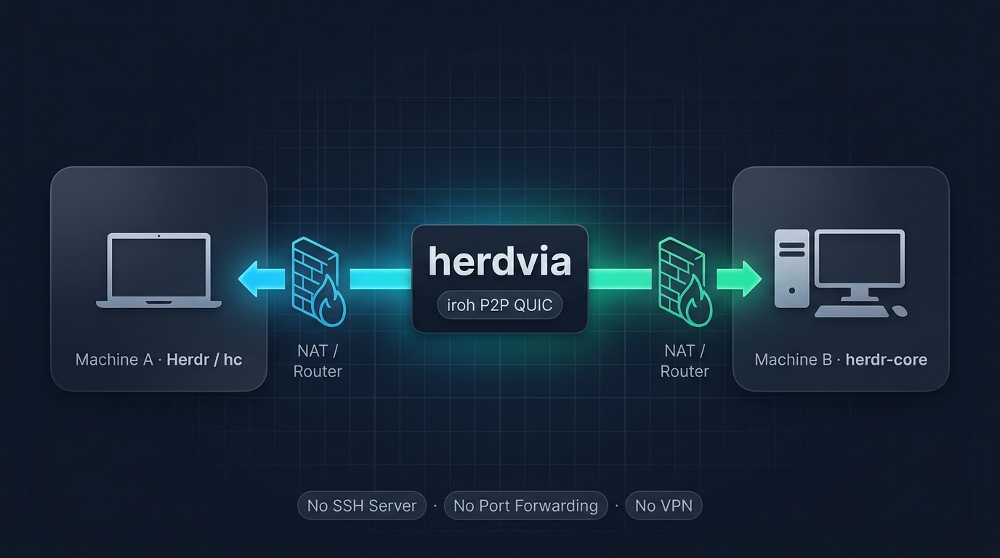
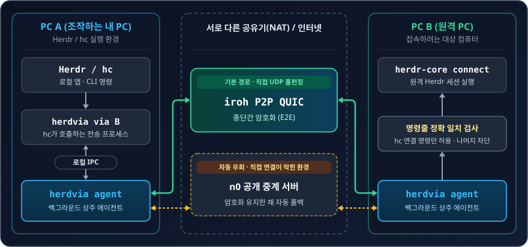
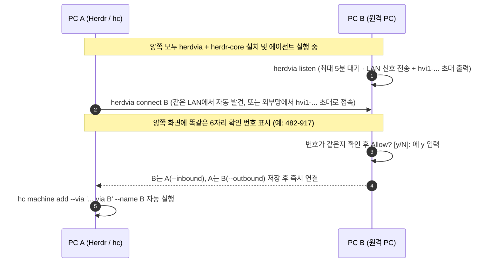

# herdvia

<p align="center">
  <a href="../README.md">English</a> · <strong>한국어</strong> · <a href="README.ja.md">日本語</a> · <a href="README.zh-CN.md">简体中文</a>
</p>

<p align="center">
  <a href="https://github.com/photojupi/herdvia/actions/workflows/ci.yml"></a>
  <a href="https://github.com/photojupi/herdvia/releases/latest"></a>
  <a href="#license"></a>
</p>

**SSH 서버, 공유기 포트 포워딩, VPN 없이 서로 다른 공유기 뒤에 있는 원격 PC를 [Herdr](https://herdr.dev)에 연결하세요.**



> [!NOTE]
> **비공식 · 실험적 프로젝트 안내:** `herdvia`는 개인 프로젝트이며 Herdr / `herdr-core` 공식 프로젝트와 무관합니다(제휴·보증·기술 지원 없음). 실험 단계이므로 명령어, 파일 형식, 통신 프로토콜이 하위 호환 없이 변경될 수 있습니다.

---

## 목차

- [herdvia란 무엇인가요?](#what-is-herdvia)
- [동작 원리](#how-it-works)
- [사전 준비 사항](#requirements)
- [5분 빠른 시작 (Quick start)](#quick-start)
  - [수동 페어링](#manual-pairing)
- [설치 가이드](#install)
  - [설치 스크립트 (권장)](#install-script)
  - [수동 설치](#manual-install)
  - [소스 코드에서 빌드](#from-source)
- [명령어 일람](#commands)
- [로그인 시 자동 시작](#automatic-startup)
- [자주 겪는 문제 해결 (Troubleshooting)](#troubleshooting)
  - [`herdvia doctor` 실행하기](#run-herdvia-doctor)
  - [자주 겪는 증상](#common-symptoms)
- [업그레이드 및 삭제](#upgrading-and-uninstalling)
- [보안 모델](#security-model)
- [네트워크 및 외부 공개 정보](#network-and-published-information)
- [지원 플랫폼](#supported-platforms)
- [설정 및 파일 위치](#configuration-and-files)
- [설계 문서 및 라이선스](#design)

---

<a id="what-is-herdvia"></a>
## herdvia란 무엇인가요?

Herdr에서 원격 PC를 등록할 때 쓰는 `hc machine add --via <명령>`은 보통 `ssh`를 전제로 합니다. 하지만 집·사무실·카페처럼 서로 다른 공유기(NAT) 뒤에 있는 PC끼리 연결하려면 SSH 서버를 띄우거나, 공유기 포트 포워딩을 설정하거나, 각 PC에 메시 VPN을 설치해야 하는 번거로움이 따릅니다.

**`herdvia`는 바로 그 `--via` 자리에 그대로 꽂아 쓰는 P2P 전송 통로입니다.** [iroh](https://www.iroh.computer)(자동 NAT 통과 및 직접 UDP 경로가 막혔을 때의 공개 중계 서버 폴백을 지원하는 종단 간 암호화 P2P QUIC)를 통해 두 PC 사이에서 `hc` 세션의 바이트만 안전하게 실어 나릅니다.

| 연결 방식 | 공유기 포트 포워딩 | 추가 서버 / 계정 가입 | 네트워크 노출 범위 | 초기 설정 난이도 |
|---|---|---|---|---|
| **SSH (`ssh user@host`)** | 외부망 연결 시 필요 | 원격 PC에 SSH 서버 필요 | SSH 포트 노출 | 중간~높음 |
| **메시 VPN** | 불필요 | 가상 네트워크 드라이버 + 계정 가입 | IP 인터페이스 전체 (별도 ACL 설정이 없으면) | 중간 |
| **`herdvia`** | **불필요** | **경량 사용자 공간 실행 파일 하나 (무계정)** | **명시적으로 허용한 키에 한해 `herdr-core connect`만 실행** | **약 5분** |

---

<a id="how-it-works"></a>
## 동작 원리

`herdvia`는 Herdr 내부 프로토콜을 해석하지 않습니다. 내가 조작하는 컴퓨터(**PC A**)의 `hc`와 원격으로 접속할 컴퓨터(**PC B**)의 `herdr-core` 사이에서 바이트만 그대로 중계합니다.



1. **상주 에이전트 (`herdvia agent`):** 양쪽 PC의 사용자 세션에서 백그라운드로 실행되며, 기기 고유 키(`EndpointId`)로 허용된 피어와 암호화된 QUIC 연결을 유지합니다.
2. **양방향 명시적 허용 (`listen` / `connect`, 또는 `allow` / `accept`):** 처음 보는 기기는 절대 자동으로 신뢰하지 않습니다. 대화형 페어링(`herdvia listen` + `herdvia connect`)은 양쪽 화면에 같은 6자리 확인 번호를 띄우고 사람의 승인을 거친 뒤, 거는 쪽(PC A)에는 `--outbound`를, 받는 쪽(PC B)에는 `--inbound`를 저장합니다.
3. **명령줄 정확 일치 검사:** 받는 쪽(PC B) 에이전트는 `hc`가 보내는 정확한 `herdr-core connect` 명령줄만 실행하며(**`hc 0.1.21`** 기준 검증 완료), 그 외 모든 명령은 거부하고 로그에 기록합니다.

---

<a id="requirements"></a>
## 사전 준비 사항

연결할 두 대의 PC에 각각 무엇이 필요한지 먼저 확인하세요.

| 구성 요소 | PC A (조작하는 쪽 — Herdr 실행) | PC B (연결할 원격 PC) | 비고 |
|---|---|---|---|
| **`herdr-core`** | 필수 | 필수 | 양쪽 PC에서 **같은 버전**을 사용하세요 (**`0.1.21`**에서 검증됨) |
| **Herdr 앱 / `hc` CLI** | 필수 | 불필요 | 원격 PC B에는 `herdr-core`만 있으면 됩니다 |
| **`herdvia` + 에이전트 실행** | 필수 | 필수 | 한 줄 스크립트, 릴리스 압축 파일, 또는 Cargo로 설치 |

### 양쪽 PC에 `herdr-core` 설치하기

`herdvia`는 `herdr-core`를 포함하거나 대신 설치·업데이트하지 않습니다. 양쪽 PC에서 Herdr 공식 설치 스크립트를 직접 실행해 설치하세요(다시 실행하면 업데이트됩니다).

- **macOS / Linux:**
  ```sh
  curl -fsSL https://releases.herdr.dev/core/install.sh | sh
  ```
  `~/.local/bin/herdr-core`를 설치합니다(`hc`가 아직 없으면 옆에 심볼릭 링크도 함께 생성). `PATH`를 자동 수정하지는 않으며, `~/.local/bin`이 `PATH`에 없으면 안내 문구를 출력합니다.

- **Windows (일반 PowerShell — 관리자 권한 불필요):**
  ```powershell
  powershell -c "irm https://releases.herdr.dev/core/install.ps1 | iex"
  ```
  `%LOCALAPPDATA%\Programs\herdr-core\herdr-core.exe`(및 아직 없으면 `hc.exe`)를 설치하고 사용자 `PATH`에 폴더를 자동 추가합니다.

`herdvia` 동작이 검증된 **`0.1.21`** 버전을 지정해 설치하려면 `HC_VERSION`을 함께 넘기세요:

```sh
# macOS / Linux
curl -fsSL https://releases.herdr.dev/core/install.sh | HC_VERSION=0.1.21 sh
```

```powershell
# Windows (PowerShell)
$env:HC_VERSION = "0.1.21"; powershell -c "irm https://releases.herdr.dev/core/install.ps1 | iex"
```

*(macOS에서는 이미 더 높은 버전의 `herdr-core`가 설치돼 있으면 스크립트가 다운그레이드를 멈추고 `hc update --from ... --force`를 쓰라고 안내합니다.)*

> [!IMPORTANT]
> **꼭 알아 두어야 할 `herdr-core` 주의사항 두 가지:**
> 1. **원격 설치·업데이트 명령 제한 (`hc 0.1.21` 기준):** `herdvia`는 `hc`가 보내는 `herdr-core connect` 줄과 글자 하나까지 똑같은 명령만 허용합니다. 따라서 `hc machine add --install`이나 `hc machine update`로는 원격 PC의 `herdr-core`를 설치·업데이트할 수 없으며, 향후 `hc`가 연결 명령 형식을 바꾸면 `herdvia`도 업데이트되기 전까지 이를 거부합니다.
> 2. **원격 PC(B)에서 `herdr-core`를 찾는 위치:**
>    - **macOS / Unix:** `~/.local/bin/herdr-core` 또는 에이전트의 `PATH`. 특히 macOS에서 `herdvia agent install`로 자동 시작된 에이전트의 `PATH`는 `~/.local/bin:/usr/bin:/bin:/usr/sbin:/sbin`뿐이므로, Homebrew 등 다른 경로에 설치했다면 `~/.local/bin/herdr-core`로 심볼릭 링크를 걸어 주세요.
>    - **Windows:** `%USERPROFILE%\AppData\Local\Programs\herdr-core\herdr-core.exe`.

---

<a id="quick-start"></a>
## 5분 빠른 시작 (Quick start)

두 대의 PC를 연결해 보겠습니다:
- **PC A** — 내가 Herdr / `hc`를 실행하는 컴퓨터 (예: 노트북)
- **PC B** — 원격으로 붙이고 싶은 컴퓨터 (예: 집 데스크톱)

먼저 **A와 B 양쪽 모두**에 `herdvia`를 설치합니다(Intel Mac, Linux, 수동 설치는 [설치 가이드](#install) 참고):

```sh
# macOS (Apple Silicon)
curl -fsSL https://github.com/photojupi/herdvia/releases/latest/download/install.sh | sh
```

```powershell
# Windows (x64) — 관리자 권한이 아닌 '일반' PowerShell 창에서 실행하세요
powershell -c "irm https://github.com/photojupi/herdvia/releases/latest/download/install.ps1 | iex"
```

설치 직후 `PATH`가 적용되도록 **새 터미널 창**(Windows에서는 새 PowerShell 창을 열고, 실행 중이던 Herdr 앱이 있다면 재시작)을 열어 주세요. 설치 스크립트 대신 수동 설치를 했다면 먼저 양쪽 PC에서 `herdvia agent install`(macOS/Windows) 또는 `herdvia agent`로 에이전트를 띄워 주세요([로그인 시 자동 시작](#automatic-startup) 참고).

전체 페어링 흐름은 다음과 같습니다:



### 1단계. 연결할 대상 PC(B)에서 페어링 대기하기

```sh
herdvia listen
```

- `listen`은 5분 동안 유지되는 일회용 페어링 창을 열고, 같은 공유기(LAN/Wi-Fi)에 탐색 신호를 보내는 동시에 다른 네트워크에서 쓸 수 있는 일회용 `hvi1-...` 초대 문자열도 함께 출력합니다.
- 기본적으로 PC B는 PC A의 정화된 호스트명을 피어 이름으로 등록합니다(다른 키가 이미 쓰는 이름이면 `-28af`처럼 A의 `EndpointId` 앞부분 16진수 접두사 추가). A에 붙일 이름을 직접 지정하려면 `herdvia listen <이름>`을 실행하세요.

### 2단계. Herdr를 쓰는 PC(A)에서 연결하기

- **같은 장소(같은 공유기 Wi-Fi / LAN):**
  ```sh
  herdvia connect B
  ```
  약 2초 동안 로컬 네트워크를 자동 탐색해 연결합니다(`herdvia listen` 중인 PC가 여러 대면 번호 선택을 묻고, 게스트 Wi-Fi 격리 등으로 탐색 신호가 막혀 있으면 B 화면의 `hvi1-...` 초대를 붙여 넣으라고 안내합니다).

- **서로 다른 장소(예: 집 ↔ 사무실·카페):**
  ```sh
  herdvia connect B <B 화면에 출력된 hvi1-... 초대 문자열>
  ```

`B`(`home-pc`, `office` 등)는 `herdvia`와 Herdr 양쪽에서 사용할 머신 이름입니다(`A-Z a-z 0-9 . _ -` 조합 1~32자).

### 3단계. 6자리 확인 번호 대조 후 PC B에서 승인하기

양쪽 터미널에 6자리 확인 번호(예: `482-917`)가 표시됩니다:

1. **양쪽 화면의 6자리 번호가 정확히 일치하는지** 눈으로 확인합니다.
2. **PC B**의 `Allow? [y/N]:` 프롬프트에 `y`를 입력합니다.

승인하는 즉시:
- **PC B**는 PC A를 `--inbound`로, **PC A**는 PC B를 `--outbound`로 각각 저장합니다.
- 재시도 대기 없이 곧바로 암호화 터널이 맺어집니다.
- **PC A**에서 `hc machine add`까지 자동 실행되어 Herdr 사이드바에 `B`가 바로 등록됩니다. *(`PATH`에 `hc`가 없거나 실행에 실패하더라도 페어링 자체는 유지되며, 직접 복사해 실행할 수 있는 `hc machine add --via ... --name B` 명령이 안내됩니다.)*

### 4단계. 연결 상태 확인하기

언제든 **A**에서 연결 상태를 확인할 수 있습니다:

```sh
herdvia status
```

```text
name permission connection path rtt
B out connected direct 4.12ms
```

- **`path`:** 같은 LAN에서는 바로 `direct`(직접 P2P)로 연결되고, 외부망에서는 `relay`(중계)로 시작한 뒤 보통 몇 초 안에 `direct`로 전환됩니다.
- **macOS 로컬 네트워크 권한 안내:** 같은 공유기(LAN/Wi-Fi) 안인데도 자동 탐색이 안 되거나 계속 `relay`에 머문다면 **시스템 설정 > 개인정보 보호 및 보안 > 로컬 네트워크**에서 `herdvia`(및 사용 중인 터미널 앱)를 허용해 주세요([macOS 자동 시작](#macos) 참고).
- **연결이 잘 안 될 때:** 양쪽 PC에서 `herdvia doctor`를 실행해 보세요. 각 `warn` 또는 `fail` 줄에 해야 할 일이 바로 안내됩니다([`herdvia doctor` 실행하기](#run-herdvia-doctor) 참고).

<a id="manual-pairing"></a>
### 수동 페어링

대화형 터미널 없이 스크립트로 설정하거나 `listen` / `connect` 대신 직접 키를 교환하고 싶다면 `id`, `allow`, `pending`, `accept` 명령으로 수동 페어링할 수 있습니다:

1. **ID와 지문 확인 (`herdvia id`):** 첫째 줄에 64자 `EndpointId`, 둘째 줄에 16자 지문(예: `28af-63b6-258e-859d`)을 출력합니다(첫 실행 시 `secret.key` 자동 생성).
2. **PC A에서 PC B 허용 (`--outbound`):**
   ```sh
   herdvia allow B <B의 EndpointId> --outbound
   ```
   앞 16글자가 B 화면의 지문과 일치하는지 직접 또는 별도 채널로 대조하세요. 방향 옵션은 `--outbound`(이 PC가 상대에게 발신), `--inbound`(상대가 이 PC에 접속), `--both`(양방향)이며 `EndpointId` 하나에는 이름 하나만 붙일 수 있습니다.
3. **PC B에서 PC A 수락 (`--inbound`):** A의 에이전트가 B로 걸면 B는 미등록 키를 거부하고 메모리에 잠시 기록합니다(`herdvia pending`). **반드시 A 화면에서 직접 읽은 지문**(`pending` 목록에서 그대로 베끼지 마세요)으로 **B**에서 수락합니다:
   ```sh
   herdvia accept A <A의 지문> --inbound
   ```
   *(또는 B에서 `herdvia allow A <A의 EndpointId> --inbound`를 실행해도 됩니다. 수동 페어링에서는 A의 다음 재시도 주기까지 최대 약 30초가 걸릴 수 있습니다.)*
4. **PC A의 Herdr에 등록:**
   ```sh
   hc machine add --via 'herdvia via B' --name B
   ```
   `hc`가 `PATH`에서 `herdvia`를 찾지 못하면 전체 경로를 적고 따옴표로 감싸세요(macOS는 `sh` 규칙, Windows는 `CommandLineToArgvW` 큰따옴표 — Windows에서는 사용자 `PATH`에 `herdvia`를 두고 Herdr를 재시작하는 편이 가장 간단합니다).

---

<a id="install"></a>
## 설치 가이드

<a id="install-script"></a>
### 설치 스크립트 (권장)

**macOS (Apple Silicon):**

```sh
curl -fsSL https://github.com/photojupi/herdvia/releases/latest/download/install.sh | sh
```

**Windows (x64)** — 관리자 창이 아닌 **일반 PowerShell 창**에서 실행:

```powershell
powershell -c "irm https://github.com/photojupi/herdvia/releases/latest/download/install.ps1 | iex"
```

설치 스크립트가 수행하는 6단계:

1. **다운로드 및 무결성 검증:** 임시 폴더에 릴리스 압축 파일과 `SHA256SUMS`를 내려받아 SHA-256 해시를 검증합니다. 실패 시 시스템을 전혀 변경하지 않고 중단합니다.
2. **실행 파일 배치:** macOS는 `~/.local/bin/herdvia`에, Windows는 `%LOCALAPPDATA%\Programs\herdvia\herdvia.exe`에(README·라이선스 파일과 함께) 설치합니다.
3. **`PATH` 등록:** macOS는 기본 로그인 셸이 `zsh`일 때 `~/.zprofile`에 `export PATH="$HOME/.local/bin:$PATH"`를 추가합니다(다른 셸이면 직접 추가할 줄만 안내). Windows는 사용자 `PATH`에 폴더를 등록합니다.
4. **`herdr-core` 확인:** **`herdr-core`를 직접 설치하지는 않습니다.** 미설치 시 공식 설치 명령을 출력하며, macOS에서 `~/.local/bin/herdr-core`가 아닌 다른 경로에만 있으면 자동 시작 에이전트가 찾을 수 있도록 `ln -s` 명령을 안내합니다.
5. **기기 ID 생성 및 출력:** `herdvia id`를 실행해 `secret.key`(최초 1회)를 만들고 `EndpointId`와 지문을 보여 줍니다.
6. **백그라운드 에이전트 자동 시작 등록:** `herdvia agent install`을 실행해 지금 바로 에이전트를 띄우고 로그인 시마다 자동 실행되도록 등록합니다(Windows 관리자 PowerShell에서 실행한 경우 이 단계만 건너뛰고 일반 창에서 실행하라고 안내합니다).

**스크립트 실행 요건:**
- **macOS:** Apple Silicon 전용(`root` 실행 거부, Intel Mac이나 Linux에서는 아무것도 바꾸지 않고 [소스 코드에서 빌드](#from-source)를 안내).
- **Windows:** x64 전용, `System32\curl.exe` 필요(Windows 10 1803 이상 기본 포함).

**환경 변수 옵션 (스위치형 변수는 값이 `1`일 때만 켜짐):**

| 환경 변수 | 동작 |
|---|---|
| `HERDVIA_VERSION` | 최신 버전 대신 지정한 릴리스 설치 (예: `0.1.0` 또는 `v0.1.0`) |
| `HERDVIA_NO_AGENT=1` | `herdvia agent install` 실행 생략 |
| `HERDVIA_NO_MODIFY_PATH=1` | `~/.zprofile` 또는 Windows 사용자 `PATH` 수정 생략 |
| `HERDVIA_RELEASE_BASE` | GitHub Releases 대신 `<url>/<파일명>`에서 다운로드 (`HERDVIA_VERSION`보다 우선) |

특정 버전을 지정해 설치하려면(참고: 버전 태그 URL에서 `install.sh` / `install.ps1`을 내려받더라도 `HERDVIA_VERSION`을 명시적으로 설정해야 합니다):

```sh
curl -fsSL https://github.com/photojupi/herdvia/releases/download/v0.1.0/install.sh | HERDVIA_VERSION=0.1.0 sh
```

```powershell
$env:HERDVIA_VERSION = "0.1.0"; powershell -c "irm https://github.com/photojupi/herdvia/releases/download/v0.1.0/install.ps1 | iex"
```

실행 전 스크립트 내용을 먼저 눈으로 확인하고 싶다면(`SHA256SUMS`에 스크립트 해시도 포함됨):

```sh
# macOS
curl -fsSLO https://github.com/photojupi/herdvia/releases/latest/download/install.sh
less install.sh
sh install.sh
```

```powershell
# Windows (PowerShell)
curl.exe -fLO https://github.com/photojupi/herdvia/releases/latest/download/install.ps1
notepad install.ps1
Get-Content -Raw .\install.ps1 | Invoke-Expression
```

*(설치 스크립트를 다시 실행하면 안전하게 업그레이드됩니다. [업그레이드](#upgrading) 절을 참고하세요.)*

<a id="manual-install"></a>
### 수동 설치

[GitHub Releases](https://github.com/photojupi/herdvia/releases)에서 파일을 내려받습니다:

- `herdvia-macos-arm64.zip` (macOS Apple Silicon)
- `herdvia-windows-x64.zip` (Windows x64)
- `install.sh`, `install.ps1`
- `SHA256SUMS` (압축 파일 및 스크립트의 SHA-256 해시 목록)

각 압축 파일 안에는 상위 폴더 없이 실행 파일, `README.md`, `LICENSE-MIT`, `LICENSE-APACHE`, `THIRD-PARTY-LICENSES.html`이 들어 있습니다. 자동 시작 등록 시 그 실행 파일의 경로가 그대로 기록되므로 다운로드 폴더나 임시 폴더에 두지 말고 고정된 경로(macOS `~/.local/bin/herdvia`, Windows `%LOCALAPPDATA%\Programs\herdvia\herdvia.exe`)로 옮기세요.

실행 파일에는 코드 서명이나 공증(notarization)이 되어 있지 않습니다. Intel Mac용 미리 빌드된 바이너리는 없으므로 [소스 코드에서 빌드](#from-source)를 이용하세요.

`v0.1.2` 이후 나온 릴리스 파일에는 GitHub 빌드 출처 증명(build provenance attestation)이 포함됩니다(`v0.1.2`까지는 미포함). [GitHub CLI](https://cli.github.com)로 `gh attestation verify <파일> --repo photojupi/herdvia --signer-workflow photojupi/herdvia/.github/workflows/release.yml`을 실행해 확인하세요(예: `<파일>` 자리에 `herdvia-macos-arm64.zip` 지정). 이 명령은 해당 파일의 내용과 정확히 일치하는 서명된 출처 증명이 존재하는지, 그리고 그 증명을 이 저장소의 릴리스 워크플로 `.github/workflows/release.yml`이 생성했는지 검증합니다(`--repo`만 지정하면 이 저장소의 다른 워크플로가 만든 증명도 통과합니다).

출처 증명은 파일을 어디서 빌드했는지 보여 줄 뿐 파일이 안전하다는 보증은 아닙니다. 메인테이너 계정을 탈취한 사람이 푸시한 태그로 빌드된 릴리스도 검증을 통과합니다. 마찬가지로 `SHA256SUMS`는 같은 릴리스에서 내려받으므로 전송 중 파일 손상은 잡아내지만 릴리스 자체가 통째로 교체된 것은 잡아내지 못합니다.

<a id="macos-apple-silicon"></a>
#### macOS (Apple Silicon)

```sh
mkdir -p ~/.local/bin
cd "$(mktemp -d)"
curl -fLO https://github.com/photojupi/herdvia/releases/latest/download/herdvia-macos-arm64.zip &&
curl -fLO https://github.com/photojupi/herdvia/releases/latest/download/SHA256SUMS &&
shasum -a 256 -c --ignore-missing SHA256SUMS &&
unzip -q herdvia-macos-arm64.zip -d herdvia &&
mv herdvia/herdvia ~/.local/bin/herdvia
echo 'export PATH="$HOME/.local/bin:$PATH"' >> ~/.zprofile
```

- `~/.local/bin`이 이미 `PATH`에 있다면 마지막 `echo ... >> ~/.zprofile` 줄은 생략하세요.
- 다운로드 폴더에 파일을 둔 채 심볼릭 링크만 걸지 말고 실행 파일 자체를 `~/.local/bin`으로 옮기세요(`launchd`가 심볼릭 링크 경로를 기록하므로 원본이 삭제되면 실행이 깨집니다).
- 새 터미널을 열고 `herdvia id`가 실행되는지 확인합니다.
- 웹 브라우저로 압축 파일을 내려받았다면 Gatekeeper 격리 속성이 붙어 실행이 막힐 수 있습니다. 아래 명령으로 해제하세요:
  ```sh
  xattr -d com.apple.quarantine ~/.local/bin/herdvia
  ```

<a id="windows-x64"></a>
#### Windows (x64)

관리자 권한이 아닌 **일반 PowerShell 창**에서 한 줄씩 결과를 확인하며 실행하세요(오류가 뜨면 거기서 중단):

```powershell
# 1. 임시 다운로드 폴더 생성 및 이동
$tmp = Join-Path $env:TEMP "herdvia-$(Get-Random)"
New-Item -ItemType Directory $tmp
Set-Location $tmp

# 2. 압축 파일과 SHA256SUMS 다운로드
curl.exe -fLO https://github.com/photojupi/herdvia/releases/latest/download/herdvia-windows-x64.zip
curl.exe -fLO https://github.com/photojupi/herdvia/releases/latest/download/SHA256SUMS

# 3. SHA256SUMS와 대조할 SHA-256 해시 계산
$hash = (Get-FileHash herdvia-windows-x64.zip -Algorithm SHA256).Hash

# 4. SHA256SUMS에 그 해시가 있을 때만 %LOCALAPPDATA%\Programs\herdvia 에 압축 해제, 없으면 중단
if (@(Get-Content SHA256SUMS) -contains "$hash  herdvia-windows-x64.zip") {
  New-Item -ItemType Directory -Force "$env:LOCALAPPDATA\Programs\herdvia"
  tar.exe -xf herdvia-windows-x64.zip -C "$env:LOCALAPPDATA\Programs\herdvia"
} else {
  throw "herdvia-windows-x64.zip does not match SHA256SUMS; do not install it"
}
```

`herdvia`를 이름만으로 실행하려면 **사용자 `Path`** (*시작 메뉴 → "계정에 대한 환경 변수 편집" → 사용자 변수 → `Path` → 편집 → 새로 만들기*)에 `%LOCALAPPDATA%\Programs\herdvia`를 추가한 뒤, 새 PowerShell 창을 열고(Herdr가 실행 중이면 재시작) `herdvia id`로 확인하세요. 첫 실행 시 Windows SmartScreen 안내 창이 뜰 수 있습니다.

<a id="from-source"></a>
### 소스 코드에서 빌드

`iroh` 의존성 요구 사항으로 **Rust 1.91 이상**이 필요합니다.

- **macOS:** Xcode Command Line Tools (`xcode-select --install`) 및 [rustup](https://rustup.rs)으로 설치한 Rust
- **Windows:** [rustup](https://rustup.rs) 및 Visual Studio Build Tools("C++를 사용한 데스크톱 개발"). *(참고: 공식 릴리스용 Windows 실행 파일은 Linux에서 MinGW `x86_64-pc-windows-gnu`로 교차 빌드하며, CI는 MSVC로 단위 테스트만 실행합니다.)*

```sh
cargo install --locked --git https://github.com/photojupi/herdvia
```

기본적으로 `main` 브랜치를 빌드해 `~/.cargo/bin`(Windows는 `%USERPROFILE%\.cargo\bin`)에 설치합니다. 특정 릴리스 태그를 빌드하려면 `--tag v<버전>`을 추가하세요.

---

<a id="commands"></a>
## 명령어 일람

| 명령어 | 설명 |
|---|---|
| `herdvia listen [<이름>]` | 연결될 대상 PC에서 최대 5분 동안 대화형 페어링 요청을 기다리며, 로컬 네트워크에 탐색 신호를 보내고 외부망용 일회용 `hvi1-...` 초대를 출력한 뒤, 6자리 확인 번호를 보여 주고 `[y/N]` 승인 시 `--inbound`로 등록합니다(`<이름>` 생략 시 상대의 정화된 호스트명 사용). 거부하거나 시간 초과되면 종료 코드 `1`로 끝납니다. 에이전트 실행 필요. |
| `herdvia connect <이름> [<초대>]` | Herdr를 실행하는 PC에서 LAN 자동 탐색 또는 `<초대>`(`hvi1-...`)로 대기 중인 대상 PC와 페어링하여, 6자리 확인 번호를 표시하고 상대가 승인하면 `--outbound` 등록 후 `hc machine add --via ... --name <이름>`을 자동 실행합니다. 거부·시간 초과·`hc` 등록 실패 시(수동 명령 출력) 종료 코드 `1`로 끝납니다. 에이전트 실행 필요. |
| `herdvia id` | 이 PC의 `EndpointId`(첫째 줄)와 16자 지문(둘째 줄)을 출력합니다. `secret.key`가 없으면 새로 생성합니다. |
| `herdvia allow <이름> <EndpointId> (--inbound \| --outbound \| --both)` | 피어를 추가하거나 기존 항목을 갱신하고, 저장한 항목(`<이름> <EndpointId> <in\|out\|both>`)을 출력합니다. 이미 다른 이름으로 등록된 `EndpointId`는 거부합니다. 실행 중인 에이전트에는 즉시 반영됩니다(또는 다음 에이전트 시작 시 반영). |
| `herdvia revoke <이름>` | 피어를 삭제하고 `revoked <이름> <EndpointId>`를 출력하며, 해당 피어와의 연결을 즉시 닫고 그 연결이 실행한 `herdr-core connect` 프로세스를 종료합니다(이것으로 되돌려지지 않는 항목은 [보안 모델](#security-model) 참고). 해당 이름의 피어가 없으면 실패합니다. 같은 `EndpointId`가 다른 이름으로 아직 남아 있으면(이전 버전이 작성한 `peers` 파일) 경고를 출력합니다. |
| `herdvia status` | 각 피어의 이름, 권한, 연결 상태, 경로(`direct`/`relay`), 왕복 시간(RTT)을 표시합니다. 에이전트 실행 필요. |
| `herdvia pending` | 인바운드 접속 시도가 거부된 기기 목록을 보여 줍니다(지문, `EndpointId`, 시도 횟수, 마지막 확인 후 경과 시간). 메모리에만 최대 16개까지 보관하며 마지막 시도로부터 10분 뒤 만료됩니다. 에이전트 실행 필요. |
| `herdvia accept <이름> <지문> (--inbound \| --both)` | `pending` 목록에서 해당 지문과 일치하는 유일한 기기를 전체 `EndpointId`로 등록합니다. 일치 항목이 없거나 둘 이상이거나, 목록이 가득 찼거나(16개 — 누군가 접속 시도를 대량으로 보내고 있을 수 있으므로 전체 `EndpointId`로 `allow`를 사용하세요), `<이름>`이 이미 다른 ID를 가리키고 있거나, 해당 `EndpointId`가 이미 다른 이름으로 등록돼 있으면 거부합니다. 에이전트 실행 필요. |
| `herdvia doctor` | 아무것도 변경하지 않고 이 PC의 설정 상태(실행 파일, 데이터 폴더, `secret.key`, `peers`, `herdr-core`, 자동 시작, 에이전트, 중계 서버, 피어 연결, 대기 목록의 접속 시도)를 점검합니다. `ok`/`warn`/`fail` 줄을 출력하며(피어 연결은 피어마다 한 줄, 앞 단계가 실패하면 의존하는 뒤 점검 생략), 실패한 항목이 하나라도 있으면 종료 코드 `1`로 끝납니다. [`herdvia doctor` 실행하기](#run-herdvia-doctor) 참고. |
| `herdvia --version` | `herdvia <버전>`을 출력합니다. |
| `herdvia agent` | 에이전트를 포그라운드에서 실행합니다 (`Ctrl-C`로 종료). |
| `herdvia agent install` | 로그인 시 자동 시작을 등록하고 즉시 에이전트를 시작합니다 (macOS, Windows). |
| `herdvia agent uninstall` | 자동 시작 에이전트를 멈추고 등록을 해제합니다. 데이터 폴더와 로그는 유지됩니다. |
| `herdvia via <피어> <줄>` | `hc`가 내부적으로 호출하는 전송 명령어입니다 (수동 실행용 아님). 로컬 에이전트 실행 필요. |

오류 발생 시 `herdvia`는 표준 오류(`stderr`)에 `herdvia:`로 시작하는 한 줄을 출력하고 종료 코드 **`255`**로 끝납니다.

---

<a id="automatic-startup"></a>
## 로그인 시 자동 시작

<a id="macos"></a>
### macOS

`herdvia agent install`은 사용자별 LaunchAgent(`~/Library/LaunchAgents/io.github.photojupi.herdvia.agent.plist`)를 만들고 `launchctl bootstrap`으로 시작합니다. 로그인 시 자동 실행되며 종료되면 `launchd`가 자동으로 다시 띄웁니다. 로그는 `~/Library/Logs/herdvia.log`에 기록되며, 에이전트가 180일이 지난 줄을 삭제하고 파일 크기가 10 MiB를 넘으면 정리합니다([설정 및 파일 위치](#configuration-and-files) 참고).

- `HERDVIA_DIR`이 설정된 상태이거나(자동 시작은 항상 기본 데이터 폴더를 사용함) 수동으로 띄운 포그라운드 에이전트가 이미 돌아가고 있으면 설치를 거부합니다.
- `herdvia agent install`을 다시 실행하면 현재 실행 파일 경로로 등록을 갱신하고 에이전트를 재시작합니다.
- 임시 폴더나 Cargo `target` 폴더에서 실행하면 경고를 출력하되 등록은 진행합니다.

> [!IMPORTANT]
> **macOS 15 이상 로컬 네트워크 권한:** macOS 15(Sequoia)부터는 백그라운드 에이전트가 같은 공유기(로컬 네트워크)의 기기와 직접 통신하려면 권한 허용이 필요합니다. 알림 창이 뜨면 **허용**을 누르거나 **시스템 설정 > 개인정보 보호 및 보안 > 로컬 네트워크**에서 `herdvia`를 켜 주세요. 허용하기 전까지는 같은 공유기 안의 피어와도 `direct` 대신 `relay`(중계 서버)로 연결됩니다(외부 네트워크 피어나 터미널에서 직접 띄운 `herdvia agent`에는 영향 없음).

### Windows

`herdvia agent install`은 현재 사용자의 레지스트리 `Run` 키(`HKCU\Software\Microsoft\Windows\CurrentVersion\Run`)에 `conhost.exe --headless "<herdvia.exe 경로>" agent --log`를 등록하고, 콘솔 창 없이 즉시 백그라운드로 띄웁니다. 관리자 권한이나 Windows 서비스·작업 스케줄러를 사용하지 않습니다.

- **반드시 일반 PowerShell 창에서 실행하세요.** 관리자 권한 PowerShell에서는 실행을 거부하며, 에이전트 자체도 "관리자 권한으로 실행"한 창에서는 시작을 거부합니다([보안 모델](#security-model) 참고).
- `HERDVIA_DIR`이 설정돼 있거나, 아직 자동 시작 등록이 없는 상태에서 수동 실행 중인 에이전트가 있으면 거부합니다(이미 자동 시작이 등록돼 있다면 기존 기본 폴더 에이전트를 멈추고 새 에이전트로 교체합니다).
- 실행 파일 경로에 `%`가 포함되면 안 되며, 등록 명령줄 전체 길이는 259 UTF-16 코드 단위 이내여야 합니다.
- 로그는 `%LOCALAPPDATA%\herdvia\herdvia.log`에 이어서 기록됩니다(180일이 지난 줄은 삭제되고, 파일 크기가 10 MiB를 넘으면 정리됩니다). 에이전트가 예기치 않게 종료되면 Windows가 자동으로 재시작하지 않으며 다음 로그온 때 다시 시작됩니다.

### Linux

자동 시작(`agent install` / `agent uninstall`)을 지원하지 않습니다. `herdvia agent`를 직접 실행하세요(예: `systemd --user` 아래나 세션 관리자 안에서).

---

<a id="troubleshooting"></a>
## 자주 겪는 문제 해결 (Troubleshooting)

<a id="run-herdvia-doctor"></a>
### `herdvia doctor` 실행하기

`herdvia doctor`는 다음 항목을 순서대로 점검합니다:

1. **이 실행 파일:** 버전과 경로 (`agent install`이 이 경로를 그대로 기록하므로 임시 폴더나 Cargo `target` 폴더에서 실행 중이면 경고).
2. **데이터 폴더:** 경로(`HERDVIA_DIR`로 지정되었는지 여부 포함 — `HERDVIA_DIR`은 절대 경로여야 함), 존재 여부, 실제 디렉터리인지 여부(심볼릭 링크 거부, Windows에서는 정션도 거부), 그리고 현재 사용자가 열 수 있는지 여부(macOS/Unix에서는 소유자도 확인하며, 열 수 없으면 `fail`을 출력하고 macOS/Unix에서는 `chmod 700`을 안내).
   - **macOS / Unix:** macOS에서 폴더에 접근을 허용하는 ACL(접근 제어 목록) 항목이 있으면 `fail`을 출력하며 `chmod -N`을 안내하고, macOS/Unix에서 에이전트 소켓 경로가 Unix 소켓 길이 한도 안에 들어오는지도 함께 확인합니다.
   - **Windows:** 다른 종류의 재분석 지점(reparse point)이거나, 소유자가 현재 사용자·Administrators·SYSTEM이 아니거나, 다른 계정에 접근 권한이 허용되어 있는데 현재 사용자가 권한을 바꿀 수 없으면 `fail`을 출력합니다(마지막 경우 관리자 터미널에서 실행할 `icacls … /grant` 명령을 안내). 이 세 계정 외의 계정에 접근 권한이 허용되어 있더라도 현재 사용자가 권한을 바꿀 수 있으면, herdvia가 다음 실행 때 권한을 제한하므로 `warn`을 출력합니다.
3. **`secret.key`:** 존재 여부 및 에이전트와 동일한 검사를 통과하는지 여부 — macOS/Unix: 현재 사용자 소유이고 권한이 `0600` 이하이며, macOS에서는 접근을 허용하는 ACL 항목이 없을 것. Windows: 링크가 아닌 일반 파일이고 소유자가 현재 사용자·Administrators·SYSTEM 중 하나이며 다른 계정에 접근 권한이 허용되어 있지 않을 것. Windows에서 다른 계정에 접근 권한이 허용된 파일은 현재 사용자가 권한을 바꿀 수 있으면 `warn`(herdvia가 다음 실행 때 제한), 바꿀 수 없으면 `icacls … /grant` 명령을 안내하는 `fail`이 됩니다. 출력에는 지문만 표시됩니다.
4. **`peers`:** 파일을 읽고(`secret.key`와 동일한 검사) 해석할 수 있는지 여부, 그리고 방향별 등록된 피어 수. Windows에서 herdvia가 다음 실행 때 제한할 파일은 피어 수 없이 `warn` 줄로 표시되지만 파일 내용은 그대로 검사하며, 형식 오류가 있으면 파일 권한을 제한해도 고쳐지지 않으므로 일반 `fail` 줄을 출력합니다.
5. **`herdr-core`:** 에이전트가 실제로 찾는 위치(macOS에서는 자동 시작 에이전트의 `PATH`)에 있는지, `herdr-core --version`이 검증된 버전인 `0.1.21`을 출력하는지 여부.
6. **자동 시작:** 등록되어 있는지(macOS의 LaunchAgent plist, Windows의 레지스트리 `Run` 값), 그리고 이 실행 파일을 가리키는지 여부. Windows에서 관리자 권한으로 실행 중이면 이에 대해서도 경고합니다.
7. **에이전트:** 이 데이터 폴더의 에이전트가 응답하는지, 실행 중인 버전과 실행 파일 경로, 홈 중계 서버(relay) 연결 여부.
8. **피어 연결:** `herdvia status`를 바탕으로 등록된 피어마다 연결 상태와 경로를 한 줄씩 표시 (등록된 피어가 없으면 `warn` 한 줄).
9. **대기 목록(`pending`):** `herdvia pending`이 보여 줄 거부된 접속 시도 건수.

출력 줄은 표준 출력(`stdout`)에 `ok`, `warn`, `fail` 중 하나로 시작하며, `warn`과 `fail` 줄에는 해야 할 일이 같은 줄에 함께 안내됩니다. 피어 연결은 피어마다 한 줄씩 출력되고, 앞 단계가 실패하면 그에 의존하는 뒤 점검은 생략됩니다. 즉 데이터 폴더 점검이 `fail`이면 에이전트 점검과 그 이후 줄들이 생략되고(Unix 소켓 경로 길이 초과만 원인인 경우가 아니면 `secret.key`와 `peers`도 생략), 에이전트가 응답하지 않으면 `relay`, 피어, `pending` 줄이 생략됩니다. 실패(`fail`)한 점검이 하나도 없으면 종료 코드 `0`(경고만 있어도 `0`), 하나라도 있으면 `1`로 끝납니다. 명령어 인자 오류 등은 다른 명령과 마찬가지로 `herdvia:` 한 줄을 출력하고 `255`로 끝납니다.

- **읽기 전용 동작:** `doctor`는 데이터 폴더, `secret.key`, `peers`, 자동 시작 등록, 에이전트 상태를 새로 만들거나 변경하지 않습니다. 따라서 Windows에서 다른 계정에 접근 권한이 허용된 데이터 폴더, `secret.key`, `peers`는 데이터 폴더를 준비하는 명령이 권한을 제한하기 전까지 계속 `warn`(`… herdvia restricts it the next time it runs (herdvia id, or the agent when it starts)`)으로 표시됩니다 — 해당 명령은 `herdvia id`, `listen`(승인 시), `connect`(승인 시), `allow`, `accept`, `revoke`, 그리고 에이전트 시작이며, `status`, `pending`, `doctor`는 아무것도 바꾸지 않습니다. Windows용 `v0.1.2`는 데이터 폴더와 내부 파일의 권한을 바꾸지 않고 사용자 프로필에서 상속된 기본 권한(다른 계정의 읽기를 허용할 수 있음)을 그대로 유지했으므로, `v0.1.2`에서 업그레이드한 PC는 새 버전으로 위 명령 중 하나를 실행하기 전까지 세 항목 모두 경고가 표시될 수 있습니다(설치 스크립트는 `herdvia id`를 실행합니다). 한 번 실행되고 나면 폴더와 두 파일 모두 현재 사용자, SYSTEM, Administrators에게만 접근을 허용하며 세 줄 모두 `ok`가 됩니다.
- **시간 제한:** 외부 프로그램으로는 `herdr-core --version`(2초 제한) 하나만 실행합니다. 에이전트에 보내는 각 요청에는 3초 제한이 있어서, 에이전트가 실행 중이더라도 3초 안에 응답하지 않으면 `fail agent: it may be running, but it did not answer within 3 seconds; …`를 출력하고 나머지 에이전트 점검을 건너뜁니다. 뒤이어 보내는 피어 상태나 `pending` 요청이 3초를 넘기면 해당 줄은 `warn`이 됩니다(`status`가 시간 초과되면 `pending`은 생략).
- **이전 버전 에이전트:** `herdvia doctor`는 `v0.1.2`에서 추가되었습니다. 그보다 이전 버전의 에이전트는 `doctor` 요청을 알지 못하므로, `doctor`는 실행 중인 에이전트가 현재 실행 파일보다 오래되어 재시작해야 한다고 경고하며(`relay`는 생략하되 피어와 `pending`은 계속 점검), 해당 에이전트 로그에는 `unknown CONTROL request` 한 줄이 기록됩니다.

**양쪽 PC 모두에서** 실행해 보세요. B에 `herdr-core`가 없거나 아직 피어를 수락하지 않은 문제 등은 B의 출력에 나타납니다. PC A에서의 실행 예시:

```text
$ herdvia doctor
ok   executable: herdvia 0.1.2 at /Users/you/.local/bin/herdvia
ok   data directory: /Users/you/Library/Application Support/herdvia
ok   secret.key: present, fingerprint 28af-63b6-258e-859d
ok   peers: 2 registered (in 0, out 1, both 1)
ok   herdr-core: /Users/you/.local/bin/herdr-core (hc 0.1.21)
ok   automatic start: registered for this executable
ok   agent: running herdvia 0.1.2 from /Users/you/.local/bin/herdvia
ok   relay: connected to https://aps1-1.relay.n0.iroh.link./
ok   peer B (out): connected directly, 4.12ms
warn peer office (both): not connected; its agent is off, or it has not allowed this PC (on that PC: herdvia pending, then herdvia accept)
ok   pending: no rejected connection attempts
```

<a id="common-symptoms"></a>
### 자주 겪는 증상

| 증상 | 주요 원인 | 해결 방법 |
|---|---|---|
| 같은 Wi-Fi인데 `herdvia connect <이름>`이 상대 PC를 자동으로 못 찾음 | 게스트 Wi-Fi 기기 격리, 방화벽의 UDP `48721` 차단, 또는 macOS 로컬 네트워크 권한 미허용 | `herdvia listen` 화면에 출력된 `hvi1-...` 초대를 직접 넘기거나(`herdvia connect <이름> <초대>`), 로컬 네트워크 권한을 허용 |
| B에서 `herdvia pending`을 쳐도 아무것도 안 나옴 | A의 에이전트가 꺼져 있거나, A에서 `--outbound` 허용을 안 했거나, 재시도 대기 간격 중임 | A에서 `herdvia status`가 동작하는지, `herdvia allow B <B_ID> --outbound`를 했는지 확인 후 최대 30초 기다렸다 다시 `herdvia pending` 실행 |
| 같은 공유기 Wi-Fi인데도 `status`가 계속 `relay`로 나옴 | macOS 15+에서 LaunchAgent의 로컬 네트워크 접근이 차단됨 | Mac의 **시스템 설정 > 개인정보 보호 및 보안 > 로컬 네트워크**에서 `herdvia`를 켬 |
| Homebrew로 `herdr-core`를 깐 Mac에서 Herdr에 `herdr-core is not installed here`가 표시됨 | macOS LaunchAgent는 `~/.local/bin:/usr/bin:/bin:/usr/sbin:/sbin`만 검색함 | `mkdir -p ~/.local/bin && ln -s "$(command -v herdr-core)" ~/.local/bin/herdr-core` 실행 |
| `hc machine add --install`이나 `hc machine update` 실패 | `herdvia`는 `herdr-core connect` 외의 모든 명령을 차단함 | 각 PC에서 직접 Herdr의 `herdr-core` 설치 스크립트를 실행해 설치·업데이트 |
| 설치 직후 `herdvia` 명령어를 찾을 수 없다고 나옴 | 현재 열려 있는 터미널·Herdr 앱에 새 `PATH`가 아직 반영되지 않음 | 새 터미널 창을 열고, Windows에서는 실행 중이던 Herdr 앱도 재시작 |
| Windows에서 `herdvia agent install`이나 `herdvia agent`가 관리자 권한 오류로 멈춤 | 관리자 권한으로 실행된 PowerShell 창에서 실행함 | 일반(비관리자) PowerShell 창을 새로 열어 `herdvia agent install` 실행 |
| B가 아직 수락 안 했는데 A의 `status`에 잠깐 `connected`가 뜸 | 핸드셰이크 직후 B가 연결을 끊기 전 찰나에 A 목록에 잡힘 | 실제 연결 여부는 받는 쪽인 **B**에서 `herdvia status`로 확인 |

---

<a id="upgrading-and-uninstalling"></a>
## 업그레이드 및 삭제

기기 비밀키(`secret.key`)와 피어 허용 목록(`peers`)은 실행 파일 옆이 아니라 별도의 데이터 폴더에 보관되므로, 실행 파일을 교체하거나 삭제해도 ID와 피어 설정은 그대로 유지됩니다. 현재 버전은 `herdvia --version`으로 확인할 수 있습니다.

<a id="upgrading"></a>
### 업그레이드

**권장 방법 — [설치 스크립트](#install-script) 다시 실행:**
새 버전을 내려받아 검증한 뒤 실행 파일을 안전하게 교체(macOS는 원자적 `mv`, Windows는 실행 중인 파일 잠금을 피하기 위해 `herdvia.new.exe` 검증 후 `.old`로 이름 변경 교체)하고 `herdvia agent install`을 다시 실행해 새 실행 파일로 에이전트를 재시작합니다. `PATH` 항목은 중복 추가하지 않습니다.

*(수동으로 띄운 포그라운드 에이전트가 돌고 있거나 `HERDVIA_DIR`이 설정돼 있으면 해당 에이전트를 끄거나 `HERDVIA_DIR`을 해제한 뒤 `herdvia agent install`을 실행하거나, `HERDVIA_NO_AGENT=1`을 넘기고 에이전트를 직접 재시작하세요.)*

**수동 업그레이드:**
- **macOS:** [macOS (Apple Silicon)](#macos-apple-silicon)의 다운로드·검증·`mv` 명령을 다시 실행합니다(`~/.zprofile` 추가 줄은 생략). **실행 중인 파일 위에 절대 `cp`로 덮어쓰지 마세요**(`Killed: 9` 오류 발생) — 반드시 `mv`로 교체한 뒤 `herdvia agent install`을 실행하세요(또는 포그라운드 `herdvia agent`를 재시작하세요).
- **Windows:** 실행 중인 `.exe`는 `tar.exe`가 덮어쓸 수 없으므로 먼저 `herdvia agent uninstall`(포그라운드 실행 중이면 `Ctrl-C`)로 에이전트를 멈춘 뒤, [Windows (x64)](#windows-x64)의 다운로드·검증·압축 해제 명령을 실행하고 다시 `herdvia agent install`을 실행하세요.

업그레이드 후에도 실행 중인 에이전트가 여전히 이전 실행 파일이나 이전 버전이면 `herdvia doctor`가 경고합니다.

### 삭제 (Uninstalling)

1. **에이전트 중지 및 자동 시작 해제:** `herdvia agent uninstall` 실행 (포그라운드 실행 중이면 `Ctrl-C`).
2. **실행 파일 삭제:**
   - macOS: `rm ~/.local/bin/herdvia`
   - Windows (PowerShell): `Remove-Item -Recurse -Force "$env:LOCALAPPDATA\Programs\herdvia"`
3. **기기 키·피어 목록·로그까지 완전 삭제(선택):** [설정 및 파일 위치](#configuration-and-files)를 참고해 데이터 폴더와 로그 파일을 삭제합니다.
4. **`PATH` 정리:**
   - Windows: 사용자 환경 변수 `Path`에서 `%LOCALAPPDATA%\Programs\herdvia`를 삭제합니다.
   - macOS: `~/.zprofile`의 `~/.local/bin` 줄은 `hc`·`herdr-core` 등 다른 프로그램도 함께 쓰므로 다른 도구가 전혀 없을 때만 지우세요.
5. **상대방 PC에서 등록 해제:** 이 PC를 허용했던 다른 PC에서 `herdvia revoke <이름>`, Herdr를 쓰던 PC에서 `hc machine rm <이름>`을 실행합니다.

---

<a id="security-model"></a>
## 보안 모델

> [!WARNING]
> **`--inbound`(또는 `--both`) 권한을 준 피어는 이 PC에서 내 사용자 권한으로 `herdr-core` 세션을 열 수 있으며, 이는 사실상 셸(터미널) 권한을 주는 것과 같습니다.** 본인이 직접 소유하거나 완전히 신뢰하는 기기만 허용하세요.

- **피어 공개키 상호 인증:** 모든 연결은 `iroh`가 양쪽 기기의 Ed25519 키 쌍(`EndpointId`)으로 인증합니다. 피어 목록이 비어 있거나 방향 권한(`in`, `out`, `both`)이 맞지 않으면 모든 연결을 거부합니다. 스트림마다 권한을 재확인하며, `revoke` / `allow` 변경 사항은 실행 중인 에이전트에 즉시 반영됩니다(에이전트가 시작하는 도중의 변경도 포함).
- **`revoke`가 되돌리지 않는 것:** `revoke`는 해당 피어와의 터널을 닫고 그 터널이 실행한 `herdr-core connect` 프로세스를 종료합니다. 하지만 피어가 이미 열어 둔 원격 터미널은 `herdr-core` 안에 그대로 남으며, 이미 실행한 프로세스와 변경 사항도 유지됩니다. 피어가 침해되었다고 의심되면 `revoke`로 등록을 해제한 뒤 이 PC의 Herdr 세션과 에이전트 로그의 `session started` / `session ended` 줄을 확인하세요([설정 및 파일 위치](#configuration-and-files) 참고).
- **인바운드 신뢰의 연쇄:** 피어에 `--inbound`를 허용한 PC의 보안 수준은 그 피어의 보안 수준을 넘지 못합니다. 해당 피어를 장악한 사람은 이 PC에서도 세션을 열 수 있기 때문입니다. Herdr를 사용하는 PC에만 `--outbound`를, 그 PC가 접속할 대상 PC에만 `--inbound`를 부여하고, `--both`는 양쪽 PC에서 실제로 서로 접속할 때만 사용하세요.
- **아웃바운드 피어가 보내는 데이터:** 이 PC에서 먼저 연결을 거는 경우에도 상대 피어는 이 PC의 `hc`가 읽는 바이트 스트림과 오류 문구, 종료 코드를 보내옵니다. 신뢰하는 PC에만 연결하세요.
- **명령줄 허용 목록의 역할:** `hc`의 정확한 `herdr-core connect` 줄만 허용하고 나머지를 로그에 남기며 차단하는 것은 오용 가능성을 줄이고 이상 징후를 포착하기 위한 심층 방어일 뿐입니다. `herdr-core connect` 자체가 셸 실행을 제공하므로, **실질적인 보안 경계는 피어 키 목록(`peers`)입니다.**
- **`root`·관리자 권한 실행 거부:** macOS/Unix에서 `herdvia`는 `root` 권한으로 실행되지 않습니다. Windows에서 `herdvia agent`는 "관리자 권한으로 실행"한 터미널(UAC 분리 토큰 중 권한이 상승된 쪽)에서는 시작을 거부하고, `herdvia agent install`은 상승된 토큰을 모두 거부합니다. UAC를 끈 PC나 기본 제공 Administrator 계정에서는 에이전트가 시작됩니다.
- **연결 한도:** 연결된 피어는 한 연결에서 동시에 최대 16개의 스트림(`hc` 세션당 하나)만 열 수 있으며, 단방향 스트림과 데이터그램은 사용할 수 없습니다. 스트림을 연 뒤 10초 안에 첫 요청을 보내지 않으면 해당 스트림은 닫힙니다.
- **사용자 전용 로컬 통신(IPC):**
  - **macOS / Unix:** 권한 `0700` 데이터 폴더 안의 `0600` 소켓을 사용하며 접속 프로세스의 UID를 검증합니다.
  - **Windows:** DACL로 현재 사용자 SID에만 접근을 허용한 이름 있는 파이프(Named Pipe)를 사용하며 원격 네트워크 파이프 클라이언트를 차단합니다. 에이전트는 데이터 폴더의 `agent.lock`을 잠가 두므로 같은 폴더로 두 번째 에이전트를 실행하면 시작을 거부하며, 다른 계정이 이미 파이프 이름을 선점하고 있으면 해당 계정의 SID를 알리고(소유자를 읽을 수 없으면 그 사실을 알리고) 시작을 거부합니다.
- **데이터 폴더, `secret.key`, `peers`:**
  - **macOS / Unix:** 데이터 폴더는 권한 `0700`으로 설정하고 `secret.key`는 권한 `0600`으로 생성합니다. `secret.key`나 `peers`가 다른 사용자 소유이거나 권한이 더 넓으면 오류를 내고 멈추며, macOS에서는 폴더나 두 파일 중 하나에 접근을 허용하는 ACL(접근 제어 목록) 항목이 있어도 멈춥니다(오류 문구에 ACL을 제거하는 `chmod -N` 명령이 안내되며, ACL을 지원하지 않는 파일 시스템은 ACL이 없는 것으로 간주합니다).
  - **Windows (권한 설정):** 데이터 폴더가 정션 같은 재분석 지점이거나 소유자가 현재 사용자·Administrators·SYSTEM이 아니면 거부합니다. 폴더에 아직 해당 설정이 없으면 이 세 계정에만 모든 권한을 허용하는 보호된 DACL을 설정해 herdvia가 그 안에 만드는 파일이 상속받도록 합니다(하위 파일로 상속되는 거부(deny) 항목이 있는 폴더는 이미 설정된 것으로 인정하지 않습니다). 다른 계정에 접근 권한이 허용된 `secret.key`·`peers`는 현재 사용자가 권한을 바꿀 수 있을 때마다 파일 자체에 이 세 계정에만 모든 권한을 허용하는 보호된 DACL을 직접 설정하므로, 상위 폴더가 물려주는 권한에 의존하지 않습니다.
  - **Windows (거부 조건과 예외):** 링크이거나, 소유자가 다르거나, 여전히 다른 계정에 접근 권한이 허용된 `secret.key`·`peers`는 거부합니다(오류 문구에 관리자 터미널에서 실행할 `icacls … /grant` 명령이 안내되며, 이를 실행해 현재 사용자에게 파일의 모든 권한을 부여한 뒤 herdvia를 다시 실행하면 권한이 제한됩니다). 폴더가 다른 계정에 접근 권한을 허용하는데 현재 사용자가 권한을 바꿀 수 없을 때도 폴더를 거부하고 `icacls … /grant` 명령을 안내합니다. 두 `icacls` 명령은 모두 PowerShell과 cmd에 그대로 붙여 넣어 실행할 수 있습니다. 이 세 계정에만 접근을 허용하지만 현재 사용자가 권한을 바꿀 수 없는 폴더는 그대로 사용하며, 보호되지 않은 폴더라면 상위 폴더로부터 계속 권한 항목을 상속받습니다.
- **`secret.key`는 이 PC의 신원입니다:** 이 파일을 손에 넣은 사람은 이 PC를 신뢰하는 피어에게 이 PC로 위장할 수 있습니다. 유출되었을 가능성이 있거나, 백업에서 복원했거나, 다른 PC로 복사했다면 키를 교체하세요:
  1. 모든 피어에서 이 PC의 항목을 `herdvia revoke <이름>`으로 삭제합니다.
  2. 에이전트를 중지합니다(`herdvia agent uninstall`, 포그라운드 실행 중이면 `Ctrl-C`).
  3. `secret.key`를 삭제합니다.
  4. `herdvia id`를 실행해 새 ID를 생성합니다.
  5. `herdvia agent install`을 실행합니다(또는 `herdvia agent`를 다시 시작합니다).
  6. 모든 피어와 다시 페어링합니다.
- **대화형 페어링 (`listen` / `connect`):** 페어링은 원격 명령을 전혀 실행하지 않고 `pending`에도 기록되지 않는 별도 ALPN(`herdvia/pair/1`)으로 동작하며, `herdvia listen`이 대기 중일 때만 핸드셰이크를 받아들입니다. 각 `listen` 세션은 5분 뒤 만료되는 128비트 일회용 토큰을 만들며, 잘못된 증명이 5회 누적되면 세션을 중단하고, 한 번에 한 요청만 승인 프롬프트를 띄우며 사용자가 승인하거나 거절하는 즉시 종료됩니다. 양쪽은 QUIC TLS 1.3 exporter(`herdvia-pair-v1`)와 commit-reveal 난수 교환으로 6자리 확인 번호(`NNN-NNN`, 약 20비트)를 계산하며, 대상 PC 사용자가 두 화면의 번호가 일치함을 확인하고 `y`를 입력하기 전에는 `peers`를 전혀 바꾸지 않습니다. 승인 시에도 대상 PC에는 `--inbound`만, 조작하는 PC에는 `--outbound`만 부여합니다(자동으로 `--both`를 주지 않음).
- **지문과 `pending` / `accept`:** 지문은 사람이 눈으로 대조하기 위해 256비트 `EndpointId`의 앞 16자리 16진수 문자(64비트)만 표시한 것이며, `herdvia`는 항상 전체 `EndpointId`를 저장하고 검증합니다. `pending`은 `iroh` 인증 핸드셰이크를 마친 피어만 메모리에 최대 16개·10분간 보관하며, `accept`는 접두사가 겹쳐 모호하거나 목록이 가득 찬 경우(이 PC의 `EndpointId`를 아는 누구나 채울 수 있음)를 모두 거부합니다. 지문은 절대 `pending` 목록에서 베끼지 말고 반드시 **상대 PC 화면에서 직접 읽고** 입력하세요.

**보안 취약점 제보:** 민감한 보안 문제는 이 저장소의 [비공개 보안 취약점 제보(Private vulnerability reporting)](https://github.com/photojupi/herdvia/security/advisories/new)를 이용해 주시고, 민감하지 않은 버그는 일반 이슈를 열어 주세요.

---

<a id="network-and-published-information"></a>
## 네트워크 및 외부 공개 정보

`herdvia`는 `iroh`의 기본 `N0` 네트워크 설정을 사용합니다(변경 옵션 없음):

- **공개 중계 서버 ([n0](https://n0.computer)):** 각 에이전트는 홈 중계 서버(relay)와 연결을 유지하며 초기 연결 수립 및 직접 연결 불가 시의 암호화 트래픽 중계에 사용합니다.
- **DNS 주소 조회 (`dns.iroh.link`):** 피어가 `EndpointId`만으로 서로를 찾을 수 있도록 각 에이전트는 자신의 **`EndpointId`와 홈 중계 서버 URL**이 담긴 서명된 레코드를 공개 조회 서비스에 게시합니다.
- **공유기 포트 매핑:** 직접 연결 성공률을 높이기 위해 공유기가 지원하는 경우 UPnP, PCP, NAT-PMP로 포트 매핑을 요청합니다.
- **포그라운드 LAN 페어링 탐색:** `herdvia listen` 또는 초대 없는 `herdvia connect`가 포그라운드에서 실행되는 동안에만 UDP 포트 `48721`(IPv4 멀티캐스트 `239.255.77.86` 및 브로드캐스트)로 대상의 `EndpointId`, 에이전트 QUIC 포트, 일회용 LAN 토큰, 정화된 호스트명이 담긴 짧은 탐색 패킷을 주고받습니다. 백그라운드 `herdvia agent`는 이 UDP 포트를 열지 않습니다.
- **IP 주소와 `EndpointId`:** 주소 조회 서비스에는 홈 중계 서버 URL만 전달되지만, 이 PC의 `EndpointId`를 아는 사람은 중계 서버를 거쳐 이 PC에 접속할 수 있으며, `herdvia`가 연결을 거부하기 전에 `iroh`가 이 PC의 직접 연결용 주소 후보(LAN 주소 및 포트 매핑된 공인 주소 포함)를 상대에게 보낼 수 있습니다. 따라서 이 PC의 현재 IP 주소가 노출될 수 있습니다. `EndpointId`는 비밀 정보가 아니지만 공개된 곳에 올리지 마세요.
- **종단 간 암호화 및 메타데이터:** 모든 세션 트래픽은 QUIC/TLS로 종단 간 암호화되어 중계 서버가 내용을 읽을 수 없습니다. 다만 n0 안내에 따르면 중계 서버는 IP 주소, 접속 시각, 전송 데이터양 같은 연결 메타데이터는 볼 수 있습니다.
- **서비스 수준 안내:** n0의 공개 중계 서버는 **개발 및 취미 용도(development and hobby use only)**로 제공되며 가동률 보장(SLA)이 없고 속도 제한이 있습니다. 자세한 내용은 iroh 문서의 [Public Relays](https://docs.iroh.computer/iroh-services/relays/public) 및 [DNS address lookup](https://docs.iroh.computer/connecting/dns-address-lookup)을 참고하세요.
- **로그 기록 범위:** `iroh` 내부 로그는 비활성화되어 있으며, 에이전트는 연결·거부·종료 같은 이벤트와 피어가 이 PC에서 실행한 세션의 시작·종료만 기록하고 세션 입출력 내용은 절대 기록하지 않습니다. 원격에서 보낼 수 있는 문자열은 이스케이프하고 잘라서 기록하며, 로그 출력에는 속도 제한이 적용됩니다([설정 및 파일 위치](#configuration-and-files) 참고).

---

<a id="supported-platforms"></a>
## 지원 플랫폼

| 플랫폼 | 지원 상태 |
|---|---|
| **macOS (Apple Silicon)** | 실기 검증 완료. 사전 빌드 바이너리 및 `launchd` 자동 시작 지원. |
| **macOS (Intel)** | 미검증. 사전 빌드 바이너리 없음 ([소스 코드에서 빌드](#from-source)). |
| **Windows 11 (x64)** | 실기 검증 완료. 사전 빌드 바이너리 및 레지스트리 `Run` 키 자동 시작 지원. |
| **Windows 10 (x64)** | 미검증. |
| **Windows on ARM** | 미검증. x64 빌드만 제공되며 Herdr의 Windows 설치 스크립트도 x64 전용입니다. |
| **Linux** | 미검증. 자동 시작 미지원 ([소스 코드에서 빌드](#from-source)). |

*Windows 연결 동작 참고:* 원격 PC B가 Windows일 때 `hc`는 먼저 Unix용 `sh` 연결 줄을 보냅니다. `herdvia`가 `sh`가 없을 때의 `cmd`처럼 종료 코드 `1`로 응답하면, `hc`가 곧바로 Windows용 연결 줄을 다시 보내고 `herdvia`가 이를 셸 없이 직접 실행합니다.

---

<a id="configuration-and-files"></a>
## 설정 및 파일 위치

| 항목 | 위치 |
|---|---|
| **데이터 폴더 (macOS)** | `~/Library/Application Support/herdvia` |
| **데이터 폴더 (Windows)** | `%APPDATA%\herdvia` |
| **데이터 폴더 (Linux)** | `$XDG_DATA_HOME/herdvia` (기본값 `~/.local/share/herdvia`) |
| **경로 재정의 환경 변수** | `HERDVIA_DIR=<경로>`로 데이터 폴더 변경 가능 (절대 경로여야 하며, `hc`가 띄우는 `via` 프로세스를 포함해 모든 명령에 동일한 값이 전달되어야 하고, `agent install`과는 함께 쓸 수 없음) |
| **`secret.key`** | 이 PC의 32바이트 Ed25519 비밀키 (데이터 폴더 내) |
| **`peers`** | 피어 허용 목록 (줄마다 `<이름> <EndpointId> <in\|out\|both>`, `listen`·`connect` 또는 `allow`·`accept`·`revoke`로 관리) |
| **`agent.sock`** | macOS/Unix 로컬 Unix 도메인 소켓 (Windows는 대신 사용자 SID별 이름 있는 파이프 사용) |
| **`agent.lock`** | Windows 전용. 데이터 폴더 하나에 에이전트가 하나만 실행되도록 실행 중 잠가 두는 파일이며, 에이전트가 멈춘 뒤에도 파일은 남습니다. |
| **로그 (macOS 자동 시작)** | `~/Library/Logs/herdvia.log` |
| **로그 (Windows 자동 시작)** | `%LOCALAPPDATA%\herdvia\herdvia.log` |
| **로그 (`herdvia agent` 수동 실행)** | 표준 오류 (`stderr`) |

에이전트 로그 동작:

- **줄 형식과 이스케이프:** 에이전트가 실행 중 기록하는 모든 로그 줄은 `2026-11-14T14:17:03Z herdvia: connected <id>`처럼 UTC 시각으로 시작하며 항상 한 줄로 유지됩니다. 개행이나 ESC 같은 제어 문자, Unicode 줄·문단 구분자(U+2028, U+2029), 양방향 제어 문자 12종(U+202E 등)은 이스케이프되고(`\n`, `\u{1b}`, `\u{2028}`, `\u{202e}`), 300자를 넘는 문자열은 잘린 뒤 `... [truncated, <N> bytes]`로 끝납니다.
- **속도 제한:** 인증되지 않은 연결 관련 로그(거부한 피어, 실패한 인바운드 핸드셰이크)는 한 번에 최대 30줄까지 즉시 기록한 뒤 10초당 1줄로 제한하고, 그 외 모든 로그는 한 번에 최대 60줄까지 즉시 기록한 뒤 1초당 1줄로 제한합니다. 제한으로 생략된 줄이 있으면 같은 분류의 다음 줄을 기록하기 직전에 `suppressed 71 log lines about unauthenticated connections`나 `suppressed 3 other log lines`처럼 생략된 줄 수를 먼저 기록합니다.
- **세션 기록 및 쓰기 실패 처리:** 받는 쪽에서는 피어가 실행한 세션마다 `session started: <이름> (fingerprint <지문>), herdr session <세션>` 줄(`hc`가 세션 이름을 지정하지 않으면 `herdr session` 부분은 생략)과 `session ended: <같은 설명>: <사유>` 줄을 남기며, 사유로는 예를 들어 `exit code 0`, `closed`(이 PC에서 `revoke`나 권한 변경을 수행한 경우), `the agent stopped`가 기록됩니다. 디스크가 가득 찬 경우처럼 로그에 줄을 쓰지 못하면 에이전트는 그 줄을 흔적 없이 버리며, 에이전트와 진행 중인 세션은 계속 동작합니다.
- **용량 및 보관 기간 정리:** 자동 시작으로 실행된 에이전트는 시작 직후와 이후 1시간마다 로그 파일 크기를 점검해, 10 MiB를 넘으면 파일 끝 5 MiB 안에 들어가는 온전한 줄만 남깁니다. 또한 시작 직후와 이후 24시간마다 180일이 지난 줄을 삭제합니다(실패하면 다음 1시간 주기 점검 때 다시 시도). 별도 파일로 분할 순환(rotate)하지 않고 같은 파일의 앞부분을 제자리에서 잘라내며, 시각이 없는 줄(이전 버전이 남긴 줄이나 에이전트가 시작에 실패할 때 출력한 오류 줄 등)은 그다음에 오는 시각 있는 줄과 함께 삭제됩니다. 포그라운드로 실행한 `herdvia agent`는 `stderr`가 터미널이나 다른 파일을 향할 때는 파일을 건드리지 않지만, macOS에서는 포그라운드 실행이라도 `stderr`를 `~/Library/Logs/herdvia.log`에 이어 쓰도록 열었다면 동일하게 정리합니다.

---

<a id="design"></a>
## 설계 문서

아키텍처 설명, 와이어 프레이밍 세부 규격, 실측한 `hc` 동작은 [DESIGN.md](../DESIGN.md)(한국어로 작성됨)에 정리되어 있습니다.

---

<a id="license"></a>
## 라이선스

이 프로젝트는 사용자의 선택에 따라 아래 두 라이선스 중 하나로 사용할 수 있습니다:

- Apache License, Version 2.0 ([LICENSE-APACHE](../LICENSE-APACHE) 또는 <http://www.apache.org/licenses/LICENSE-2.0>)
- MIT license ([LICENSE-MIT](../LICENSE-MIT) 또는 <http://opensource.org/licenses/MIT>)

### 기여 안내

별도로 명시하지 않는 한, Apache-2.0 라이선스의 정의에 따라 본 작업에 포함시키기 위해 의도적으로 제출한 모든 기여는 추가 조건 없이 위와 같이 이중 라이선스로 제공되는 것으로 간주합니다.
