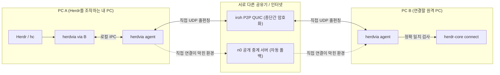

# herdvia

<p align="center">
  <a href="../README.md">English</a> · <strong>한국어</strong> · <a href="README.ja.md">日本語</a> · <a href="README.zh-CN.md">简体中文</a>
</p>

<p align="center">
  <a href="https://github.com/photojupi/herdvia/actions/workflows/ci.yml"></a>
  <a href="https://github.com/photojupi/herdvia/releases/latest"></a>
  <a href="#license"></a>
</p>

**SSH 서버, 공유기 포트포워딩, VPN 없이도 서로 다른 공유기 뒤의 PC들을 [Herdr](https://herdr.dev)에 원격 머신으로 연결하세요.**


> [!NOTE]
> **비공식 · 실험적 프로젝트 안내:** `herdvia`는 개인 프로젝트이며 Herdr / `herdr-core` 공식 프로젝트와 무관합니다(제휴·보증·기술 지원 없음). 실험 단계이므로 명령어, 파일 형식, 통신 프로토콜이 하위 호환 없이 변경될 수 있습니다.

---

## 목차

- [herdvia란 무엇인가요?](#what-is-herdvia)
- [동작 원리](#how-it-works)
- [사전 준비 사항](#requirements)
- [5분 빠른 시작 (Quick start)](#quick-start)
- [설치 가이드](#install)
  - [설치 스크립트 (권장)](#install-script)
  - [수동 설치](#manual-install)
  - [소스 코드에서 빌드](#from-source)
- [명령어 일람](#commands)
- [로그인 시 자동 시작](#automatic-startup)
- [자주 겪는 문제 해결 (Troubleshooting)](#troubleshooting)
- [업그레이드 및 삭제](#upgrading-and-uninstalling)
- [보안 모델](#security-model)
- [네트워크 및 외부 공개 정보](#network-and-published-information)
- [지원 플랫폼](#supported-platforms)
- [설정 및 파일 위치](#configuration-and-files)
- [설계 문서 및 라이선스](#design)

---

<a id="what-is-herdvia"></a>
## herdvia란 무엇인가요?

Herdr에서 원격 PC를 등록할 때 쓰는 `hc machine add --via <명령>`은 보통 `ssh`를 전제로 합니다. 하지만 집·사무실·카페처럼 서로 다른 공유기(NAT) 뒤에 있는 PC끼리 연결하려면 SSH 서버를 띄우고, 공유기 포트포워딩을 설정하거나, 별도의 메쉬 VPN을 설치해야 하는 번거로움이 따릅니다.

**`herdvia`는 바로 그 `--via` 자리에 그대로 꽂아 쓰는 P2P 전송 통로입니다.** [iroh](https://www.iroh.computer)(자동 NAT 통과 및 공개 중계 서버 폴백을 지원하는 종단간 암호화 P2P QUIC)를 통해 두 PC 사이에서 `hc` 세션의 바이트만 안전하게 실어 나릅니다.

| 연결 방식 | 공유기 포트포워딩 | 추가 서버 / 계정 가입 | 네트워크 노출 범위 | 초기 설정 난이도 |
|---|---|---|---|---|
| **SSH (`ssh user@host`)** | 외부망 연결 시 필요 | 원격 PC에 SSH 서버 필요 | SSH 포트 노출 | 중간~높음 |
| **메쉬 VPN** | 불필요 | 가상 네트워크 드라이버 + 계정 가입 | IP 인터페이스 전체 (별도 ACL 설정 전) | 중간 |
| **`herdvia`** | **불필요** | **단일 경량 실행 파일 하나 (무계정)** | **허용한 키에 한해 `herdr-core connect`만 실행** | **약 5분** |

---

<a id="how-it-works"></a>
## 동작 원리

`herdvia`는 Herdr 내부 프로토콜을 해석하지 않습니다. 내가 조작하는 컴퓨터(**PC A**)의 `hc`와 원격으로 접속할 컴퓨터(**PC B**)의 `herdr-core` 사이에서 바이트만 그대로 중계합니다.



1. **상주 에이전트 (`herdvia agent`):** 양쪽 PC의 사용자 세션에서 백그라운드로 실행되며, 기기 고유 키(`EndpointId`)로 허용된 피어와 암호화된 QUIC 연결을 유지합니다.
2. **양방향 명시적 허용 (`allow` / `accept`):** 처음 보는 기기는 절대 자동으로 신뢰하지 않습니다. 거는 쪽(PC A)은 `--outbound`로 B를 허용하고, 받는 쪽(PC B)은 `--inbound`로 A를 수락해야 연결됩니다.
3. **명령줄 정확 일치 검사:** 받는 쪽(PC B) 에이전트는 `hc`가 보내는 정확한 `herdr-core connect` 명령줄만 실행하며(**`hc 0.1.21`** 기준 검증 완료), 그 외 모든 명령은 거부하고 로그에 기록합니다.

---

<a id="requirements"></a>
## 사전 준비 사항

연결할 두 대의 PC에 각각 무엇이 필요한지 먼저 확인하세요.

| 구성 요소 | PC A (조작하는 쪽 — Herdr 실행) | PC B (연결할 원격 PC) | 비고 |
|---|---|---|---|
| **`herdr-core`** | 필수 | 필수 | 양쪽 PC에 **동일한 버전** 설치 권장 (**`0.1.21`**에서 검증됨) |
| **Herdr 앱 / `hc` CLI** | 필수 | 불필요 | 원격 PC B에는 `herdr-core`만 있으면 됩니다 |
| **`herdvia` + 에이전트 실행** | 필수 | 필수 | 한 줄 스크립트, 릴리스 압축 파일, 또는 Cargo로 설치 |

### 양쪽 PC에 `herdr-core` 설치하기

`herdvia`는 `herdr-core`를 대신 설치하거나 업데이트하지 않습니다. 양쪽 PC에서 Herdr 공식 설치 스크립트를 직접 실행해 설치하세요(다시 실행하면 업데이트됩니다).

- **macOS / Linux:**
  ```sh
  curl -fsSL https://releases.herdr.dev/core/install.sh | sh
  ```
  `~/.local/bin/herdr-core`를 설치합니다(`hc`가 아직 없으면 옆에 심볼릭 링크도 함께 생성). `PATH`를 자동 수정하지는 않으며, `~/.local/bin`이 `PATH`에 없으면 안내 문구를 출력합니다.

- **Windows (일반 PowerShell — 관리자 권한 불필요):**
  ```powershell
  powershell -c "irm https://releases.herdr.dev/core/install.ps1 | iex"
  ```
  `%LOCALAPPDATA%\Programs\herdr-core\herdr-core.exe`(및 `hc.exe`)를 설치하고 사용자 `PATH`에 폴더를 자동 추가합니다.

`herdvia` 동작이 검증된 **`0.1.21`** 버전을 지정해 설치하려면 `HC_VERSION`을 함께 넘기세요:

```sh
# macOS / Linux
curl -fsSL https://releases.herdr.dev/core/install.sh | HC_VERSION=0.1.21 sh
```

```powershell
# Windows (PowerShell)
$env:HC_VERSION = "0.1.21"; powershell -c "irm https://releases.herdr.dev/core/install.ps1 | iex"
```

*(macOS에서는 이미 더 높은 버전의 `herdr-core`가 설치돼 있으면 스크립트가 다운그레이드를 멈추고 `hc update --from ... --force`를 쓰라고 안내합니다.)*

> [!IMPORTANT]
> **꼭 알아 두어야 할 `herdr-core` 주의사항 두 가지:**
> 1. **원격 설치·업데이트 명령 제한 (`hc 0.1.21` 기준):** `herdvia`는 `hc`가 보내는 `herdr-core connect` 줄과 글자 하나까지 똑같은 명령만 허용합니다. 따라서 `hc machine add --install`이나 `hc machine update`로는 원격 PC의 `herdr-core`를 설치·업데이트할 수 없으며, 향후 `hc`가 연결 명령 형식을 바꾸면 `herdvia`도 업데이트되기 전까지 이를 거부합니다.
> 2. **원격 PC(B)에서 `herdr-core`를 찾는 위치:**
>    - **macOS / Unix:** `~/.local/bin/herdr-core` 또는 에이전트의 `PATH`. 특히 macOS에서 `herdvia agent install`로 자동 시작된 에이전트의 `PATH`는 `~/.local/bin:/usr/bin:/bin:/usr/sbin:/sbin`뿐이므로, Homebrew 등 다른 경로에 설치했다면 `~/.local/bin/herdr-core`로 심볼릭 링크를 걸어 주세요.
>    - **Windows:** `%USERPROFILE%\AppData\Local\Programs\herdr-core\herdr-core.exe`.

---

<a id="quick-start"></a>
## 5분 빠른 시작 (Quick start)

두 대의 PC를 연결해 보겠습니다:
- **PC A** — 내가 Herdr / `hc`를 실행하는 컴퓨터 (예: 노트북)
- **PC B** — 원격으로 붙이고 싶은 컴퓨터 (예: 집 데스크톱, 맥미니)

먼저 **A와 B 양쪽 모두**에 `herdvia`를 설치합니다(Intel Mac, Linux, 수동 설치는 [설치 가이드](#install) 참고):

```sh
# macOS (Apple Silicon)
curl -fsSL https://github.com/photojupi/herdvia/releases/latest/download/install.sh | sh
```

```powershell
# Windows (x64) — 관리자 권한이 아닌 '일반' PowerShell 창에서 실행하세요
powershell -c "irm https://github.com/photojupi/herdvia/releases/latest/download/install.ps1 | iex"
```

설치 직후 `PATH`가 적용되도록 **새 터미널 창**(Windows에서는 새 PowerShell 창을 열고, 실행 중이던 Herdr 앱이 있다면 재시작)을 열어 주세요.

전체 페어링 흐름은 다음과 같습니다:

```mermaid
sequenceDiagram
    autonumber
    participant A as PC A (Herdr / hc)
    participant B as PC B (원격 PC)

    Note over A,B: 1~2단계: 양쪽 모두 herdvia 설치 및 에이전트 실행 중
    B->>B: herdvia id (B의 64자 EndpointId 복사)
    A->>A: herdvia allow B <B의_EndpointId> --outbound
    A-->>B: 에이전트가 B로 연결 시도 (아직 미허용이라 거부 후 pending에 기록됨)
    B->>B: herdvia pending
    Note over A,B: A 화면에 찍힌 16자 지문(fingerprint)을 눈으로 확인
    B->>B: herdvia accept A <A의_지문> --inbound
    A-->>B: 다음 재시도(최대 약 30초)에서 암호화 P2P 연결 성립
    A->>B: hc machine add --via 'herdvia via B' --name B
```



### 1단계. 각 PC의 ID와 지문 확인하기

**A와 B 양쪽**에서 실행합니다(설치 스크립트를 썼다면 이미 한 번 출력되었습니다):

```sh
herdvia id
```

- **첫째 줄:** 64자 `EndpointId` (이 PC의 공개키)
- **둘째 줄:** 4글자씩 끊어 읽는 16자 지문(fingerprint, 예: `28af-63b6-258e-859d`). 비밀키는 첫 실행 시 자동으로 생성됩니다.

### 2단계. 양쪽 PC에서 에이전트 실행하기

[설치 스크립트](#install-script)로 설치했다면 에이전트가 **이미 자동 시작 등록 및 실행 완료**된 상태이므로 바로 3단계로 넘어가세요.

수동으로 설치했다면 로그인 시 자동 시작되도록 등록하고 즉시 띄우거나(macOS, Windows):

```sh
herdvia agent install
```

터미널 포그라운드에서 직접 실행합니다:

```sh
herdvia agent
```

운영체제별 세부 동작은 [로그인 시 자동 시작](#automatic-startup)을 참고하세요.

### 3단계. PC A에서 PC B 허용하기 (`--outbound`)

피어는 절대 자동으로 신뢰되지 않습니다. **B의 `EndpointId`**를 복사해 **A**에서 B로 연결을 걸 수 있도록 등록합니다:

```sh
herdvia allow B <B의 EndpointId> --outbound
```

붙여 넣은 `EndpointId`의 앞 16글자가 B 화면에서 `herdvia id`가 출력한 지문과 일치하는지 확인하세요(ID를 복사해 온 메신저·클립보드와는 다른 채널이나 직접 화면을 보고 대조하는 것이 안전합니다).

| 방향 옵션 | 의미 |
|---|---|
| `--outbound` | **이 PC에서** 저 피어로 연결을 걸 수 있음 |
| `--inbound` | **저 피어가** 이 PC로 들어와 세션을 열 수 있음 |
| `--both` | 양방향 모두 허용 |

*이름(`A`, `B`, `home-pc` 등)은 이 PC 안에서 부르는 로컬 별칭입니다(`A-Z a-z 0-9 . _ -` 조합 1~32자). 같은 이름으로 `allow`를 다시 실행하면 기존 항목을 덮어씁니다.*

### 4단계. PC B에서 PC A 수락하기 (`--inbound`)

이제 A의 에이전트가 B로 접속을 시도합니다. 아직 B의 허용 목록에 A가 없으므로 B는 접속을 거부하지만, 긴 64자 ID를 또 복사해 옮기지 않아도 되도록 시도 기록을 메모리에 잠시 남겨 둡니다.

**B**에서 대기 목록을 확인합니다:

```sh
herdvia pending
```

```text
fingerprint id attempts last-seen
28af-63b6-258e-859d 28af63b6258e859dc534c014248ebf7284cdbb34e7cff524e3e4d35c2df1fc55 3 4s
```

**반드시 A의 화면에서 직접 읽은 A의 지문**(`herdvia id` 둘째 줄 — B의 `EndpointId`를 아는 누구나 `pending` 목록에 나타날 수 있으므로 `pending`에 뜬 값을 그대로 복사해 쓰면 안 됩니다!)을 **B**에 입력해 수락합니다:

```sh
herdvia accept A <A의 지문> --inbound
```

- `accept`는 해당 지문을 가진 대기 항목의 전체 `EndpointId`를 등록하고 `A <EndpointId> in`을 출력합니다.
- 지문은 하이픈(`-`) 유무나 대소문자를 가리지 않습니다. B에서도 A로 역방향 연결을 걸려면 `--both`를 쓰세요(`accept`에서는 `--outbound`를 받지 않습니다).
- A는 거부된 연결을 최대 **30초**까지 간격을 늘려 가며 재시도합니다. 따라서 `pending`에 나타나기까지 최대 약 30초, `accept` 후 실제 연결되기까지 다시 최대 약 30초가 걸릴 수 있습니다.
- *(참고: A의 64자 `EndpointId`를 B로 직접 복사할 수 있다면 B에서 `herdvia allow A <A의 EndpointId> --inbound`를 실행하고 지문을 대조해도 결과는 같습니다.)*

### 5단계. PC A의 Herdr에 PC B 등록하기

**A**에서 Herdr에 원격 머신을 추가합니다:

```sh
hc machine add --via 'herdvia via B' --name B
```

- `'herdvia via B'` 안의 `B`는 3단계 `herdvia allow`에서 지정한 피어 이름이고, `--name B`는 Herdr 사이드바에 표시할 이름입니다(서로 달라도 됩니다).
- `hc`는 이 명령어 뒤에 원격 실행 줄을 인자 하나로 덧붙여 호출합니다.
- **`hc`가 `PATH`에서 `herdvia`를 찾지 못하는 경우:** 실행 파일의 전체 경로를 적고, 공백이 있으면 따옴표로 감싸야 합니다.
  - **macOS:** `hc`가 `--via` 값을 `sh` 명령줄로 실행하므로 `sh` 규칙에 맞게 따옴표를 씌웁니다(설치 스크립트 출력에 그대로 붙여 넣을 수 있는 명령이 안내됩니다).
  - **Windows:** `hc`가 셸 없이 `CommandLineToArgvW` 규칙으로 인자를 분리하므로 공백 있는 경로는 큰따옴표(`"..."`)로 감싸야 합니다. Windows PowerShell 5.1은 인자 안의 큰따옴표 전달이 까다로우므로, 설치 후 새 PowerShell 창을 열고 Herdr를 재시작해 `PATH`에 잡힌 상태에서 위의 `hc machine add --via 'herdvia via B' --name B` 형태를 그대로 쓰는 것이 가장 간편합니다.

### 6단계. 연결 상태 확인하기

**A**에서 연결 상태를 확인합니다:

```sh
herdvia status
```

```text
name permission connection path rtt
B out connected direct 4.12ms
```

- **`path`:** 처음에는 `relay`(중계)로 연결된 뒤 보통 몇 초 안에 `direct`(직접 P2P)로 전환됩니다.
- **macOS 로컬 네트워크 권한 안내:** 같은 공유기(LAN/Wi-Fi) 안인데도 계속 `relay`에 머문다면 **시스템 설정 > 개인정보 보호 및 보안 > 로컬 네트워크**에서 `herdvia`를 허용해 주세요([macOS 자동 시작](#macos) 참고).
- **팁:** B가 아직 A를 `accept`하기 전에도 A가 재시도할 때마다 잠깐 `connected`로 보일 수 있습니다. 확실한 연결 여부는 **B**에서 `herdvia status`를 실행해 확인하세요.

---

<a id="install"></a>
## 설치 가이드

<a id="install-script"></a>
### 설치 스크립트 (권장)

**macOS (Apple Silicon):**

```sh
curl -fsSL https://github.com/photojupi/herdvia/releases/latest/download/install.sh | sh
```

**Windows (x64)** — 관리자 창이 아닌 **일반 PowerShell 창**에서 실행:

```powershell
powershell -c "irm https://github.com/photojupi/herdvia/releases/latest/download/install.ps1 | iex"
```

설치 스크립트가 수행하는 6단계:

1. **다운로드 및 무결성 검증:** 임시 폴더에 릴리스 압축 파일과 `SHA256SUMS`를 내려받아 SHA-256 해시를 검증합니다. 실패 시 시스템을 전혀 변경하지 않고 중단합니다.
2. **실행 파일 배치:** macOS는 `~/.local/bin/herdvia`에, Windows는 `%LOCALAPPDATA%\Programs\herdvia\herdvia.exe`에(README·라이선스 파일과 함께) 설치합니다.
3. **`PATH` 등록:** macOS는 기본 로그인 셸이 `zsh`일 때 `~/.zprofile`에 `export PATH="$HOME/.local/bin:$PATH"`를 추가합니다(다른 셸이면 직접 추가할 줄만 안내). Windows는 사용자 `PATH`에 폴더를 등록합니다.
4. **`herdr-core` 확인:** **`herdr-core`를 직접 설치하지는 않습니다.** 미설치 시 공식 설치 명령을 출력하며, macOS에서 `~/.local/bin/herdr-core`가 아닌 다른 경로에만 있으면 자동 시작 에이전트가 찾을 수 있도록 `ln -s` 명령을 안내합니다.
5. **기기 ID 생성 및 출력:** `herdvia id`를 실행해 `secret.key`(최초 1회)를 만들고 `EndpointId`와 지문을 보여 줍니다.
6. **백그라운드 에이전트 자동 시작 등록:** `herdvia agent install`을 실행해 지금 바로 에이전트를 띄우고 로그인 시마다 자동 실행되도록 등록합니다(Windows 관리자 PowerShell에서 실행한 경우 이 단계만 건너뛰고 일반 창에서 실행하라고 안내합니다).

**스크립트 실행 요건:**
- **macOS:** Apple Silicon 전용(`root` 실행 거부, Intel Mac이나 Linux에서는 아무것도 바꾸지 않고 [소스 코드에서 빌드](#from-source)를 안내).
- **Windows:** x64 전용, `System32\curl.exe` 필요(Windows 10 1803 이상 기본 포함).

**환경 변수 옵션 (스위치형 변수는 값이 `1`일 때만 켜짐):**

| 환경 변수 | 동작 |
|---|---|
| `HERDVIA_VERSION` | 최신 버전 대신 지정한 릴리스 설치 (예: `0.1.0` 또는 `v0.1.0`) |
| `HERDVIA_NO_AGENT=1` | `herdvia agent install` 실행 생략 |
| `HERDVIA_NO_MODIFY_PATH=1` | `~/.zprofile` 또는 Windows 사용자 `PATH` 수정 생략 |
| `HERDVIA_RELEASE_BASE` | GitHub Releases 대신 `<url>/<파일명>`에서 다운로드 (`HERDVIA_VERSION`보다 우선) |

특정 버전을 지정해 설치하려면(버전 태그 URL의 스크립트를 받더라도 `HERDVIA_VERSION`을 지정하지 않으면 최신 버전을 설치합니다):

```sh
curl -fsSL https://github.com/photojupi/herdvia/releases/download/v0.1.0/install.sh | HERDVIA_VERSION=0.1.0 sh
```

```powershell
$env:HERDVIA_VERSION = "0.1.0"; powershell -c "irm https://github.com/photojupi/herdvia/releases/download/v0.1.0/install.ps1 | iex"
```

실행 전 스크립트 내용을 먼저 눈으로 확인하고 싶다면(`SHA256SUMS`에 스크립트 해시도 포함됨):

```sh
# macOS
curl -fsSLO https://github.com/photojupi/herdvia/releases/latest/download/install.sh
less install.sh
sh install.sh
```

```powershell
# Windows (PowerShell)
curl.exe -fLO https://github.com/photojupi/herdvia/releases/latest/download/install.ps1
notepad install.ps1
Get-Content -Raw .\install.ps1 | Invoke-Expression
```

*(설치 스크립트를 다시 실행하면 안전하게 업그레이드됩니다. [업그레이드](#upgrading) 절을 참고하세요.)*

<a id="manual-install"></a>
### 수동 설치

[GitHub Releases](https://github.com/photojupi/herdvia/releases)에서 파일을 내려받습니다:

- `herdvia-macos-arm64.zip` (macOS Apple Silicon)
- `herdvia-windows-x64.zip` (Windows x64)
- `install.sh`, `install.ps1`
- `SHA256SUMS` (압축 파일 및 스크립트의 SHA-256 해시 목록)

각 압축 파일 안에는 상위 폴더 없이 실행 파일, `README.md`, `LICENSE-MIT`, `LICENSE-APACHE`, `THIRD-PARTY-LICENSES.html`이 들어 있습니다. 자동 시작 등록 시 그 실행 파일의 경로가 그대로 기록되므로 다운로드 폴더나 임시 폴더에 두지 말고 고정된 경로(macOS `~/.local/bin/herdvia`, Windows `%LOCALAPPDATA%\Programs\herdvia\herdvia.exe`)로 옮기세요.

실행 파일에는 코드 서명이나 공증(notarization)이 되어 있지 않습니다. Intel Mac용 미리 빌드된 바이너리는 없으므로 [소스 코드에서 빌드](#from-source)를 이용하세요.

<a id="macos-apple-silicon"></a>
#### macOS (Apple Silicon)

```sh
mkdir -p ~/.local/bin
cd "$(mktemp -d)"
curl -fLO https://github.com/photojupi/herdvia/releases/latest/download/herdvia-macos-arm64.zip &&
curl -fLO https://github.com/photojupi/herdvia/releases/latest/download/SHA256SUMS &&
shasum -a 256 -c --ignore-missing SHA256SUMS &&
unzip -q herdvia-macos-arm64.zip -d herdvia &&
mv herdvia/herdvia ~/.local/bin/herdvia
echo 'export PATH="$HOME/.local/bin:$PATH"' >> ~/.zprofile
```

- `~/.local/bin`이 이미 `PATH`에 있다면 마지막 `echo ... >> ~/.zprofile` 줄은 생략하세요.
- 다운로드 폴더에 파일을 둔 채 심볼릭 링크만 걸지 말고 실행 파일 자체를 `~/.local/bin`으로 옮기세요.
- 새 터미널을 열고 `herdvia id`가 실행되는지 확인합니다.
- 웹 브라우저로 압축 파일을 내려받았다면 Gatekeeper 격리 속성이 붙어 실행이 막힐 수 있습니다. 아래 명령으로 해제하세요:
  ```sh
  xattr -d com.apple.quarantine ~/.local/bin/herdvia
  ```

<a id="windows-x64"></a>
#### Windows (x64)

관리자 권한이 아닌 **일반 PowerShell 창**에서 한 줄씩 결과를 확인하며 실행하세요(오류가 뜨면 거기서 중단):

```powershell
# 1. 임시 다운로드 폴더 생성 및 이동
$tmp = Join-Path $env:TEMP "herdvia-$(Get-Random)"
New-Item -ItemType Directory $tmp
Set-Location $tmp

# 2. 압축 파일과 SHA256SUMS 다운로드
curl.exe -fLO https://github.com/photojupi/herdvia/releases/latest/download/herdvia-windows-x64.zip
curl.exe -fLO https://github.com/photojupi/herdvia/releases/latest/download/SHA256SUMS

# 3. SHA-256 해시 대조 (두 해시가 반드시 같아야 합니다!)
certutil -hashfile herdvia-windows-x64.zip SHA256
Select-String herdvia-windows-x64.zip SHA256SUMS

# 4. %LOCALAPPDATA%\Programs\herdvia 에 압축 해제
New-Item -ItemType Directory -Force "$env:LOCALAPPDATA\Programs\herdvia"
tar.exe -xf herdvia-windows-x64.zip -C "$env:LOCALAPPDATA\Programs\herdvia"
```

이후 시작 메뉴에서 **"계정에 대한 환경 변수 편집"**을 검색해 사용자 변수 `Path`에 `%LOCALAPPDATA%\Programs\herdvia`의 실제 경로를 추가한 뒤, 새 PowerShell 창을 열고(Herdr가 켜져 있었다면 재시작) `herdvia id`를 실행해 확인하세요. 첫 실행 시 SmartScreen 경고가 뜰 수 있습니다.

<a id="from-source"></a>
### 소스 코드에서 빌드

`iroh` 의존성 요구 사항으로 **Rust 1.91 이상**이 필요합니다.

- **macOS:** Xcode Command Line Tools (`xcode-select --install`) 및 [rustup](https://rustup.rs)으로 설치한 Rust
- **Windows:** [rustup](https://rustup.rs) 및 Visual Studio Build Tools("C++를 사용한 데스크톱 개발"). *(참고: 공식 릴리스용 Windows 실행 파일은 Linux에서 MinGW `x86_64-pc-windows-gnu`로 교차 빌드하며, Windows MSVC 빌드는 CI에서 검증하지 않습니다.)*

```sh
cargo install --locked --git https://github.com/photojupi/herdvia
```

기본적으로 `main` 브랜치를 빌드해 `~/.cargo/bin`(Windows는 `%USERPROFILE%\.cargo\bin`)에 설치합니다. 특정 릴리스 태그를 빌드하려면 `--tag v<버전>`을 추가하세요.

---

<a id="commands"></a>
## 명령어 일람

| 명령어 | 설명 |
|---|---|
| `herdvia id` | 이 PC의 `EndpointId`(첫째 줄)와 16자 지문(둘째 줄)을 출력합니다. 비밀키가 없으면 새로 생성합니다. |
| `herdvia allow <이름> <EndpointId> (--inbound \| --outbound \| --both)` | 피어를 추가하거나 기존 항목을 바꿉니다. 실행 중인 에이전트가 있으면 즉시 반영됩니다. |
| `herdvia revoke <이름>` | 피어를 삭제하고 해당 피어와 맺어진 연결을 즉시 끊습니다. |
| `herdvia status` | 각 피어의 이름, 권한, 연결 상태, 경로(`direct`/`relay`), 왕복 시간(RTT)을 표시합니다. 에이전트 실행 필요. |
| `herdvia pending` | `inbound` 권한이 없어 거부된 접속 시도를 최근 순으로 보여 줍니다(지문, `EndpointId`, 횟수, 경과 초). 메모리에만 최대 16개까지 보관하며 마지막 시도로부터 10분 뒤 만료됩니다. 에이전트 실행 필요. |
| `herdvia accept <이름> <지문> (--inbound \| --both)` | `pending` 목록에서 해당 지문으로 시작하는 유일한 기기를 전체 `EndpointId`로 등록합니다. 일치 항목이 없거나 둘 이상이거나, `<이름>`이 이미 다른 ID로 등록돼 있으면 거부합니다. 에이전트 실행 필요. |
| `herdvia --version` | `herdvia <버전>`을 출력합니다. |
| `herdvia agent` | 에이전트를 포그라운드에서 실행합니다 (`Ctrl-C`로 종료). |
| `herdvia agent install` | 로그인 시 자동 시작을 등록하고 즉시 에이전트를 시작합니다 (macOS, Windows). |
| `herdvia agent uninstall` | 자동 시작 에이전트를 멈추고 등록을 해제합니다. 데이터 폴더와 로그는 유지됩니다. |
| `herdvia via <피어> <줄>` | `hc`가 내부적으로 호출하는 전송 명령어입니다 (수동 실행용 아님). 로컬 에이전트 실행 필요. |

오류 발생 시 `herdvia`는 표준 오류(`stderr`)에 `herdvia:`로 시작하는 한 줄을 출력하고 종료 코드 **`255`**로 끝납니다.

---

<a id="automatic-startup"></a>
## 로그인 시 자동 시작

<a id="macos"></a>
### macOS

`herdvia agent install`은 사용자별 LaunchAgent(`~/Library/LaunchAgents/io.github.photojupi.herdvia.agent.plist`)를 만들고 `launchctl bootstrap`으로 시작합니다. 로그인 시 자동 실행되며 비정상 종료 시 `launchd`가 다시 띄웁니다. 로그는 `~/Library/Logs/herdvia.log`에 쌓입니다.

- `HERDVIA_DIR`이 설정된 상태이거나 수동으로 띄운 에이전트가 이미 돌아가고 있으면 설치를 거부합니다.
- `herdvia agent install`을 다시 실행하면 현재 실행 파일 경로로 등록을 갱신하고 에이전트를 재시작합니다.
- 임시 폴더나 `target` 빌드 폴더에서 실행하면 경고를 출력하되 등록은 진행합니다.

> [!IMPORTANT]
> **macOS 15 이상 로컬 네트워크 권한:** macOS 15(Sequoia)부터는 백그라운드 에이전트가 같은 공유기(로컬 네트워크)의 기기와 직접 통신하려면 권한 허용이 필요합니다. 알림 창이 뜨면 **허용**을 누르거나 **시스템 설정 > 개인정보 보호 및 보안 > 로컬 네트워크**에서 `herdvia`를 켜 주세요. 허용하기 전까지는 같은 공유기 안의 피어와도 `direct` 대신 `relay`(중계 서버)로 연결됩니다(외부 네트워크 피어나 터미널에서 직접 띄운 `herdvia agent`에는 영향 없음).

### Windows

`herdvia agent install`은 현재 사용자의 레지스트리 `Run` 키(`HKCU\Software\Microsoft\Windows\CurrentVersion\Run`)에 `conhost.exe --headless "<herdvia.exe 경로>" agent --log`를 등록하고, 콘솔 창 없이 즉시 백그라운드로 띄웁니다. 관리자 권한이나 Windows 서비스·작업 스케줄러를 사용하지 않습니다.

- **반드시 일반 PowerShell 창에서 실행하세요.** 관리자 권한 PowerShell에서는 실행을 거부합니다.
- `HERDVIA_DIR`이 설정돼 있거나, 아직 자동 시작 등록이 없는 상태에서 수동 실행 중인 에이전트가 있으면 거부합니다(이미 자동 시작이 등록돼 있다면 기존 기본 폴더 에이전트를 멈추고 새 에이전트로 교체합니다).
- 실행 파일 경로에 `%`가 포함되면 안 되며, 등록 명령줄 전체 길이는 259 UTF-16 코드 단위 이내여야 합니다.
- 로그는 `%LOCALAPPDATA%\herdvia\herdvia.log`에 기록됩니다. 에이전트가 중간에 종료되면 다음 Windows 로그온 때 다시 시작됩니다.

### Linux

자동 시작(`agent install` / `agent uninstall`)을 지원하지 않습니다. `herdvia agent`를 직접 실행하세요.

---

<a id="troubleshooting"></a>
## 자주 겪는 문제 해결 (Troubleshooting)

| 증상 | 주요 원인 | 해결 방법 |
|---|---|---|
| B에서 `herdvia pending`을 쳐도 아무것도 안 나옴 | A의 에이전트가 꺼져 있거나, A에서 `--outbound` 허용을 안 했거나, 재시도 대기 간격 중임 | A에서 `herdvia status`가 동작하는지, `herdvia allow B <B_ID> --outbound`를 했는지 확인 후 최대 30초 기다렸다 다시 `herdvia pending` 실행 |
| 같은 공유기 Wi-Fi인데도 `status`가 계속 `relay`로 나옴 | macOS 15+에서 LaunchAgent의 로컬 네트워크 접근이 차단됨 | Mac의 **시스템 설정 > 개인정보 보호 및 보안 > 로컬 네트워크**에서 `herdvia`를 켬 |
| Homebrew로 `herdr-core`를 깔았는데 Herdr에 미설치로 표시됨 | macOS 자동 시작 에이전트의 `PATH`는 `~/.local/bin`과 기본 시스템 경로만 검색함 | `mkdir -p ~/.local/bin && ln -s "$(command -v herdr-core)" ~/.local/bin/herdr-core` 실행 |
| `hc machine add --install`이나 `hc machine update` 실패 | `herdvia`는 `herdr-core connect` 외의 모든 명령을 차단함 | 각 PC에서 직접 Herdr의 `herdr-core` 설치 스크립트를 실행해 설치·업데이트 |
| 설치 직후 `herdvia` 명령어를 찾을 수 없다고 나옴 | 현재 열려 있는 터미널·Herdr 앱에 새 `PATH`가 아직 반영되지 않음 | 새 터미널 창을 열고, Windows에서는 실행 중이던 Herdr 앱도 재시작 |
| Windows에서 `herdvia agent install`이 관리자 권한 오류로 멈춤 | 관리자 권한으로 실행된 PowerShell 창에서 실행함 | 일반(비관리자) PowerShell 창을 새로 열어 `herdvia agent install` 실행 |
| B가 아직 수락 안 했는데 A의 `status`에 잠깐 `connected`가 뜸 | 핸드셰이크 직후 B가 연결을 끊기 전 찰나에 A 목록에 잡힘 | 실제 연결 여부는 받는 쪽인 **B**에서 `herdvia status`로 확인 |

---

<a id="upgrading-and-uninstalling"></a>
## 업그레이드 및 삭제

기기 비밀키(`secret.key`)와 피어 허용 목록(`peers`)은 실행 파일 옆이 아니라 별도의 데이터 폴더에 보관되므로, 실행 파일을 교체해도 ID와 피어 설정은 그대로 유지됩니다. 현재 버전은 `herdvia --version`으로 확인할 수 있습니다.

<a id="upgrading"></a>
### 업그레이드

**권장 방법 — [설치 스크립트](#install-script) 다시 실행:**
새 버전을 내려받아 검증한 뒤 실행 파일을 안전하게 교체(macOS는 원자적 `mv`, Windows는 실행 중인 파일 잠금을 피하기 위해 `herdvia.new.exe` 검증 후 `.old`로 이름 변경 교체)하고 `herdvia agent install`을 다시 실행해 새 실행 파일로 에이전트를 재시작합니다. `PATH` 항목은 중복 추가하지 않습니다.

*(수동으로 띄운 포그라운드 에이전트가 돌고 있거나 `HERDVIA_DIR`이 설정돼 있으면 실행 파일 교체 후 멈추므로, 해당 에이전트를 끄거나 `HERDVIA_DIR`을 해제한 뒤 `herdvia agent install`을 실행하세요.)*

**수동 업그레이드:**
- **macOS:** [macOS (Apple Silicon)](#macos-apple-silicon)의 다운로드·검증·`mv` 명령을 다시 실행합니다(`~/.zprofile` 추가 줄은 생략). **실행 중인 파일 위에 절대 `cp`로 덮어쓰지 마세요**(`Killed: 9` 오류 발생) — 반드시 `mv`로 교체한 뒤 `herdvia agent install`을 실행하세요.
- **Windows:** 실행 중인 `.exe`는 `tar.exe`가 덮어쓸 수 없으므로 먼저 `herdvia agent uninstall`(포그라운드 실행 중이면 `Ctrl-C`)로 에이전트를 멈춘 뒤, [Windows (x64)](#windows-x64)의 다운로드·검증·압축 해제 명령을 실행하고 다시 `herdvia agent install`을 실행하세요.

### 삭제 (Uninstalling)

1. **에이전트 중지 및 자동 시작 해제:** `herdvia agent uninstall` 실행 (포그라운드 실행 중이면 `Ctrl-C`).
2. **실행 파일 삭제:**
   - macOS: `rm ~/.local/bin/herdvia`
   - Windows (PowerShell): `Remove-Item -Recurse -Force "$env:LOCALAPPDATA\Programs\herdvia"`
3. **기기 키·피어 목록·로그까지 완전 삭제(선택):** [설정 및 파일 위치](#configuration-and-files)를 참고해 데이터 폴더와 로그 파일을 삭제합니다.
4. **`PATH` 정리:**
   - Windows: 사용자 환경 변수 `Path`에서 `herdvia` 폴더 항목을 삭제합니다.
   - macOS: `~/.zprofile`의 `~/.local/bin` 줄은 `hc`·`herdr-core` 등 다른 프로그램도 함께 쓰므로 다른 도구가 전혀 없을 때만 지우세요.
5. **상대방 PC에서 등록 해제:** 이 PC를 허용했던 다른 PC에서 `herdvia revoke <이름>`, Herdr를 쓰던 PC에서 `hc machine rm <이름>`을 실행합니다.

---

<a id="security-model"></a>
## 보안 모델

> [!WARNING]
> **`--inbound`(또는 `--both`) 권한을 준 피어는 이 PC에서 내 사용자 권한으로 `herdr-core` 세션을 열 수 있으며, 이는 사실상 셸(터미널) 권한을 주는 것과 같습니다.** 본인이 직접 소유하거나 완전히 신뢰하는 기기만 허용하세요.

- **피어 공개키 상호 인증:** 모든 연결은 `iroh`가 양쪽 기기의 키 쌍(`EndpointId`)으로 인증합니다. 피어 목록이 비어 있거나 방향 권한(`in`, `out`, `both`)이 맞지 않으면 모든 연결을 거부합니다. 세션마다 권한을 재확인하며, `allow`·`revoke` 변경 사항은 실행 중인 에이전트에 즉시 반영됩니다.
- **명령줄 허용 목록의 역할:** `hc`의 정확한 `herdr-core connect` 줄만 허용하고 나머지를 로그에 남기며 차단하는 것은 오용 표면을 줄이고 이상 징후를 포착하기 위함입니다. `herdr-core connect` 자체가 임의 명령을 실행할 수 있으므로, **실질적인 보안 경계는 피어 키 목록(`peers`)입니다.**
- **`root` 실행 거부:** macOS/Unix에서 `herdvia`는 `root` 권한으로 실행되지 않습니다.
- **사용자 전용 로컬 통신(IPC):**
  - **macOS / Unix:** 권한 `0700` 데이터 폴더 안의 `0600` 소켓을 사용하며 접속 프로세스의 UID를 검사합니다.
  - **Windows:** 현재 사용자 SID에만 접근을 허용하는 이름 있는 파이프(Named Pipe)를 쓰며 원격 네트워크 클라이언트를 차단합니다.
- **비밀키(`secret.key`) 관리:** macOS/Unix에서는 권한 `0600`으로 생성되며 권한이 더 넓으면 시작을 거부합니다(Windows는 사용자 프로필 기본 권한 사용). 이 파일이 유출되면 공격자가 내 PC로 위장할 수 있으므로, 유출 시 모든 피어에서 즉시 `revoke`하고 `secret.key`를 삭제해 새 키를 발급받으세요.
- **지문과 `pending` / `accept`:** 지문은 `EndpointId` 앞 16자(64비트)로 사람이 눈으로 대조하고 입력하기 위한 축약값이며, 실제 저장·검증은 항상 전체 `EndpointId`로 이루어집니다. `pending`은 핸드셰이크 인증을 통과한 시도만 메모리에 최대 16개·10분간 유지하며, `accept`는 일치하는 항목이 정확히 1개일 때만 등록합니다. 지문은 반드시 **상대 PC 화면에서 직접 읽고** 입력하세요.

**보안 취약점 제보:** 민감한 보안 문제는 이 저장소의 [비공개 보안 취약점 제보(Private vulnerability reporting)](https://github.com/photojupi/herdvia/security/advisories/new)를 이용해 주세요.

---

<a id="network-and-published-information"></a>
## 네트워크 및 외부 공개 정보

`herdvia`는 `iroh`의 기본 `N0` 네트워크 설정을 사용합니다(변경 옵션 없음):

- **공개 중계 서버 ([n0](https://n0.computer)):** 각 에이전트는 홈 중계 서버(relay)와 연결을 유지하며 초기 연결 수립 및 직접 연결 불가 시의 암호화 트래픽 중계에 사용합니다.
- **DNS 주소 조회 (`dns.iroh.link`):** 피어가 `EndpointId`만으로 서로를 찾을 수 있도록 각 에이전트는 자신의 **`EndpointId`와 홈 중계 서버 URL**이 담긴 서명된 레코드를 공개 조회 서비스에 게시합니다.
- **공유기 포트 매핑:** 직접 연결 성공률을 높이기 위해 공유기가 지원하는 경우 UPnP, PCP, NAT-PMP로 포트 매핑을 요청합니다.
- **종단간 암호화 및 메타데이터:** 모든 트래픽은 종단간 암호화되어 중계 서버가 내용을 읽을 수 없습니다. 다만 n0 안내에 따르면 중계 서버는 IP 주소, 접속 시각, 전송 데이터양 같은 연결 메타데이터는 볼 수 있습니다.
- **서비스 수준 안내:** n0의 공개 중계 서버는 **개발 및 취미 용도(development and hobby use only)**로 제공되며 가동률 보장(SLA)이 없고 속도 제한이 있습니다. 자세한 내용은 iroh 문서의 [Public Relays](https://docs.iroh.computer/iroh-services/relays/public) 및 [DNS address lookup](https://docs.iroh.computer/connecting/dns-address-lookup)을 참고하세요.
- **로그 기록 범위:** `iroh` 내부 로그는 꺼져 있으며, 에이전트는 연결·거부·종료 같은 이벤트만 남기고 세션 안의 입출력 내용은 기록하지 않습니다.

---

<a id="supported-platforms"></a>
## 지원 플랫폼

| 플랫폼 | 지원 상태 |
|---|---|
| **macOS (Apple Silicon)** | 실기 검증 완료. 사전 빌드 바이너리 및 `launchd` 자동 시작 지원. |
| **macOS (Intel)** | 미검증. 사전 빌드 바이너리 없음 ([소스 코드에서 빌드](#from-source)). |
| **Windows 11 (x64)** | 실기 검증 완료. 사전 빌드 바이너리 및 레지스트리 `Run` 키 자동 시작 지원. |
| **Windows 10 (x64)** | 미검증. |
| **Windows on ARM** | 미검증. x64 빌드만 제공되며 Herdr의 Windows 설치 스크립트도 x64 전용입니다. |
| **Linux** | 미검증. 자동 시작 미지원 ([소스 코드에서 빌드](#from-source)). |

*Windows 연결 동작 참고:* 원격 PC B가 Windows일 때 `hc`는 먼저 Unix용 `sh` 연결 줄을 보냅니다. `herdvia`가 `sh`가 없을 때의 `cmd`처럼 종료 코드 `1`로 응답하면, `hc`가 곧바로 Windows용 연결 줄을 다시 보내고 `herdvia`가 이를 셸 없이 직접 실행합니다.

---

<a id="configuration-and-files"></a>
## 설정 및 파일 위치

| 항목 | 위치 |
|---|---|
| **데이터 폴더 (macOS)** | `~/Library/Application Support/herdvia` |
| **데이터 폴더 (Windows)** | `%APPDATA%\herdvia` |
| **데이터 폴더 (Linux)** | `$XDG_DATA_HOME/herdvia` (기본값 `~/.local/share/herdvia`) |
| **경로 재정의 환경 변수** | `HERDVIA_DIR=<경로>`로 데이터 폴더 변경 가능 (`hc`가 띄우는 `via`를 포함해 모든 명령에 동일한 값이 보여야 하며, 자동 시작 등록과는 함께 쓸 수 없음) |
| **`secret.key`** | 이 PC의 32바이트 비밀키 (데이터 폴더 내) |
| **`peers`** | 피어 허용 목록 (`이름 EndpointId 권한` 형식, `allow`·`accept`·`revoke`로 관리) |
| **`agent.sock`** | macOS/Unix 로컬 소켓 (Windows는 사용자 SID별 이름 있는 파이프 사용) |
| **로그 (macOS 자동 시작)** | `~/Library/Logs/herdvia.log` |
| **로그 (Windows 자동 시작)** | `%LOCALAPPDATA%\herdvia\herdvia.log` |
| **로그 (`herdvia agent` 수동 실행)** | 표준 오류 (`stderr`) |

*참고: `herdvia`는 로그 파일을 자동으로 순환(rotate)하거나 비우지 않습니다.*

---

<a id="design"></a>
## 설계 문서

내부 프레임 규격, 실측한 `hc` 동작, 설계 배경은 [DESIGN.md](../DESIGN.md)에 정리되어 있습니다.

---

<a id="license"></a>
## 라이선스

이 프로젝트는 사용자의 선택에 따라 아래 두 라이선스 중 하나로 사용할 수 있습니다:

- Apache License, Version 2.0 ([LICENSE-APACHE](../LICENSE-APACHE) 또는 <http://www.apache.org/licenses/LICENSE-2.0>)
- MIT license ([LICENSE-MIT](../LICENSE-MIT) 또는 <http://opensource.org/licenses/MIT>)

### 기여 안내

별도로 명시하지 않는 한, Apache-2.0 라이선스의 정의에 따라 본 작업에 포함시키기 위해 의도적으로 제출한 모든 기여는 추가 조건 없이 위와 같이 이중 라이선스로 제공되는 것으로 간주합니다.
