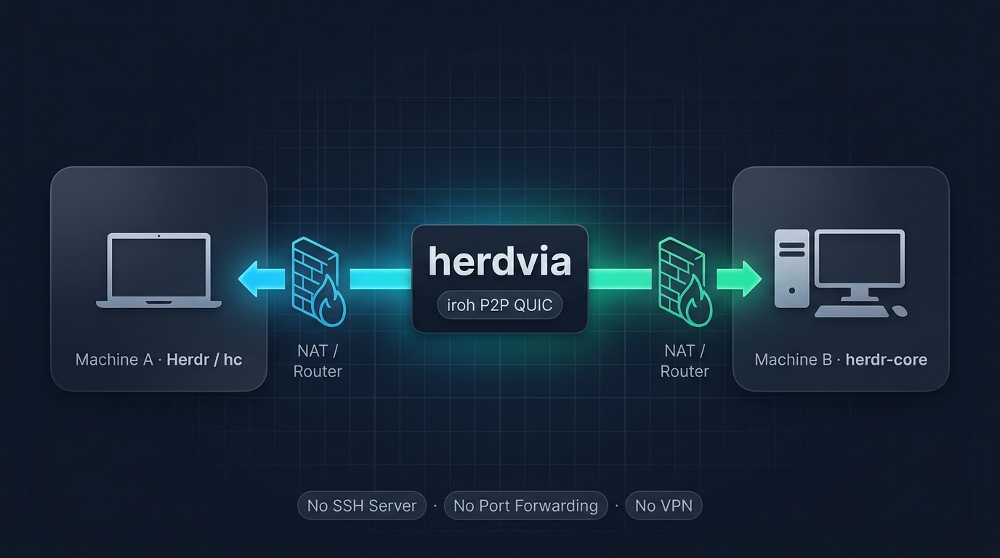
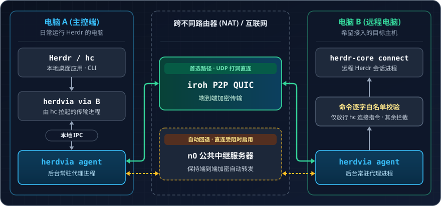
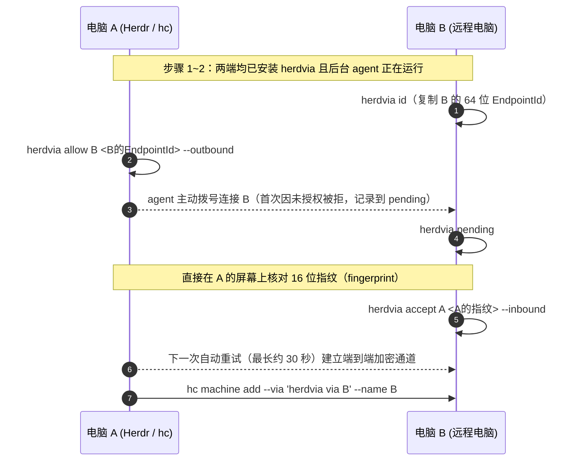

# herdvia

<p align="center">
  <a href="../README.md">English</a> · <a href="README.ko.md">한국어</a> · <a href="README.ja.md">日本語</a> · <strong>简体中文</strong>
</p>

<p align="center">
  <a href="https://github.com/photojupi/herdvia/actions/workflows/ci.yml"></a>
  <a href="https://github.com/photojupi/herdvia/releases/latest"></a>
  <a href="#license"></a>
</p>

**无需 SSH 服务器、无需路由器端口转发、无需 VPN，即可将位于不同路由器（NAT）后的电脑作为远程主机接入 [Herdr](https://herdr.dev)。**



> [!NOTE]
> **非官方 · 实验性项目说明：** `herdvia` 是个人独立项目，与 Herdr / `herdr-core` 官方项目无任何关联、背书或技术支持关系。目前处于实验阶段，其命令行接口、文件格式与通信协议可能在后续版本中发生不兼容变更。

---

## 目录

- [什么是 herdvia？](#what-is-herdvia)
- [工作原理](#how-it-works)
- [前置准备](#requirements)
- [5 分钟快速上手](#quick-start)
- [安装指南](#install)
  - [一键安装脚本（推荐）](#install-script)
  - [手动安装](#manual-install)
  - [从源码编译](#from-source)
- [命令参考](#commands)
- [开机自动启动](#automatic-startup)
- [常见问题排查（Troubleshooting）](#troubleshooting)
  - [运行 `herdvia doctor`](#run-herdvia-doctor)
  - [常见现象](#common-symptoms)
- [升级与卸载](#upgrading-and-uninstalling)
- [安全模型](#security-model)
- [网络与公开信息说明](#network-and-published-information)
- [支持平台](#supported-platforms)
- [配置与文件路径](#configuration-and-files)
- [设计文档与开源许可](#design)

---

<a id="what-is-herdvia"></a>
## 什么是 herdvia？

在 Herdr 中添加远程电脑时，`hc machine add --via <命令>` 通常搭配 `ssh` 使用。但如果要跨家庭、办公室或咖啡馆等不同路由器（NAT）连接多台电脑，往往需要配置 SSH 服务端、设置路由器端口转发，或者在每台设备上安装组网 VPN。

**`herdvia` 是可直接替换 `--via` 命令的点对点（P2P）传输通道。** 它基于 [iroh](https://www.iroh.computer)（支持自动 NAT 穿透并在直连受阻时自动回退至公共中继的端到端加密 P2P QUIC），在你的两台设备之间原样搬运 `hc` 会话的字节流。

| 连接方案 | 路由器端口转发 | 额外服务 / 注册账号 | 网络暴露面 | 配置耗时 |
|---|---|---|---|---|
| **SSH (`ssh user@host`)** | 跨内网连接时必需 | 目标电脑需开启 SSH 服务 | 暴露 SSH 端口 | 中～高 |
| **组网 VPN** | 不需要 | 虚拟网卡驱动 + 平台账号 | 暴露整个虚拟网卡 IP（未精细配置 ACL 时） | 中 |
| **`herdvia`** | **不需要** | **单个轻量级用户态可执行文件（免账号）** | **仅向显式授权的公钥开放 `herdr-core connect`** | **约 5 分钟** |

---

<a id="how-it-works"></a>
## 工作原理

`herdvia` 不解析也不干预 Herdr 内部协议——它只负责在你操作的主控端（**电脑 A**）上的 `hc` 与远程被控端（**电脑 B**）上的 `herdr-core` 之间安全搬运字节。



1. **常驻后台代理 (`herdvia agent`)：** 在每台电脑的当前用户会话中运行，持有设备密钥身份（`EndpointId`），并与已授权对端保持加密 QUIC 连接。
2. **双向显式授权 (`allow` / `accept`)：** 从不自动信任陌生设备。主控端 A 必须显式允许拨向 B（`--outbound`），被控端 B 也必须显式允许 A 接入（`--inbound`）。
3. **命令逐字白名单校验：** 接收端（电脑 B）仅执行与 `hc` 发送的 `herdr-core connect` 命令逐字完全一致的指令（已基于 **`hc 0.1.21`** 实测验证），其余任何命令均会被拒绝并写入日志。

---

<a id="requirements"></a>
## 前置准备

配对两台电脑前，请先确认各自需要安装的组件：

| 组件 | 电脑 A（主控端 — 运行 Herdr） | 电脑 B（远程目标电脑） | 说明 |
|---|---|---|---|
| **`herdr-core`** | 必需 | 必需 | 两台电脑请保持**相同版本**（已验证版本为 **`0.1.21`**） |
| **Herdr 应用 / `hc` CLI** | 必需 | 不需要 | 电脑 B 只需安装 `herdr-core` |
| **`herdvia` + 运行中的 agent** | 必需 | 必需 | 可通过一键脚本、发布包或 Cargo 安装 |

### 在两台电脑上安装 `herdr-core`

`herdvia` **不会**代为安装或更新 `herdr-core`，请在两台电脑上分别运行 Herdr 官方安装脚本（重复运行即可更新）：

- **macOS / Linux：**
  ```sh
  curl -fsSL https://releases.herdr.dev/core/install.sh | sh
  ```
  安装至 `~/.local/bin/herdr-core`（若尚无 `hc` 则一并创建链接）。该脚本不会自动修改 `PATH`；若 `~/.local/bin` 不在 `PATH` 中会打印提示。

- **Windows（普通 PowerShell — 无需管理员权限）：**
  ```powershell
  powershell -c "irm https://releases.herdr.dev/core/install.ps1 | iex"
  ```
  安装至 `%LOCALAPPDATA%\Programs\herdr-core\herdr-core.exe`（若尚无 `hc.exe` 则一并安装），并自动将该目录加入当前用户的 `PATH`。

如需安装经 `herdvia` 实测验证的 **`0.1.21`** 版本：

```sh
# macOS / Linux
curl -fsSL https://releases.herdr.dev/core/install.sh | HC_VERSION=0.1.21 sh
```

```powershell
# Windows (PowerShell)
$env:HC_VERSION = "0.1.21"; powershell -c "irm https://releases.herdr.dev/core/install.ps1 | iex"
```

*（在 macOS 上，若已安装更新版本的 `herdr-core`，脚本会拒绝降级并提示使用 `hc update --from ... --force`。）*

> [!IMPORTANT]
> **关于 `herdr-core` 的两条重要说明：**
> 1. **不支持通过通道远程安装/更新（基于 `hc 0.1.21`）：** 由于 `herdvia` 只放行与 `hc` 的 `herdr-core connect` 完全一致的命令行，`hc machine add --install` 和 `hc machine update` 无法通过 `herdvia` 安装或更新远端的 `herdr-core`；若未来 `hc` 更改了连接命令格式，在 `herdvia` 跟进更新前也会被拒绝。
> 2. **远程电脑 B 上查找 `herdr-core` 的路径：**
>    - **macOS / Unix：** `~/.local/bin/herdr-core` 或 agent 所在环境的 `PATH`。在 macOS 上，通过 `herdvia agent install` 自动启动的代理其 `PATH` 仅包含 `~/.local/bin:/usr/bin:/bin:/usr/sbin:/sbin`——若通过 Homebrew 等方式安装在其他位置，请创建软链接至 `~/.local/bin/herdr-core`。
>    - **Windows：** `%USERPROFILE%\AppData\Local\Programs\herdr-core\herdr-core.exe`。

---

<a id="quick-start"></a>
## 5 分钟快速上手

假设你有两台设备：
- **电脑 A** — 你日常操作 Herdr / `hc` 的电脑（例如随身笔记本）
- **电脑 B** — 你希望远程接入的电脑（例如家里的台式机）

首先，在 **A 和 B 两台电脑**上安装 `herdvia`（Intel Mac、Linux 或手动解压安装请参阅[安装指南](#install)）：

```sh
# macOS (Apple Silicon)
curl -fsSL https://github.com/photojupi/herdvia/releases/latest/download/install.sh | sh
```

```powershell
# Windows (x64) — 请在【普通】PowerShell 窗口中运行，不要使用管理员窗口
powershell -c "irm https://github.com/photojupi/herdvia/releases/latest/download/install.ps1 | iex"
```

安装完成后，请**新开一个终端窗口**使 `PATH` 生效（在 Windows 上请打开新的 PowerShell 窗口，若 Herdr 正在运行请重启 Herdr）。

完整配对流程一览：



### 步骤 1. 查看每台电脑的身份标识

在 **A 和 B 两台电脑**上运行（若使用了一键脚本，安装时已打印过一次）：

```sh
herdvia id
```

- **第 1 行：** 完整的 64 位 `EndpointId`（本机公钥）。
- **第 2 行：** 每 4 位一组的 16 位短指纹（例如 `28af-63b6-258e-859d`）。首次运行时会自动创建私钥。

### 步骤 2. 确保两台电脑上的代理正在运行

如果使用了[一键安装脚本](#install-script)，后台代理**已经注册开机自启并正在运行**，可直接跳到步骤 3。

如果是手动安装，可以注册登录自启并立即启动（支持 macOS 与 Windows）：

```sh
herdvia agent install
```

或者直接在终端前台运行：

```sh
herdvia agent
```

各平台详情请参阅[开机自动启动](#automatic-startup)。

### 步骤 3. 在电脑 A 上授权连接电脑 B (`--outbound`)

对端绝不会被自动信任。将 **B 的 `EndpointId`** 复制到 **A**，允许 A 主动连接 B：

```sh
herdvia allow B <B的EndpointId> --outbound
```

核对你粘贴的 `EndpointId` 前 16 位字符是否与 B 上 `herdvia id` 打印的指纹一致（建议当面核对，或通过不同于复制 ID 所用的另一条渠道核对）。

| 方向参数 | 含义 |
|---|---|
| `--outbound` | 允许**本机**主动拨号连接该对端 |
| `--inbound` | 允许**该对端**连入本机并开启会话 |
| `--both` | 同时允许双向连接 |

*节点名称（如 `A`、`B`、`home-pc`）是本地别名，支持 `1–32` 个 `A-Z a-z 0-9 . _ -` 字符。使用相同名称再次执行 `allow` 会覆盖更新原记录。*

### 步骤 4. 在电脑 B 上接受电脑 A (`--inbound`)

此时 A 的代理会开始尝试连接 B。由于 A 尚未加入 B 的授权列表，B 会拒绝连接，但会将 A 的请求暂存在内存中，免去你再次手动搬运 64 位长 ID。

在 **B** 上查看待确认连接：

```sh
herdvia pending
```

```text
fingerprint id attempts last-seen
28af-63b6-258e-859d 28af63b6258e859dc534c014248ebf7284cdbb34e7cff524e3e4d35c2df1fc55 3 4s
```

请**直接查看 A 自己的屏幕**读取 A 的指纹（即 A 上 `herdvia id` 的第 2 行——任何知道 B 的 `EndpointId` 的设备都可能出现在 `pending` 中，因此切勿直接照抄 `pending` 列表里的指纹！），然后在 **B** 上执行：

```sh
herdvia accept A <A的指纹> --inbound
```

- `accept` 会将该指纹对应的完整 `EndpointId` 写入授权列表（等效于 `herdvia allow A <A的EndpointId> --inbound`），并输出 `A <EndpointId> in`。
- 输入指纹时可带或不带连字符 `-`，不区分大小写。如果希望 B 也能反向连接 A，可使用 `--both`（`accept` 不接受 `--outbound`）。
- A 对被拒连接采用递增退避重试（最长间隔 **30 秒**），因此 A 出现在 `pending` 中最长可能需要约 30 秒，`accept` 后重新连上最长也可能需要约 30 秒。
- *（备选方式：若方便直接把 A 的完整 ID 复制到 B，也可以直接在 B 上运行 `herdvia allow A <A的EndpointId> --inbound` 并核对指纹。）*

### 步骤 5. 在电脑 A 上将电脑 B 添加到 Herdr

在 **A** 上执行：

```sh
hc machine add --via 'herdvia via B' --name B
```

- `'herdvia via B'` 中的 `B` 必须与步骤 3 中 `herdvia allow` 使用的名称一致；`--name B` 是 Herdr 界面中显示的名称，可自由命名。
- `hc` 会在该命令末尾追加一个远程命令参数后执行。
- **如果 `hc` 在其 `PATH` 中找不到 `herdvia`：** 请填写可执行文件的完整路径，若路径含空格需加引号：
  - **macOS：** `hc` 通过 `sh` 执行 `--via`，请按 `sh` 规则加引号（安装脚本会自动输出可直接粘贴的命令）。
  - **Windows：** `hc` 不经过 shell 拆分 `--via`（`CommandLineToArgvW` 规则），路径含空格时需用双引号包裹。由于 Windows PowerShell 5.1 在未转义时会剥离内层双引号，更简单的做法是将 `herdvia` 保留在用户 `PATH` 中（安装后打开新的 PowerShell 窗口并重启 Herdr），然后如上运行 `hc machine add --via 'herdvia via B' --name B`。

### 步骤 6. 检查连接状态

在 **A** 上查看连接详情：

```sh
herdvia status
```

```text
name permission connection path rtt
B out connected direct 4.12ms
```

- **`path`：** 连接刚建立时通常走 `relay`（中继），一般在几秒内自动升级为 `direct`（点对点直连）。
- **macOS 局域网权限提示：** 如果两台设备在同一局域网/Wi-Fi 下却一直停留在 `relay`，请在 Mac 的 **系统设置 > 隐私与安全性 > 本地网络** 中允许 `herdvia`（详见 [macOS 自动启动](#macos)）。
- **提示：** 在 B 尚未 `accept` A 之前，每次 A 重试时 A 侧的 `herdvia status` 可能会短暂闪现 `connected`。若要确认真正连通，请在 **B** 上运行 `herdvia status`。
- **如果遇到连接异常：** 请在两台电脑上运行 `herdvia doctor`，每条 `warn` 或 `fail` 输出都会直接提示处理方法（详见[运行 `herdvia doctor`](#run-herdvia-doctor)）。

---

<a id="install"></a>
## 安装指南

<a id="install-script"></a>
### 一键安装脚本（推荐）

**macOS (Apple Silicon)：**

```sh
curl -fsSL https://github.com/photojupi/herdvia/releases/latest/download/install.sh | sh
```

**Windows (x64)** — 请在**普通 PowerShell 窗口**（非管理员）中运行：

```powershell
powershell -c "irm https://github.com/photojupi/herdvia/releases/latest/download/install.ps1 | iex"
```

安装脚本依次执行的 6 个步骤：

1. **下载与校验：** 将发布压缩包与 `SHA256SUMS` 下载到临时目录并校验 SHA-256 哈希；若下载或校验失败，立即中止且不做任何改动。
2. **安装可执行文件：** macOS 放置到 `~/.local/bin/herdvia`；Windows 放置到 `%LOCALAPPDATA%\Programs\herdvia\herdvia.exe`（连同 README 与许可证文件）。
3. **配置 `PATH`：** macOS 在登录 shell 为 `zsh` 时向 `~/.zprofile` 追加 `export PATH="$HOME/.local/bin:$PATH"`（其他 shell 仅打印提示行）；Windows 自动将该目录添加到用户 `PATH`。
4. **检查 `herdr-core`：** **不会自动安装 `herdr-core`。** 若未安装则打印官方安装命令；在 macOS 上若 `herdr-core` 位于其他路径而非 `~/.local/bin/herdr-core`，会打印 `ln -s` 软链接命令以便后台代理找到它。
5. **生成并打印身份标识：** 运行 `herdvia id` 初始化 `secret.key`（若需要）并显示本机 `EndpointId` 与指纹。
6. **注册并启动后台代理：** 运行 `herdvia agent install` 使代理立即启动并在每次登录时自动运行（若在 Windows 管理员 PowerShell 中运行，会跳过此步并提示改用普通窗口执行）。

**脚本平台要求：**
- **macOS：** 仅支持 Apple Silicon（拒绝以 `root` 运行；Intel Mac 或 Linux 会安全退出并指引前往[从源码编译](#from-source)）。
- **Windows：** 仅支持 x64，且需要 `System32\curl.exe`（Windows 10 1803 及以上自带）。

**环境变量选项（布尔开关仅在值为 `1` 时生效）：**

| 变量名 | 作用 |
|---|---|
| `HERDVIA_VERSION` | 安装指定版本（如 `0.1.0` 或 `v0.1.0`），而非最新版 |
| `HERDVIA_NO_AGENT=1` | 跳过运行 `herdvia agent install` |
| `HERDVIA_NO_MODIFY_PATH=1` | 不修改 `~/.zprofile` 或 Windows 用户 `PATH` |
| `HERDVIA_RELEASE_BASE` | 改从 `<url>/<文件名>` 而非 GitHub Releases 下载发布文件（优先级高于 `HERDVIA_VERSION`） |

安装指定版本（注意：即使从带版本标签的 URL 下载 `install.sh` / `install.ps1`，也需显式设置 `HERDVIA_VERSION`）：

```sh
curl -fsSL https://github.com/photojupi/herdvia/releases/download/v0.1.0/install.sh | HERDVIA_VERSION=0.1.0 sh
```

```powershell
$env:HERDVIA_VERSION = "0.1.0"; powershell -c "irm https://github.com/photojupi/herdvia/releases/download/v0.1.0/install.ps1 | iex"
```

先审阅脚本内容再运行（`SHA256SUMS` 中同样包含安装脚本的校验值）：

```sh
# macOS
curl -fsSLO https://github.com/photojupi/herdvia/releases/latest/download/install.sh
less install.sh
sh install.sh
```

```powershell
# Windows (PowerShell)
curl.exe -fLO https://github.com/photojupi/herdvia/releases/latest/download/install.ps1
notepad install.ps1
Get-Content -Raw .\install.ps1 | Invoke-Expression
```

*（再次运行安装脚本即可原地升级，详见[升级](#upgrading)。）*

<a id="manual-install"></a>
### 手动安装

前往 [GitHub Releases](https://github.com/photojupi/herdvia/releases) 下载：

- `herdvia-macos-arm64.zip`（macOS Apple Silicon）
- `herdvia-windows-x64.zip`（Windows x64）
- `install.sh` 与 `install.ps1`
- `SHA256SUMS`（压缩包与脚本的 SHA-256 校验值）

每个压缩包解压后均无外层目录，直接包含可执行文件、`README.md`、`LICENSE-MIT`、`LICENSE-APACHE` 与 `THIRD-PARTY-LICENSES.html`。由于开机自启会记录你运行 `agent install` 时的绝对路径，请务必将可执行文件放在固定目录（如 macOS 的 `~/.local/bin/herdvia` 或 Windows 的 `%LOCALAPPDATA%\Programs\herdvia\herdvia.exe`），切勿留在下载目录或临时目录中。

二进制文件未经代码签名或公证（notarization）。不提供 Intel Mac 预编译包，请[从源码编译](#from-source)。

<a id="macos-apple-silicon"></a>
#### macOS (Apple Silicon)

```sh
mkdir -p ~/.local/bin
cd "$(mktemp -d)"
curl -fLO https://github.com/photojupi/herdvia/releases/latest/download/herdvia-macos-arm64.zip &&
curl -fLO https://github.com/photojupi/herdvia/releases/latest/download/SHA256SUMS &&
shasum -a 256 -c --ignore-missing SHA256SUMS &&
unzip -q herdvia-macos-arm64.zip -d herdvia &&
mv herdvia/herdvia ~/.local/bin/herdvia
echo 'export PATH="$HOME/.local/bin:$PATH"' >> ~/.zprofile
```

- 若 `~/.local/bin` 已在 `PATH` 中，请跳过最后一行 `echo ... >> ~/.zprofile`。
- 请直接移动可执行文件本身到 `~/.local/bin`（不要软链接到下载目录中的文件，因为 `launchd` 会记录软链接路径，一旦源文件被删除就会失效）。
- 打开新终端并运行 `herdvia id` 验证。
- 若通过浏览器下载压缩包，macOS Gatekeeper 会附加隔离属性导致无法运行，可执行以下命令移除：
  ```sh
  xattr -d com.apple.quarantine ~/.local/bin/herdvia
  ```

<a id="windows-x64"></a>
#### Windows (x64)

请在**普通（非管理员）PowerShell 窗口**中逐条运行以下命令，若任意一步报错请立即停止：

```powershell
# 1. 创建并进入临时目录
$tmp = Join-Path $env:TEMP "herdvia-$(Get-Random)"
New-Item -ItemType Directory $tmp
Set-Location $tmp

# 2. 下载压缩包与校验文件
curl.exe -fLO https://github.com/photojupi/herdvia/releases/latest/download/herdvia-windows-x64.zip
curl.exe -fLO https://github.com/photojupi/herdvia/releases/latest/download/SHA256SUMS

# 3. 核对 SHA-256 哈希（两者必须完全一致！）
certutil -hashfile herdvia-windows-x64.zip SHA256
Select-String herdvia-windows-x64.zip SHA256SUMS

# 4. 解压至 %LOCALAPPDATA%\Programs\herdvia（仅在哈希一致时）
New-Item -ItemType Directory -Force "$env:LOCALAPPDATA\Programs\herdvia"
tar.exe -xf herdvia-windows-x64.zip -C "$env:LOCALAPPDATA\Programs\herdvia"
```

要直接通过名称运行 `herdvia`，请将 `%LOCALAPPDATA%\Programs\herdvia` 加入**用户 `Path`**（*开始菜单 → “编辑账户的环境变量” → 用户变量 → `Path` → 编辑 → 新建*），随后打开新的 PowerShell 窗口（若 Herdr 正在运行请重启）并运行 `herdvia id` 验证。首次运行时 Windows SmartScreen 可能会弹出提示。

<a id="from-source"></a>
### 从源码编译

由于 `iroh` 依赖要求，需要 **Rust 1.91 及以上版本**。

- **macOS：** Xcode Command Line Tools (`xcode-select --install`) 以及通过 [rustup](https://rustup.rs) 安装的 Rust。
- **Windows：** [rustup](https://rustup.rs) 以及 Visual Studio Build Tools（勾选“使用 C++ 的桌面开发”）。*（注：官方发布的 Windows 可执行文件在 Linux 上使用 MinGW `x86_64-pc-windows-gnu` 交叉编译，CI 未覆盖 Windows MSVC 编译。）*

```sh
cargo install --locked --git https://github.com/photojupi/herdvia
```

默认编译 `main` 分支并安装至 `~/.cargo/bin`（Windows 为 `%USERPROFILE%\.cargo\bin`）。如需编译特定发布版本，请追加 `--tag v<版本号>`。

---

<a id="commands"></a>
## 命令参考

| 命令 | 说明 |
|---|---|
| `herdvia id` | 打印本机 `EndpointId`（第 1 行）与 16 位短指纹（第 2 行）。若 `secret.key` 不存在则自动生成。 |
| `herdvia allow <名称> <EndpointId> (--inbound \| --outbound \| --both)` | 添加或更新对端节点。运行中的代理会立即生效；未运行时在下次启动生效。 |
| `herdvia revoke <名称>` | 移除对端节点，并立即断开与该节点的所有活动连接与会话。 |
| `herdvia status` | 显示各对端的名称、权限、连接状态、`direct`/`relay` 路径及往返时延（RTT）。需要代理正在运行。 |
| `herdvia pending` | 列出连入连接尝试被拒绝的设备（指纹、`EndpointId`、尝试次数、距上次出现的时间）。仅保存在内存中：最多保留 16 条，末次尝试 10 分钟后过期。需要代理正在运行。 |
| `herdvia accept <名称> <指纹> (--inbound \| --both)` | 将 `pending` 中唯一匹配该指纹的设备以其完整 `EndpointId` 加入授权列表。若匹配数为 0 或多于 1，或 `<名称>` 已绑定其他 ID，则拒绝操作。需要代理正在运行。 |
| `herdvia doctor` | 在不做任何修改的前提下检查本机配置（可执行文件、数据目录、`secret.key`、`peers`、`herdr-core`、自动启动、代理、中继、对端连接、待确认连入请求）。输出以 `ok`/`warn`/`fail` 开头的检查行（对端连接为每个对端一行；前置步骤失败时省略后续依赖项），若有任一检查失败则以退出码 `1` 结束。详见[运行 `herdvia doctor`](#run-herdvia-doctor)。 |
| `herdvia --version` | 输出 `herdvia <版本号>`。 |
| `herdvia agent` | 在前台运行代理（按 `Ctrl-C` 停止）。 |
| `herdvia agent install` | 注册登录自动启动并立即启动代理（支持 macOS、Windows）。 |
| `herdvia agent uninstall` | 停止后台自启代理并移除自启注册（保留数据目录与日志文件）。 |
| `herdvia via <对端> <命令>` | 供 `hc` 内部调用的传输子命令，无需手动执行。需要本地代理正在运行。 |

发生任何错误时，`herdvia` 会在标准错误（`stderr`）输出一行以 `herdvia:` 开头的错误信息，并以退出码 **`255`** 结束。

---

<a id="automatic-startup"></a>
## 开机自动启动

<a id="macos"></a>
### macOS

`herdvia agent install` 会创建当前用户的 LaunchAgent（`~/Library/LaunchAgents/io.github.photojupi.herdvia.agent.plist`），并通过 `launchctl bootstrap` 立即启动。`launchd` 会在用户登录时自动拉起代理，并在进程退出时自动重启。日志输出至 `~/Library/Logs/herdvia.log`。

- 若设置了 `HERDVIA_DIR` 环境变量（自动启动始终使用默认数据目录），或已有手动启动的前台代理在运行，则会拒绝安装。
- 再次运行 `herdvia agent install` 会更新为当前可执行文件路径并重启代理。
- 若从临时目录或 Cargo `target` 编译目录运行，会打印警告但仍完成注册。

> [!IMPORTANT]
> **macOS 15+ 本地网络权限：** 在 macOS 15（Sequoia）及更新版本上，自动启动的后台代理在获得授权前无法直连局域网地址。请在系统弹窗中点击**允许**，或前往 **系统设置 > 隐私与安全性 > 本地网络** 开启 `herdvia`。未开启前，同一局域网内的设备也会走 `relay` 中继而非 `direct` 直连（跨公网设备以及在终端前台手动运行的 `herdvia agent` 不受影响）。

### Windows

`herdvia agent install` 会在当前用户的注册表 `Run` 键（`HKCU\Software\Microsoft\Windows\CurrentVersion\Run`）下写入启动项，登录时通过 `conhost.exe --headless "<herdvia.exe路径>" agent --log` 无窗口后台启动，并在安装当下立即拉起。全程无需管理员权限，不创建系统服务或计划任务。

- **必须在普通（非管理员）PowerShell 窗口中运行**——管理员窗口中会拒绝执行。
- 若设置了 `HERDVIA_DIR`，或尚未注册自启时已有前台代理正在运行，则会拒绝安装（若已注册过自启，再次运行 `install` 会停止正在运行的默认数据目录代理并启动新代理）。
- 可执行文件路径不能包含 `%`，且完整注册命令行长度不得超过 259 个 UTF-16 代码单元。
- 日志写入 `%LOCALAPPDATA%\herdvia\herdvia.log`。若代理意外退出，Windows 不会自动重启，将在下次登录时重新启动。

### Linux

Linux 不支持自动启动（`agent install` / `agent uninstall`）。请直接运行 `herdvia agent`（例如在 `systemd --user` 下或会话管理器内）。

---

<a id="troubleshooting"></a>
## 常见问题排查（Troubleshooting）

<a id="run-herdvia-doctor"></a>
### 运行 `herdvia doctor`

`herdvia doctor` 会按顺序检查以下项目：

1. **当前可执行文件：** 版本与路径（若从临时目录或 Cargo `target` 编译目录运行会发出警告，因为 `agent install` 会记录该路径）。
2. **数据目录：** 路径（包括是否来自 `HERDVIA_DIR`）、是否存在、是否为目录（macOS/Unix 上不接受符号链接），以及当前用户是否能够打开（macOS/Unix 上还会校验所有者；若无法打开则判为 `fail`，并在 macOS/Unix 上提示运行 `chmod 700`）。在 macOS/Unix 上还会检查代理套接字路径是否超出 Unix 套接字长度上限。
3. **`secret.key`：** 是否存在，以及在 macOS/Unix 上是否符合 `herdvia` 要求的权限。输出中仅显示短指纹。
4. **`peers`：** 是否可读且格式有效，并统计各方向已注册的对端数量。
5. **`herdr-core`：** 是否位于代理实际查找的位置（macOS 上为自启代理的 `PATH`），以及 `herdr-core --version` 是否返回已验证的 `0.1.21`。
6. **自动启动：** 是否已注册（macOS 的 LaunchAgent plist、Windows 的注册表 `Run` 值）且指向当前可执行文件。在 Windows 上若以管理员身份运行也会发出警告。
7. **代理：** 当前数据目录对应的代理是否响应、其版本与可执行文件路径，以及是否已连接归属中继（home relay）。
8. **对端连接：** 基于 `herdvia status`，为每个已注册对端输出一行连接状态与路径（若尚未注册任何对端，则输出一行 `warn`）。
9. **待确认连接（`pending`）：** `herdvia pending` 中会列出的被拒连入请求数量。

输出行写往标准输出（`stdout`），以 `ok`、`warn` 或 `fail` 开头；`warn` 与 `fail` 行会在同一行给出处理建议。对端连接按每个对端输出一行，当前置步骤失败时会省略依赖它的后续检查：若数据目录检查为 `fail`，将跳过代理检查及其后的所有行（除非仅因 Unix 套接字路径过长而失败，否则 `secret.key` 与 `peers` 也会一并跳过）；若代理无响应，则跳过 `relay`、对端连接与 `pending` 行。没有任何 `fail` 时退出码为 `0`（仅有 `warn` 仍为 `0`），存在任一 `fail` 时退出码为 `1`。命令参数错误等情况仍输出一行 `herdvia:` 并以 `255` 结束。

`doctor` 是只读命令：不会创建或修改数据目录、`secret.key`、`peers`、自动启动注册项或代理状态，唯一运行的程序是 `herdr-core --version`（限时 2 秒）。向代理发送的每次请求均有 3 秒超时限制：即使代理正在运行，若未在 3 秒内响应，`doctor` 也会输出 `fail agent: it may be running, but it did not answer within 3 seconds; …` 并跳过其余代理检查；若后续的对端状态或 `pending` 请求超过 3 秒，则对应行记为 `warn`（`status` 超时后跳过 `pending`）。`herdvia doctor` 自 `v0.1.2` 起提供；更早版本的代理不认识该请求，此时 `doctor` 会警告正在运行的代理早于当前可执行文件并提示重启（省略 `relay`，但仍继续检查对端连接与 `pending`），同时该代理日志中会记录一行 `unknown CONTROL request`。

请在**两台电脑**上都运行一次：电脑 B 上的问题（例如缺少 `herdr-core` 或尚未 `accept` 对端）会显示在 B 的输出中。电脑 A 上的运行示例：

```text
$ herdvia doctor
ok   executable: herdvia 0.1.2 at /Users/you/.local/bin/herdvia
ok   data directory: /Users/you/Library/Application Support/herdvia
ok   secret.key: present, fingerprint 28af-63b6-258e-859d
ok   peers: 2 registered (in 0, out 1, both 1)
ok   herdr-core: /Users/you/.local/bin/herdr-core (hc 0.1.21)
ok   automatic start: registered for this executable
ok   agent: running herdvia 0.1.2 from /Users/you/.local/bin/herdvia
ok   relay: connected to https://aps1-1.relay.n0.iroh.link./
ok   peer B (out): connected directly, 4.12ms
warn peer office (both): not connected; its agent is off, or it has not allowed this PC (on that PC: herdvia pending, then herdvia accept)
ok   pending: no rejected connection attempts
```

<a id="common-symptoms"></a>
### 常见现象

| 现象 | 常见原因 | 解决方法 |
|---|---|---|
| 在 B 上运行 `herdvia pending` 列表为空 | A 的代理未启动、A 未配置 `--outbound`，或正处于重试间隔内 | 确认 A 上 `herdvia status` 正常且已执行 `herdvia allow B <B_ID> --outbound`，等待最多 30 秒后再运行 `herdvia pending` |
| 两台电脑连同一 Wi-Fi，`status` 却一直是 `relay` | macOS 15+ 拦截了后台 LaunchAgent 的局域网访问 | 在 Mac 的 **系统设置 > 隐私与安全性 > 本地网络** 中开启 `herdvia` |
| Mac 上已通过 Homebrew 安装 `herdr-core`，但 Herdr 显示 `herdr-core is not installed here` | macOS LaunchAgent 仅搜索 `~/.local/bin:/usr/bin:/bin:/usr/sbin:/sbin` | 运行 `mkdir -p ~/.local/bin && ln -s "$(command -v herdr-core)" ~/.local/bin/herdr-core` |
| `hc machine add --install` 或 `hc machine update` 失败 | `herdvia` 拒绝除 `herdr-core connect` 以外的一切命令 | 请直接在各台电脑上运行 Herdr 官方的 `herdr-core` 安装脚本 |
| 刚装完提示找不到 `herdvia` 命令 | 当前终端或 Herdr 应用尚未加载更新后的 `PATH` | 打开全新的终端窗口；Windows 上同时重启 Herdr 应用 |
| Windows 上 `herdvia agent install` 提示管理员错误 | 在“以管理员身份运行”的 PowerShell 中执行了命令 | 打开普通（非管理员）PowerShell 窗口重新运行 `herdvia agent install` |
| B 还没 `accept`，A 的 `status` 却短暂显示 `connected` | 握手完成后、B 主动断开未授权连接前的瞬间状态 | 在接收端 **B** 上运行 `herdvia status` 确认是否真正建立连接 |

---

<a id="upgrading-and-uninstalling"></a>
## 升级与卸载

本机密钥（`secret.key`）与对端列表（`peers`）保存在独立的数据目录中，不在可执行文件旁，因此替换或删除可执行文件不会丢失身份与配对配置。可随时运行 `herdvia --version` 查看当前版本。

<a id="upgrading"></a>
### 升级

**推荐方式 — 重新运行[一键安装脚本](#install-script)：**
脚本会自动下载校验新版文件、安全替换旧程序（macOS 采用原子 `mv`；Windows 先复制为 `herdvia.new.exe` 验证可运行后将正在运行的旧程序重命名为 `.old`，避免文件占用锁死），并再次运行 `herdvia agent install` 用新程序重启代理，且不会重复写入 `PATH`。

*（若有手动启动的前台代理正在运行或设置了 `HERDVIA_DIR`，请停止该代理或取消 `HERDVIA_DIR` 后运行 `herdvia agent install`，或传入 `HERDVIA_NO_AGENT=1` 并自行重启代理。）*

**手动升级：**
- **macOS：** 重新执行 [macOS (Apple Silicon)](#macos-apple-silicon) 中的下载、校验与 `mv` 命令（省略 `.zprofile` 那行）。**切勿用 `cp` 直接覆盖正在运行的二进制文件**（否则下次启动会触发 `Killed: 9`），务必使用 `mv` 替换后再运行 `herdvia agent install`（或重启前台运行的 `herdvia agent`）。
- **Windows：** 由于运行中的 `.exe` 无法被 `tar.exe` 覆盖，请先运行 `herdvia agent uninstall`（前台运行则按 `Ctrl-C`）停止代理，按 [Windows (x64)](#windows-x64) 步骤解压替换后，再运行 `herdvia agent install`。

升级完成后，若正在运行的代理仍是旧的可执行文件或旧版本，`herdvia doctor` 会发出警告。

### 卸载

1. **停止代理并取消自启：** 运行 `herdvia agent uninstall`（前台运行则按 `Ctrl-C`）。
2. **删除可执行文件：**
   - macOS：`rm ~/.local/bin/herdvia`
   - Windows (PowerShell)：`Remove-Item -Recurse -Force "$env:LOCALAPPDATA\Programs\herdvia"`
3. **彻底清除身份密钥、对端列表与日志（可选）：** 按[配置与文件路径](#configuration-and-files)删除数据目录与日志文件。
4. **清理 `PATH`：**
   - Windows：从用户环境变量 `Path` 中移除 `%LOCALAPPDATA%\Programs\herdvia`。
   - macOS：`~/.zprofile` 中的 `~/.local/bin` 可能还被 `hc`、`herdr-core` 等工具共用，仅在确认无其他程序依赖时再移除。
5. **在对端设备上解除配对：** 在曾授权本机的设备上运行 `herdvia revoke <名称>`，并在运行 Herdr 的设备上执行 `hc machine rm <名称>`。

---

<a id="security-model"></a>
## 安全模型

> [!WARNING]
> **向某个对端授予 `--inbound`（或 `--both`）权限，意味着允许它以你的当前系统用户身份启动 `herdr-core` 会话——实际上等同于授予完整的本地 Shell 权限。** 请仅授权你像信任自己一样完全信任的设备。

- **端到端公钥双向认证：** 所有连接均由 `iroh` 使用各设备的 Ed25519 密钥对（`EndpointId`）完成双向认证。当授权列表为空或方向权限（`in`、`out`、`both`）不匹配时一律拒绝。在每个流（stream）上都会重新校验权限，`revoke` / `allow` 变更对运行中的代理立即生效。
- **命令白名单仅作纵深防御：** 仅放行 `hc` 的精确 `herdr-core connect` 命令并记录异常请求，旨在缩小误用面并及时发现异常；但 `herdr-core connect` 本身即可执行任意命令，**真正的安全边界是对端密钥列表（`peers`）。**
- **拒绝 `root` 运行：** 在 macOS/Unix 上，`herdvia` 拒绝以 `root` 身份启动。
- **用户隔离的本地 IPC：**
  - **macOS / Unix：** 位于 `0700` 数据目录内的 `0600` 域套接字，并校验连接进程的 UID。
  - **Windows：** 通过 DACL 将命名管道限制为仅当前用户 SID 可访问，并拒绝远程网络管道客户端。
- **私钥保护 (`secret.key`)：** macOS/Unix 上以 `0600` 权限创建，若权限过宽则拒绝启动；Windows 上沿用用户配置文件夹的默认权限。任何拿到 `secret.key` 的人都可向信任本机的对端冒充本机——一旦泄露，请立即在所有对端上运行 `herdvia revoke <名称>`，并删除 `secret.key` 以重新生成新身份。
- **短指纹与 `pending` / `accept`：** 指纹仅表示 256 位 `EndpointId` 的前 16 个十六进制字符（64 位），供人工比对；`herdvia` 存储与校验始终使用完整 `EndpointId`。`pending` 仅记录完成已认证 `iroh` 握手的对端，在内存中最多保留 16 条、10 分钟过期，且 `accept` 仅在唯一匹配时才放行。请务必**从对方电脑自己的屏幕上读取指纹**，切勿照抄 `pending` 列表。

**报告安全漏洞：** 如发现敏感安全问题，请通过本仓库的 [GitHub 私密漏洞报告（Private vulnerability reporting）](https://github.com/photojupi/herdvia/security/advisories/new) 提交；非敏感的 bug 请新建普通 Issue。

---

<a id="network-and-published-information"></a>
## 网络与公开信息说明

`herdvia` 固定使用 `iroh` 默认的 `N0` 网络预设（无修改选项）：

- **公共中继服务器 ([n0](https://n0.computer))：** 每个代理会连接一个归属中继（home relay）用于信令协商与初始连接建立；当两端无法建立直连路径时，加密流量也会通过中继转发。
- **DNS 地址发现 (`dns.iroh.link`)：** 每个代理会向该服务发布一条包含本机 **`EndpointId` 与归属中继 URL** 的签名记录，以便对端通过 `EndpointId` 寻址。
- **路由器端口映射：** 默认开启 UPnP、PCP 与 NAT-PMP，在路由器支持时辅助打洞直连。
- **加密与元数据：** 所有会话流量均通过 QUIC/TLS 端到端加密，中继服务器无法解密内容；但据 n0 说明，中继可观测到 IP 地址、连接时间与传输字节量等连接元数据。
- **服务等级说明：** n0 将其公共中继定位为**仅供开发与个人业余使用（development and hobby use only）**，无 SLA 可用性承诺且设有速率限制。详见 iroh 文档中的 [Public Relays](https://docs.iroh.computer/iroh-services/relays/public) 与 [DNS address lookup](https://docs.iroh.computer/connecting/dns-address-lookup)。
- **日志隐私：** 已关闭 `iroh` 内部日志；代理仅记录连接、拒绝、断开等事件，绝不记录会话内容。

---

<a id="supported-platforms"></a>
## 支持平台

| 平台 | 支持状态 |
|---|---|
| **macOS (Apple Silicon)** | 真机实测验证。提供预编译包，支持 `launchd` 登录自启。 |
| **macOS (Intel)** | 未测试。无预编译包，请[从源码编译](#from-source)。 |
| **Windows 11 (x64)** | 真机实测验证。提供预编译包，支持注册表 `Run` 键登录自启。 |
| **Windows 10 (x64)** | 未测试。 |
| **Windows on ARM** | 未测试。仅提供 x64 构建（Herdr 官方 Windows 安装脚本同样仅限 x64）。 |
| **Linux** | 未测试。不支持自动启动，请[从源码编译](#from-source)。 |

*Windows 握手说明：* 当电脑 B 为 Windows 时，`hc` 会先发送 Unix 版的 `sh` 连接命令；`herdvia` 会像缺少 `sh` 时的 `cmd` 一样返回退出码 `1`，随后 `hc` 便会改发 Windows 版连接命令，由 `herdvia` 不经 shell 直接启动。

---

<a id="configuration-and-files"></a>
## 配置与文件路径

| 项目 | 位置 |
|---|---|
| **数据目录（macOS）** | `~/Library/Application Support/herdvia` |
| **数据目录（Windows）** | `%APPDATA%\herdvia` |
| **数据目录（Linux）** | `$XDG_DATA_HOME/herdvia`（默认为 `~/.local/share/herdvia`） |
| **覆盖数据目录环境变量** | `HERDVIA_DIR=<路径>` 可替换默认数据目录（包含 `hc` 拉起的 `via` 在内的所有命令必须看到相同值；设置后无法使用 `agent install`） |
| **`secret.key`** | 本机 32 字节 Ed25519 私钥（位于数据目录内） |
| **`peers`** | 对端授权列表（每行 `<名称> <EndpointId> <in\|out\|both>`，通过 `allow`、`accept`、`revoke` 管理） |
| **`agent.sock`** | macOS/Unix 本地 Unix 域套接字（Windows 改用按用户 SID 区分的命名管道） |
| **日志（macOS 自动启动）** | `~/Library/Logs/herdvia.log` |
| **日志（Windows 自动启动）** | `%LOCALAPPDATA%\herdvia\herdvia.log` |
| **日志（`herdvia agent` 前台运行）** | 标准错误输出（`stderr`） |

*注：`herdvia` 不会自动轮转（rotate）日志文件。*

---

<a id="design"></a>
## 设计文档

架构说明、通信分帧细节与实测 `hc` 行为测量记录详见 [DESIGN.md](../DESIGN.md)（韩文）。

---

<a id="license"></a>
## 开源许可

本项目采用以下任一许可证双许可授权（由你任选其一）：

- Apache License, Version 2.0（[LICENSE-APACHE](../LICENSE-APACHE) 或 <http://www.apache.org/licenses/LICENSE-2.0>）
- MIT license（[LICENSE-MIT](../LICENSE-MIT) 或 <http://opensource.org/licenses/MIT>）

### 贡献说明

除非你明确另有声明，否则根据 Apache-2.0 许可证的定义，你有意提交以纳入本作品的任何贡献均应按上述双许可证授权，且不附加任何额外条款或条件。
