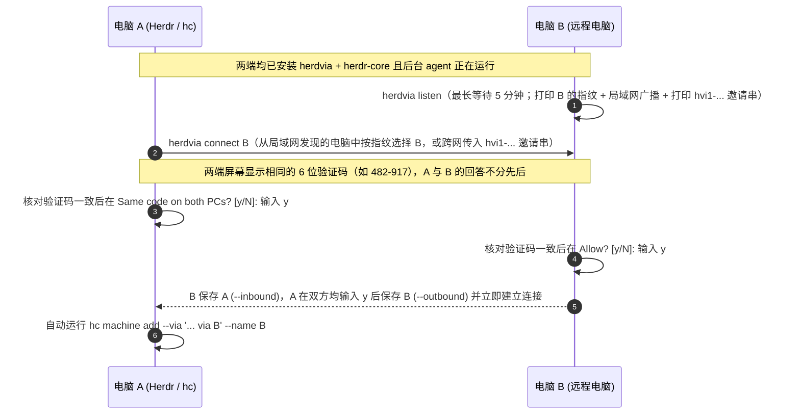

# herdvia

<p align="center">
  <a href="../README.md">English</a> · <a href="README.ko.md">한국어</a> · <a href="README.ja.md">日本語</a> · <strong>简体中文</strong>
</p>

<p align="center">
  <a href="https://github.com/photojupi/herdvia/actions/workflows/ci.yml"></a>
  <a href="https://github.com/photojupi/herdvia/releases/latest"></a>
  <a href="#license"></a>
</p>

**无需 SSH 服务器、无需路由器端口转发、无需 VPN，即可将位于不同路由器（NAT）后的电脑作为远程主机接入 [Herdr](https://herdr.dev)。**


> [!NOTE]
> **非官方 · 实验性项目说明：** `herdvia` 是个人独立项目，与 Herdr / `herdr-core` 项目没有任何关联，也未获得其官方背书或支持。其命令、文件格式与通信协议可能发生不兼容变更。

---

## 目录

- [什么是 herdvia？](#what-is-herdvia)
- [工作原理](#how-it-works)
- [前置准备](#requirements)
- [5 分钟快速上手](#quick-start)
  - [手动配对](#manual-pairing)
- [安装指南](#install)
  - [一键安装脚本（推荐）](#install-script)
  - [手动安装](#manual-install)
  - [从源码编译](#from-source)
- [命令参考](#commands)
- [开机自动启动](#automatic-startup)
- [常见问题排查（Troubleshooting）](#troubleshooting)
  - [运行 `herdvia doctor`](#run-herdvia-doctor)
  - [常见现象](#common-symptoms)
- [升级与卸载](#upgrading-and-uninstalling)
- [安全模型](#security-model)
- [网络与公开信息说明](#network-and-published-information)
- [支持平台](#supported-platforms)
- [配置与文件路径](#configuration-and-files)
- [设计文档与开源许可](#design)

---

<a id="what-is-herdvia"></a>
## 什么是 herdvia？

在 Herdr 中添加远程电脑时，`hc machine add --via <命令>` 通常搭配 `ssh` 使用。但如果要跨家庭、办公室或咖啡馆等不同路由器（NAT）连接多台电脑，往往需要配置 SSH 服务端、设置路由器端口转发，或者在每台设备上安装组网 VPN。

**`herdvia` 是可直接替换 `--via` 命令的点对点（P2P）传输通道。** 它基于 [iroh](https://www.iroh.computer)（支持自动 NAT 穿透并在直连受阻时自动回退至公共中继的端到端加密 P2P QUIC），在你的两台设备之间原样搬运 `hc` 会话的字节流。

| 连接方案 | 路由器端口转发 | 额外服务 / 注册账号 | 网络暴露面 | 配置耗时 |
|---|---|---|---|---|
| **SSH (`ssh user@host`)** | 跨内网连接时必需 | 目标电脑需开启 SSH 服务 | 暴露 SSH 端口 | 中～高 |
| **组网 VPN** | 不需要 | 虚拟网卡驱动 + 平台账号 | 暴露整个虚拟网卡 IP（未精细配置 ACL 时） | 中 |
| **`herdvia`** | **不需要** | **单个轻量级用户态可执行文件（免账号）** | **仅向显式授权的公钥开放 `herdr-core connect`** | **约 5 分钟** |


*通过 `herdvia` 连接的 4 台电脑（`This computer`、`macbook`、`macmini`、`win1` —— Windows + macOS），在单个 Herdr 窗口中并排协同运行 27 个 Claude Code、Codex 与 Antigravity 会话。*

---

<a id="how-it-works"></a>
## 工作原理

`herdvia` 不解析也不干预 Herdr 内部协议——它只负责在你操作的主控端（**电脑 A**）上的 `hc` 与远程被控端（**电脑 B**）上的 `herdr-core` 之间安全搬运字节。


1. **常驻后台代理 (`herdvia agent`)：** 在每台电脑的当前用户会话中运行，持有设备密钥身份（`EndpointId`），并与已授权对端保持加密 QUIC 连接。
2. **双向显式授权 (`listen` / `connect`，或 `allow` / `accept`)：** 从不自动信任陌生设备。交互式配对（`herdvia listen` + `herdvia connect`）在两端屏幕显示相同的 6 位验证码。被控端 B 仅在 B 的用户确认后才写入 `--inbound`，主控端 A 仅在 A 的用户也核对验证码一致后才写入 `--outbound`。
3. **命令逐字白名单校验：** 接收端（电脑 B）仅执行与 `hc` 发送的 `herdr-core connect` 命令逐字完全一致的指令（已基于 **`hc 0.1.21`** 实测验证），其余任何命令均会被拒绝并写入日志。

---

<a id="requirements"></a>
## 前置准备

配对两台电脑前，请先确认各自需要安装的组件：

| 组件 | 电脑 A（主控端 — 运行 Herdr） | 电脑 B（远程目标电脑） | 说明 |
|---|---|---|---|
| **`herdr-core`** | 必需 | 必需 | 两台电脑请保持**相同版本**（已验证版本为 **`0.1.21`**） |
| **Herdr 应用 / `hc` CLI** | 必需 | 不需要 | 电脑 B 只需安装 `herdr-core` |
| **`herdvia` + 运行中的代理** | 必需 | 必需 | 可通过一键脚本、发布包或 Cargo 安装 |

### 在两台电脑上安装 `herdr-core`

`herdvia` **不会**捆绑、安装或更新 `herdr-core`，请在两台电脑上使用 Herdr 官方脚本安装（再次运行即可更新）：

- **macOS / Linux：**
  ```sh
  curl -fsSL https://releases.herdr.dev/core/install.sh | sh
  ```
  安装至 `~/.local/bin/herdr-core`（若尚无 `hc` 则一并创建链接）。该脚本不会自动修改 `PATH`；若 `~/.local/bin` 不在 `PATH` 中会打印提示。

- **Windows（普通 PowerShell — 无需管理员权限）：**
  ```powershell
  powershell -c "irm https://releases.herdr.dev/core/install.ps1 | iex"
  ```
  安装至 `%LOCALAPPDATA%\Programs\herdr-core\herdr-core.exe`（若尚无 `hc.exe` 则一并安装），并自动将该目录加入当前用户的 `PATH`。

如需安装经 `herdvia` 实测验证的 **`0.1.21`** 版本：

```sh
# macOS / Linux
curl -fsSL https://releases.herdr.dev/core/install.sh | HC_VERSION=0.1.21 sh
```

```powershell
# Windows (PowerShell)
$env:HC_VERSION = "0.1.21"; powershell -c "irm https://releases.herdr.dev/core/install.ps1 | iex"
```

*（在 macOS 上，若已安装更新版本的 `herdr-core`，脚本会拒绝降级并提示使用 `hc update --from ... --force`。）*

> [!IMPORTANT]
> **关于 `herdr-core` 的两条重要说明：**
> 1. **不支持通过通道远程安装/更新（基于 `hc 0.1.21`）：** 由于 `herdvia` 只放行与 `hc` 的 `herdr-core connect` 完全一致的命令行，`hc machine add --install` 和 `hc machine update` 无法通过 `herdvia` 安装或更新远端的 `herdr-core`；若未来 `hc` 更改了连接命令格式，在 `herdvia` 跟进更新前也会被拒绝。
> 2. **远程电脑 B 上查找 `herdr-core` 的路径：**
>    - **macOS / Unix：** `~/.local/bin/herdr-core` 或代理所在环境的 `PATH`。在 macOS 上，通过 `herdvia agent install` 自动启动的代理，其 `PATH` 仅包含 `~/.local/bin:/usr/bin:/bin:/usr/sbin:/sbin`——若通过 Homebrew 等方式安装在其他位置，请创建软链接至 `~/.local/bin/herdr-core`。
>    - **Windows：** `%USERPROFILE%\AppData\Local\Programs\herdr-core\herdr-core.exe`。

---

<a id="quick-start"></a>
## 5 分钟快速上手

假设你有两台设备：
- **电脑 A** — 你日常操作 Herdr / `hc` 的电脑（例如随身笔记本）
- **电脑 B** — 你希望远程接入的电脑（例如家里的台式机）

首先，在 **A 和 B 两台电脑**上安装 `herdvia`（Intel Mac、Linux 或手动解压安装请参阅[安装指南](#install)）：

```sh
# macOS (Apple Silicon)
curl -fsSL https://github.com/photojupi/herdvia/releases/latest/download/install.sh | sh
```

```powershell
# Windows (x64) — 请在【普通】PowerShell 窗口中运行，不要使用管理员窗口
powershell -c "irm https://github.com/photojupi/herdvia/releases/latest/download/install.ps1 | iex"
```

安装完成后，请**新开一个终端窗口**使 `PATH` 生效（在 Windows 上请打开新的 PowerShell 窗口，若 Herdr 正在运行请重启 Herdr）。如果未使用一键安装脚本而是手动安装，请先在两台电脑上运行 `herdvia agent install`（macOS/Windows）或 `herdvia agent` 启动后台代理（参见[开机自动启动](#automatic-startup)）。

完整配对流程一览：



### 步骤 1. 在被控端电脑 B 上等待配对

```sh
herdvia listen
```

- `listen` 会开启一个 5 分钟有效的一次性配对窗口，打印本机指纹（`This PC's fingerprint: xxxx-xxxx-xxxx-xxxx`），在当前局域网/Wi-Fi 发送发现广播，同时打印一条供跨网络配对使用的一次性 `hvi1-...` 邀请字符串。
- 默认情况下，电脑 B 会使用电脑 A 净化后的主机名作为对端名称（若该名称已被其他公钥占用，或为 `--help` 或 `-h`，则自动追加如 `-28af` 这样的 A 的 `EndpointId` 短十六进制前缀）。如需自定义 A 在本机的名称，可运行 `herdvia listen <名称>`。

### 步骤 2. 在运行 Herdr 的电脑 A 上发起连接

- **同一 Wi-Fi / 局域网：**
  ```sh
  herdvia connect B
  ```
  `connect` 会在局域网内扫描约 2 秒，即使只找到一台，也会以带指纹的编号列表（含 `0) Paste an invite token instead`）列出找到的等待中电脑。请选择与 B 的 `listen` 屏幕上所示指纹相同的一项。由于局域网发现没有身份验证，`connect` 从不自行选择电脑（参见[安全模型](#security-model)）。若一台也没找到（例如访客 Wi-Fi 隔离拦截了广播），则会提示粘贴 B 屏幕上的 `hvi1-...` 邀请串。

- **不同网络（例如家里 ↔ 办公室或咖啡馆）：**
  ```sh
  herdvia connect B <B屏幕上打印的 hvi1-... 邀请串>
  ```

`B`（或 `home-pc`、`office` 等）是在 `herdvia` 与 Herdr 中共同使用的主机名称（支持 `1–32` 个 `A-Z a-z 0-9 . _ -` 字符，但名称不能为 `--help` 或 `-h`）。

### 步骤 3. 核对 6 位验证码并在两台电脑上确认

两端终端会显示一组 6 位验证码（例如 `482-917`）：

1. 核对**两块屏幕上显示的 6 位数字是否完全相同**。若不同，请输入 `n`：你可能连接到了另一台电脑。
2. 在**电脑 A** 的 `Same code on both PCs? [y/N]:` 和**电脑 B** 的 `Allow? [y/N]:` 提示符后分别输入 `y`（顺序不限）。

在电脑 A 上输入 `n`、输入空行或关闭输入（EOF）都会取消配对并以退出码 `1` 结束；若 A 的回答未在 60 秒内送达，`connect` 会以退出码 `255` 失败。若 B 已确认而 A 取消，B 上会保留 A 作为 `--inbound` 对端，但由于 A 未保存任何内容，连接不会建立；如有需要，可在 B 上运行 `herdvia revoke <名称>` 将其删除。

双方都输入 `y` 后：
- **电脑 B** 将电脑 A 保存为 `--inbound`（在 B 确认时即保存），**电脑 A** 将电脑 B 保存为 `--outbound`。
- 两端代理无需等待退避重试，立即建立端到端加密通道。
- **电脑 A** 自动执行 `hc machine add`，`B` 会直接出现在 Herdr 中。*（若 `PATH` 中找不到 `hc` 或注册失败，配对本身依然保留，并会打印可直接复制执行的 `hc machine add --via ... --name B` 命令——也可在安装 Herdr 后运行 `herdvia register B`。）*

### 步骤 4. 检查连接状态

在 **A** 上随时查看连接详情：

```sh
herdvia status
```

```text
name permission connection path rtt
B out connected direct 4.12ms
```

- **`path`：** 同局域网下通常直接走 `direct`（点对点直连）；跨网络时先走 `relay`（中继），一般在几秒内自动升级为 `direct`。
- **macOS 局域网权限提示：** 如果两台设备在同一局域网/Wi-Fi 下无法自动发现或一直停留在 `relay`，请在 Mac 的 **系统设置 > 隐私与安全性 > 本地网络** 中允许 `herdvia`（及当前终端，详见 [macOS 自动启动](#macos)）。
- **如果遇到连接异常：** 请在两台电脑上运行 `herdvia doctor`，每条 `warn` 或 `fail` 输出都会直接提示处理方法（详见[运行 `herdvia doctor`](#run-herdvia-doctor)）。

<a id="manual-pairing"></a>
### 手动配对

如果你在无交互终端的脚本环境中配置，或倾向于不使用 `listen` / `connect` 而手动交换密钥，仍可使用 `id`、`allow`、`pending` 与 `accept` 完成配对：

1. **查看身份标识 (`herdvia id`)：** 第 1 行输出 64 位完整 `EndpointId`，第 2 行输出 16 位短指纹（如 `28af-63b6-258e-859d`），首次运行时自动生成 `secret.key`。
2. **在电脑 A 上允许连接 B (`--outbound`)：**
   ```sh
   herdvia allow B <B的EndpointId> --outbound
   ```
   请当面或通过独立渠道核对前 16 位字符是否与 B 上的指纹一致。方向参数为 `--outbound`（允许本机拨出）、`--inbound`（允许对端连入）或 `--both`（双向），每个 `EndpointId` 只能对应一个名称。
3. **在电脑 B 上接受 A (`--inbound`)：** A 的代理拨向 B 时，B 会拒绝未授权公钥并暂存于内存（`herdvia pending`）。请**直接从 A 自己的屏幕读取指纹**（切勿照抄 `pending` 列表），在 **B** 上运行：
   ```sh
   herdvia accept A <A的指纹> --inbound
   ```
   *（也可直接在 B 上运行 `herdvia allow A <A的EndpointId> --inbound`。手动配对下 A 最长可能需要约 30 秒在下一次重试时连上；在 A 上运行 `herdvia agent reload` 可立即重连。）*
4. **在电脑 A 上添加到 Herdr：**
   ```sh
   hc machine add --via 'herdvia via B' --name B
   ```
   若 `hc` 在其 `PATH` 中找不到 `herdvia`，请传入可执行文件的完整路径并按平台规则加引号（macOS 按 `sh` 规则，Windows 按 `CommandLineToArgvW` 双引号规则——在 Windows 上保留 `herdvia` 在用户 `PATH` 中并重启 Herdr 最为简单），或运行 `herdvia register B`。

---

<a id="install"></a>
## 安装指南

<a id="install-script"></a>
### 一键安装脚本（推荐）

**macOS (Apple Silicon)：**

```sh
curl -fsSL https://github.com/photojupi/herdvia/releases/latest/download/install.sh | sh
```

**Windows (x64)** — 请在**普通 PowerShell 窗口**（非管理员）中运行：

```powershell
powershell -c "irm https://github.com/photojupi/herdvia/releases/latest/download/install.ps1 | iex"
```

安装脚本依次执行的 6 个步骤：

1. **下载与校验：** 将发布压缩包与 `SHA256SUMS` 下载到临时目录并校验 SHA-256 哈希；若下载或校验失败，立即中止且不做任何改动。
2. **安装可执行文件：** macOS 放置到 `~/.local/bin/herdvia`；Windows 放置到 `%LOCALAPPDATA%\Programs\herdvia\herdvia.exe`（连同 README 与许可证文件）。
3. **配置 `PATH`：** macOS 在登录 shell 为 `zsh` 时向 `~/.zprofile` 追加 `export PATH="$HOME/.local/bin:$PATH"`（其他 shell 仅打印提示行）；Windows 自动将该目录添加到用户 `PATH`。
4. **检查 `herdr-core`：** **不会自动安装 `herdr-core`。** 若未安装则打印官方安装命令；在 macOS 上若 `herdr-core` 位于其他路径而非 `~/.local/bin/herdr-core`，会打印 `ln -s` 软链接命令以便后台代理找到它。
5. **生成并打印身份标识：** 运行 `herdvia id` 初始化 `secret.key`（若需要）并显示本机 `EndpointId` 与指纹。
6. **注册并启动后台代理：** 运行 `herdvia agent install` 使代理立即启动并在每次登录时自动运行（若在 Windows 管理员 PowerShell 中运行，会跳过此步并提示改用普通窗口执行）。

**脚本平台要求：**
- **macOS：** 仅支持 Apple Silicon（拒绝以 `root` 运行；Intel Mac 或 Linux 会安全退出并指引前往[从源码编译](#from-source)）。
- **Windows：** 仅支持 x64，且需要 `System32\curl.exe`（Windows 10 1803 及以上自带）。

**环境变量选项（布尔开关仅在值为 `1` 时生效）：**

| 变量名 | 作用 |
|---|---|
| `HERDVIA_VERSION` | 安装指定版本（如 `0.1.0` 或 `v0.1.0`），而非最新版 |
| `HERDVIA_NO_AGENT=1` | 跳过运行 `herdvia agent install` |
| `HERDVIA_NO_MODIFY_PATH=1` | 不修改 `~/.zprofile` 或 Windows 用户 `PATH` |
| `HERDVIA_RELEASE_BASE` | 改从 `<url>/<文件名>` 而非 GitHub Releases 下载发布文件（优先级高于 `HERDVIA_VERSION`）。必须以 `https://` 开头；`http://` 仅接受 `127.0.0.1`、`localhost` 或 `[::1]`（用于本地测试）。即使跟随重定向，也只通过 HTTPS 下载。 |

安装指定版本（注意：即使从带版本标签的 URL 下载 `install.sh` / `install.ps1`，也需显式设置 `HERDVIA_VERSION`）：

```sh
curl -fsSL https://github.com/photojupi/herdvia/releases/download/v0.1.0/install.sh | HERDVIA_VERSION=0.1.0 sh
```

```powershell
$env:HERDVIA_VERSION = "0.1.0"; powershell -c "irm https://github.com/photojupi/herdvia/releases/download/v0.1.0/install.ps1 | iex"
```

先审阅脚本内容再运行（`SHA256SUMS` 中同样包含安装脚本的校验值）：

```sh
# macOS
curl -fsSLO https://github.com/photojupi/herdvia/releases/latest/download/install.sh
less install.sh
sh install.sh
```

```powershell
# Windows (PowerShell)
curl.exe -fLO https://github.com/photojupi/herdvia/releases/latest/download/install.ps1
notepad install.ps1
Get-Content -Raw .\install.ps1 | Invoke-Expression
```

*（再次运行安装脚本即可原地升级，详见[升级](#upgrading)。）*

<a id="manual-install"></a>
### 手动安装

前往 [GitHub Releases](https://github.com/photojupi/herdvia/releases) 下载：

- `herdvia-macos-arm64.zip`（macOS Apple Silicon）
- `herdvia-windows-x64.zip`（Windows x64）
- `install.sh` 与 `install.ps1`
- `SHA256SUMS`（压缩包与脚本的 SHA-256 校验值）

每个压缩包解压后均无外层目录，直接包含可执行文件、`README.md`、`LICENSE-MIT`、`LICENSE-APACHE` 与 `THIRD-PARTY-LICENSES.html`。由于开机自启会记录你运行 `agent install` 时的绝对路径，请务必将可执行文件放在固定目录（如 macOS 的 `~/.local/bin/herdvia` 或 Windows 的 `%LOCALAPPDATA%\Programs\herdvia\herdvia.exe`），切勿留在下载目录或临时目录中。

二进制文件未经代码签名或公证（notarization）。不提供 Intel Mac 预编译包，请[从源码编译](#from-source)。

`v0.1.2` 之后（不含 `v0.1.2`）发布的发行文件附带 GitHub 构建来源证明（build provenance attestation）。可使用 [GitHub CLI](https://cli.github.com) 运行 `gh attestation verify <文件> --repo photojupi/herdvia --signer-workflow photojupi/herdvia/.github/workflows/release.yml`（例如将 `<文件>` 替换为 `herdvia-macos-arm64.zip`）。该命令会校验已签名的来源证明与文件内容完全一致，且确实由本仓库的发布工作流 `.github/workflows/release.yml` 生成（若仅指定 `--repo`，本仓库中其他工作流生成的证明同样会通过校验）。

来源证明只能说明文件在何处构建，并不保证文件本身安全：如果有人盗用维护者账号推送标签，由此构建出的发行版同样能通过验证。同理，`SHA256SUMS` 来自同一发行版，只能检出下载损坏，无法检出整个发行版被替换。

<a id="macos-apple-silicon"></a>
#### macOS (Apple Silicon)

```sh
mkdir -p ~/.local/bin
cd "$(mktemp -d)"
curl -fLO https://github.com/photojupi/herdvia/releases/latest/download/herdvia-macos-arm64.zip &&
curl -fLO https://github.com/photojupi/herdvia/releases/latest/download/SHA256SUMS &&
shasum -a 256 -c --ignore-missing SHA256SUMS &&
unzip -q herdvia-macos-arm64.zip -d herdvia &&
mv herdvia/herdvia ~/.local/bin/herdvia
echo 'export PATH="$HOME/.local/bin:$PATH"' >> ~/.zprofile
```

- 若 `~/.local/bin` 已在 `PATH` 中，请跳过最后一行 `echo ... >> ~/.zprofile`。
- 请直接移动可执行文件本身到 `~/.local/bin`（不要软链接到下载目录中的文件，因为 `launchd` 会记录软链接路径，一旦源文件被删除就会失效）。
- 打开新终端并运行 `herdvia id` 验证。
- 若通过浏览器下载压缩包，macOS Gatekeeper 会附加隔离属性导致无法运行，可执行以下命令移除：
  ```sh
  xattr -d com.apple.quarantine ~/.local/bin/herdvia
  ```

<a id="windows-x64"></a>
#### Windows (x64)

请在**普通（非管理员）PowerShell 窗口**中逐条运行以下命令，若任意一步报错请立即停止：

```powershell
# 1. 创建并进入临时目录
$tmp = Join-Path $env:TEMP "herdvia-$(Get-Random)"
New-Item -ItemType Directory $tmp
Set-Location $tmp

# 2. 下载压缩包与校验文件
curl.exe -fLO https://github.com/photojupi/herdvia/releases/latest/download/herdvia-windows-x64.zip
curl.exe -fLO https://github.com/photojupi/herdvia/releases/latest/download/SHA256SUMS

# 3. 计算用于与 SHA256SUMS 核对的 SHA-256 哈希
$hash = (Get-FileHash herdvia-windows-x64.zip -Algorithm SHA256).Hash

# 4. 仅当 SHA256SUMS 列出该哈希时才解压至 %LOCALAPPDATA%\Programs\herdvia，否则中止
if (@(Get-Content SHA256SUMS) -contains "$hash  herdvia-windows-x64.zip") {
  New-Item -ItemType Directory -Force "$env:LOCALAPPDATA\Programs\herdvia"
  tar.exe -xf herdvia-windows-x64.zip -C "$env:LOCALAPPDATA\Programs\herdvia"
} else {
  throw "herdvia-windows-x64.zip does not match SHA256SUMS; do not install it"
}
```

要直接通过名称运行 `herdvia`，请将 `%LOCALAPPDATA%\Programs\herdvia` 加入**用户 `Path`**（*开始菜单 → “编辑账户的环境变量” → 用户变量 → `Path` → 编辑 → 新建*），随后打开新的 PowerShell 窗口（若 Herdr 正在运行请重启）并运行 `herdvia id` 验证。首次运行时 Windows SmartScreen 可能会弹出提示。

<a id="from-source"></a>
### 从源码编译

由于 `iroh` 依赖要求，需要 **Rust 1.91 及以上版本**。

- **macOS：** Xcode Command Line Tools (`xcode-select --install`) 以及通过 [rustup](https://rustup.rs) 安装的 Rust。
- **Windows：** [rustup](https://rustup.rs) 以及 Visual Studio Build Tools（勾选“使用 C++ 的桌面开发”）。*（注：官方发布的 Windows 可执行文件在 Linux 上使用 MinGW `x86_64-pc-windows-gnu` 交叉编译，CI 仅使用 MSVC 运行单元测试。）*

```sh
cargo install --locked --git https://github.com/photojupi/herdvia
```

默认编译 `main` 分支并安装至 `~/.cargo/bin`（Windows 为 `%USERPROFILE%\.cargo\bin`）。如需编译特定发布版本，请追加 `--tag v<版本号>`。

---

<a id="commands"></a>
## 命令参考

| 命令 | 说明 |
|---|---|
| `herdvia listen [<名称>]` | 在被控目标电脑上等待最长 5 分钟的交互式配对请求，打印本机指纹，发送局域网发现广播并打印供跨网使用的一次性 `hvi1-...` 邀请串，显示 6 位验证码并在用户于 `[y/N]` 确认后授予 `--inbound`（省略 `<名称>` 时默认使用对方净化后的主机名）。拒绝或超时以退出码 `1` 结束。需要代理正在运行。 |
| `herdvia connect <名称> [<邀请串>]` | 从运行 Herdr 的主控电脑与等待中的目标电脑配对，目标从局域网发现的电脑编号列表中按指纹选择，或由 `<邀请串>`（`hvi1-...`）指定；显示相同的 6 位验证码并询问 `Same code on both PCs? [y/N]:`，仅在用户输入 `y` 且目标电脑也确认后才授予 `--outbound`，随后自动执行 `hc machine add --via ... --name <名称>`。取消、拒绝、目标电脑超时或 `hc` 注册失败（打印手动命令）时以退出码 `1` 结束，用户的回答未在 60 秒内送达时以 `255` 结束。需要代理正在运行。 |
| `herdvia register <名称>` | 仅为已配对的出站对端重新执行 Herdr 注册（`hc machine add --via ... --name <名称>`），不修改密钥、权限或代理状态（无需代理正在运行）。输出 `Registered machine '<name>' in Herdr.`（若已注册则输出 `<name> is already registered in Herdr`）并以退出码 `0` 结束。若 Herdr 中同名主机已指向别处，或 `hc` 缺失、执行失败或 15 秒后超时（在 `stderr` 打印 `hc machine rm` / `hc machine rename` 提示或手动 `hc machine add` 命令），则以退出码 `1` 结束；若不存在该名称的出站对端则以 `255` 结束。 |
| `herdvia id` | 打印本机 `EndpointId`（第 1 行）与 16 位短指纹（第 2 行）。若 `secret.key` 不存在则自动生成。 |
| `herdvia allow <名称> <EndpointId> (--inbound \| --outbound \| --both)` | 添加或更新对端，并输出保存后的记录（`<名称> <EndpointId> <in\|out\|both>`）。替换已有名称的公钥时会在 `stderr` 发出警告（`herdvia: warning: <name> now points to a different key (fingerprint <old> -> <new>)`）。若该 `EndpointId` 已以其他名称注册则拒绝。对运行中的代理立即生效，若运行中的代理未能确认重新读取则以退出码 `255` 结束（无代理运行时在代理下次启动时生效）。 |
| `herdvia revoke <名称>` | 移除对端并输出 `revoked <名称> <EndpointId>`（同时在 `stderr` 输出清理提示），立即关闭与该对端的连接，并终止由这些连接启动的 `herdr-core connect` 进程（无法撤销的影响以及运行中的代理未确认重新读取时的行为参见[安全模型](#security-model)）。若不存在该名称的对端则失败。若同一 `EndpointId` 仍以其他名称注册（旧版本写入的 `peers` 文件），会发出警告。要移除 `0.1.4` 及更早版本存为 `--help` 或 `-h` 的对端，请运行 `herdvia revoke -- --help`（或 `-- -h`）。 |
| `herdvia peers` | 列出已保存的对端：表头 `name permission fingerprint`，每个对端一行，最后是说明行 `in = may open sessions on this PC; out = this PC may connect to it`（未注册任何对端时仅输出 `no peers registered`）。仅读取 `peers`，不创建任何内容，无需代理正在运行。 |
| `herdvia status` | 显示各对端的名称、权限、连接状态、`direct`/`relay` 路径及往返时延（RTT），并在存在未连接对端时为每个此类对端追加一行原因（若已知）与重试倒计时（参见[常见现象](#common-symptoms)）。需要代理正在运行。 |
| `herdvia pending` | 列出连入连接尝试被拒绝的设备（指纹、`EndpointId`、尝试次数、距上次出现的时间）。仅保存在内存中：最多保留 16 条，末次尝试 10 分钟后过期。需要代理正在运行。 |
| `herdvia accept <名称> <指纹> (--inbound \| --both)` | 将 `pending` 中唯一匹配该指纹的设备以其完整 `EndpointId` 加入授权列表。若匹配数为 0 或多于 1、列表已满（16 条：可能有人在大量发起连接尝试，请改用完整 `EndpointId` 执行 `allow`）、`<名称>` 已绑定其他 ID，或该 `EndpointId` 已以其他名称注册，则拒绝操作。需要代理正在运行。 |
| `herdvia doctor` | 在不做任何修改的前提下检查本机配置（可执行文件、数据目录、`secret.key`、`peers`、`herdr-core`、自动启动、代理、中继、对端连接、待确认连入请求）。输出以 `ok`/`warn`/`fail` 开头的检查行（对端连接为每个对端一行；前置步骤失败时省略后续依赖项），若有任一检查失败则以退出码 `1` 结束。详见[运行 `herdvia doctor`](#run-herdvia-doctor)。 |
| `herdvia --version` | 输出 `herdvia <版本号>`。 |
| `herdvia --help` | 输出命令概览与用法（`-h` 与 `herdvia help` 相同），或运行 `herdvia <command> --help`（`-h`）查看单个命令的用法与示例。不读取任何文件，无需代理正在运行。 |
| `herdvia agent` | 在前台运行代理（按 `Ctrl-C` 停止）。在 Windows 上，`herdvia agent --log` 会将输出追加至 `%LOCALAPPDATA%\herdvia\herdvia.log`。 |
| `herdvia agent install` | 注册登录自动启动并立即启动代理（支持 macOS、Windows）。 |
| `herdvia agent uninstall` | 停止后台自启代理并移除自启注册（保留数据目录与日志文件）。 |
| `herdvia agent reload` | 让运行中的代理重新读取 `peers` 并立即重试等待中的出站连接，输出 `reloaded: peers re-read; waiting connections retry now`。若代理未运行则以退出码 `255` 失败（`herdvia: agent is not running; start it with 'herdvia agent install' (or 'herdvia agent' in a terminal)`）。 |
| `herdvia via <对端> <命令>` | 供 `hc` 内部调用的传输子命令，无需手动执行。需要本地代理正在运行。 |

发生任何错误时，`herdvia` 会在标准错误（`stderr`）输出一行以 `herdvia:` 开头的错误信息，并以退出码 **`255`** 结束。`--help` 和 `-h` 不能用作对端名称（`herdvia: --help and -h cannot be peer names`），若代理未在 5 秒内响应，`status`、`pending`、`accept` 和 `agent reload` 会以 `herdvia: the agent did not answer the <request> request within 5 seconds` 结束（`status` 的 `<request>` 为 `status-detail`）。

---

<a id="automatic-startup"></a>
## 开机自动启动

<a id="macos"></a>
### macOS

`herdvia agent install` 会创建当前用户的 LaunchAgent（`~/Library/LaunchAgents/io.github.photojupi.herdvia.agent.plist`），并通过 `launchctl bootstrap` 立即启动。`launchd` 会在用户登录时自动拉起代理，并在进程退出时自动重启。日志输出至 `~/Library/Logs/herdvia.log`，代理会删除其中超过 180 天的行，并在文件超过 10 MiB 时将其截短（参见[配置与文件路径](#configuration-and-files)）。

- 若设置了 `HERDVIA_DIR` 环境变量（自动启动始终使用默认数据目录），或已有手动启动的前台代理在运行，则会拒绝安装。
- 再次运行 `herdvia agent install` 会更新为当前可执行文件路径并重启代理。
- 若从临时目录或 Cargo `target` 编译目录运行，会打印警告但仍完成注册。

> [!IMPORTANT]
> **macOS 15+ 本地网络权限：** 在 macOS 15（Sequoia）及更新版本上，自动启动的后台代理在获得授权前无法直连局域网地址。请在系统弹窗中点击**允许**，或前往 **系统设置 > 隐私与安全性 > 本地网络** 开启 `herdvia`。未开启前，同一局域网内的设备也会走 `relay` 中继而非 `direct` 直连（跨公网设备以及在终端前台手动运行的 `herdvia agent` 不受影响）。

### Windows

`herdvia agent install` 会在当前用户的注册表 `Run` 键（`HKCU\Software\Microsoft\Windows\CurrentVersion\Run`）下写入启动项，登录时通过 `conhost.exe --headless "<herdvia.exe路径>" agent --log` 无窗口后台启动，并在安装当下立即拉起。全程无需管理员权限，不创建系统服务或计划任务。

- **必须在普通（非管理员）PowerShell 窗口中运行**——管理员窗口中会拒绝执行，代理本身也会拒绝在“以管理员身份运行”打开的窗口中启动（参见[安全模型](#security-model)）。
- 若设置了 `HERDVIA_DIR`，或尚未注册自启时已有前台代理正在运行，则会拒绝安装（若已注册过自启，再次运行 `install` 会停止正在运行的默认数据目录代理并启动新代理）。
- 可执行文件路径不能包含 `%`，且完整注册命令行长度不得超过 259 个 UTF-16 代码单元。
- 日志写入 `%LOCALAPPDATA%\herdvia\herdvia.log`（超过 180 天的行会被删除，文件超过 10 MiB 时会被截短）。若代理意外退出，Windows 不会自动重启，将在下次登录时重新启动。

### Linux

Linux 不支持自动启动（`agent install` / `agent uninstall`）。请直接运行 `herdvia agent`（例如在 `systemd --user` 下或会话管理器内）。

---

<a id="troubleshooting"></a>
## 常见问题排查（Troubleshooting）

<a id="run-herdvia-doctor"></a>
### 运行 `herdvia doctor`

`herdvia doctor` 会按顺序检查以下项目：

1. **当前可执行文件：** 版本与路径（若从临时目录或 Cargo `target` 编译目录运行会发出警告，因为 `agent install` 会记录该路径）。
2. **数据目录：** 路径（包括是否来自 `HERDVIA_DIR`；`HERDVIA_DIR` 必须为绝对路径）、是否存在、是否为真实目录（不接受符号链接，Windows 上也不接受目录联接 junction），以及当前用户能否打开（macOS/Unix 上还会校验所有者；若无法打开则判为 `fail`，并在 macOS/Unix 上提示运行 `chmod 700`）。对于由 `HERDVIA_DIR`（Linux 上也包括 `XDG_DATA_HOME`）指定的目录，若其他账户可以更改其任一父目录，即使该目录尚不存在也判为 `fail`（参见[安全模型](#security-model)）。
   - **macOS / Unix：** 在 macOS 上，若目录带有允许访问的 ACL（访问控制列表）条目，会判为 `fail` 并提示 `chmod -N`；在 macOS/Unix 上还会检查代理套接字路径是否未超出 Unix 套接字长度上限。
   - **Windows：** 若目录是其他类型的重解析点（reparse point），或所有者不是当前用户、Administrators 或 SYSTEM，又或向其他账户开放了访问权限而当前用户无法修改其权限，均判为 `fail`（最后一种情况会给出需在管理员终端运行的 `icacls … /grant` 命令）。若目录向这三者以外的账户开放了访问权限但当前用户可以修改其权限，则判为 `warn`，因为 herdvia 会在下次运行时限制其权限。
3. **`secret.key`：** 是否存在，以及能否通过与代理相同的检查（macOS/Unix：归当前用户所有、权限不宽于 `0600`，且在 macOS 上没有允许访问的 ACL 条目；Windows：非链接的普通文件，所有者为当前用户、Administrators 或 SYSTEM，且未向其他账户授予访问权限）。在 Windows 上，若文件向其他账户授予了访问权限，当前用户可以修改其权限时判为 `warn`（因为 herdvia 会在下次运行时限制其权限），否则判为 `fail` 并给出 `icacls … /grant` 命令。若 `secret.key` 不是恰好 32 字节，或因权限拒绝以外的原因读取失败，`doctor` 会输出 `fail secret.key: <error>; fix its permissions or ownership if that is the cause; otherwise remove it, run herdvia id to create a new identity, and pair again with every peer (restoring a copied or backed-up key is not recommended)`；重新配对前，请在所有对端上针对本机运行 `herdvia revoke <名称>`（参见[安全模型](#security-model)）。输出中仅显示短指纹。
4. **`peers`：** 是否可读（执行与 `secret.key` 相同的检查）且可解析，以及各方向已注册的对端数量。在 Windows 上，herdvia 将在下次运行时限制权限的文件会输出不带计数信息的 `warn` 行；文件内容仍会照常校验，若存在格式错误则输出常规的 `fail` 行（因为限制文件权限并不能修复损坏的内容）。
5. **`herdr-core`：** 是否位于代理实际查找的位置（macOS 上为自启代理的 `PATH`），以及 `herdr-core --version` 是否返回已验证的 `0.1.21`。
6. **自动启动：** 是否已注册（macOS 的 LaunchAgent plist、Windows 的注册表 `Run` 值）且指向当前可执行文件。在 Windows 上若以管理员身份运行也会发出警告。
7. **代理：** 当前数据目录对应的代理是否响应、其版本与可执行文件路径，以及是否已连接归属中继（home relay）。
8. **对端连接：** 基于 `herdvia status`，为每个已注册对端输出一行连接状态与路径，未连接时则输出带有断开原因与重试倒计时的 `warn peer <name> (<in|out|both>): ...`（若尚未注册任何对端，则输出一行 `warn`）。
9. **待确认连接（`pending`）：** `herdvia pending` 中会列出的被拒连入请求数量。

输出行写往标准输出（`stdout`），以 `ok`、`warn` 或 `fail` 开头；`warn` 与 `fail` 行会在同一行给出处理建议。对端连接按每个对端输出一行，当前置步骤失败时会省略依赖它的后续检查：若数据目录检查为 `fail`，将跳过代理检查及其后的所有行（除非仅因 Unix 套接字路径过长而失败，否则 `secret.key` 与 `peers` 也会一并跳过）；若代理无响应，则跳过 `relay`、对端连接与 `pending` 行。没有任何 `fail` 时退出码为 `0`（仅有 `warn` 仍为 `0`），存在任一 `fail` 时退出码为 `1`。命令参数错误等情况仍输出一行 `herdvia:` 并以 `255` 结束。

- **只读行为：** `doctor` 不会创建或修改数据目录、`secret.key`、`peers`、自动启动注册项或代理状态。因此在 Windows 上，向其他账户授予了访问权限的数据目录、`secret.key` 或 `peers` 会一直保持 `warn`（`… herdvia restricts it the next time it runs (herdvia id, or the agent when it starts)`），直到运行某个会准备数据目录的命令来限制权限——即 `herdvia id`、`listen`（确认通过时）、`connect`（确认通过时）、`allow`、`accept`、`revoke` 或启动代理（`peers`、`status`、`pending`、`register`、`agent reload`、`doctor` 和 `--help` 不做任何修改；在权限受限之前，`peers` 与 `register` 会拒绝此类 `peers` 文件，并提示运行 `herdvia id` 或启动代理）。由于 Windows 版 `v0.1.2` 未修改数据目录及内部文件的权限，沿用了从用户配置文件继承的默认权限（可能允许其他账户读取），从 `v0.1.2` 升级上来的电脑在用新版本运行上述任一命令之前，这三项可能都会显示 `warn`（安装脚本会运行 `herdvia id`）。一旦运行过上述命令，该目录和两个文件将仅向当前用户、SYSTEM 和 Administrators 授予访问权限，三行都会变为 `ok`。
- **超时限制：** 唯一调用的外部程序是 `herdr-core --version`（限时 2 秒）。发往代理的每次请求均有 3 秒超时限制：即使代理正在运行，若未在 3 秒内响应，`doctor` 也会输出 `fail agent: it may be running, but it did not answer within 3 seconds; …` 并跳过其余代理检查；若后续的对端状态或 `pending` 请求超过 3 秒，对应行会记为 `warn`；若对端详情请求超过 3 秒，对端行改用通用提示，其后再输出 `warn peer details: the agent did not answer within 3 seconds; …`（`status` 或对端详情超时后跳过 `pending`）。
- **旧版本代理：** `herdvia doctor` 自 `v0.1.2` 起新增。更早版本的代理不识别该请求，因此 `doctor` 会警告正在运行的代理早于当前可执行文件并提示重启（省略 `relay`，但仍继续检查对端连接与 `pending`），同时该代理的日志会记录一行 `unknown CONTROL request`。`v0.1.4` 及更早版本的代理不识别 `status-detail`，因此未连接对端的检查行仍显示通用的 `not connected; …` 提示。

请在**两台电脑**上都运行一次：电脑 B 上的问题（例如缺少 `herdr-core` 或尚未 `accept` 对端）会显示在 B 的输出中。电脑 A 上的运行示例：

```text
$ herdvia doctor
ok   executable: herdvia 0.1.2 at /Users/you/.local/bin/herdvia
ok   data directory: /Users/you/Library/Application Support/herdvia
ok   secret.key: present, fingerprint 28af-63b6-258e-859d
ok   peers: 2 registered (in 0, out 1, both 1)
ok   herdr-core: /Users/you/.local/bin/herdr-core (hc 0.1.21)
ok   automatic start: registered for this executable
ok   agent: running herdvia 0.1.2 from /Users/you/.local/bin/herdvia
ok   relay: connected to https://aps1-1.relay.n0.iroh.link./
ok   peer B (out): connected directly, 4.12ms
warn peer office (both): not connected; its agent is off, or it has not allowed this PC (on that PC: herdvia pending, then herdvia accept)
ok   pending: no rejected connection attempts
```

<a id="common-symptoms"></a>
### 常见现象

存在任一未连接对端时，`herdvia status` 会在表格后空一行，并为每个此类对端输出一行原因——`rejected by the peer (<reason>)`（对 `403 peer not allowed`、`403 inbound permission required` 或 `403 peer permissions changed` 附有处理提示）、`could not reach it (<detail>); its agent may be off or offline.`、`the connection closed (<detail>).`、`waiting for <name> to connect (this PC only accepts it).` 或 `not connected yet.`；有待执行重试的对端，其行末会附上 `Retrying in <n>s.`，只要存在此类对端，末尾还会多出一行 `Run herdvia agent reload to retry now.`：

```text
$ herdvia status
name permission connection path rtt
win1 out disconnected - -

win1: rejected by the peer (403 peer not allowed); on win1 run herdvia pending, then herdvia accept. Retrying in 12s.
Run herdvia agent reload to retry now.
```

出站失败记录仅保存在内存中，因此代理刚启动时会显示 `not connected yet.`；向已关机的电脑发起连接则需约 30 秒（QUIC 空闲超时）后才会显示 `could not reach it`。若正在运行的代理为 `0.1.4` 或更早版本，`herdvia status` 仅输出表格，并在 `stderr` 输出 `herdvia: note: restart the agent (herdvia agent install) to see why peers are disconnected`。

| 现象 | 常见原因 | 解决方法 |
|---|---|---|
| 同一 Wi-Fi 下 `herdvia connect <名称>` 未自动发现对方电脑 | 访客 Wi-Fi 客户端隔离、防火墙拦截 UDP `48721`，或 macOS 本地网络权限未开启 | 直接传入 `herdvia listen` 打印的 `hvi1-...` 邀请串（`herdvia connect <名称> <邀请串>`），或开启本地网络权限 |
| 在 B 上运行 `herdvia pending` 列表为空 | A 的代理未启动、A 未配置 `--outbound`，或正处于重试间隔内 | 确认 A 上 `herdvia status` 正常且已执行 `herdvia allow B <B_ID> --outbound`，在 A 上运行 `herdvia agent reload` 立即重试（或等待最多 30 秒）后再运行 `herdvia pending` |
| 两台电脑连同一 Wi-Fi，`status` 却一直是 `relay` | macOS 15+ 拦截了后台 LaunchAgent 的局域网访问 | 在 Mac 的 **系统设置 > 隐私与安全性 > 本地网络** 中开启 `herdvia` |
| Mac 上已通过 Homebrew 安装 `herdr-core`，但 Herdr 显示 `herdr-core is not installed here` | macOS LaunchAgent 仅搜索 `~/.local/bin:/usr/bin:/bin:/usr/sbin:/sbin` | 运行 `mkdir -p ~/.local/bin && ln -s "$(command -v herdr-core)" ~/.local/bin/herdr-core` |
| `hc machine add --install` 或 `hc machine update` 失败 | `herdvia` 拒绝除 `herdr-core connect` 以外的一切命令 | 请直接在各台电脑上运行 Herdr 官方的 `herdr-core` 安装脚本 |
| 刚装完提示找不到 `herdvia` 命令 | 当前终端或 Herdr 应用尚未加载更新后的 `PATH` | 打开全新的终端窗口；Windows 上同时重启 Herdr 应用 |
| Windows 上 `herdvia agent install` 或 `herdvia agent` 提示管理员错误 | 在“以管理员身份运行”的 PowerShell 中执行了命令 | 打开普通（非管理员）PowerShell 窗口重新运行 `herdvia agent install` |
| B 还没 `accept`，A 的 `status` 却短暂显示 `connected` | 握手完成后、B 主动断开未授权连接前的瞬间状态 | 在接收端 **B** 上运行 `herdvia status` 确认是否真正建立连接 |
| Herdr 显示 `peer did not connect within 5 seconds: rejected by the peer (403 peer not allowed)`（或 `...: could not reach it (timed out)`） | 出站通道未连通，`via` 附上了代理记录的该对端最近一次失败原因 | 运行 `herdvia status` 查看完整提示（如在对端运行 `herdvia pending` 与 `herdvia accept`，或启动对端代理），再运行 `herdvia agent reload` 立即重试 |
| `allow`、`accept` 或 `revoke` 以退出码 `255` 结束并输出 `herdvia: saved <name> in the peers file, but the running agent did not confirm it (<cause>); ...`（或 `herdvia: revoked <name> in the peers file, but the running agent did not confirm it (<cause>), so it may still admit <name> until it reloads; ...`） | 磁盘上的 `peers` 已更新，但运行中的代理未在 5 秒内响应、持续 1 秒拒绝重新读取请求（macOS/Unix），或返回了错误 | 运行 `herdvia agent reload`；若仍失败，重启代理（`herdvia agent install`，或重启 `herdvia agent`） |
| `herdvia connect <名称>` 报错 `herdvia: peer <name> is already registered; revoke it first or choose another name; to re-run only the Herdr registration, run herdvia register <name>` | 该名称已作为出站对端保存（例如此前配对已成功，但当时缺少 `hc` 或 `hc machine add` 失败） | 运行 `herdvia register <名称>` 直接将其添加到 Herdr，无需重新配对（如需重新配对，请先运行 `herdvia revoke <名称>`） |

---

<a id="upgrading-and-uninstalling"></a>
## 升级与卸载

本机密钥（`secret.key`）与对端列表（`peers`）保存在独立的数据目录中，不在可执行文件旁，因此替换或删除可执行文件不会丢失身份与配对配置。可随时运行 `herdvia --version` 查看当前版本。

<a id="upgrading"></a>
### 升级

**推荐方式 — 重新运行[一键安装脚本](#install-script)：**
脚本会自动下载校验新版文件、安全替换旧程序（macOS 采用原子 `mv`；Windows 先复制为 `herdvia.new.exe` 验证可运行后将正在运行的旧程序重命名为 `.old`，避免文件占用锁死），并再次运行 `herdvia agent install` 用新程序重启代理，且不会重复写入 `PATH`。

*（若有手动启动的前台代理正在运行或设置了 `HERDVIA_DIR`，请停止该代理或取消 `HERDVIA_DIR` 后运行 `herdvia agent install`，或传入 `HERDVIA_NO_AGENT=1` 并自行重启代理。）*

**手动升级：**
- **macOS：** 重新执行 [macOS (Apple Silicon)](#macos-apple-silicon) 中的下载、校验与 `mv` 命令（省略 `.zprofile` 那行）。**切勿用 `cp` 直接覆盖正在运行的二进制文件**（否则下次启动会触发 `Killed: 9`），务必使用 `mv` 替换后再运行 `herdvia agent install`（或重启前台运行的 `herdvia agent`）。
- **Windows：** 由于运行中的 `.exe` 无法被 `tar.exe` 覆盖，请先运行 `herdvia agent uninstall`（前台运行则按 `Ctrl-C`）停止代理，按 [Windows (x64)](#windows-x64) 步骤解压替换后，再运行 `herdvia agent install`。

升级完成后，若正在运行的代理仍是旧的可执行文件或旧版本，`herdvia doctor` 会发出警告。

### 卸载

1. **停止代理并取消自启：** 运行 `herdvia agent uninstall`（前台运行则按 `Ctrl-C`）。
2. **删除可执行文件：**
   - macOS：`rm ~/.local/bin/herdvia`
   - Windows (PowerShell)：`Remove-Item -Recurse -Force "$env:LOCALAPPDATA\Programs\herdvia"`
3. **彻底清除身份密钥、对端列表与日志（可选）：** 按[配置与文件路径](#configuration-and-files)删除数据目录与日志文件。
4. **清理 `PATH`：**
   - Windows：从用户环境变量 `Path` 中移除 `%LOCALAPPDATA%\Programs\herdvia`。
   - macOS：`~/.zprofile` 中的 `~/.local/bin` 可能还被 `hc`、`herdr-core` 等工具共用，仅在确认无其他程序依赖时再移除。
5. **在对端设备上解除配对：** 在曾授权本机的设备上运行 `herdvia revoke <名称>`，并在运行 Herdr 的设备上执行 `hc machine rm <名称>`。

---

<a id="security-model"></a>
## 安全模型

> [!WARNING]
> **向某个对端授予 `--inbound`（或 `--both`）权限，意味着允许它以你的当前系统用户身份启动 `herdr-core` 会话——实际上等同于授予完整的本地 Shell 权限。** 请仅授权你像信任自己一样完全信任的设备。

- **端到端公钥双向认证：** 所有连接均由 `iroh` 使用各设备的 Ed25519 密钥对（`EndpointId`）完成双向认证。当授权列表为空或方向权限（`in`、`out`、`both`）不匹配时一律拒绝。在每个流（stream）上都会重新校验权限，`revoke` / `allow` 变更对运行中的代理立即生效（包括代理启动过程中所做的变更）。
- **`revoke` 无法撤销的内容：** `revoke` 会关闭与该对端的通道，并终止由该通道启动的 `herdr-core connect` 进程；但该对端已经打开的远程终端仍会保留在 `herdr-core` 中，其已启动的进程和已做的更改也都会保留。若怀疑某个对端已被入侵，请先撤销其授权，再检查本机的 Herdr 会话以及代理日志中的 `session started` / `session ended` 行（参见[配置与文件路径](#configuration-and-files)）。由于 `revoke` 仅更新本机的 `peers`，成功后还会在 `stderr` 输出提示：`herdvia: note: Herdr may still list <name>; remove it with: hc machine rm <name>`（当该对端具有出站权限时）与 `herdvia: note: on that PC, also revoke this PC (herdvia revoke <the name it uses for this PC>)`。若运行中的代理未能确认重新读取 `peers`，由于在重新读取前代理仍可能放行该对端，`revoke` 会以退出码 `255` 结束——请运行 `herdvia agent reload`；若仍失败，请重启代理（`herdvia agent install`，或重启 `herdvia agent`）。
- **入站信任的传递性：** 向某个对端授予 `--inbound` 的电脑，其安全性不会高于该对端，因为控制了该对端的人同样可以在本机打开会话。请仅在使用 Herdr 的主控电脑上授予 `--outbound`，仅在被连接的目标电脑上授予 `--inbound`；只有当两台电脑确实需要双向互连时才使用 `--both`。
- **出站连接的对端同样会发回数据：** 即使由本机主动发起连接，远端对端仍会发送由本机 `hc` 读取的字节流，以及错误文本和退出码。请仅连接你信任的电脑。
- **命令白名单仅作纵深防御而非沙箱：** 拒绝除 `hc` 精确的 `herdr-core connect` 命令以外的一切请求并记入日志，旨在减少误用并及时暴露异常；但 `herdr-core connect` 本身即提供 Shell 执行能力，**真正的安全边界是对端密钥列表（`peers`）。**
- **拒绝以 `root` 或管理员权限运行：** 在 macOS/Unix 上，`herdvia` 拒绝以 `root` 身份启动。在 Windows 上，`herdvia agent` 拒绝在“以管理员身份运行”打开的终端（UAC 拆分令牌中的提升部分）中启动，`herdvia agent install` 则拒绝任何提升的令牌。在关闭了 UAC 的电脑上或使用内置 Administrator 账户时，代理仍可启动。
- **连接限制：** 已连接的对端在一个连接上最多同时打开 16 个流（每个 `hc` 会话一个），且不能打开单向流或发送数据报。打开流后 10 秒内未发送首个请求的流会被关闭。
- **用户隔离的本地 IPC：**
  - **macOS / Unix：** 位于 `0700` 数据目录内的 `0600` 域套接字，并校验连接进程的 UID。
  - **Windows：** 通过 DACL 将命名管道限制为仅当前用户 SID 可访问，并拒绝远程网络管道客户端。代理会锁定数据目录中的 `agent.lock`，因此针对同一目录启动第二个代理会被拒绝；若其他账户已占用该管道名，代理会报出该账户的 SID（无法读取所有者时则如实说明）并拒绝启动。
- **数据目录、`secret.key` 与 `peers`：**
  - **macOS / Unix：** 数据目录权限设为 `0700`，`secret.key` 以 `0600` 权限创建。若 `secret.key` 或 `peers` 归属其他用户或权限更宽，会报错停止；在 macOS 上，若目录或任一文件带有允许访问的 ACL（访问控制列表）条目也会停止（错误信息会打印用于移除该 ACL 的 `chmod -N` 命令；不支持 ACL 的文件系统视为没有 ACL）。
  - **Windows（设置权限）：** 若数据目录是目录联接（junction）或其他重解析点，或所有者不是当前用户、Administrators 或 SYSTEM，则拒绝使用。除非目录已具备相应设置，否则 herdvia 会为其设置仅向这三个账户授予完全访问权限的受保护 DACL，并由 herdvia 在其中创建的文件继承（带有会继承给内部文件的拒绝（deny）条目的目录，不视为已具备该设置）。每当 `secret.key` 或 `peers` 向其他账户授予了访问权限且当前用户可以修改其权限时，herdvia 都会直接为该文件本身设置仅向这三个账户授予完全访问权限的受保护 DACL，而不依赖目录继承下来的权限。此外，作为尽力而为的加固措施，herdvia 还会为数据目录、`secret.key` 和 `peers` 设置 Medium 完整性标签（no-write-up、no-read-up），使同一用户的 Low 完整性进程无法新打开这些文件进行读取。在当前用户无权设置该标签的目录中不会应用此标签，herdvia 仍可正常工作。
  - **Windows（拒绝条件与例外）：** 若 `secret.key` 或 `peers` 是链接、所有者不同，或仍向其他账户授予访问权限，则拒绝使用（错误信息会打印需在管理员终端运行的 `icacls … /grant` 命令，执行后当前用户将获得该文件的完全控制权限，再次运行 herdvia 时即会限制其权限）。同理，若目录向其他账户授予了访问权限而当前用户无法修改其权限，也会拒绝该目录并打印 `icacls … /grant` 命令。这两条 `icacls` 命令均可原样粘贴到 PowerShell 或 cmd 中执行。仅向这三个账户授予访问权限但当前用户无法修改其权限的目录会按原样使用；若该目录未受保护，则会继续从父目录继承权限条目。
  - **`HERDVIA_DIR` 数据目录的父目录：** 当数据目录来自 `HERDVIA_DIR`（Linux 上也包括 `XDG_DATA_HOME`）时，其父目录必须是其他账户无法更改的，以防其他账户将某个父目录替换为别的目录，从而改变密钥和对端列表的存放位置。内置的默认数据目录不做此检查（默认目录位于用户配置文件内，且自动启动只使用默认目录）。
    - **macOS / Unix：** 每个父目录必须归当前用户或 root 所有，且 group/other 没有写权限；位于 `/tmp` 等带 sticky 位的目录中、归当前用户（或 root）所有的目录可以接受。在 macOS 上，若父目录带有允许添加或删除条目、或更改权限的 ACL allow 条目，也会被拒绝。
    - **Windows（以驱动器号开头的路径）：** 每个父目录不得是目录联接或符号链接等重解析点，所有者必须是当前用户、SYSTEM、Administrators 或 TrustedInstaller 之一，且不得授予其他账户删除、重命名或更改该目录或其中条目权限的权利（只读权限没有问题）。UNC 路径不做检查。
    - 若父目录未通过检查，所有命令和代理都会以包含该目录及原因的错误结束（退出码 `255`），`herdvia doctor` 也会将 `data directory` 一行报告为 `fail`，即使数据目录尚不存在。
- **`secret.key` 即本机身份：** 任何拿到它的人都可向信任本机的对端冒充本机。若它可能已泄露、无法读取或丢失（不建议从备份中恢复），或你从备份中恢复了它、把它复制到了另一台电脑，请更换密钥：
  1. 在所有对端上用 `herdvia revoke <名称>` 删除本机的记录（即使 `herdvia doctor` 因 `secret.key` 无法读取而建议创建新身份，也请先执行这一步；否则对端电脑仍会将该名称绑定到旧的 `EndpointId`，从而拒绝以同名执行 `accept`）。
  2. 停止代理（`herdvia agent uninstall`，前台运行时按 `Ctrl-C`）。
  3. 删除 `secret.key`。
  4. 运行 `herdvia id` 生成新身份。
  5. 运行 `herdvia agent install`（或重新启动 `herdvia agent`）。
  6. 与所有对端重新配对。
- **交互式配对 (`listen` / `connect`)：** 配对运行在独立的 `herdvia/pair/1` ALPN 上，绝不执行远程命令，也不会写入 `pending`，且仅在 `herdvia listen` 正在等待时接受握手。每次 `listen` 会话都会生成 5 分钟后过期的 128 位一次性令牌，连续 5 次握手证明无效即中止会话，同时仅允许一个请求进入人工确认，并在用户确认或拒绝后立即关闭。双方基于 QUIC TLS 1.3 exporter（`herdvia-pair-v1`）与 commit-reveal 随机数交换导出 6 位验证码（`NNN-NNN`，约 20 位熵），在目标电脑用户核对两屏一致并输入 `y` 之前绝不修改 `peers`。主控电脑同样要等其用户在 `Same code on both PCs? [y/N]:` 输入 `y` 且目标电脑已确认后，才会写入 `peers` 并运行 `hc machine add`。这是因为局域网发现广播没有签名：同一局域网中的任何人都可以用自己的公钥发送广播并立即发送确认消息，因此 `connect` 从不自行选择发现的电脑。此确认步骤并未改变网络协议，因此仍可与旧版本正常配对。授权遵循最小权限：目标电脑仅写入 `--inbound`，主控电脑仅写入 `--outbound`（不会默认授予 `--both`）。
- **`0.1.4` 及更早版本的交互式配对：** `herdvia connect` 在局域网中只找到一台电脑时会自动选择它，并且仅凭对方的确认消息就会保存，无需本机用户确认，因此同一局域网中的其他设备可以冒充目标电脑。升级运行 Herdr 的电脑（运行 `connect` 的一端）上的 `herdvia` 即可修复。升级之前，请使用目标电脑屏幕上打印的邀请串进行配对（`herdvia connect <名称> hvi1-...`）。
- **短指纹与 `pending` / `accept`：** 指纹仅表示 256 位 `EndpointId` 的前 16 个十六进制字符（64 位），供人工比对；`herdvia` 存储与校验始终使用完整 `EndpointId`。`pending` 仅记录完成已认证 `iroh` 握手的对端，在内存中最多保留 16 条、10 分钟过期，且 `accept` 仅在唯一匹配时才放行；由于任何知道本机 `EndpointId` 的人都能填满列表，列表已满时也会拒绝。请务必**从对方电脑自己的屏幕上读取指纹**，切勿照抄 `pending` 列表。

**报告安全漏洞：** 如发现敏感安全问题，请通过本仓库的 [GitHub 私密漏洞报告（Private vulnerability reporting）](https://github.com/photojupi/herdvia/security/advisories/new) 提交；非敏感的 bug 请新建普通 Issue。

---

<a id="network-and-published-information"></a>
## 网络与公开信息说明

`herdvia` 固定使用 `iroh` 默认的 `N0` 网络预设（无修改选项）：

- **公共中继服务器 ([n0](https://n0.computer))：** 每个代理会连接一个归属中继（home relay）用于信令协商与初始连接建立；当两端无法建立直连路径时，加密流量也会通过中继转发。
- **DNS 地址发现 (`dns.iroh.link`)：** 每个代理会向该服务发布一条包含本机 **`EndpointId` 与归属中继 URL** 的签名记录，以便对端通过 `EndpointId` 寻址。
- **路由器端口映射：** 默认开启 UPnP、PCP 与 NAT-PMP，在路由器支持时辅助打洞直连。
- **前台局域网配对发现：** 仅当 `herdvia listen` 或未传邀请串的 `herdvia connect` 在前台运行时，才会在 UDP 端口 `48721`（IPv4 组播 `239.255.77.86` 及广播）收发包含目标 `EndpointId`、代理 QUIC 端口、一次性局域网令牌与净化后主机名的简短发现报文。这些报文没有签名，局域网中的任何设备都可以声称任意公钥（因此 `connect` 要求你按指纹选择）。`herdvia listen` 在直接（单播）回应发现查询时，仅回应来自私有（RFC 1918）、链路本地（`169.254.0.0/16`）或环回地址的查询，并忽略来自其他地址的查询，以免能访问该端口的远程主机拿到一次性局域网令牌；定期的组播与广播通告不受影响。常驻后台的 `herdvia agent` 从不打开此 UDP 端口。
- **IP 地址与 `EndpointId`：** 地址发现服务只会收到归属中继 URL，但任何知道本机 `EndpointId` 的人都可以经由中继连接本机，而且在 `herdvia` 拒绝该连接之前，`iroh` 可能已把本机的直连地址候选（包括局域网地址和经端口映射的公网地址）发给对方。因此对方可能得知本机当前的 IP 地址。`EndpointId` 不是秘密，但请不要公开发布。
- **加密与元数据：** 所有会话流量均通过 QUIC/TLS 端到端加密，中继服务器无法解密内容；但据 n0 说明，中继可观测到 IP 地址、连接时间与传输字节量等连接元数据。
- **服务等级说明：** n0 将其公共中继定位为**仅供开发与个人业余使用（development and hobby use only）**，无 SLA 可用性承诺且设有速率限制。详见 iroh 文档中的 [Public Relays](https://docs.iroh.computer/iroh-services/relays/public) 与 [DNS address lookup](https://docs.iroh.computer/connecting/dns-address-lookup)。
- **日志隐私：** 已关闭 `iroh` 内部日志；代理仅记录连接、拒绝、断开等事件以及对端在本机运行的会话的开始与结束，绝不记录会话内容。远端可控制的文本会被转义并截短，日志行数也有速率限制（参见[配置与文件路径](#configuration-and-files)）。

---

<a id="supported-platforms"></a>
## 支持平台

| 平台 | 支持状态 |
|---|---|
| **macOS (Apple Silicon)** | 真机实测验证。提供预编译包，支持 `launchd` 登录自启。 |
| **macOS (Intel)** | 未测试。无预编译包，请[从源码编译](#from-source)。 |
| **Windows 11 (x64)** | 真机实测验证。提供预编译包，支持注册表 `Run` 键登录自启。 |
| **Windows 10 (x64)** | 未测试。 |
| **Windows on ARM** | 未测试。仅提供 x64 构建（Herdr 官方 Windows 安装脚本同样仅限 x64）。 |
| **Linux** | 未测试。不支持自动启动，请[从源码编译](#from-source)。 |

*Windows 握手说明：* 当电脑 B 为 Windows 时，`hc` 会先发送 Unix 版的 `sh` 连接命令；`herdvia` 会像缺少 `sh` 时的 `cmd` 一样返回退出码 `1`，随后 `hc` 便会改发 Windows 版连接命令，由 `herdvia` 不经 shell 直接启动。

---

<a id="configuration-and-files"></a>
## 配置与文件路径

| 项目 | 位置 |
|---|---|
| **数据目录（macOS）** | `~/Library/Application Support/herdvia` |
| **数据目录（Windows）** | `%APPDATA%\herdvia` |
| **数据目录（Linux）** | `$XDG_DATA_HOME/herdvia`（默认为 `~/.local/share/herdvia`） |
| **覆盖数据目录环境变量** | `HERDVIA_DIR=<路径>` 可替换默认数据目录（必须为其他账户无法更改其父目录的绝对路径，参见[安全模型](#security-model)；包含 `hc` 拉起的 `via` 在内的所有命令必须看到相同值；设置后无法使用 `agent install`） |
| **`secret.key`** | 本机 32 字节 Ed25519 私钥（位于数据目录内） |
| **`peers`** | 对端授权列表（每行 `<名称> <EndpointId> <in\|out\|both>`，通过 `listen`、`connect` 或 `allow`、`accept`、`revoke` 管理） |
| **`agent.sock`** | macOS/Unix 本地 Unix 域套接字（Windows 改用按用户 SID 区分的命名管道） |
| **`agent.lock`** | 仅限 Windows：代理运行期间锁定的文件，确保同一数据目录只有一个代理在运行。代理停止后该文件仍会保留。 |
| **日志（macOS 自动启动）** | `~/Library/Logs/herdvia.log` |
| **日志（Windows 自动启动）** | `%LOCALAPPDATA%\herdvia\herdvia.log` |
| **日志（`herdvia agent` 前台运行）** | 标准错误输出（`stderr`） |

代理日志行为说明：

- **行格式与转义：** 代理在运行期间写入的每条日志均以 UTC 时间戳开头（如 `2026-11-14T14:17:03Z herdvia: connected <id>`），且始终保持单行。换行、ESC 等控制字符、Unicode 行分隔符与段落分隔符（U+2028、U+2029）以及 12 个双向控制字符（如 U+202E）均会被转义（`\n`、`\u{1b}`、`\u{2028}`、`\u{202e}`）；超过 300 个字符的文本会被截断并以 `... [truncated, <N> bytes]` 结尾。
- **速率限制：** 未认证连接相关的日志（被拒对端与入站握手失败）突发上限为 30 行，随后限制为每 10 秒 1 行；其余所有日志突发上限为 60 行，随后限制为每秒 1 行。若有日志被丢弃，代理会在写入同一类别的下一行前先记录被丢弃的行数，例如 `suppressed 71 log lines about unauthenticated connections` 或 `suppressed 3 other log lines`。
- **会话记录与写入失败处理：** 在接收端，对端运行的每个会话都会记录一行 `session started: <名称> (fingerprint <指纹>), herdr session <会话>`（当 `hc` 未指定会话名称时省略 `herdr session` 部分）和一行 `session ended: <相同说明>: <原因>`，其中原因例如 `exit code 0`、`closed`（在本机执行了 `revoke` 或变更了权限后）或 `the agent stopped`。若因磁盘已满等原因无法写入某行日志，代理会无痕丢弃该行，代理本身与进行中的会话均照常运行。
- **按大小与天数裁剪：** 通过自动启动运行的代理会在启动后立即以及此后每小时检查一次日志文件大小，若超过 10 MiB 则仅保留末尾 5 MiB 内的完整行；同时会在启动后立即以及此后每 24 小时删除一次超过 180 天的旧行（若裁剪失败，会在下一次每小时检查时重试）。裁剪不会轮转（rotate）拆分出新文件，而是直接在原文件上移除开头部分；不带时间戳的行（如旧版本写入的行，或代理启动失败时输出的错误行）会随其后第一条带时间戳的行一并移除。前台运行的 `herdvia agent` 若将 `stderr` 输出到终端或其他文件则不做任何裁剪；但在 macOS 上，即使以前台方式运行，只要其 `stderr` 以追加方式写入 `~/Library/Logs/herdvia.log`，也会按同样规则裁剪。

---

<a id="design"></a>
## 设计文档

架构说明、通信分帧细节与实测 `hc` 行为测量记录详见 [DESIGN.md](../DESIGN.md)（韩文）。

---

<a id="license"></a>
## 开源许可

本项目采用以下任一许可证双许可授权（由你任选其一）：

- Apache License, Version 2.0（[LICENSE-APACHE](../LICENSE-APACHE) 或 <http://www.apache.org/licenses/LICENSE-2.0>）
- MIT license（[LICENSE-MIT](../LICENSE-MIT) 或 <http://opensource.org/licenses/MIT>）

### 贡献说明

除非你明确另有声明，否则根据 Apache-2.0 许可证的定义，你有意提交以纳入本作品的任何贡献均应按上述双许可证授权，且不附加任何额外条款或条件。
